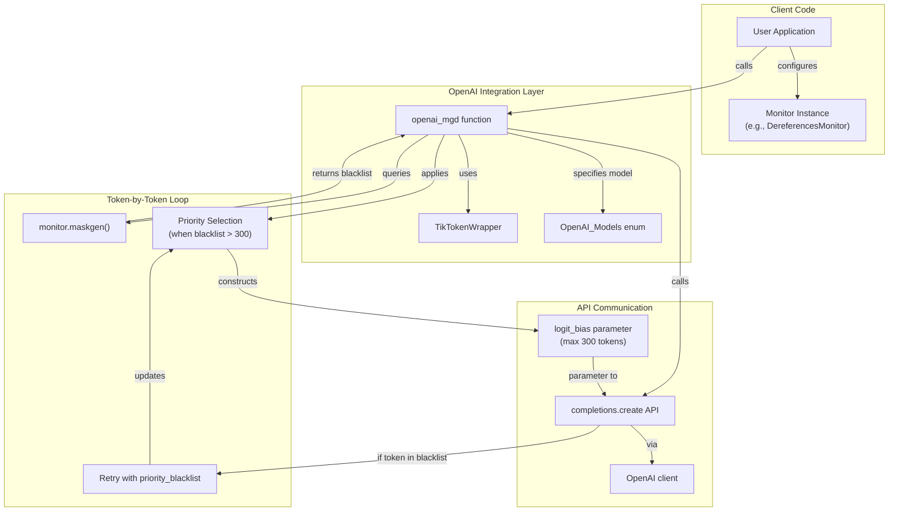
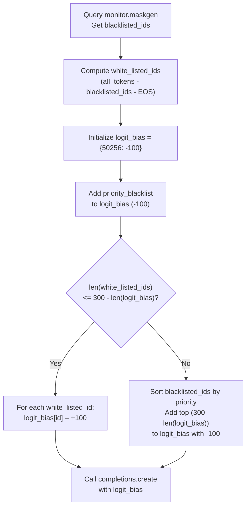
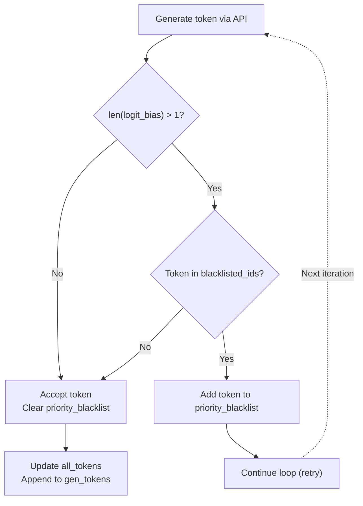

<!-- source: DeepWiki mcp.deepwiki.com · repo microsoft/monitors4codegen · extra page OpenAI Integration · fetched 2026-10-26 -->

# OpenAI Integration

<details>
<summary>Relevant source files</summary>

The following files were used as context for generating this wiki page:

- [src/monitors4codegen/monitor_guided_decoding/monitors/dereferences_monitor.py](src/monitors4codegen/monitor_guided_decoding/monitors/dereferences_monitor.py)
- [src/monitors4codegen/monitor_guided_decoding/openai_gen.py](src/monitors4codegen/monitor_guided_decoding/openai_gen.py)
- [tests/monitor_guided_decoding/test_dereferences_monitor_java_openai.py](tests/monitor_guided_decoding/test_dereferences_monitor_java_openai.py)

</details>


## Purpose and Scope

This page documents the integration of Monitor-Guided Decoding with OpenAI API models, specifically focusing on the `openai_mgd` function and associated infrastructure. This integration enables constrained code generation using OpenAI's completion API while respecting monitor-provided token blacklists.

For information about integrating with HuggingFace models, see [HuggingFace Integration](#3.3.1). For general monitor concepts and architecture, see [Core Concepts](#3.1).

## Architecture Overview

The OpenAI integration differs fundamentally from the HuggingFace integration due to API constraints. While HuggingFace models allow direct logit manipulation via the `LogitsProcessor` interface, OpenAI's API only supports token biasing through the `logit_bias` parameter, which is limited to 300 tokens per request.

### Key Components

| Component | File Location | Purpose |
|-----------|--------------|---------|
| `openai_mgd` | [src/monitors4codegen/monitor_guided_decoding/openai_gen.py:18-176]() | Main generation function implementing token-by-token MGD |
| `OpenAI_Models` | [src/monitors4codegen/monitor_guided_decoding/openai_gen.py:15-16]() | Enum defining supported OpenAI models |
| `TikTokenWrapper` | Referenced via import | Tokenizer wrapper for tiktoken (OpenAI's tokenizer) |

**Diagram: OpenAI Integration Architecture**



Sources: [src/monitors4codegen/monitor_guided_decoding/openai_gen.py:1-177]()

## The `openai_mgd` Function

The `openai_mgd` function implements a custom token-by-token generation loop that queries monitors and applies constraints via OpenAI's `logit_bias` parameter.

### Function Signature

```python
def openai_mgd(
    client: OpenAI,
    model: OpenAI_Models,
    tokenizer: TikTokenWrapper,
    prompt_tokenized: torch.Tensor,
    temp: float,
    top_p: float,
    monitor: Monitor,
    num_new_tokens: int
)
```

### Parameters

| Parameter | Type | Description |
|-----------|------|-------------|
| `client` | `OpenAI` | OpenAI API client instance |
| `model` | `OpenAI_Models` | Model enum (e.g., `TD3` for text-davinci-003) |
| `tokenizer` | `TikTokenWrapper` | Tokenizer wrapper for tiktoken |
| `prompt_tokenized` | `torch.Tensor` | Input prompt as token IDs |
| `temp` | `float` | Temperature for sampling |
| `top_p` | `float` | Top-p (nucleus) sampling parameter |
| `monitor` | `Monitor` | Monitor instance providing constraints |
| `num_new_tokens` | `int` | Maximum number of tokens to generate |

### Return Value

Returns a tuple `(gen_tokens, gen_text)` where:
- `gen_tokens`: List of generated token IDs
- `gen_text`: Generated text as a string

Sources: [src/monitors4codegen/monitor_guided_decoding/openai_gen.py:18-27]()

## Token-by-Token Generation Loop

The core of the OpenAI integration is a while loop that generates one token at a time, querying the monitor at each step.

**Diagram: Token Generation Flow**

```mermaid
sequenceDiagram
    participant Loop as "Generation Loop"
    participant Monitor as "Monitor.maskgen"
    participant Priority as "Priority Selection"
    participant API as "OpenAI API"
    participant Retry as "Retry Handler"
    
    Loop->>Loop: "Initialize token tracking<br/>all_tokens, gen_tokens"
    
    loop "While tokens < target"
        Loop->>Monitor: "maskgen(all_tokens)"
        Monitor-->>Loop: "blacklisted_ids"
        
        Loop->>Loop: "Compute white_listed_ids<br/>(all_ids - blacklisted_ids)"
        
        alt "len(white_listed_ids) <= 300"
            Loop->>Priority: "Use whitelist approach"
            Priority-->>Loop: "logit_bias with +100 for valid"
        else "len(white_listed_ids) > 300"
            Loop->>Priority: "Use blacklist approach<br/>(prioritize by tokens_sort_key)"
            Priority-->>Loop: "logit_bias with -100 for invalid"
        end
        
        Loop->>API: "completions.create<br/>(logit_bias, max_tokens=1)"
        API-->>Loop: "Generated token"
        
        alt "Token in blacklisted_ids"
            Loop->>Retry: "Add to priority_blacklist"
            Retry->>Loop: "Continue (retry)"
        else "Token valid"
            Loop->>Loop: "Append token<br/>Reset priority_blacklist"
            Loop->>Loop: "Update all_tokens"
        end
    end
    
    Loop-->>Loop: "Return gen_tokens, gen_text"
```

Sources: [src/monitors4codegen/monitor_guided_decoding/openai_gen.py:70-176]()

### Loop Initialization

The function initializes tracking variables and a token prioritization structure:

```python
all_tokens: torch.Tensor = prompt_tokenized
gen_text: bytes = b''
gen_tokens: List[int] = []
tokens_sort_key = {k:[0, 0] for k in tokenizer.all_token_ids}
```

The `tokens_sort_key` dictionary is prepared for future prioritization logic (currently unused but designed to support frequency-based or break-character-based prioritization).

Sources: [src/monitors4codegen/monitor_guided_decoding/openai_gen.py:31-39]()

### Monitor Query and Blacklist Construction

At each iteration, the function queries the monitor for blacklisted tokens:

```python
blacklisted_ids: List[int] = asyncio.run_coroutine_threadsafe(
    monitor.maskgen(all_tokens.tolist()), 
    monitor.monitor_file_buffer.lsp.server.loop
).result()
white_listed_ids: Set[int] = set(tokenizer.all_token_ids) - set(blacklisted_ids+[50256])
```

The EOS token (50256) is always blacklisted to prevent premature termination.

Sources: [src/monitors4codegen/monitor_guided_decoding/openai_gen.py:73-74]()

## Logit Bias Construction and 300-Token Limit

The OpenAI API restricts `logit_bias` to 300 tokens. The function handles this constraint through two strategies:

### Strategy 1: Whitelist Approach (When Feasible)

If the number of valid tokens is ≤ 300, use a whitelist by setting positive bias:

```python
logit_bias = {50256:-100}  # Always blacklist EOS

for token_id in priority_blacklist:
    logit_bias[token_id] = -100

if len(white_listed_ids) <= (300 - len(logit_bias)):
    for white_token_id in white_listed_ids:
        logit_bias[white_token_id] = 100
```

Sources: [src/monitors4codegen/monitor_guided_decoding/openai_gen.py:76-83]()

### Strategy 2: Prioritized Blacklist (When Whitelist Exceeds 300)

When there are too many valid tokens to whitelist, the function selects the highest-priority blacklisted tokens:

```python
else:
    for candidate_token in sorted(blacklisted_ids, key=lambda x: tokens_sort_key[x], reverse=True):
        if len(logit_bias) >= 300:
            break
        if candidate_token in blacklisted_ids:
            logit_bias[candidate_token] = -100
```

The `tokens_sort_key` is designed to prioritize tokens based on:
1. Presence of break characters (commented out in current implementation)
2. Token frequency in the repository (commented out)
3. Potential for smaller/faster model scoring (commented out)

Sources: [src/monitors4codegen/monitor_guided_decoding/openai_gen.py:84-89]()

**Diagram: Logit Bias Construction Logic**



Sources: [src/monitors4codegen/monitor_guided_decoding/openai_gen.py:73-89]()

## API Request and Error Handling

### Request Construction

The function constructs the API request with special handling for Unicode errors:

```python
exponential_backoff_wait = 1
while True:
    try:
        prompt_arg: str = all_text_bytes.decode('utf-8', errors='strict')
    except UnicodeDecodeError:
        prompt_arg: List[int] = all_tokens.tolist()
    
    try:
        response = client.completions.create(
            model=model.value,
            prompt=[prompt_arg],
            temperature=temp,
            max_tokens=num_toks_to_gen if len(logit_bias) <= 1 else 1,
            top_p=top_p,
            stop=['.'],
            logit_bias=logit_bias,
            logprobs=5
        )
        break
    except Exception:
        time.sleep(exponential_backoff_wait)
        if exponential_backoff_wait < 64:
            exponential_backoff_wait = exponential_backoff_wait*2
        else:
            exponential_backoff_wait = 1
```

Key details:
- If `logit_bias` has constraints, `max_tokens=1` to enable token-by-token validation
- `stop=['.']` ensures generation stops at sentence boundaries
- Exponential backoff handles rate limits and transient errors

Sources: [src/monitors4codegen/monitor_guided_decoding/openai_gen.py:91-115]()

### Stop Sequence Handling

OpenAI's API excludes the stop sequence from returned text. The function detects and adds it back when needed:

```python
should_manually_add_dot = None
if response.choices[0].finish_reason == 'stop':
    if dot_found:
        should_manually_add_dot = False
    else:
        should_manually_add_dot = True
elif response.choices[0].finish_reason == 'length':
    should_manually_add_dot = False

if should_manually_add_dot:
    gen_text += b'.'
    all_text_bytes += b'.'
    tokens_gen.append(tokenizer.tokenizer.encode_single_token('.'))
```

Sources: [src/monitors4codegen/monitor_guided_decoding/openai_gen.py:139-156]()

## Priority Blacklist Retry Mechanism

When the prioritized blacklist approach fails to prevent an invalid token, the function adds that token to a `priority_blacklist` and retries:

```python
if len(logit_bias) > 1:
    assert len(tokens_gen) == 1
    if tokens_gen[0] in blacklisted_ids:
        priority_blacklist.append(tokens_gen[0])
        continue
priority_blacklist = []
```

This ensures that problematic tokens are explicitly blocked in the next iteration.

Sources: [src/monitors4codegen/monitor_guided_decoding/openai_gen.py:158-163]()

**Diagram: Retry Logic Flow**



Sources: [src/monitors4codegen/monitor_guided_decoding/openai_gen.py:158-174]()

## Usage Example

The following example demonstrates using `openai_mgd` with the `DereferencesMonitor` on a Java repository:

```python
import os
import tiktoken
import torch
from openai import OpenAI
from monitors4codegen.monitor_guided_decoding.tokenizer_wrapper import TikTokenWrapper
from monitors4codegen.monitor_guided_decoding.openai_gen import openai_mgd, OpenAI_Models
from monitors4codegen.monitor_guided_decoding.monitors.dereferences_monitor import DereferencesMonitor
from monitors4codegen.monitor_guided_decoding.monitor import MonitorFileBuffer

# Initialize OpenAI client
client = OpenAI()
client.api_key = os.environ["OPENAI_API_KEY"]

# Initialize tokenizer
encoding = tiktoken.encoding_for_model("text-davinci-003")
tokenizer = TikTokenWrapper(encoding)

# Set up monitor with LSP and file buffer
# (assumes lsp is already initialized with repository context)
filebuffer = MonitorFileBuffer(
    lsp.language_server,
    filepath,
    prompt_position,
    prompt_position,
    Language.JAVA
)
monitor = DereferencesMonitor(tokenizer, filebuffer)

# Tokenize prompt
prompt_tokenized = encoding.encode(prompt)[-(2048 - 512):]

# Generate with MGD
gen_tokens, generated_code = openai_mgd(
    client=client,
    model=OpenAI_Models.TD3,
    tokenizer=tokenizer,
    prompt_tokenized=prompt_tokenized,
    temp=0,
    top_p=0.95,
    monitor=monitor,
    num_new_tokens=30
)
```

Sources: [tests/monitor_guided_decoding/test_dereferences_monitor_java_openai.py:21-108]()

### Complete Test Case

A full test demonstrating the improvement from MGD can be found in the test suite. The test compares generation with and without monitor guidance:

**Without MGD:**
```java
.newBuilder()
                .host(arr[0])
                .port(Integer.parseInt(arr[1]))
```

**With MGD (DereferencesMonitor):**
```java
.newServerNode()
                .withIp(arr[0])
                .withPort(Integer.parseInt(arr[1]
```

The monitor-guided version correctly uses `newServerNode()` and `withIp()`/`withPort()` methods that actually exist in the codebase, while the baseline hallucinates non-existent methods.

Sources: [tests/monitor_guided_decoding/test_dereferences_monitor_java_openai.py:71-108]()

## Limitations and Trade-offs

### 300-Token Limit

The most significant constraint is OpenAI's 300-token `logit_bias` limit. When the number of valid tokens exceeds 300 (or when blacklist size exceeds 300), the system cannot guarantee complete constraint enforcement.

**Mitigation strategies:**
1. Whitelist valid tokens when feasible (fewer than 300 valid options)
2. Prioritize most likely invalid tokens for blacklisting
3. Use retry mechanism with `priority_blacklist` for tokens that slip through

Sources: [src/monitors4codegen/monitor_guided_decoding/openai_gen.py:41-45](), [src/monitors4codegen/monitor_guided_decoding/openai_gen.py:81-89]()

### Token-by-Token Generation

Unlike HuggingFace integration where the model generates multiple tokens in parallel, OpenAI integration must generate one token at a time when constraints apply:

```python
max_tokens=num_toks_to_gen if len(logit_bias) <= 1 else 1
```

This increases API calls and latency but is necessary for enforcing constraints.

Sources: [src/monitors4codegen/monitor_guided_decoding/openai_gen.py:103]()

### Prioritization Options (Future Work)

The code includes commented-out prioritization strategies for selecting which tokens to blacklist when exceeding 300:

1. **Break character heuristic**: Prioritize tokens containing breaking characters
2. **Frequency-based**: Use token frequency in the repository
3. **Small model scoring**: Use a fast local model to score token likelihood
4. **Prompt-based scoring**: Score tokens based on prompt context

Sources: [src/monitors4codegen/monitor_guided_decoding/openai_gen.py:47-63]()

### Comparison with HuggingFace Integration

| Aspect | OpenAI Integration | HuggingFace Integration |
|--------|-------------------|------------------------|
| **Constraint mechanism** | `logit_bias` parameter | Direct logit manipulation |
| **Token limit** | 300 tokens | Unlimited |
| **Generation mode** | Token-by-token when constrained | Batched generation possible |
| **Completeness** | Best-effort with retry | Complete constraint enforcement |
| **API calls** | One per token (worst case) | One per sequence |
| **Tokenizer** | tiktoken (`TikTokenWrapper`) | HuggingFace tokenizers (`HFTokenizerWrapper`) |

## Supported Models

Currently, the integration supports OpenAI's `text-davinci-003` model through the `OpenAI_Models` enum:

```python
class OpenAI_Models(Enum):
    TD3 = 'text-davinci-003'
```

Sources: [src/monitors4codegen/monitor_guided_decoding/openai_gen.py:15-16]()

## Integration with Monitors

The `openai_mgd` function integrates with any monitor implementing the `Monitor` interface. The monitor's `maskgen` method is called asynchronously:

```python
blacklisted_ids: List[int] = asyncio.run_coroutine_threadsafe(
    monitor.maskgen(all_tokens.tolist()), 
    monitor.monitor_file_buffer.lsp.server.loop
).result()
```

This allows the monitor to perform LSP queries on the language server's event loop while the main generation loop runs synchronously.

Sources: [src/monitors4codegen/monitor_guided_decoding/openai_gen.py:73-74]()

---

