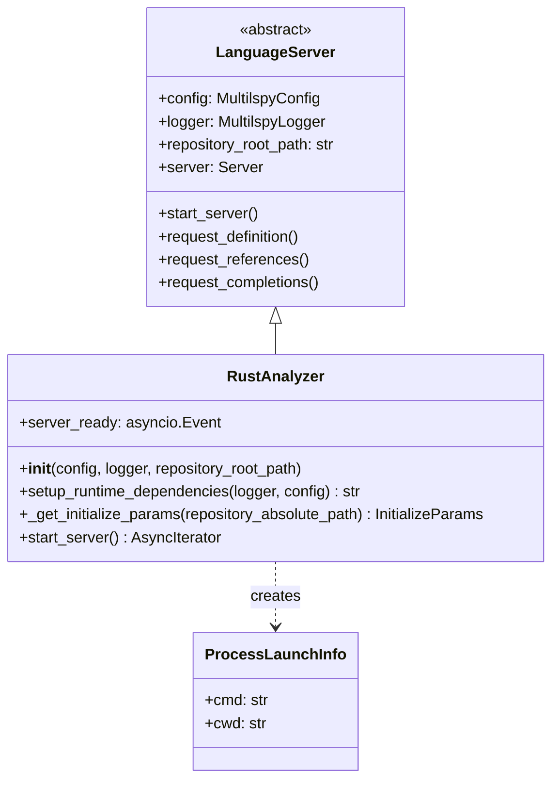
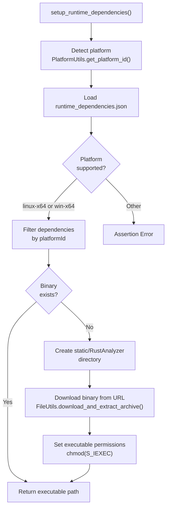
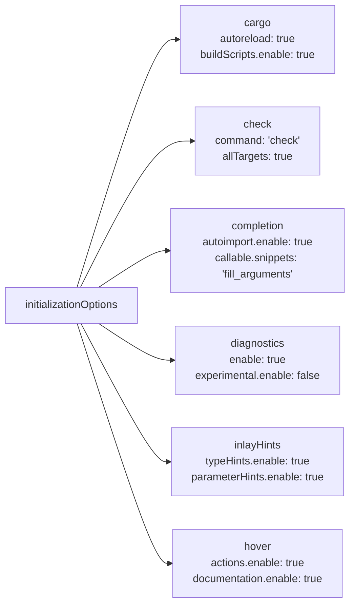
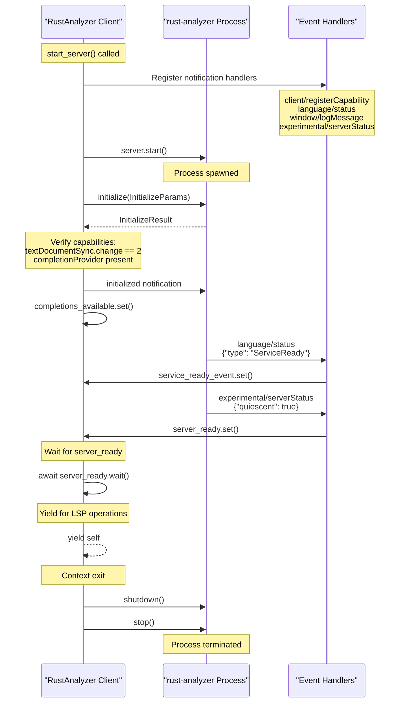
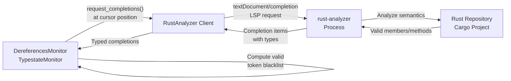

<!-- source: DeepWiki mcp.deepwiki.com · repo microsoft/monitors4codegen · extra page Rust (rust-analyzer) · fetched 2026-10-26 -->

# Rust (rust-analyzer)

<details>
<summary>Relevant source files</summary>

The following files were used as context for generating this wiki page:

- [src/monitors4codegen/multilspy/language_servers/rust_analyzer/initialize_params.json](src/monitors4codegen/multilspy/language_servers/rust_analyzer/initialize_params.json)
- [src/monitors4codegen/multilspy/language_servers/rust_analyzer/rust_analyzer.py](src/monitors4codegen/multilspy/language_servers/rust_analyzer/rust_analyzer.py)
- [tests/multilspy/test_multilspy_rust.py](tests/multilspy/test_multilspy_rust.py)

</details>


This page documents the Rust language server client implementation within the multilspy library. It covers the `RustAnalyzer` class, which provides a concrete implementation of the `LanguageServer` interface for communicating with the rust-analyzer language server process. For information about the base `LanguageServer` architecture and factory pattern, see [Core Architecture](#4.1). For details on the LSP request methods available across all language servers, see [LSP Request Methods](#4.2).

---

## Overview

The `RustAnalyzer` class encapsulates all Rust-specific configuration, initialization, and runtime behavior needed to communicate with the rust-analyzer language server. It handles automatic downloading and setup of the rust-analyzer binary, provides comprehensive initialization parameters that declare client capabilities, and manages the server lifecycle including readiness detection through various server notifications.

**Sources:** [src/monitors4codegen/multilspy/language_servers/rust_analyzer/rust_analyzer.py:1-183]()

---

## Class Structure

The `RustAnalyzer` class extends the base `LanguageServer` class and implements language-specific behavior:



**Key Components:**

| Component | Type | Purpose |
|-----------|------|---------|
| `server_ready` | `asyncio.Event` | Signals when server has completed initialization and is ready for requests |
| `setup_runtime_dependencies()` | Method | Downloads and configures rust-analyzer binary for current platform |
| `_get_initialize_params()` | Method | Constructs LSP initialization parameters with Rust-specific capabilities |
| `start_server()` | Async Context Manager | Manages server lifecycle and registers notification handlers |

**Sources:** [src/monitors4codegen/multilspy/language_servers/rust_analyzer/rust_analyzer.py:23-40]()

---

## Runtime Dependencies Setup

The `RustAnalyzer` class automatically downloads and configures the rust-analyzer binary during instantiation:



The runtime dependencies configuration specifies:

- **Platform-specific binaries**: Different download URLs for Linux and Windows
- **Archive format**: `.gz` for direct binary or `.zip`/`.tar.gz` for packaged archives
- **Binary name**: Platform-specific executable name (e.g., `rust-analyzer` on Linux)

The downloaded binary is stored in `src/monitors4codegen/multilspy/language_servers/rust_analyzer/static/RustAnalyzer/`.

**Sources:** [src/monitors4codegen/multilspy/language_servers/rust_analyzer/rust_analyzer.py:42-79]()

---

## Initialization Parameters

The initialization parameters sent to rust-analyzer are loaded from `initialize_params.json` and declare comprehensive client capabilities:

### Client Capabilities Structure

```mermaid
graph TB
    InitParams["InitializeParams"]
    
    InitParams --> Workspace["workspace capabilities"]
    InitParams --> TextDoc["textDocument capabilities"]
    InitParams --> Window["window capabilities"]
    InitParams --> General["general capabilities"]
    InitParams --> InitOpts["initializationOptions"]
    
    Workspace --> WS1["applyEdit: true"]
    Workspace --> WS2["configuration: true"]
    Workspace --> WS3["didChangeWatchedFiles"]
    Workspace --> WS4["symbol, codeLens, etc."]
    
    TextDoc --> TD1["completion"]
    TextDoc --> TD2["hover"]
    TextDoc --> TD3["definition"]
    TextDoc --> TD4["references"]
    TextDoc --> TD5["documentSymbol"]
    TextDoc --> TD6["semanticTokens"]
    
    InitOpts --> Cargo["cargo settings"]
    InitOpts --> Check["check settings"]
    InitOpts --> Completion["completion settings"]
    InitOpts --> Diagnostics["diagnostics settings"]
    InitOpts --> InlayHints["inlayHints settings"]
```



### Key Configuration Categories

| Category | Key Settings | Description |
|----------|--------------|-------------|
| **Workspace** | `applyEdit`, `configuration`, `didChangeWatchedFiles` | Enables workspace-level operations and file watching |
| **Completion** | `snippetSupport`, `commitCharactersSupport`, `resolveSupport` | Declares support for code completion features |
| **Semantic Tokens** | `tokenTypes`, `tokenModifiers`, `formats` | Enables syntax highlighting via semantic tokens |
| **Hover** | `contentFormat: ["markdown", "plaintext"]` | Declares supported hover content formats |
| **Document Symbol** | `hierarchicalDocumentSymbolSupport: true` | Enables hierarchical symbol tree |

### Rust-Analyzer Specific Settings

The `initializationOptions` section contains extensive rust-analyzer configuration:



**Notable Configuration Defaults:**

- **Cargo**: Autoreload enabled, build scripts enabled, uses default sysroot discovery
- **Check**: Uses `cargo check` command, checks all targets
- **Completion**: Auto-import enabled, fills function arguments in snippets
- **Diagnostics**: Enabled by default, experimental features disabled
- **Inlay Hints**: Type and parameter hints enabled with 25-line minimum for closing braces

**Sources:** [src/monitors4codegen/multilspy/language_servers/rust_analyzer/initialize_params.json:1-917]()

---

## Server Lifecycle Management

The `start_server()` method is an async context manager that orchestrates the complete server lifecycle:



### Event Handlers

The server registers several notification and request handlers to track initialization progress:

| Handler | Method | Purpose |
|---------|--------|---------|
| `register_capability_handler` | `client/registerCapability` | Detects when workspace commands are available |
| `lang_status_handler` | `language/status` | Tracks service readiness status |
| `check_experimental_status` | `experimental/serverStatus` | Detects when server indexing is complete (`quiescent: true`) |
| `window_log_message` | `window/logMessage` | Logs server messages for debugging |
| `execute_client_command_handler` | `workspace/executeClientCommand` | Handles server command execution requests |
| `do_nothing` | `$/progress`, `textDocument/publishDiagnostics` | Acknowledges notifications without action |

**Critical Synchronization Points:**

1. **`completions_available`**: Set after receiving `InitializeResult` with completion provider capability
2. **`service_ready_event`**: Set when `language/status` reports `"ServiceReady"`
3. **`server_ready`**: Set when `experimental/serverStatus` reports `"quiescent": true`, indicating indexing complete

**Sources:** [src/monitors4codegen/multilspy/language_servers/rust_analyzer/rust_analyzer.py:105-183]()

---

## Usage Examples

### Basic LSP Operations

The following example demonstrates typical usage patterns with the carbonyl Rust repository:

```python
# From test_multilspy_rust.py
code_language = Language.RUST
params = {
    "code_language": code_language,
    "repo_url": "https://github.com/fathyb/carbonyl/",
    "repo_commit": "ab80a276b1bd1c2c8dcefc8f248415dfc61dc2bf"
}

with create_test_context(params) as context:
    lsp = LanguageServer.create(context.config, context.logger, context.source_directory)
    
    async with lsp.start_server():
        # Request definition: navigate from usage to declaration
        result = await lsp.request_definition(
            str(PurePath("src/browser/bridge.rs")), 
            132, 18  # Line and character position
        )
        # Returns: [{"relativePath": "src/input/tty.rs", "range": {...}}]
        
        # Request references: find all usages of symbol
        result = await lsp.request_references(
            str(PurePath("src/input/tty.rs")), 
            43, 15
        )
        # Returns list of all reference locations
```

**Sources:** [tests/multilspy/test_multilspy_rust.py:17-73]()

### Code Completions

Example demonstrating completion requests with filtering:

```python
# From test_multilspy_rust.py - mediaplayer example
with create_test_context(params) as context:
    lsp = LanguageServer.create(context.config, context.logger, context.source_directory)
    filepath = "src/playlist.rs"
    
    async with lsp.start_server():
        with lsp.open_file(filepath):
            # Modify file buffer to trigger completion context
            deleted_text = lsp.delete_text_between_positions(
                filepath, 
                Position(line=10, character=40), 
                Position(line=12, character=4)
            )
            
            # Request completions at cursor position
            response = await lsp.request_completions(
                filepath, 10, 40, allow_incomplete=True
            )
            
            # Filter out snippet completions
            response = [
                item for item in response 
                if item['kind'] != CompletionItemKind.Snippet
            ]
            
            # Extract method names (before opening parenthesis)
            for item in response:
                item['completionText'] = item['completionText'][:item['completionText'].find('(')]
            
            # Verify expected methods: reset, into, try_into, prepare
            assert set([item['completionText'] for item in response]) == {
                'reset', 'into', 'try_into', 'prepare'
            }
```

**Sources:** [tests/multilspy/test_multilspy_rust.py:76-112]()

---

## Integration with Monitor-Guided Decoding

The `RustAnalyzer` client enables monitors to query Rust codebases for type information and valid completions:



The `RustAnalyzer` client is used by monitors such as:

- **DereferencesMonitor**: Queries completions after `.` or `::` to ensure valid member access
- **Typestate Monitor**: Tracks valid method sequences for API contracts

The comprehensive initialization parameters ensure that rust-analyzer provides rich semantic information including type inference, trait resolution, and method availability, which monitors use to constrain code generation.

**Sources:** [src/monitors4codegen/multilspy/language_servers/rust_analyzer/rust_analyzer.py:1-183](), [tests/multilspy/test_multilspy_rust.py:1-112]()

---

