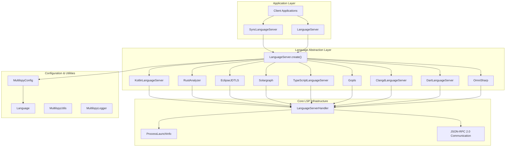
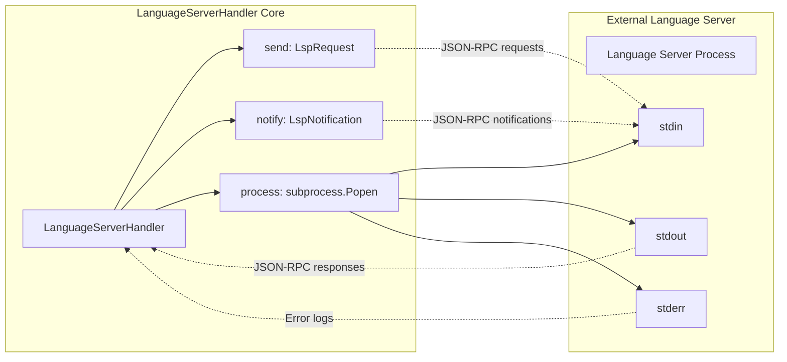
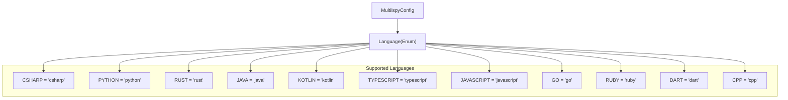
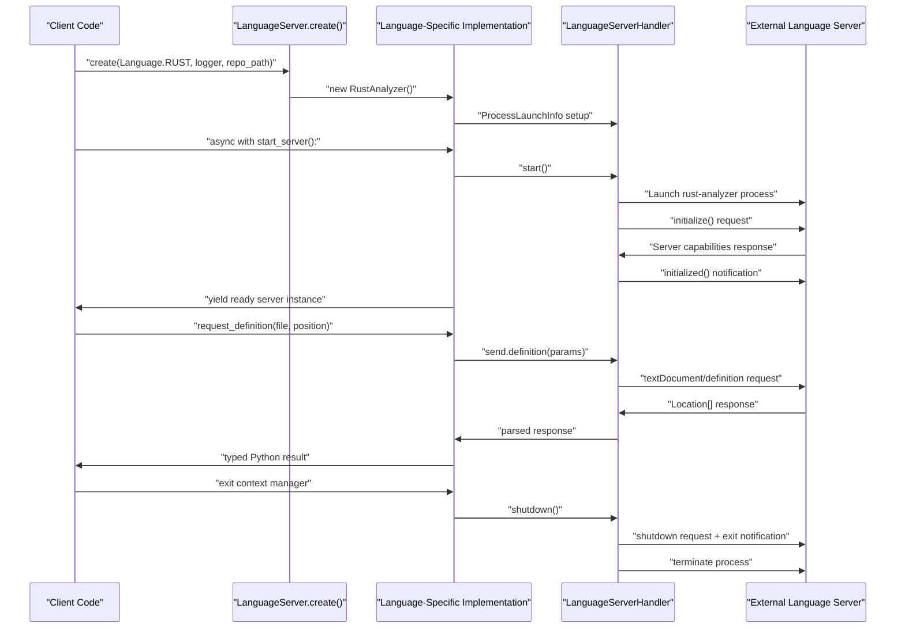

<!-- source: DeepWiki mcp.deepwiki.com · repo microsoft/multilspy · page 1 Overview · fetched 2026-10-26 -->

# Overview

Relevant source files

The following files were used as context for generating this wiki page:

- [pyproject.toml](pyproject.toml)
- [src/multilspy/lsp_protocol_handler/server.py](src/multilspy/lsp_protocol_handler/server.py)
- [src/multilspy/multilspy_config.py](src/multilspy/multilspy_config.py)

## Purpose and Scope

Multilspy is a language-agnostic Language Server Protocol (LSP) client library written in Python that provides a unified interface for interacting with multiple programming language servers. It abstracts the complexity of LSP communication and process management, allowing developers to build applications that can analyze and manipulate code across different programming languages through a consistent API.

This document covers the high-level architecture, core components, and design principles of multilspy. For specific language server implementations, see [Language Server Implementations](#3). For practical usage examples, see [Using multilspy](#4).

## High-Level Architecture

Multilspy follows a layered architecture that separates low-level LSP protocol handling from high-level language-specific functionality:

**Sources:** [src/multilspy/lsp_protocol_handler/server.py:143-179](), [src/multilspy/multilspy_config.py:8-47]()

## Core Components

### Language Server Handler

The `LanguageServerHandler` class serves as the foundation for all LSP communication. It implements the JSON-RPC 2.0 protocol over stdin/stdout pipes and manages the lifecycle of external language server processes.

Key responsibilities include:
- Process launch and management via `ProcessLaunchInfo`
- Bidirectional JSON-RPC communication
- Request/response correlation using unique request IDs
- Asynchronous message handling and task management
- Graceful shutdown with process tree cleanup

**Sources:** [src/multilspy/lsp_protocol_handler/server.py:47-61](), [src/multilspy/lsp_protocol_handler/server.py:143-179](), [src/multilspy/lsp_protocol_handler/server.py:210-231]()

### Configuration System

The configuration system is built around two primary classes:

| Component | Purpose | Key Features |
|-----------|---------|--------------|
| `Language` | Enumeration of supported languages | String-based enum with values like `"rust"`, `"java"`, `"python"` |
| `MultilspyConfig` | Configuration parameters | Language selection, LSP tracing, process independence settings |

**Sources:** [src/multilspy/multilspy_config.py:8-24](), [src/multilspy/multilspy_config.py:28-46]()

## Language Server Lifecycle

The typical lifecycle of a language server interaction follows this pattern:

**Sources:** [src/multilspy/lsp_protocol_handler/server.py:210-231](), [src/multilspy/lsp_protocol_handler/server.py:343-355](), [src/multilspy/lsp_protocol_handler/server.py:460-473]()

## Project Metadata and Distribution

Multilspy is distributed as a Python package with the following characteristics:

| Attribute | Value |
|-----------|-------|
| Package Name | `multilspy` |
| Current Version | `0.0.15` |
| Python Requirements | `>=3.8, <4.0` |
| Build System | `flit_core` |
| Distribution | PyPI, TestPyPI, GitHub Releases |

### Key Dependencies

- `jedi-language-server==0.41.3` - Python language server
- `requests==2.32.3` - HTTP library for dependency downloads
- `typing-extensions>=4.2.0` - Enhanced type annotations
- `psutil (>=7.0.0,<8.0.0)` - Process management utilities

**Sources:** [pyproject.toml:6-14](), [pyproject.toml:30-35]()

## Supported Programming Languages

Multilspy provides first-class support for 11 programming languages through their respective language servers:

| Language | Enum Value | External Language Server |
|----------|------------|-------------------------|
| C# | `Language.CSHARP` | OmniSharp |
| Python | `Language.PYTHON` | jedi-language-server |
| Rust | `Language.RUST` | rust-analyzer |
| Java | `Language.JAVA` | Eclipse JDT Language Server |
| Kotlin | `Language.KOTLIN` | kotlin-language-server |
| TypeScript | `Language.TYPESCRIPT` | typescript-language-server |
| JavaScript | `Language.JAVASCRIPT` | typescript-language-server |
| Go | `Language.GO` | gopls |
| Ruby | `Language.RUBY` | Solargraph |
| Dart | `Language.DART` | Dart Language Server |
| C++ | `Language.CPP` | clangd |

Each language implementation handles the specific requirements, dependency management, and configuration needed for its corresponding external language server.

**Sources:** [src/multilspy/multilspy_config.py:8-24](), [pyproject.toml:12-28]()

## Design Principles

Multilspy is designed around several key principles:

1. **Language Agnosticism**: A unified API that abstracts language-specific differences
2. **Asynchronous by Default**: Built on asyncio for high-performance concurrent operations  
3. **Automatic Dependency Management**: Runtime download and setup of language server binaries
4. **Process Isolation**: Independent language server processes with proper lifecycle management
5. **Type Safety**: Comprehensive type annotations and LSP protocol type definitions
6. **Cross-Platform Support**: Windows, Linux, and macOS compatibility with platform-specific binary management

These principles enable multilspy to serve as a foundation for building sophisticated code analysis tools that work across multiple programming languages without requiring users to manually install and configure individual language servers.

**Sources:** [src/multilspy/lsp_protocol_handler/server.py:175-179](), [src/multilspy/multilspy_config.py:28-36]()

---

