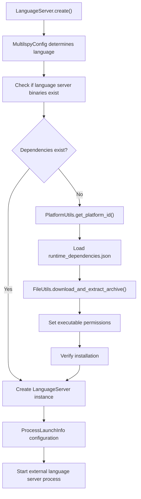
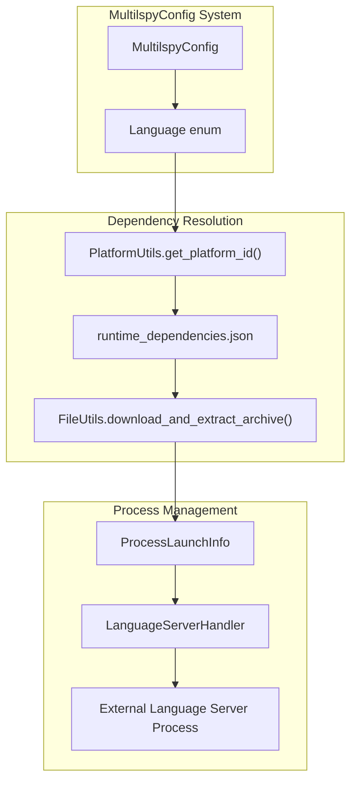

<!-- source: DeepWiki mcp.deepwiki.com · repo microsoft/multilspy · page 1.1 Installation and Setup · fetched 2026-10-26 -->

# Installation and Setup

<details>
<summary>Relevant source files</summary>

The following files were used as context for generating this wiki page:

- [pyproject.toml](pyproject.toml)
- [requirements.txt](requirements.txt)
- [src/multilspy/lsp_protocol_handler/server.py](src/multilspy/lsp_protocol_handler/server.py)

</details>


This document covers installing multilspy and setting up your development environment to use the library. It includes system requirements, package installation, runtime dependency management, and basic configuration. 

For information about specific language server configurations, see [Supported Languages](#1.2). For detailed configuration options, see [Configuration System](#1.3). For runtime dependency details, see [Runtime Dependency Management](#2.5).

## Purpose and Scope

multilspy is a language-agnostic LSP client library that automatically manages language server binaries and their runtime dependencies across platforms. This setup guide covers the initial installation process and explains how multilspy's dependency management system works during first use.

## System Requirements

### Python Environment

multilspy requires Python 3.8 or higher but less than 4.0, as specified in [pyproject.toml:14](). The library is distributed as a Python package with the following core dependencies:

| Dependency | Version | Purpose |
|------------|---------|---------|
| `jedi-language-server` | 0.41.3 | Python language server |
| `requests` | 2.32.3 | HTTP downloads for language server binaries |
| `typing-extensions` | >=4.2.0 | Enhanced typing support |
| `psutil` | >=7.0.0,<8.0.0 | Process management |

### Platform Support

multilspy supports the following platforms through its runtime dependency management system:

- **Windows**: win-x64, win-arm64
- **Linux**: linux-x64, linux-arm64  
- **macOS**: osx-x64, osx-arm64

## Package Installation

### Install from PyPI

```bash
pip install multilspy
```

### Install from Source

```bash
git clone https://github.com/microsoft/multilspy
cd multilspy
pip install -e .
```

### Verify Installation

```python
import multilspy
from multilspy import LanguageServer
from multilspy.multilspy_config import Language

# Verify core classes are available
print(f"multilspy version: {multilspy.__version__}")
print(f"Supported languages: {list(Language)}")
```

Sources: [pyproject.toml:6-35]()

## Runtime Dependency Management System

multilspy automatically downloads and manages language server binaries when you first use a specific language. This eliminates the need for manual installation of external language servers.

### Dependency Download Process



**Runtime Dependency Management Flow**
This diagram shows how multilspy automatically handles language server setup during first use.

Sources: [Architecture diagrams from context]()

### Language Server Binary Management



**Core Installation Components**
This diagram maps the key classes involved in multilspy's installation and dependency management.

Sources: [src/multilspy/lsp_protocol_handler/server.py:47-61]()

## Basic Configuration

### Language Selection

multilspy uses the `Language` enum to specify which language server to use:

```python
from multilspy.multilspy_config import Language

# Available languages (examples)
Language.PYTHON     # Uses jedi-language-server
Language.KOTLIN     # Downloads kotlin-language-server + JDK
Language.RUST       # Downloads rust-analyzer binary
Language.TYPESCRIPT # Downloads Node.js + typescript-language-server
Language.JAVA       # Downloads Eclipse JDT LS + dependencies
```

### Creating Language Server Instances

The `LanguageServer.create()` factory method handles all setup automatically:

```python
import asyncio
from multilspy import LanguageServer
from multilspy.multilspy_config import Language

async def setup_language_server():
    # This will automatically download dependencies if needed
    language_server = LanguageServer.create(
        config=Language.KOTLIN,
        logger=None,  # Optional logger function
        repo_path="/path/to/your/project"
    )
    
    async with language_server.start_server():
        # Language server is ready for use
        pass
```

### Process Launch Configuration

The `ProcessLaunchInfo` class from [src/multilspy/lsp_protocol_handler/server.py:47-61]() configures how external language servers are launched:

```python
@dataclasses.dataclass
class ProcessLaunchInfo:
    cmd: str                                    # Command to launch
    env: Dict[str, str] = dataclasses.field(default_factory=dict)  # Environment variables
    cwd: str = os.getcwd()                     # Working directory
```

Sources: [src/multilspy/lsp_protocol_handler/server.py:47-61]()

## First Run Behavior

### Automatic Dependency Download

On first use of a language, multilspy will:

1. **Detect Platform**: Use `PlatformUtils.get_platform_id()` to determine your system
2. **Load Configuration**: Read language-specific settings from `runtime_dependencies.json`
3. **Download Binaries**: Fetch platform-appropriate language server binaries
4. **Extract and Configure**: Set up binaries with correct permissions and paths
5. **Verify Installation**: Ensure the language server can be launched

### Storage Locations

Downloaded language server binaries are stored in a cache directory managed by multilspy. The exact location varies by platform but follows standard conventions for application data.

### Network Requirements

Initial setup requires internet connectivity to download language server binaries. Once downloaded, multilspy can work offline.

## Troubleshooting Common Issues

### Python Version Compatibility

Ensure you're using Python 3.8+ but less than 4.0:

```bash
python --version  # Should show 3.8.x through 3.11.x
```

### Permission Issues

On Unix-like systems, multilspy automatically sets executable permissions on downloaded binaries. If you encounter permission errors, verify that your user has write access to the cache directory.

### Network/Proxy Issues

If downloads fail due to network restrictions, check your firewall and proxy settings. multilspy uses the `requests` library, which respects standard HTTP proxy environment variables.

### Platform Detection

If automatic platform detection fails, check that your system is among the supported platforms listed in the requirements section.

Sources: [pyproject.toml:14](), [requirements.txt:1-7]()

---

