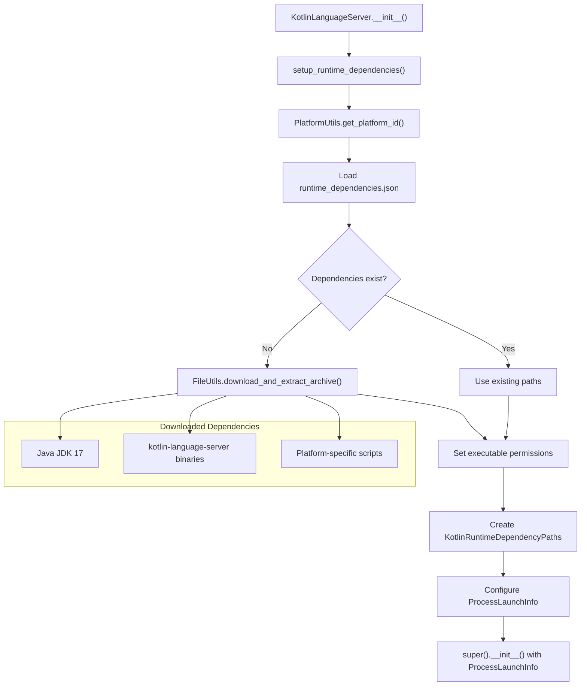
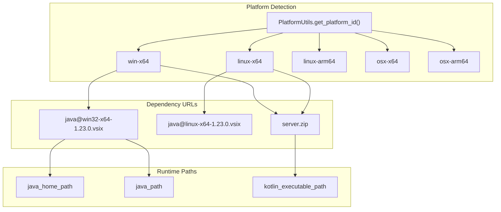

<!-- source: DeepWiki mcp.deepwiki.com · repo microsoft/multilspy · page 1.2 Supported Languages · fetched 2026-10-26 -->

# Supported Languages

<details>
<summary>Relevant source files</summary>

The following files were used as context for generating this wiki page:

- [README.md](README.md)
- [src/multilspy/language_servers/kotlin_language_server/initialize_params.json](src/multilspy/language_servers/kotlin_language_server/initialize_params.json)
- [src/multilspy/language_servers/kotlin_language_server/kotlin_language_server.py](src/multilspy/language_servers/kotlin_language_server/kotlin_language_server.py)
- [src/multilspy/language_servers/kotlin_language_server/runtime_dependencies.json](src/multilspy/language_servers/kotlin_language_server/runtime_dependencies.json)
- [src/multilspy/multilspy_config.py](src/multilspy/multilspy_config.py)

</details>


This page provides a comprehensive list of all programming languages supported by multilspy and their respective language servers. These language servers enable multilspy to perform static analyses such as finding symbol definitions, references, and providing code completions across multiple languages using a consistent interface. For information about how to configure these language servers, see [Configuration System](#1.3).

## Language Support Overview

multilspy supports multiple programming languages through the Language Server Protocol (LSP), which allows it to communicate with language-specific servers in a standardized way. Each language server provides specialized static analysis capabilities for its respective language.

### Supported Language and Server Mapping

The following diagram illustrates the languages supported by multilspy and their corresponding language servers:

**Language Server Factory Pattern**

```mermaid
graph TB
    subgraph "Language Enum Values"
        JAVA["Language.JAVA"]
        PYTHON["Language.PYTHON"]
        RUST["Language.RUST"]
        CSHARP["Language.CSHARP"]
        TYPESCRIPT["Language.TYPESCRIPT"]
        JAVASCRIPT["Language.JAVASCRIPT"]
        GO["Language.GO"]
        RUBY["Language.RUBY"]
        DART["Language.DART"]
        KOTLIN["Language.KOTLIN"]
        CPP["Language.CPP"]
    end
    
    subgraph "Implementation Classes"
        JDTLS["EclipseJDTLS"]
        JEDI["JediServer"]
        RUSTANALYZER["RustAnalyzer"]
        OMNISHARP["OmniSharp"]
        TSLS["TypeScriptLanguageServer"]
        GOPLS["Gopls"]
        SOLARGRAPH["Solargraph"]
        DARTLS["DartLanguageServer"]
        KOTLINLS["KotlinLanguageServer"]
        CLANGD["ClangdLanguageServer"]
    end
    
    subgraph "External Processes"
        ECLIPSE["Eclipse JDTLS binary"]
        JEDIBINARY["jedi-language-server"]
        RUSTBINARY["rust-analyzer"]
        OMNISHARPBINARY["OmniSharp binary"]
        TSBINARY["typescript-language-server"]
        GOPLSBINARY["gopls binary"]
        SOLARGRAPHGEM["solargraph gem"]
        DARTSDK["Dart SDK"]
        KOTLINBINARY["kotlin-language-server"]
        CLANGDBINARY["clangd binary"]
    end
    
    JAVA --> JDTLS --> ECLIPSE
    PYTHON --> JEDI --> JEDIBINARY
    RUST --> RUSTANALYZER --> RUSTBINARY
    CSHARP --> OMNISHARP --> OMNISHARPBINARY
    TYPESCRIPT --> TSLS --> TSBINARY
    JAVASCRIPT --> TSLS
    GO --> GOPLS --> GOPLSBINARY
    RUBY --> SOLARGRAPH --> SOLARGRAPHGEM
    DART --> DARTLS --> DARTSDK
    KOTLIN --> KOTLINLS --> KOTLINBINARY
    CPP --> CLANGD --> CLANGDBINARY
```



Sources: [README.md:38-52](), [src/multilspy/multilspy_config.py:8-24]()

## Comprehensive Language Support Table

The following table provides details about all programming languages currently supported by multilspy and their respective language servers:

| Language | Language Server | Implementation Class | Description |
|----------|-----------------|---------------------|-------------|
| Java | Eclipse JDTLS | `EclipseJDTLS` | Full-featured Java language server from Eclipse project |
| Python | jedi-language-server | `JediServer` | Python server bundled with multilspy |
| Rust | Rust Analyzer | `RustAnalyzer` | Provides semantic code intelligence for Rust |
| C# | OmniSharp / RazorSharp | `OmniSharp` | .NET language server for C# projects |
| TypeScript | TypeScriptLanguageServer | `TypeScriptLanguageServer` | Official TypeScript server, also handles JavaScript |
| JavaScript | TypeScriptLanguageServer | `TypeScriptLanguageServer` | Uses same server as TypeScript |
| Go | gopls | `Gopls` | Official Go language server from the Go team |
| Ruby | Solargraph | `Solargraph` | Ruby gem-based language server with code intelligence |
| Dart | Dart | `DartLanguageServer` | Official Dart language server, supports Flutter |
| Kotlin | KotlinLanguageServer | `KotlinLanguageServer` | JVM-based Kotlin language support |
| C/C++ | clangd | `ClangdLanguageServer` | LLVM-based language server for C and C++ |

Sources: [README.md:38-52](), [src/multilspy/multilspy_config.py:8-24]()

## Language Server Class Hierarchy

In multilspy, each supported language has a corresponding implementation that extends the abstract `LanguageServer` class. This architecture allows for language-specific handling while maintaining a consistent interface.

**Language Server Implementation Architecture**

```mermaid
classDiagram
    class LanguageServer {
        +create(config, logger, repository_root_path)$ LanguageServer
        +start_server() AsyncContextManager
        +request_definition(filepath, line, column) List~Location~
        +request_references(filepath, line, column) List~Location~
        +request_completions(filepath, line, column) List~CompletionItem~
        +request_document_symbols(filepath) Tuple
        +request_hover(filepath, line, column) Hover
        +open_file(filepath) ContextManager
        #MultilspyConfig config
        #MultilspyLogger logger
        #ProcessLaunchInfo process_launch_info
    }
    
    class KotlinLanguageServer {
        +setup_runtime_dependencies() KotlinRuntimeDependencyPaths
        +_get_initialize_params() InitializeParams
        -runtime_dependency_paths KotlinRuntimeDependencyPaths
    }
    
    class RustAnalyzer {
        +setup_runtime_dependencies()
        +_get_initialize_params() InitializeParams
    }
    
    class JediServer {
        +_get_initialize_params() InitializeParams
    }
    
    class Solargraph {
        +setup_runtime_dependencies()
        +_get_initialize_params() InitializeParams
    }
    
    class EclipseJDTLS {
        +setup_runtime_dependencies()
        +_get_initialize_params() InitializeParams
    }
    
    class TypeScriptLanguageServer {
        +setup_runtime_dependencies()
        +_get_initialize_params() InitializeParams
    }
    
    class ProcessLaunchInfo {
        +cmd str
        +env dict
        +cwd str
    }
    
    class MultilspyConfig {
        +code_language Language
        +trace_lsp_communication bool
        +start_independent_lsp_process bool
    }
    
    LanguageServer <|-- KotlinLanguageServer
    LanguageServer <|-- RustAnalyzer
    LanguageServer <|-- JediServer
    LanguageServer <|-- Solargraph
    LanguageServer <|-- EclipseJDTLS
    LanguageServer <|-- TypeScriptLanguageServer
    LanguageServer o-- ProcessLaunchInfo
    LanguageServer o-- MultilspyConfig
```



Sources: [src/multilspy/language_servers/kotlin_language_server/kotlin_language_server.py:34-58](), [src/multilspy/multilspy_config.py:28-36]()

## Language Configuration

multilspy determines which language server to use based on the `code_language` parameter in the `MultilspyConfig` object. The supported languages are defined in the `Language` enum:

**Supported Language Values**

| Enum Value | String Value | Language Server Class |
|------------|--------------|----------------------|
| `Language.CSHARP` | `"csharp"` | `OmniSharp` |
| `Language.PYTHON` | `"python"` | `JediServer` |
| `Language.RUST` | `"rust"` | `RustAnalyzer` |
| `Language.JAVA` | `"java"` | `EclipseJDTLS` |
| `Language.KOTLIN` | `"kotlin"` | `KotlinLanguageServer` |
| `Language.TYPESCRIPT` | `"typescript"` | `TypeScriptLanguageServer` |
| `Language.JAVASCRIPT` | `"javascript"` | `TypeScriptLanguageServer` |
| `Language.GO` | `"go"` | `Gopls` |
| `Language.RUBY` | `"ruby"` | `Solargraph` |
| `Language.DART` | `"dart"` | `DartLanguageServer` |
| `Language.CPP` | `"cpp"` | `ClangdLanguageServer` |

The `Language` enum inherits from both `str` and `Enum`, allowing direct string comparison:

```python
# Both work equivalently
config = MultilspyConfig.from_dict({"code_language": "kotlin"})
config = MultilspyConfig.from_dict({"code_language": Language.KOTLIN})
```

Sources: [src/multilspy/multilspy_config.py:8-26]()

### Language Selection Example

To create a language server for a specific language:

```python
from multilspy import SyncLanguageServer
from multilspy.multilspy_config import MultilspyConfig
from multilspy.multilspy_logger import MultilspyLogger

# Specify language in config
config = MultilspyConfig.from_dict({"code_language": "java"})
logger = MultilspyLogger()

# Create language server instance
lsp = SyncLanguageServer.create(config, logger, "/path/to/repository/root")

# Use the language server
with lsp.start_server():
    # Make requests to the language server
    definitions = lsp.request_definition("path/to/file.java", 10, 15)
```

Sources: [README.md:54-95]()

## Runtime Dependencies Management

Most language servers require platform-specific runtime dependencies that multilspy manages automatically. The `KotlinLanguageServer` provides a concrete example of this process:

**Kotlin Runtime Dependency Management Flow**



**Platform-Specific Dependency Configuration**

The `runtime_dependencies.json` file defines platform-specific URLs and paths:



Key dependency management features:

- **Automatic Download**: `FileUtils.download_and_extract_archive()` handles platform-specific binary downloads
- **Path Management**: `KotlinRuntimeDependencyPaths` stores Java and Kotlin executable paths
- **Permission Setting**: Unix platforms get executable permissions via `os.chmod()`
- **Environment Variables**: `ProcessLaunchInfo` configures `JAVA_HOME` for the Kotlin server process
- **Caching**: Dependencies are stored in `static/` directories to avoid repeated downloads

Languages with runtime dependency management:
- **Kotlin**: Java JDK + kotlin-language-server binaries
- **Rust**: rust-analyzer binary
- **TypeScript**: Node.js + npm packages  
- **Java**: Gradle + JRE + Eclipse JDTLS + IntelliCode
- **C#**: OmniSharp binary + .NET runtime
- **Ruby**: Solargraph gem installation
- **Dart**: Dart SDK

**Python Exception**: `jedi-language-server` is bundled directly with multilspy and requires no external dependencies.

Sources: [src/multilspy/language_servers/kotlin_language_server/kotlin_language_server.py:60-131](), [src/multilspy/language_servers/kotlin_language_server/runtime_dependencies.json:1-42]()

## Language Features

All supported language servers implement the core Language Server Protocol features, though the exact capabilities may vary by language. The common features available across all languages include:

1. **Definition Finding**: Locate the definition of a symbol
2. **Reference Finding**: Find all references to a symbol
3. **Code Completion**: Get context-aware completion suggestions
4. **Document Symbols**: Retrieve the symbol structure of a document
5. **Hover Information**: Get information about a symbol on hover

These features are accessed through the common `LanguageServer` API methods, ensuring consistent usage patterns regardless of the underlying language.

Sources: [README.md:17-23]()

---

