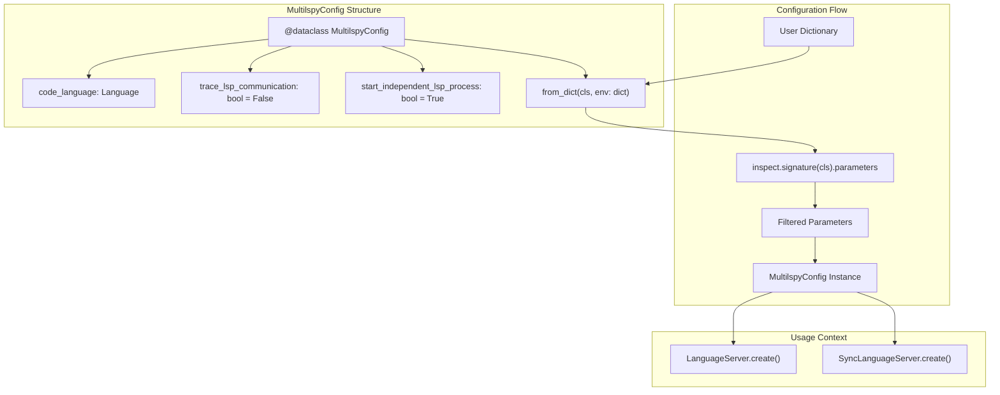
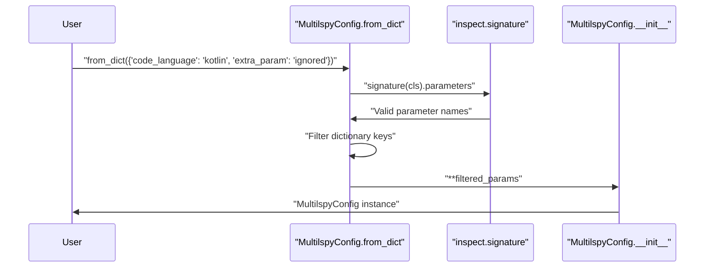
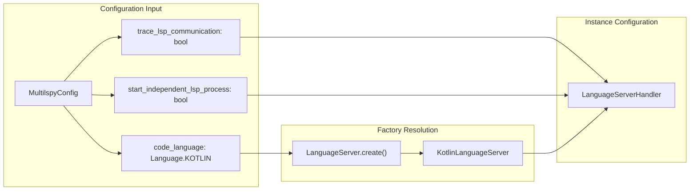

<!-- source: DeepWiki mcp.deepwiki.com · repo microsoft/multilspy · page 1.3 Configuration System · fetched 2026-10-26 -->

# Configuration System

<details>
<summary>Relevant source files</summary>

The following files were used as context for generating this wiki page:

- [src/multilspy/multilspy_config.py](src/multilspy/multilspy_config.py)

</details>


This document explains multilspy's configuration system, including the `Language` enum that defines supported programming languages and the `MultilspyConfig` class that controls language server behavior. The configuration system provides a centralized way to specify which language server to use and how it should operate.

For information about language-specific implementations and their setup requirements, see [Supported Languages](#1.2). For details about runtime dependency management controlled by these configurations, see [Runtime Dependency Management](#2.5).

## Language Enumeration

The `Language` enum serves as the central registry of all programming languages supported by multilspy. Each enum value maps to a specific language server implementation and corresponds to a concrete language server class.

```mermaid
graph TD
    LanguageEnum["Language(str, Enum)"] --> CSHARP["CSHARP = 'csharp'"]
    LanguageEnum --> PYTHON["PYTHON = 'python'"]
    LanguageEnum --> RUST["RUST = 'rust'"]
    LanguageEnum --> JAVA["JAVA = 'java'"]
    LanguageEnum --> KOTLIN["KOTLIN = 'kotlin'"]
    LanguageEnum --> TYPESCRIPT["TYPESCRIPT = 'typescript'"]
    LanguageEnum --> JAVASCRIPT["JAVASCRIPT = 'javascript'"]
    LanguageEnum --> GO["GO = 'go'"]
    LanguageEnum --> RUBY["RUBY = 'ruby'"]
    LanguageEnum --> DART["DART = 'dart'"]
    LanguageEnum --> CPP["CPP = 'cpp'"]
    
    CSHARP --> OmniSharpImpl["OmniSharp implementation"]
    RUST --> RustAnalyzerImpl["RustAnalyzer implementation"]
    JAVA --> EclipseJDTLSImpl["EclipseJDTLS implementation"]
    KOTLIN --> KotlinLSImpl["KotlinLanguageServer implementation"]
    TYPESCRIPT --> TypeScriptLSImpl["TypeScriptLanguageServer implementation"]
    JAVASCRIPT --> TypeScriptLSImpl
    GO --> GoplsImpl["Gopls implementation"]
    RUBY --> SolargraphImpl["Solargraph implementation"]
    DART --> DartLSImpl["DartLanguageServer implementation"]
    CPP --> ClangdImpl["ClangdLanguageServer implementation"]
```



The `Language` enum inherits from both `str` and `Enum`, allowing enum values to be used directly as strings. The `__str__` method returns the enum's string value, enabling seamless integration with string-based APIs.

**Sources:** [src/multilspy/multilspy_config.py:8-26]()

## MultilspyConfig Dataclass

The `MultilspyConfig` dataclass encapsulates all configuration parameters needed to initialize and control language server behavior. It provides both direct instantiation and dictionary-based construction methods.



**Sources:** [src/multilspy/multilspy_config.py:28-46]()

## Configuration Parameters

### Required Parameters

| Parameter | Type | Purpose |
|-----------|------|---------|
| `code_language` | `Language` | Specifies which language server implementation to instantiate |

### Optional Parameters

| Parameter | Type | Default | Purpose |
|-----------|------|---------|---------|
| `trace_lsp_communication` | `bool` | `False` | Enables logging of LSP JSON-RPC messages for debugging |
| `start_independent_lsp_process` | `bool` | `True` | Controls whether to launch language server in separate process |

### Configuration Parameter Details

**`code_language`**: This required parameter determines which language-specific implementation will be created. The value directly maps to one of the supported language server implementations through the factory pattern.

**`trace_lsp_communication`**: When enabled, this parameter causes the LSP communication layer to log all JSON-RPC messages exchanged with the language server. This is primarily useful for debugging LSP protocol issues or understanding language server behavior.

**`start_independent_lsp_process`**: This parameter controls the process management strategy. When `True` (default), the language server runs in a separate process, providing better isolation and stability. When `False`, the language server may run in the same process if supported by the implementation.

**Sources:** [src/multilspy/multilspy_config.py:33-35]()

## Configuration Construction

### Direct Instantiation

```python
config = MultilspyConfig(
    code_language=Language.KOTLIN,
    trace_lsp_communication=True,
    start_independent_lsp_process=True
)
```

### Dictionary-Based Construction

The `from_dict` class method provides flexible configuration from dictionary sources, automatically filtering parameters based on the dataclass signature:



The `from_dict` method uses Python's `inspect` module to introspect the dataclass constructor signature, ensuring only valid parameters are passed while ignoring unknown dictionary keys.

**Sources:** [src/multilspy/multilspy_config.py:37-46]()

## Integration with Language Server Factory

The configuration system integrates directly with the language server factory pattern. The `code_language` parameter determines which language-specific implementation class is instantiated, while other parameters control the behavior of the resulting language server instance.



**Sources:** [src/multilspy/multilspy_config.py:28-46]()

---

