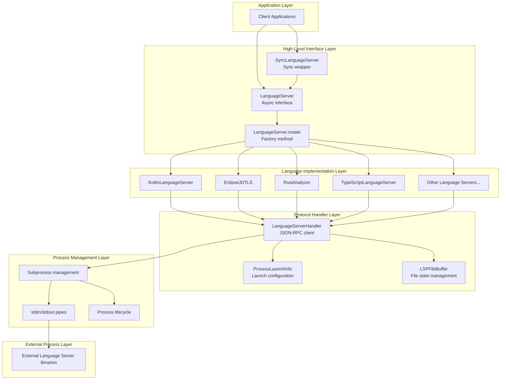
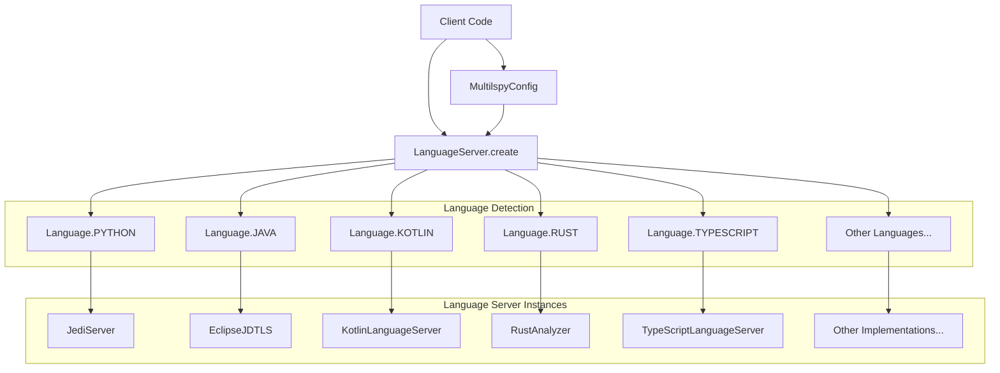
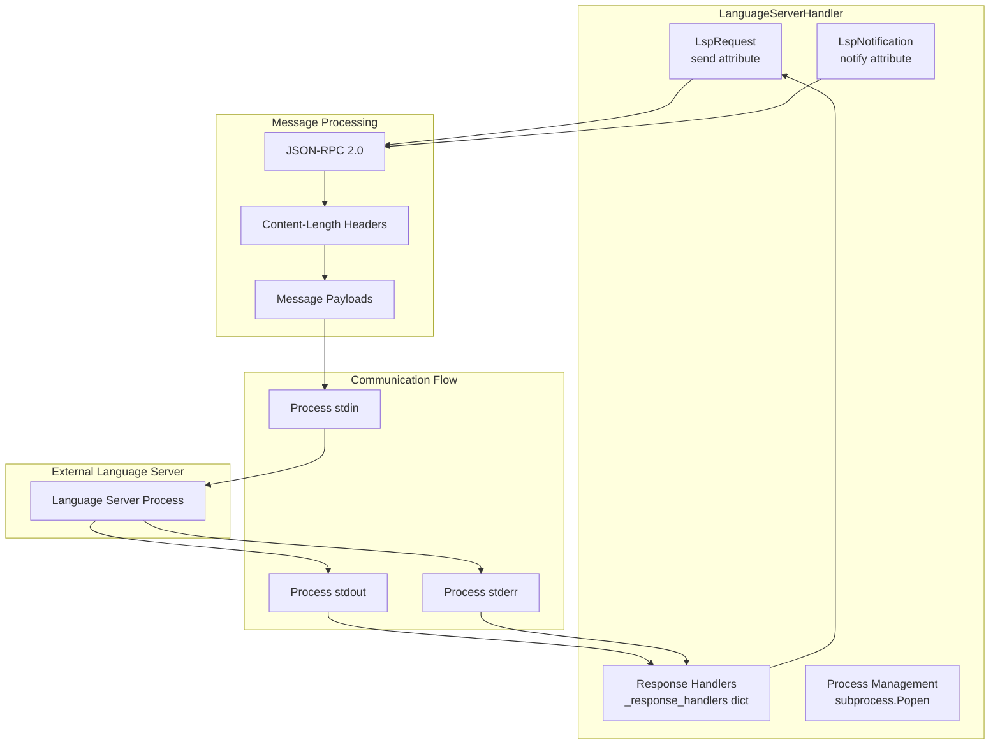
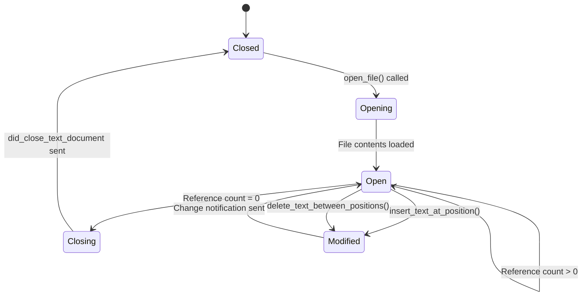
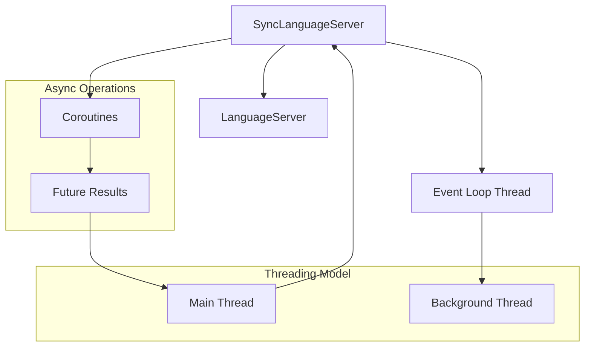
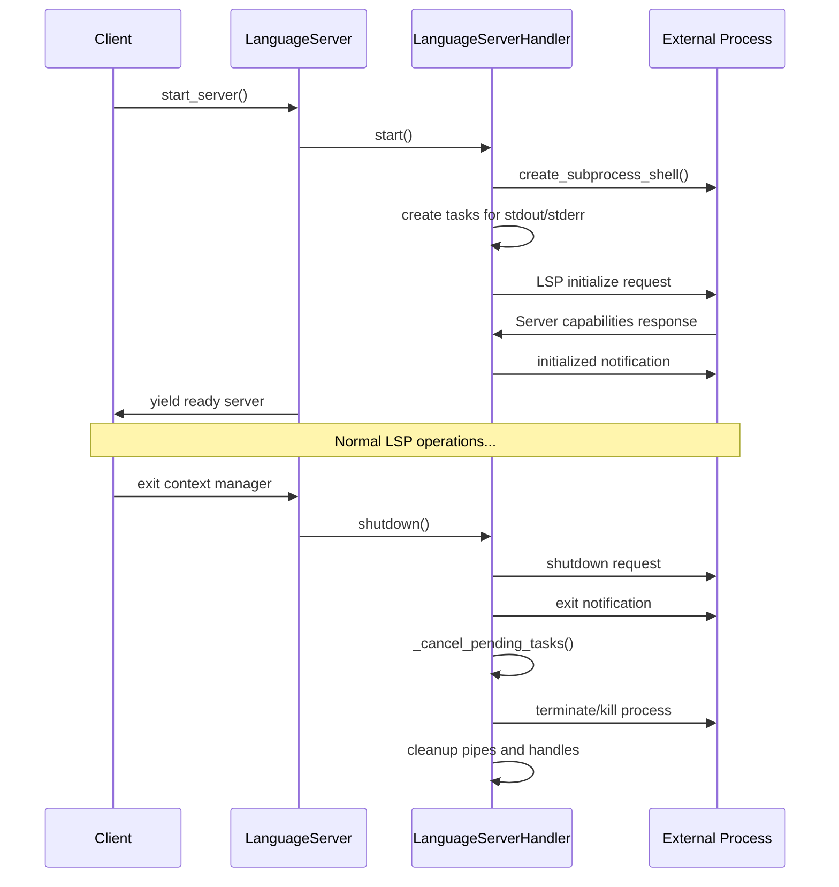

<!-- source: DeepWiki mcp.deepwiki.com · repo microsoft/multilspy · page 2 Core Architecture · fetched 2026-10-26 -->

# Core Architecture

<details>
<summary>Relevant source files</summary>

The following files were used as context for generating this wiki page:

- [pyproject.toml](pyproject.toml)
- [src/multilspy/language_server.py](src/multilspy/language_server.py)
- [src/multilspy/lsp_protocol_handler/server.py](src/multilspy/lsp_protocol_handler/server.py)

</details>


This document describes the core architectural design of multilspy, including its layered structure, key classes, and how they interact to provide a language-agnostic LSP client interface. For information about specific language server implementations, see [Language Server Implementations](#3). For details about configuration and setup, see [Configuration System](#1.3).

## Layered Architecture Overview

Multilspy is built using a layered architecture that abstracts LSP protocol complexity and provides both synchronous and asynchronous interfaces for client applications.

### Architecture Layers



Sources: [src/multilspy/language_server.py:56-198](), [src/multilspy/lsp_protocol_handler/server.py:143-179]()

## Core Classes and Responsibilities

### LanguageServer Class

The `LanguageServer` class serves as the primary asynchronous interface for LSP communication.

| Component | Responsibility | Key Methods |
|-----------|---------------|-------------|
| `LanguageServer` | Main async LSP interface | `create()`, `start_server()`, `request_definition()`, `request_references()` |
| `SyncLanguageServer` | Synchronous wrapper | Same methods as `LanguageServer` but blocking |
| `LanguageServerHandler` | Low-level LSP protocol | `start()`, `stop()`, `send_request()`, `send_notification()` |
| `LSPFileBuffer` | File state tracking | Manages file contents, versions, and reference counts |

Sources: [src/multilspy/language_server.py:56-61](), [src/multilspy/language_server.py:690-694](), [src/multilspy/lsp_protocol_handler/server.py:143-179](), [src/multilspy/language_server.py:34-54]()

### Factory Pattern Implementation



The factory method `LanguageServer.create()` examines the `config.code_language` field and instantiates the appropriate language-specific server implementation.

Sources: [src/multilspy/language_server.py:62-127]()

## LSP Protocol Handler Architecture

### LanguageServerHandler Components



Sources: [src/multilspy/lsp_protocol_handler/server.py:181-209](), [src/multilspy/lsp_protocol_handler/server.py:363-389](), [src/multilspy/lsp_protocol_handler/server.py:99-105]()

### ProcessLaunchInfo Configuration

The `ProcessLaunchInfo` dataclass encapsulates process launch parameters:

```mermaid
graph LR
    PLI[ProcessLaunchInfo]
    CMD[cmd: str<br/>Launch command]
    ENV[env: Dict[str, str]<br/>Environment variables]
    CWD[cwd: str<br/>Working directory]
    
    PLI --> CMD
    PLI --> ENV
    PLI --> CWD
```

Sources: [src/multilspy/lsp_protocol_handler/server.py:47-61]()

## File Buffer Management System

### LSPFileBuffer Lifecycle



The `LSPFileBuffer` class tracks file state with reference counting to support nested file operations:

| Field | Purpose |
|-------|---------|
| `uri` | File URI for LSP communication |
| `contents` | Current file contents in memory |
| `version` | Document version for change tracking |
| `language_id` | Language identifier for syntax |
| `ref_count` | Reference count for nested opens |

Sources: [src/multilspy/language_server.py:34-54](), [src/multilspy/language_server.py:202-253]()

## Synchronous Wrapper Architecture

### SyncLanguageServer Implementation



The `SyncLanguageServer` uses `asyncio.run_coroutine_threadsafe()` to bridge synchronous and asynchronous interfaces, running the async operations in a dedicated event loop thread.

Sources: [src/multilspy/language_server.py:689-872](), [src/multilspy/language_server.py:762-777]()

## Process Lifecycle Management

### Startup and Shutdown Sequence



The process management includes robust cleanup with timeouts and fallback mechanisms for process termination.

Sources: [src/multilspy/lsp_protocol_handler/server.py:210-232](), [src/multilspy/lsp_protocol_handler/server.py:233-248](), [src/multilspy/lsp_protocol_handler/server.py:265-341](), [src/multilspy/language_server.py:181-198]()

---

