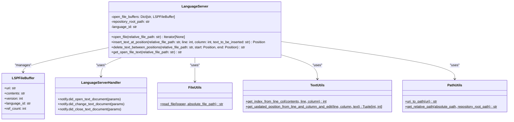
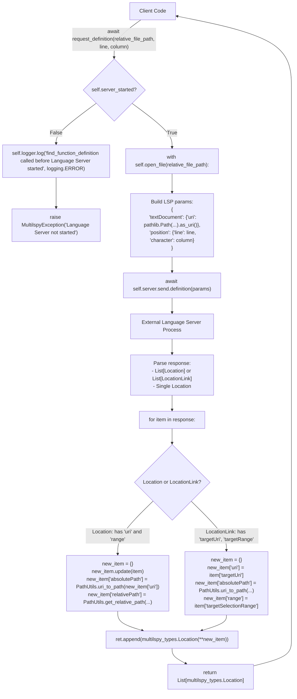
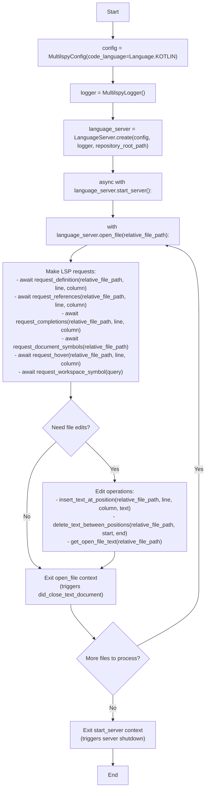
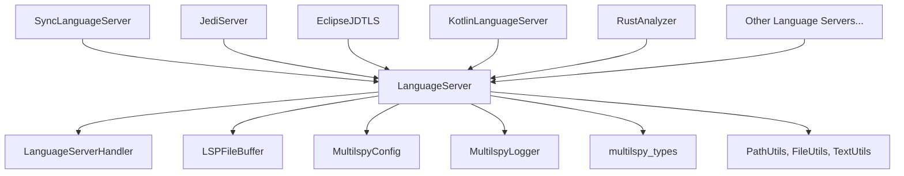

<!-- source: DeepWiki mcp.deepwiki.com · repo microsoft/multilspy · page 2.1 LanguageServer Class · fetched 2026-10-26 -->

# LanguageServer Class

<details>
<summary>Relevant source files</summary>

The following files were used as context for generating this wiki page:

- [src/multilspy/language_server.py](src/multilspy/language_server.py)

</details>


## Overview

The `LanguageServer` class is the central component of multilspy, providing a language-agnostic interface to the Language Server Protocol (LSP). It serves as the primary API entry point for clients that need to interact with language servers across multiple programming languages. This abstract class defines the contract for all language-specific implementations and manages communication with the underlying language server processes.

For the synchronous version of this interface, see [SyncLanguageServer](#2.2).

LanguageServer Class Hierarchy

```mermaid
classDiagram
    class LanguageServer {
        +create(config, logger, repository_root_path) LanguageServer$
        +__init__(config, logger, repository_root_path, process_launch_info, language_id)
        +start_server() AsyncIterator~LanguageServer~
        +open_file(relative_file_path) Iterator~None~
        +request_definition(relative_file_path, line, column) List~Location~
        +request_references(relative_file_path, line, column) List~Location~
        +request_completions(relative_file_path, line, column, allow_incomplete) List~CompletionItem~
        +request_document_symbols(relative_file_path) Tuple
        +request_hover(relative_file_path, line, column) Union~Hover, None~
        +request_workspace_symbol(query) Union~List~UnifiedSymbolInformation~, None~
        +insert_text_at_position(relative_file_path, line, column, text) Position
        +delete_text_between_positions(relative_file_path, start, end) str
        +get_open_file_text(relative_file_path) str
        -server LanguageServerHandler
        -open_file_buffers Dict~str, LSPFileBuffer~
        -completions_available asyncio.Event
    }
    
    class SyncLanguageServer {
        +create(config, logger, repository_root_path, timeout) SyncLanguageServer$
        +__init__(language_server, timeout)
        +start_server() Iterator~SyncLanguageServer~
        +open_file(relative_file_path) Iterator~None~
        +request_definition(file_path, line, column) List~Location~
        +request_references(file_path, line, column) List~Location~
        +request_completions(relative_file_path, line, column, allow_incomplete) List~CompletionItem~
        +request_document_symbols(relative_file_path) Tuple
        +request_hover(relative_file_path, line, column) Union~Hover, None~
        +request_workspace_symbol(query) Union~List~UnifiedSymbolInformation~, None~
        -language_server LanguageServer
        -loop asyncio.AbstractEventLoop
        -timeout Optional~int~
    }
    
    class LSPFileBuffer {
        +uri str
        +contents str
        +version int
        +language_id str
        +ref_count int
    }
    
    class JediServer {
        +setup_runtime_dependencies()
    }
    
    class EclipseJDTLS {
        +setup_runtime_dependencies()
    }
    
    class KotlinLanguageServer {
        +setup_runtime_dependencies()
    }
    
    class RustAnalyzer {
        +setup_runtime_dependencies()
    }
    
    class TypeScriptLanguageServer {
        +setup_runtime_dependencies()
    }
    
    class Gopls {
        +setup_runtime_dependencies()
    }
    
    class Solargraph {
        +setup_runtime_dependencies()
    }
    
    class DartLanguageServer {
        +setup_runtime_dependencies()
    }
    
    class ClangdLanguageServer {
        +setup_runtime_dependencies()
    }
    
    class OmniSharp {
        +setup_runtime_dependencies()
    }
    
    SyncLanguageServer --> LanguageServer : "wraps"
    LanguageServer --> LSPFileBuffer : "manages"
    LanguageServer <|-- JediServer : "extends"
    LanguageServer <|-- EclipseJDTLS : "extends"
    LanguageServer <|-- KotlinLanguageServer : "extends"
    LanguageServer <|-- RustAnalyzer : "extends"
    LanguageServer <|-- TypeScriptLanguageServer : "extends"
    LanguageServer <|-- Gopls : "extends"
    LanguageServer <|-- Solargraph : "extends"
    LanguageServer <|-- DartLanguageServer : "extends"
    LanguageServer <|-- ClangdLanguageServer : "extends"
    LanguageServer <|-- OmniSharp : "extends"
```



Sources: [src/multilspy/language_server.py:34-54](), [src/multilspy/language_server.py:56-688](), [src/multilspy/language_server.py:689-872]()

## Factory Method Pattern

The `LanguageServer` class implements the factory method pattern through its `create` static method. This method instantiates the appropriate language-specific implementation based on the provided configuration.

Factory Method Implementation Flow

```mermaid
flowchart TD
    Client["Client Code"] -->|"LanguageServer.create(config, logger, repository_root_path)"| FactoryMethod["LanguageServer.create()"]
    FactoryMethod -->|"config.code_language"| LanguageSwitch{"config.code_language"}
    
    LanguageSwitch -->|"Language.PYTHON"| ImportJedi["from multilspy.language_servers.jedi_language_server.jedi_server import JediServer"]
    LanguageSwitch -->|"Language.JAVA"| ImportJDTLS["from multilspy.language_servers.eclipse_jdtls.eclipse_jdtls import EclipseJDTLS"]
    LanguageSwitch -->|"Language.KOTLIN"| ImportKotlin["from multilspy.language_servers.kotlin_language_server.kotlin_language_server import KotlinLanguageServer"]
    LanguageSwitch -->|"Language.RUST"| ImportRust["from multilspy.language_servers.rust_analyzer.rust_analyzer import RustAnalyzer"]
    LanguageSwitch -->|"Language.CSHARP"| ImportOmni["from multilspy.language_servers.omnisharp.omnisharp import OmniSharp"]
    LanguageSwitch -->|"Language.TYPESCRIPT/JAVASCRIPT"| ImportTS["from multilspy.language_servers.typescript_language_server.typescript_language_server import TypeScriptLanguageServer"]
    LanguageSwitch -->|"Language.GO"| ImportGo["from multilspy.language_servers.gopls.gopls import Gopls"]
    LanguageSwitch -->|"Language.RUBY"| ImportRuby["from multilspy.language_servers.solargraph.solargraph import Solargraph"]
    LanguageSwitch -->|"Language.DART"| ImportDart["from multilspy.language_servers.dart_language_server.dart_language_server import DartLanguageServer"]
    LanguageSwitch -->|"Language.CPP"| ImportClang["from multilspy.language_servers.clangd_language_server.clangd_language_server import ClangdLanguageServer"]
    
    ImportJedi --> CreateJedi["return JediServer(config, logger, repository_root_path)"]
    ImportJDTLS --> CreateJDTLS["return EclipseJDTLS(config, logger, repository_root_path)"]
    ImportKotlin --> CreateKotlin["return KotlinLanguageServer(config, logger, repository_root_path)"]
    ImportRust --> CreateRust["return RustAnalyzer(config, logger, repository_root_path)"]
    ImportOmni --> CreateOmni["return OmniSharp(config, logger, repository_root_path)"]
    ImportTS --> CreateTS["return TypeScriptLanguageServer(config, logger, repository_root_path)"]
    ImportGo --> CreateGo["return Gopls(config, logger, repository_root_path)"]
    ImportRuby --> CreateRuby["return Solargraph(config, logger, repository_root_path)"]
    ImportDart --> CreateDart["return DartLanguageServer(config, logger, repository_root_path)"]
    ImportClang --> CreateClang["return ClangdLanguageServer(config, logger, repository_root_path)"]
    
    CreateJedi --> Return["return LanguageServer instance"]
    CreateJDTLS --> Return
    CreateKotlin --> Return
    CreateRust --> Return
    CreateOmni --> Return
    CreateTS --> Return
    CreateGo --> Return
    CreateRuby --> Return
    CreateDart --> Return
    CreateClang --> Return
    
    Return --> Client
    
    LanguageSwitch -->|"else"| LogError["logger.log(f'Language {config.code_language} is not supported', logging.ERROR)"]
    LogError --> RaiseException["raise MultilspyException(f'Language {config.code_language} is not supported')"]
```



Sources: [src/multilspy/language_server.py:62-127]()

### Supported Language Implementations

The `create` method supports multiple language-specific implementations:

| Language | Language Server | Implementation Class |
|----------|-----------------|----------------------|
| Python | Jedi Language Server | `JediServer` |
| Java | Eclipse JDTLS | `EclipseJDTLS` |
| Kotlin | Kotlin Language Server | `KotlinLanguageServer` |
| Rust | Rust Analyzer | `RustAnalyzer` |
| C# | OmniSharp | `OmniSharp` |
| TypeScript/JavaScript | TypeScript Language Server | `TypeScriptLanguageServer` |
| Go | gopls | `Gopls` |
| Ruby | Solargraph | `Solargraph` |
| Dart | Dart Language Server | `DartLanguageServer` |
| C/C++ | clangd | `ClangdLanguageServer` |

Sources: [src/multilspy/language_server.py:76-124]()

## Initialization and Server Lifecycle

The `LanguageServer` class manages the lifecycle of the underlying language server process. It uses an asynchronous context manager pattern to ensure proper startup and shutdown of the server.

LanguageServer Lifecycle and Communication

```mermaid
sequenceDiagram
    participant Client as "Client Code"
    participant LS as "LanguageServer"
    participant LSHandler as "LanguageServerHandler"
    participant ExtProcess as "External Language Server Process"
    
    Client->>LS: LanguageServer.create(config, logger, repository_root_path)
    LS->>LS: __init__(config, logger, repository_root_path, process_launch_info, language_id)
    LS->>LSHandler: LanguageServerHandler(process_launch_info, logger, start_independent_lsp_process)
    LS-->>Client: language_server instance
    
    Client->>+LS: async with start_server()
    LS->>LS: self.server_started = True
    LS-->>Client: yield self
    
    Client->>LS: with open_file(relative_file_path)
    LS->>LS: FileUtils.read_file(absolute_file_path)
    LS->>LS: LSPFileBuffer(uri, contents, version=0, language_id, ref_count=1)
    LS->>LSHandler: server.notify.did_open_text_document(textDocument)
    LSHandler->>ExtProcess: LSP textDocument/didOpen notification
    LS-->>Client: yield (file opened)
    
    Client->>LS: request_definition(relative_file_path, line, column)
    LS->>LSHandler: server.send.definition(textDocument, position)
    LSHandler->>ExtProcess: LSP textDocument/definition request
    ExtProcess-->>LSHandler: Location[] or LocationLink[] response
    LSHandler-->>LS: parsed response
    LS->>LS: convert to multilspy_types.Location[]
    LS-->>Client: List[multilspy_types.Location]
    
    Client->>LS: insert_text_at_position(relative_file_path, line, column, text)
    LS->>LS: file_buffer.version += 1
    LS->>LS: TextUtils.get_index_from_line_col(contents, line, column)
    LS->>LS: update file_buffer.contents
    LS->>LSHandler: server.notify.did_change_text_document(textDocument, contentChanges)
    LSHandler->>ExtProcess: LSP textDocument/didChange notification
    LS-->>Client: new Position
    
    Client->>LS: exit open_file context
    LS->>LS: file_buffer.ref_count -= 1
    LS->>LSHandler: server.notify.did_close_text_document(textDocument)
    LSHandler->>ExtProcess: LSP textDocument/didClose notification
    LS->>LS: del open_file_buffers[uri]
    
    Client->>-LS: exit start_server context
    LS->>LS: self.server_started = False
    LS->>LSHandler: shutdown process
    LSHandler->>ExtProcess: terminate
```

Sources: [src/multilspy/language_server.py:129-198](), [src/multilspy/language_server.py:202-304](), [src/multilspy/language_server.py:367-442]()

## File Management

The `LanguageServer` implements a buffer system to track open files and communicate changes to the language server. The `LSPFileBuffer` dataclass is used to represent file state.

File Buffer Management System



Sources: [src/multilspy/language_server.py:34-54](), [src/multilspy/language_server.py:202-365](), [src/multilspy/language_server.py:28-29]()

### File Operation Methods

The `LanguageServer` class provides several methods for file manipulation:

| Method | Description |
|--------|-------------|
| `open_file` | Opens a file in the language server. Uses a reference counting mechanism to track open status. |
| `insert_text_at_position` | Inserts text at a given position and notifies the language server. |
| `delete_text_between_positions` | Deletes text between positions and notifies the language server. |
| `get_open_file_text` | Returns the current contents of an open file. |

Sources: [src/multilspy/language_server.py:202-365]()

## LSP Request Methods

The `LanguageServer` class provides methods for common LSP requests. These methods handle communication with the language server and convert responses to appropriate types.

### Definition and Reference Requests

LSP Request Processing Flow



Sources: [src/multilspy/language_server.py:367-442]()

### Completion Requests

The `request_completions` method requests code completion items at a specific position and handles the complex response formats that can be returned by different language servers.

Sources: [src/multilspy/language_server.py:492-584]()

### Symbol and Hover Requests

The class also provides methods for document symbols, hover information, and workspace symbols:

| Method | Description | LSP Request |
|--------|-------------|-------------|
| `request_document_symbols` | Returns symbols in a document | textDocument/documentSymbol |
| `request_hover` | Returns hover information | textDocument/hover |
| `request_workspace_symbol` | Searches for symbols across the workspace | workspace/symbol |

Sources: [src/multilspy/language_server.py:586-687]()

## Usage Pattern

The typical usage pattern for the `LanguageServer` class follows an async context manager approach:

Typical Usage Pattern



Sources: [src/multilspy/language_server.py:181-198](), [src/multilspy/language_server.py:202-365]()

## Implementation Details

### Constructor

The constructor takes configuration parameters but is not meant to be called directly. It initializes the LSP handler and prepares for communication with the language server.

| Parameter | Type | Description |
|-----------|------|-------------|
| `config` | `MultilspyConfig` | Configuration object containing language and settings |
| `logger` | `MultilspyLogger` | Logger instance for debugging and tracing |
| `repository_root_path` | `str` | Absolute path to the repository root |
| `process_launch_info` | `ProcessLaunchInfo` | Process launch configuration for the language server |
| `language_id` | `str` | Language identifier for LSP communication |

Key initialization steps:
- Creates `LanguageServerHandler` instance with `process_launch_info`
- Sets up LSP communication logging based on `config.trace_lsp_communication`
- Initializes `open_file_buffers` dictionary for file management
- Creates `completions_available` asyncio event for completion synchronization

Sources: [src/multilspy/language_server.py:129-176]()

### Direct Instantiation Prevention

The class implements a check to prevent direct instantiation:

```python
if type(self) == LanguageServer:
    raise MultilspyException(
        "LanguageServer is an abstract class and cannot be instantiated directly. Use LanguageServer.create method instead."
    )
```

This ensures that clients always use the factory method `LanguageServer.create()` which properly instantiates the appropriate language-specific subclass.

Sources: [src/multilspy/language_server.py:150-153]()

## Relationships with Other Components

The `LanguageServer` class interacts with several other components in the multilspy system:



Sources: [src/multilspy/language_server.py:8-31](), [src/multilspy/language_server.py:690-872]()

---

