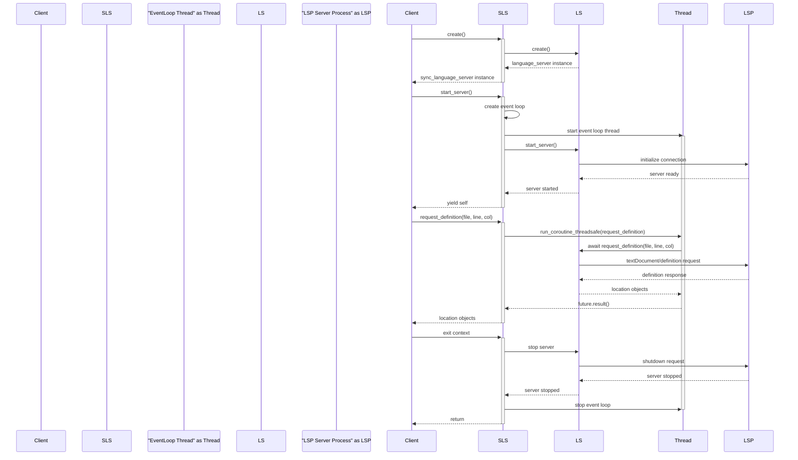
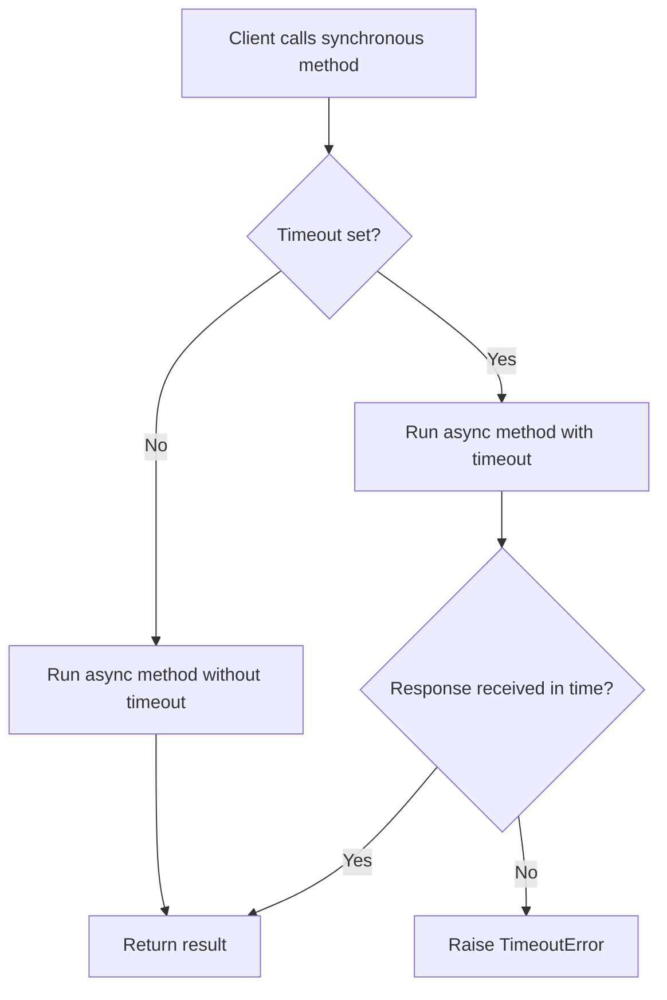
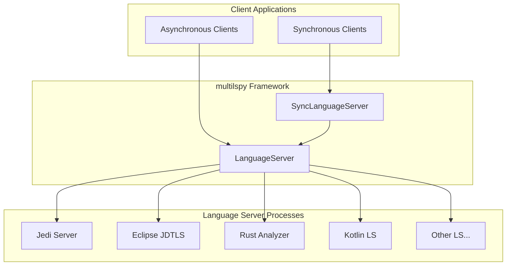

<!-- source: DeepWiki mcp.deepwiki.com · repo microsoft/multilspy · page 2.2 SyncLanguageServer · fetched 2026-10-26 -->

# SyncLanguageServer

<details>
<summary>Relevant source files</summary>

The following files were used as context for generating this wiki page:

- [src/multilspy/language_server.py](src/multilspy/language_server.py)

</details>


## Purpose and Scope

The `SyncLanguageServer` class provides a synchronous wrapper around the asynchronous `LanguageServer` API in multilspy. It enables developers to use the Language Server Protocol (LSP) functionality in synchronous code contexts without having to manage asyncio event loops or coroutines directly. This page explains how `SyncLanguageServer` works, its API, and how it bridges the gap between synchronous application code and the asynchronous LSP communication.

For information about the underlying asynchronous `LanguageServer` class, see [LanguageServer Class](#2.1).

Sources: [src/multilspy/language_server.py:690-873]()

## Architecture and Design

`SyncLanguageServer` wraps an instance of `LanguageServer` and provides method equivalents that handle the transition between synchronous and asynchronous code. This design allows applications written in a synchronous style to seamlessly interact with language servers that communicate via asynchronous protocols.

### Relationship with LanguageServer

```mermaid
classDiagram
    class "SyncLanguageServer" {
        -LanguageServer language_server
        -asyncio.EventLoop loop
        -Thread loop_thread
        -int timeout
        +create(config, logger, repository_root_path, timeout) SyncLanguageServer
        +start_server() ContextManager
        +request_definition(filepath, line, column) List~Location~
        +request_references(filepath, line, column) List~Location~
        +request_completions(filepath, line, column) List~CompletionItem~
        +request_document_symbols(filepath) Tuple
        +request_hover(filepath, line, column) Hover
    }
    
    class "LanguageServer" {
        +create(config, logger, repository_root_path) LanguageServer
        +start_server() AsyncContextManager
        +request_definition(filepath, line, column) List~Location~
        +request_references(filepath, line, column) List~Location~
        +request_completions(filepath, line, column) List~CompletionItem~
        +request_document_symbols(filepath) Tuple
        +request_hover(filepath, line, column) Hover
    }
    
    "SyncLanguageServer" --> "LanguageServer" : wraps
```

Sources: [src/multilspy/language_server.py:696-701](), [src/multilspy/language_server.py:703-717]()

### Threading Model and Execution Flow



Sources: [src/multilspy/language_server.py:763-777](), [src/multilspy/language_server.py:779-873]()

## Initialization and Setup

The `SyncLanguageServer` class is initialized with an instance of `LanguageServer` and an optional timeout parameter. It provides a factory method `create()` that creates a language-specific `LanguageServer` instance based on the provided configuration.

### Class Constructor

```python
def __init__(self, language_server: LanguageServer, timeout: Optional[int] = None):
    self.language_server = language_server
    self.loop = None
    self.loop_thread = None
    self.timeout = timeout
```

Sources: [src/multilspy/language_server.py:696-701]()

### Factory Method

The `create()` class method provides a convenient way to create a `SyncLanguageServer` instance for a specific programming language:

```python
@classmethod
def create(
    cls, config: MultilspyConfig, logger: MultilspyLogger, repository_root_path: str, timeout: Optional[int] = None
) -> "SyncLanguageServer":
    return SyncLanguageServer(LanguageServer.create(config, logger, repository_root_path), timeout=timeout)
```

Sources: [src/multilspy/language_server.py:703-717]()

## The Start Server Context Manager

The `start_server()` method is a context manager that handles the initialization and shutdown of the language server process. It:

1. Creates a new asyncio event loop
2. Starts a dedicated thread to run that loop
3. Starts the underlying language server in the loop
4. On exit, stops the language server and thread properly

```python
@contextmanager
def start_server(self) -> Iterator["SyncLanguageServer"]:
    self.loop = asyncio.new_event_loop()
    loop_thread = threading.Thread(target=self.loop.run_forever, daemon=True)
    loop_thread.start()
    ctx = self.language_server.start_server()
    asyncio.run_coroutine_threadsafe(ctx.__aenter__(), loop=self.loop).result()
    yield self
    asyncio.run_coroutine_threadsafe(ctx.__aexit__(None, None, None), loop=self.loop).result()
    self.loop.call_soon_threadsafe(self.loop.stop)
    loop_thread.join()
```

Sources: [src/multilspy/language_server.py:763-777]()

## Synchronous API Methods

`SyncLanguageServer` mirrors the API of `LanguageServer` but makes all methods synchronous. It achieves this by running each asynchronous method in the dedicated event loop using `asyncio.run_coroutine_threadsafe()` and then waiting for the result.

### Overview of Available Methods

| Method | Description | LSP Endpoint |
|--------|-------------|--------------|
| `request_definition()` | Find definitions of a symbol | textDocument/definition |
| `request_references()` | Find references to a symbol | textDocument/references |
| `request_completions()` | Get code completions | textDocument/completion |
| `request_document_symbols()` | Get all symbols in a document | textDocument/documentSymbol |
| `request_hover()` | Get hover information for a symbol | textDocument/hover |
| `request_workspace_symbol()` | Find symbols across the workspace | workspace/symbol |
| `open_file()` | Open a document for editing | textDocument/didOpen |
| `insert_text_at_position()` | Insert text at a position | textDocument/didChange |
| `delete_text_between_positions()` | Delete text between positions | textDocument/didChange |
| `get_open_file_text()` | Get the current text of an open file | - |

Sources: [src/multilspy/language_server.py:720-872]()

### Method Implementation Pattern

Each method follows a consistent pattern of calling the corresponding async method on the wrapped `LanguageServer` instance using `asyncio.run_coroutine_threadsafe()` and waiting for the result with an optional timeout:

```python
def request_definition(self, file_path: str, line: int, column: int) -> List[multilspy_types.Location]:
    result = asyncio.run_coroutine_threadsafe(
        self.language_server.request_definition(file_path, line, column), self.loop
    ).result(timeout=self.timeout)
    return result
```

Sources: [src/multilspy/language_server.py:779-793]()

## Timeout Handling

The `SyncLanguageServer` class supports timeout configuration, which limits the maximum time to wait for language server responses. This helps prevent applications from hanging indefinitely when language servers become unresponsive.

If a timeout occurs, a `TimeoutError` exception is raised.



Sources: [src/multilspy/language_server.py:696-701](), [tests/multilspy/test_sync_multilspy_timeout.py:12-34]()

## Example Usage

The following example demonstrates how to use `SyncLanguageServer` to find definitions in a Python file:

```python
from multilspy import SyncLanguageServer
from multilspy.multilspy_config import MultilspyConfig, Language
from multilspy.multilspy_logger import MultilspyLogger

# Create configuration
config = MultilspyConfig(code_language=Language.PYTHON)
logger = MultilspyLogger()
repository_path = "/path/to/repository"

# Create the language server with a 5-second timeout
lsp = SyncLanguageServer.create(config, logger, repository_path, timeout=5)

# Start the server and make requests
with lsp.start_server():
    # Open a file before making requests
    with lsp.open_file("src/example.py"):
        # Find definitions of a symbol at line 10, column 15
        definitions = lsp.request_definition("src/example.py", 10, 15)
        
        # Print the locations of definitions
        for definition in definitions:
            print(f"Definition found at {definition['relativePath']}:{definition['range']['start']['line']}")
```

Sources: [src/multilspy/language_server.py:703-717](), [src/multilspy/language_server.py:763-793]()

## Relationship to Broader System Architecture

`SyncLanguageServer` plays a vital role in the multilspy architecture by allowing synchronous code to interact with asynchronous language servers.



Sources: [src/multilspy/language_server.py:62-127](), [src/multilspy/language_server.py:690-701]()

---

