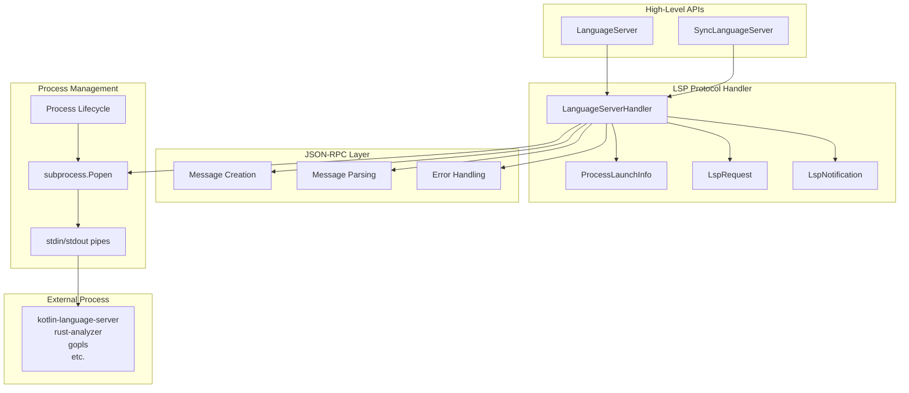
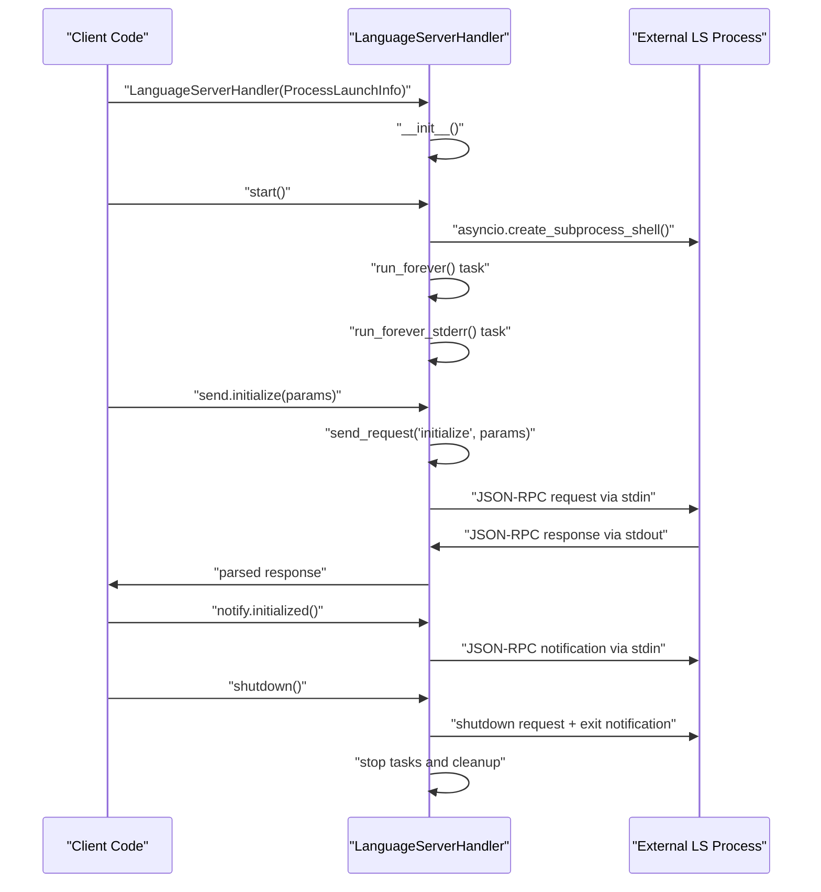
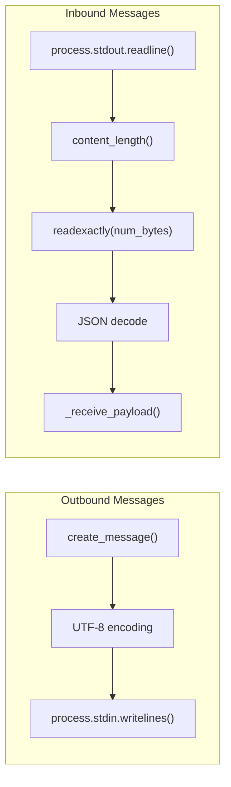
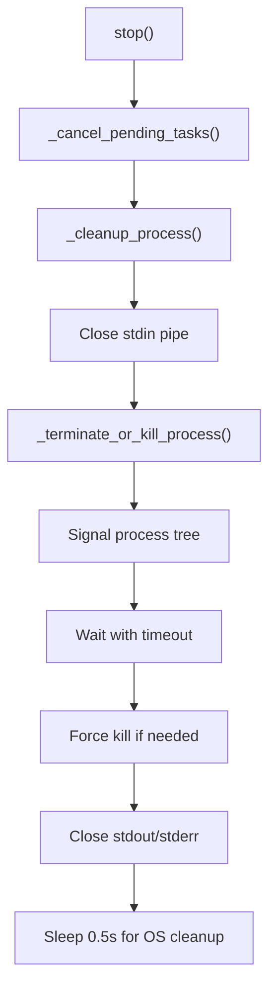
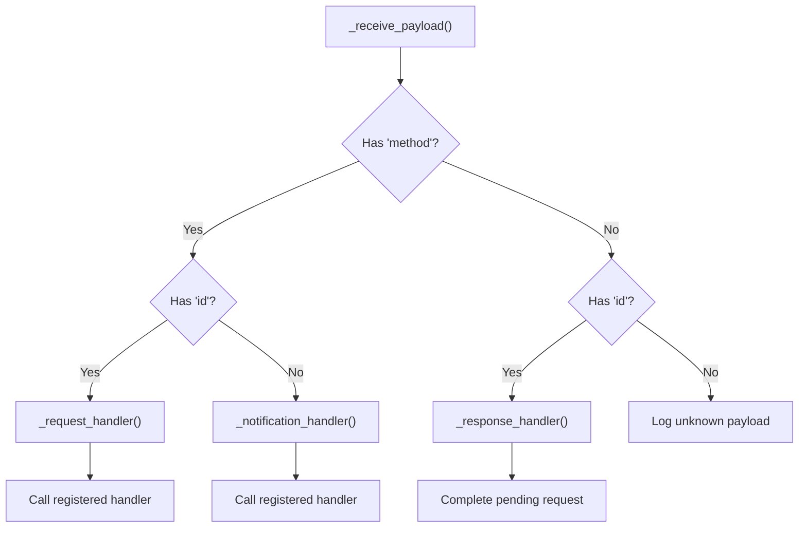

<!-- source: DeepWiki mcp.deepwiki.com · repo microsoft/multilspy · page 2.3 LSP Protocol Handler · fetched 2026-10-26 -->

# LSP Protocol Handler

<details>
<summary>Relevant source files</summary>

The following files were used as context for generating this wiki page:

- [pyproject.toml](pyproject.toml)
- [src/multilspy/lsp_protocol_handler/lsp_types.py](src/multilspy/lsp_protocol_handler/lsp_types.py)
- [src/multilspy/lsp_protocol_handler/server.py](src/multilspy/lsp_protocol_handler/server.py)
- [src/multilspy/multilspy_logger.py](src/multilspy/multilspy_logger.py)

</details>


This document covers the low-level LSP communication layer, JSON-RPC 2.0 implementation, and external language server process management. The LSP Protocol Handler provides the foundational infrastructure that enables multilspy to communicate with external language servers through the standardized Language Server Protocol.

For information about the high-level language server interfaces, see [LanguageServer Class](#2.1) and [SyncLanguageServer](#2.2). For details about LSP types and utilities, see [Types and Utilities](#2.4).

## Architecture Overview

The LSP Protocol Handler implements a JSON-RPC 2.0 client that manages the complete lifecycle of communication with external language server processes. It sits between the high-level multilspy APIs and the external language server binaries.

### Core Architecture



Sources: [src/multilspy/lsp_protocol_handler/server.py:143-179]()

### Communication Flow



Sources: [src/multilspy/lsp_protocol_handler/server.py:210-232](), [src/multilspy/lsp_protocol_handler/server.py:343-355](), [src/multilspy/lsp_protocol_handler/server.py:460-473]()

## Core Components

### LanguageServerHandler Class

The `LanguageServerHandler` is the central class that manages all LSP communication and process lifecycle.

**Key Attributes:**
- `send`: `LspRequest` object for sending requests and awaiting responses
- `notify`: `LspNotification` object for sending notifications 
- `process`: `subprocess.Popen` object representing the language server process
- `_response_handlers`: Dictionary mapping request IDs to `Request` objects
- `on_request_handlers`: Callbacks for handling server requests to client
- `on_notification_handlers`: Callbacks for handling server notifications

**Process Management Methods:**
```python
async def start() -> None          # Launch the language server process
async def stop() -> None           # Terminate and cleanup the process  
async def shutdown() -> None       # Graceful LSP shutdown sequence
```

**Communication Methods:**
```python
async def send_request(method: str, params: dict) -> Any    # Send request, await response
def send_notification(method: str, params: dict) -> None    # Send notification (no response)
def send_response(request_id: Any, params: dict) -> None    # Respond to server request
def send_error_response(request_id: Any, err: Error) -> None # Send error response
```

Sources: [src/multilspy/lsp_protocol_handler/server.py:143-179](), [src/multilspy/lsp_protocol_handler/server.py:210-232](), [src/multilspy/lsp_protocol_handler/server.py:460-473]()

### ProcessLaunchInfo

Configuration class that encapsulates all information needed to launch a language server process:

```python
@dataclasses.dataclass
class ProcessLaunchInfo:
    cmd: str                           # Command to launch the process
    env: Dict[str, str] = {}          # Environment variables
    cwd: str = os.getcwd()            # Working directory
```

Sources: [src/multilspy/lsp_protocol_handler/server.py:47-61]()

### Error Handling

The `Error` class provides LSP-compliant error representation:

```python
class Error(Exception):
    def __init__(self, code: ErrorCodes, message: str) -> None
    def to_lsp(self) -> StringDict        # Convert to LSP error format
    def from_lsp(cls, d: StringDict) -> "Error"  # Parse from LSP error
```

Error codes are defined in the LSP specification and available through the `ErrorCodes` enum.

Sources: [src/multilspy/lsp_protocol_handler/server.py:63-77](), [src/multilspy/lsp_protocol_handler/lsp_types.py:109-121]()

## JSON-RPC Message Protocol

### Message Format

All communication follows the JSON-RPC 2.0 specification with LSP-specific content-length headers:

```
Content-Length: <length>\r\n
Content-Type: application/vscode-jsonrpc; charset=utf-8\r\n
\r\n
<JSON-RPC message body>
```

### Message Creation Functions

```python
def make_request(method: str, request_id: Any, params: PayloadLike) -> StringDict
def make_notification(method: str, params: PayloadLike) -> StringDict  
def make_response(request_id: Any, params: PayloadLike) -> StringDict
def make_error_response(request_id: Any, err: Error) -> StringDict
```

### Message Processing Pipeline



Sources: [src/multilspy/lsp_protocol_handler/server.py:99-106](), [src/multilspy/lsp_protocol_handler/server.py:132-141](), [src/multilspy/lsp_protocol_handler/server.py:363-389]()

## Process Management

### Process Lifecycle

The `LanguageServerHandler` manages the complete lifecycle of external language server processes with robust cleanup and error handling.

### Process Launch

```python
async def start(self) -> None:
    child_proc_env = os.environ.copy()
    child_proc_env.update(self.process_launch_info.env)
    
    self.process = await asyncio.create_subprocess_shell(
        self.process_launch_info.cmd,
        stdout=asyncio.subprocess.PIPE,
        stdin=asyncio.subprocess.PIPE, 
        stderr=asyncio.subprocess.PIPE,
        env=child_proc_env,
        cwd=self.process_launch_info.cwd,
        start_new_session=self.start_independent_lsp_process
    )
```

The `start_new_session` parameter controls whether the language server runs in an independent process group, affecting signal handling behavior.

Sources: [src/multilspy/lsp_protocol_handler/server.py:210-232]()

### Process Termination

The cleanup process follows a careful sequence to avoid deadlocks and ensure all resources are properly released:



The termination logic uses `psutil` to handle process trees, ensuring that child processes spawned by the language server are also properly terminated.

Sources: [src/multilspy/lsp_protocol_handler/server.py:233-248](), [src/multilspy/lsp_protocol_handler/server.py:265-341]()

### Asynchronous Task Management

Two main background tasks handle continuous communication:

- `run_forever()`: Reads from `process.stdout` and handles incoming messages
- `run_forever_stderr()`: Reads from `process.stderr` for logging

Both tasks are managed through the `tasks` dictionary and properly cancelled during shutdown.

Sources: [src/multilspy/lsp_protocol_handler/server.py:363-389](), [src/multilspy/lsp_protocol_handler/server.py:391-402]()

## Request/Response Handling

### Request Management

The handler maintains a mapping of request IDs to `Request` objects that track pending requests:

```python
class Request:
    def __init__(self) -> None:
        self.cv = asyncio.Condition()     # Condition variable for waiting
        self.result: Optional[PayloadLike] = None
        self.error: Optional[Error] = None
        
    async def on_result(self, params: PayloadLike) -> None
    async def on_error(self, err: Error) -> None
```

### Message Routing

Incoming messages are routed based on their structure:



Sources: [src/multilspy/lsp_protocol_handler/server.py:417-434](), [src/multilspy/lsp_protocol_handler/server.py:510-521](), [src/multilspy/lsp_protocol_handler/server.py:522-544](), [src/multilspy/lsp_protocol_handler/server.py:546-573]()

## Integration with High-Level APIs

The `LanguageServerHandler` provides the foundation for higher-level language server implementations. Language-specific servers inherit from this class and add their own initialization logic and capability management.

The `send` and `notify` attributes expose `LspRequest` and `LspNotification` objects that provide typed methods for all standard LSP requests and notifications, bridging the low-level JSON-RPC handling with the typed LSP protocol.

Sources: [src/multilspy/lsp_protocol_handler/server.py:193-194](), [src/multilspy/lsp_protocol_handler/lsp_requests.py]()

---

