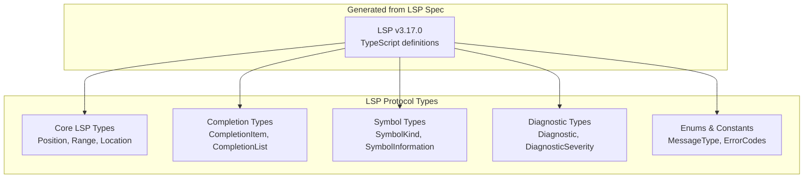
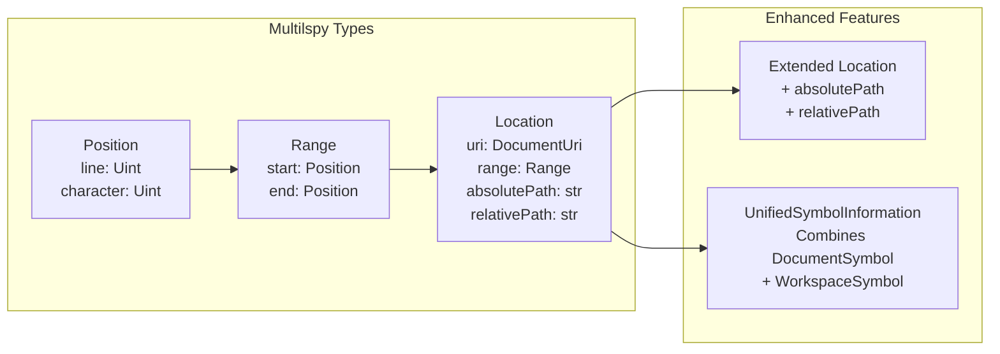
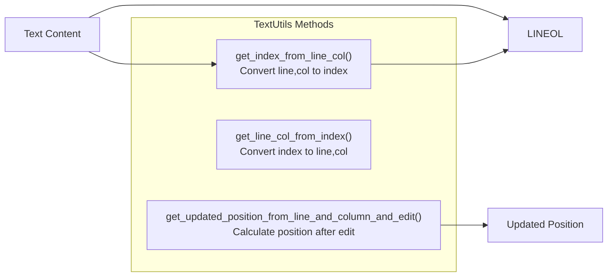
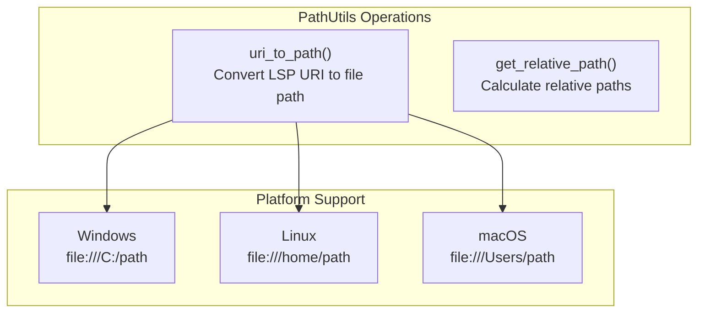
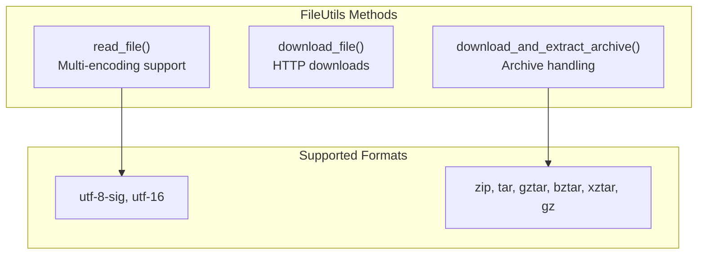
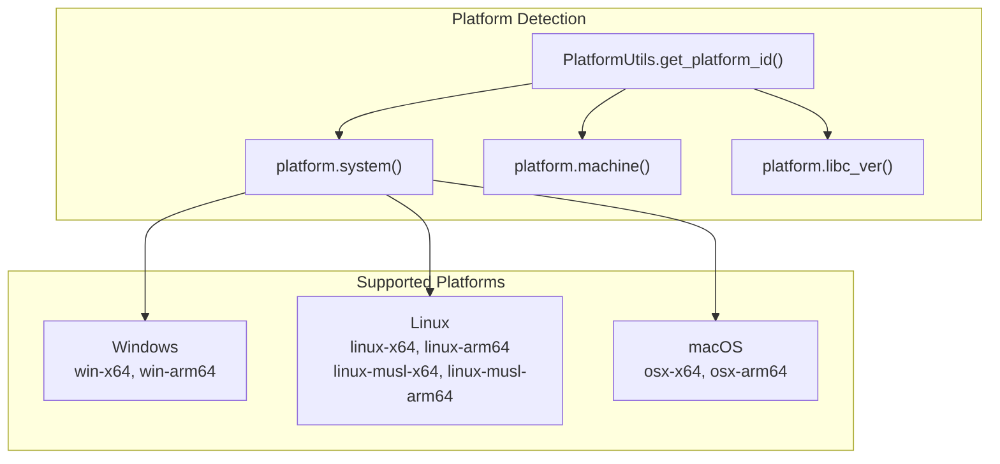
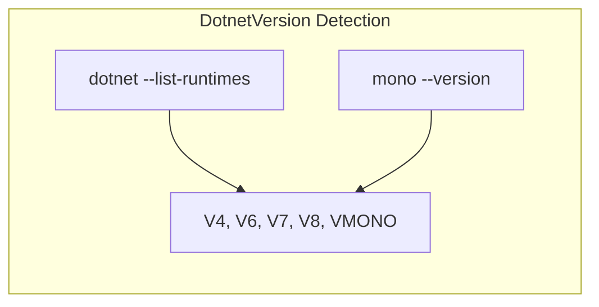
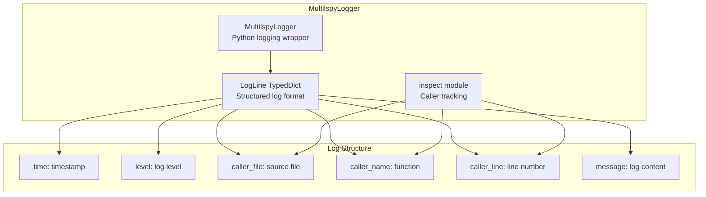
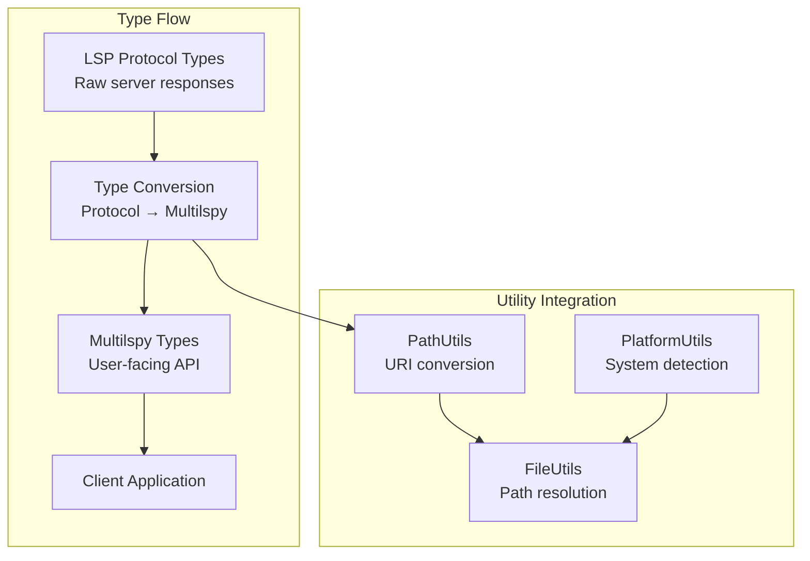
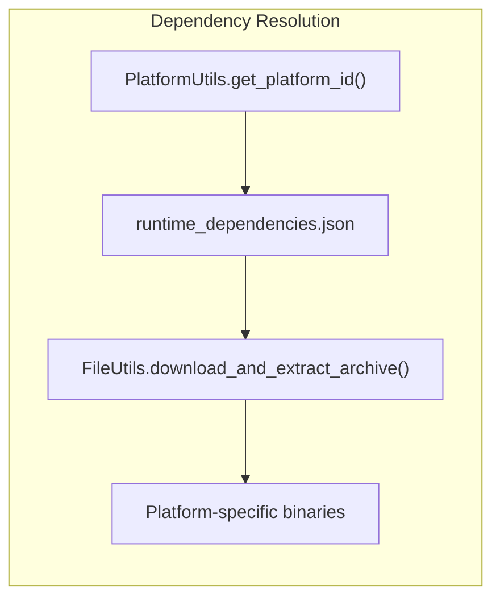

<!-- source: DeepWiki mcp.deepwiki.com · repo microsoft/multilspy · page 2.4 Types and Utilities · fetched 2026-10-26 -->

# Types and Utilities

<details>
<summary>Relevant source files</summary>

The following files were used as context for generating this wiki page:

- [src/multilspy/language_servers/typescript_language_server/runtime_dependencies.json](src/multilspy/language_servers/typescript_language_server/runtime_dependencies.json)
- [src/multilspy/lsp_protocol_handler/lsp_types.py](src/multilspy/lsp_protocol_handler/lsp_types.py)
- [src/multilspy/multilspy_logger.py](src/multilspy/multilspy_logger.py)
- [src/multilspy/multilspy_types.py](src/multilspy/multilspy_types.py)
- [src/multilspy/multilspy_utils.py](src/multilspy/multilspy_utils.py)

</details>


This page documents the type definitions, utility functions, and supporting infrastructure that form the foundation of multilspy's architecture. These components provide LSP protocol abstraction, cross-platform compatibility, logging capabilities, and various helper functions used throughout the codebase.

For information about the low-level LSP protocol communication, see [LSP Protocol Handler](#2.3). For details about the high-level language server interfaces, see [LanguageServer Class](#2.1) and [SyncLanguageServer](#2.2).

## LSP Type System

Multilspy implements a two-layer type system to provide both LSP protocol compliance and version independence. The system consists of raw LSP protocol types and multilspy-specific wrapper types that ensure API stability.

### LSP Protocol Types

The foundation layer contains auto-generated Python types corresponding to the LSP 3.17.0 specification. These types are located in [src/multilspy/lsp_protocol_handler/lsp_types.py:1-2969]() and provide complete coverage of the Language Server Protocol.



**Key LSP Protocol Types:**

| Type Category | Examples | Purpose |
|---------------|----------|---------|
| Core Types | `Position`, `Range`, `Location` | Document positioning and ranges |
| Completion | `CompletionItem`, `CompletionItemKind` | Code completion functionality |
| Symbols | `SymbolKind`, `SymbolTag` | Code symbol representation |
| Diagnostics | `DiagnosticSeverity`, `DiagnosticTag` | Error and warning reporting |
| Protocol | `ErrorCodes`, `MessageType` | LSP communication protocol |

Sources: [src/multilspy/lsp_protocol_handler/lsp_types.py:1-2969]()

### Multilspy Wrapper Types

The abstraction layer provides stable, version-independent types that insulate multilspy users from LSP protocol changes. These wrapper types are defined in [src/multilspy/multilspy_types.py:1-283]().



**Enhanced Location Type:**
The multilspy `Location` type extends the basic LSP location with additional path information:

```python
class Location(TypedDict):
    uri: DocumentUri
    range: Range
    absolutePath: str
    relativePath: Union[str, None]
```

**Unified Symbol Information:**
The `UnifiedSymbolInformation` type combines document and workspace symbol information into a single interface:

```python
class UnifiedSymbolInformation(TypedDict):
    name: str
    kind: SymbolKind
    location: NotRequired[Location]
    containerName: NotRequired[str]
    detail: NotRequired[str]
    range: NotRequired[Range]
    selectionRange: NotRequired[Range]
```

Sources: [src/multilspy/multilspy_types.py:15-214]()

## Utility Classes

Multilspy provides several utility classes that handle common operations across the codebase. These utilities are organized by functional area and provide cross-platform compatibility.

### Text Processing Utilities

The `TextUtils` class provides functions for converting between different text position representations:



**Key Methods:**
- `get_line_col_from_index(text: str, index: int) -> Tuple[int, int]` - Converts zero-based string index to line/column coordinates
- `get_index_from_line_col(text: str, line: int, col: int) -> int` - Converts line/column coordinates to string index
- `get_updated_position_from_line_and_column_and_edit()` - Calculates cursor position after text insertion

Sources: [src/multilspy/multilspy_utils.py:21-68]()

### Path and URI Management

The `PathUtils` class handles cross-platform path operations and URI conversions:



**URI to Path Conversion:**
The `uri_to_path()` method handles platform-specific URI-to-path conversion, supporting Windows drive letters and Unix-style paths.

Sources: [src/multilspy/multilspy_utils.py:70-101]()

### File Operations

The `FileUtils` class provides robust file I/O operations with error handling and encoding detection:



**Archive Extraction Support:**
The file utilities support multiple archive formats for dependency management:
- Standard formats: `zip`, `tar`, `gztar`, `bztar`, `xztar`
- Compressed formats: `zip.gz`, `gz`

Sources: [src/multilspy/multilspy_utils.py:102-176]()

## Platform Detection System

Multilspy includes sophisticated platform detection to handle cross-platform compatibility and dependency management.

### Platform Identification



**Platform ID Generation:**
The system generates platform identifiers by combining:
- Operating system: `Windows` → `win`, `Darwin` → `osx`, `Linux` → `linux`
- Architecture: `AMD64`/`x86_64` → `x64`, `aarch64`/`arm64` → `arm64`
- C library (Linux only): Non-glibc systems get suffixed (e.g., `linux-musl-x64`)

### .NET Runtime Detection

For C# language server support, multilspy detects available .NET runtimes:



Sources: [src/multilspy/multilspy_utils.py:177-258]()

## Logging System

The multilspy logging system provides structured, contextual logging with caller information tracking.

### Logger Architecture



**Log Entry Format:**
Each log entry contains structured information as JSON:

```python
class LogLine(TypedDict):
    time: str
    level: str
    caller_file: str
    caller_name: str
    caller_line: int
    message: str
```

**Automatic Caller Detection:**
The logger uses Python's `inspect` module to automatically capture caller information, providing precise debugging context without manual instrumentation.

Sources: [src/multilspy/multilspy_logger.py:1-60]()

## Integration and Usage Patterns

### Type System Integration



**Type Conversion Pipeline:**
1. LSP servers return raw protocol types
2. LanguageServerHandler converts to multilspy types
3. Path utilities resolve URIs to absolute/relative paths
4. Enhanced types provide additional context to clients

### Cross-Platform Dependency Management

The utilities work together to provide seamless cross-platform operation:



This integration enables automatic downloading and setup of language server dependencies based on the detected platform, ensuring multilspy works consistently across Windows, macOS, and Linux systems.

Sources: [src/multilspy/multilspy_utils.py:1-259](), [src/multilspy/multilspy_types.py:1-283](), [src/multilspy/multilspy_logger.py:1-60](), [src/multilspy/lsp_protocol_handler/lsp_types.py:1-100]()

---

