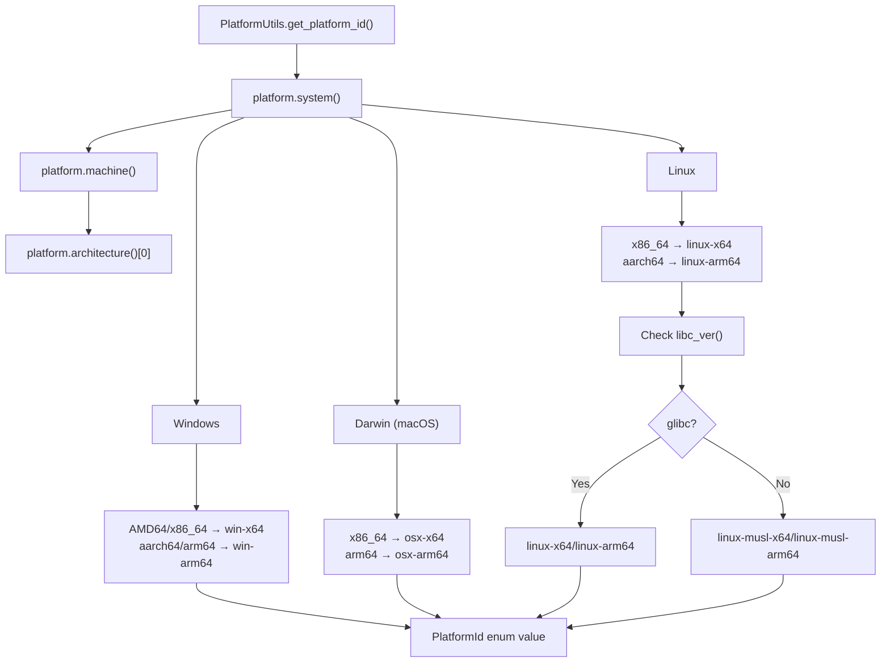
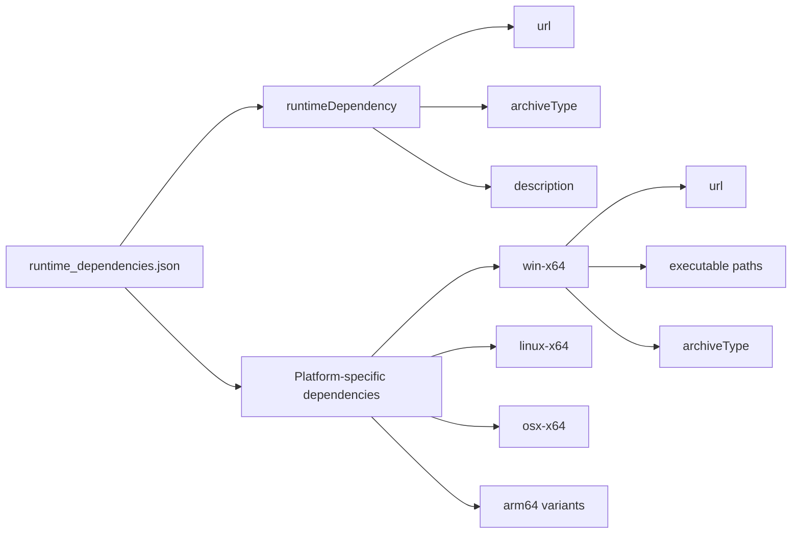
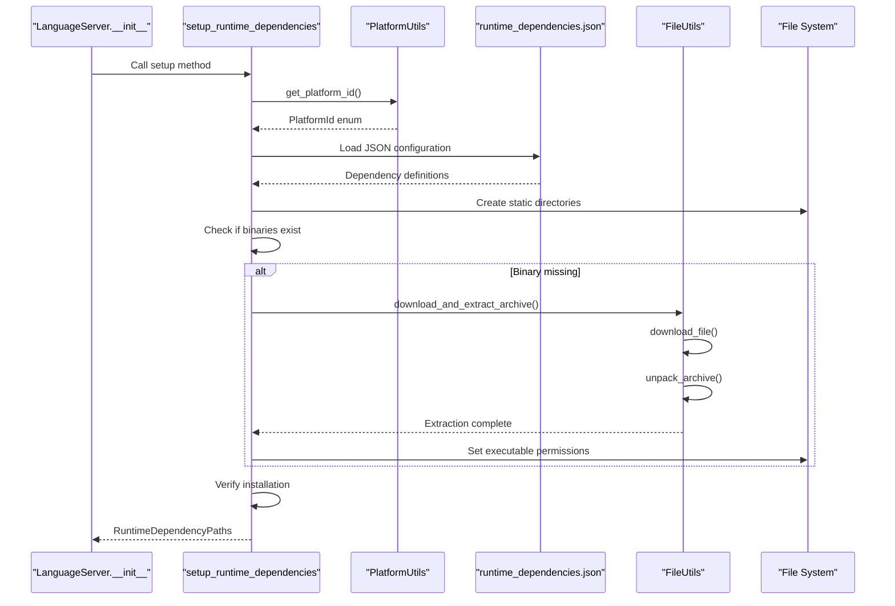
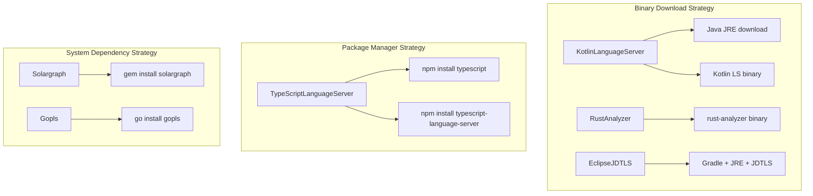
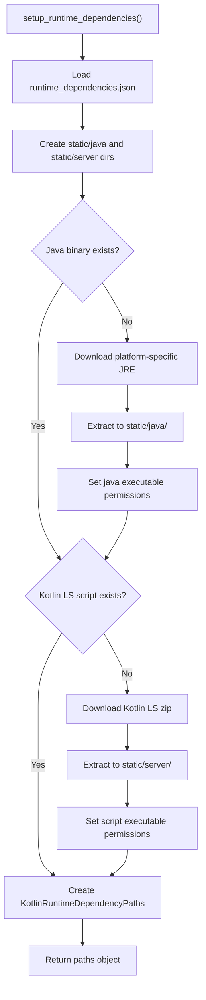
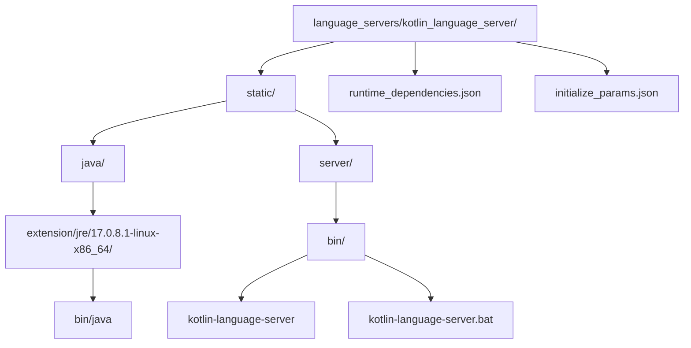
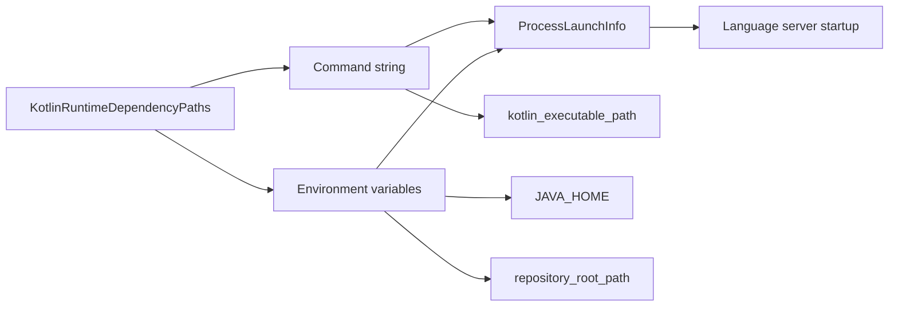

<!-- source: DeepWiki mcp.deepwiki.com · repo microsoft/multilspy · page 2.5 Runtime Dependency Management · fetched 2026-10-26 -->

# Runtime Dependency Management

Relevant source files

The following files were used as context for generating this wiki page:

- [README.md](README.md)
- [src/multilspy/language_servers/kotlin_language_server/initialize_params.json](src/multilspy/language_servers/kotlin_language_server/initialize_params.json)
- [src/multilspy/language_servers/kotlin_language_server/kotlin_language_server.py](src/multilspy/language_servers/kotlin_language_server/kotlin_language_server.py)
- [src/multilspy/language_servers/kotlin_language_server/runtime_dependencies.json](src/multilspy/language_servers/kotlin_language_server/runtime_dependencies.json)
- [src/multilspy/language_servers/typescript_language_server/runtime_dependencies.json](src/multilspy/language_servers/typescript_language_server/runtime_dependencies.json)
- [src/multilspy/multilspy_types.py](src/multilspy/multilspy_types.py)
- [src/multilspy/multilspy_utils.py](src/multilspy/multilspy_utils.py)

Runtime Dependency Management is multilspy's system for automatically downloading, configuring, and managing language server binaries and their runtime dependencies across different platforms. This system enables multilspy to work out-of-the-box without requiring users to manually install and configure language servers.

For information about the high-level language server architecture, see [Core Architecture](#2). For details about specific language server implementations, see [Language Server Implementations](#3).

## Platform Detection and Support

multilspy uses a sophisticated platform detection system to identify the current operating system and architecture, then downloads the appropriate binaries for each platform.

### Platform Detection Flow

### Supported Platform Matrix

| Platform | Architectures | Platform ID |
|----------|--------------|-------------|
| Windows | x64, ARM64 | `win-x64`, `win-arm64` |
| macOS | x64, ARM64 | `osx-x64`, `osx-arm64` |
| Linux | x64, ARM64 | `linux-x64`, `linux-arm64` |
| Linux (musl) | x64, ARM64 | `linux-musl-x64`, `linux-musl-arm64` |

Sources: [src/multilspy/multilspy_utils.py:203-227]()

## Dependency Configuration Structure

Each language server defines its runtime dependencies through JSON configuration files that specify platform-specific download URLs, archive types, and installation paths.

### Configuration Schema

### Example: Kotlin Language Server Dependencies

The Kotlin language server requires both Java runtime and the Kotlin language server binary:

| Component | Platform | URL Source | Archive Type |
|-----------|----------|------------|--------------|
| Java JRE | win-x64 | Red Hat VSCode Java extension | zip |
| Java JRE | linux-x64 | Red Hat VSCode Java extension | zip |
| Java JRE | osx-arm64 | Red Hat VSCode Java extension | zip |
| Kotlin LS | All platforms | GitHub releases | zip |

Sources: [src/multilspy/language_servers/kotlin_language_server/runtime_dependencies.json:1-42]()

## Download and Setup Process

The runtime dependency management process follows a consistent pattern across all language servers, implemented through the `setup_runtime_dependencies` method.

### Dependency Setup Flow

### Archive Type Support

multilspy supports multiple archive formats through `FileUtils.download_and_extract_archive`:

| Archive Type | Description | Example Usage |
|--------------|-------------|---------------|
| `zip` | Standard ZIP archives | Most Windows binaries |
| `tar` | TAR archives | Linux source distributions |
| `gztar` | Gzipped TAR | Linux precompiled binaries |
| `zip.gz` | Gzipped ZIP | Special compressed formats |
| `gz` | Single gzipped files | Individual executables |

Sources: [src/multilspy/multilspy_utils.py:142-176]()

## Language Server Dependency Types

Different language servers use different dependency management strategies based on their ecosystem requirements.

### Dependency Management Strategies

### Kotlin Language Server Implementation

The Kotlin language server demonstrates the most complex dependency setup, requiring both Java runtime and the language server binary:

Sources: [src/multilspy/language_servers/kotlin_language_server/kotlin_language_server.py:60-131]()

## File Organization and Permissions

multilspy organizes downloaded dependencies in a predictable directory structure within each language server's module directory.

### Directory Structure

### Permission Management

On Unix-like systems, multilspy automatically sets executable permissions for downloaded binaries:

| File Type | Permission | Octal | Purpose |
|-----------|------------|-------|---------|
| Java executable | `0o755` | 755 | Allow execution by owner, group, others |
| Script files | `S_IRUSR \| S_IWUSR \| S_IXUSR \| S_IRGRP \| S_IXGRP \| S_IROTH \| S_IXOTH` | 755 | Standard executable permissions |

Sources: [src/multilspy/language_servers/kotlin_language_server/kotlin_language_server.py:94-119]()

## Process Launch Configuration

After dependency setup, multilspy configures the `ProcessLaunchInfo` object that defines how to launch the language server process.

### Launch Configuration Components

The resulting `ProcessLaunchInfo` contains:
- **cmd**: Full path to the language server executable or script
- **env**: Environment variables including `JAVA_HOME` for Java-based servers
- **cwd**: Working directory set to the repository root

Sources: [src/multilspy/language_servers/kotlin_language_server/kotlin_language_server.py:46-58]()

---

