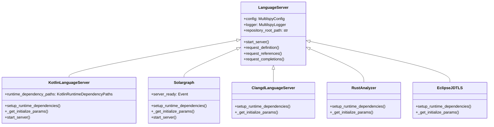
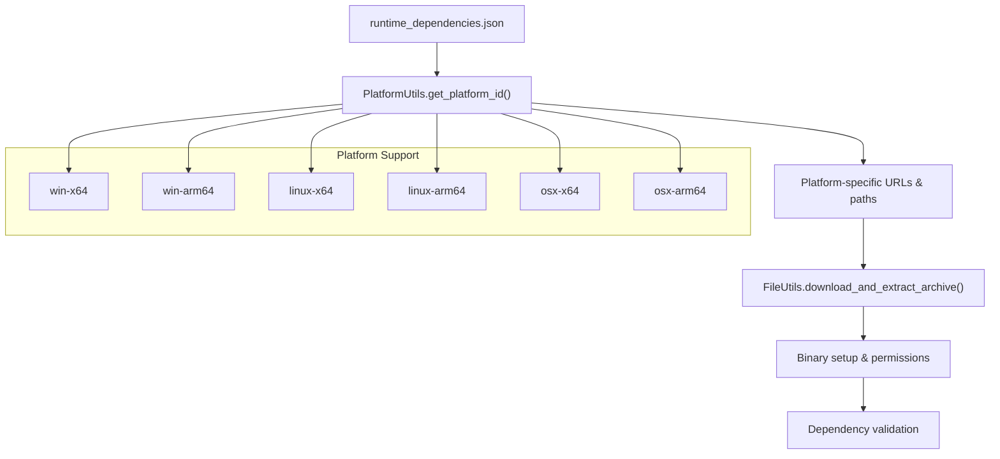
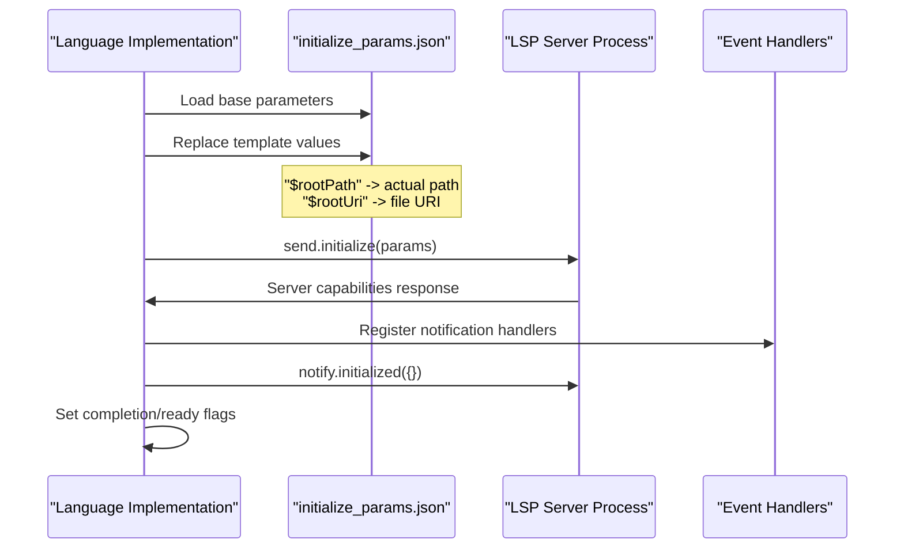
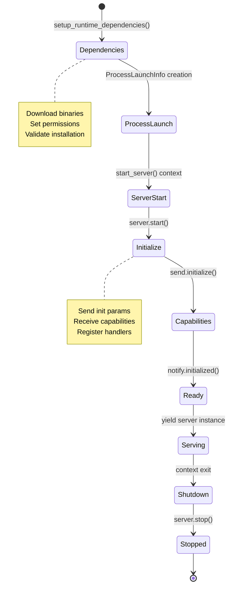

<!-- source: DeepWiki mcp.deepwiki.com · repo microsoft/multilspy · page 3 Language Server Implementations · fetched 2026-10-26 -->

# Language Server Implementations

Relevant source files

The following files were used as context for generating this wiki page:

- [README.md](README.md)
- [src/multilspy/language_servers/kotlin_language_server/initialize_params.json](src/multilspy/language_servers/kotlin_language_server/initialize_params.json)
- [src/multilspy/language_servers/kotlin_language_server/kotlin_language_server.py](src/multilspy/language_servers/kotlin_language_server/kotlin_language_server.py)
- [src/multilspy/language_servers/kotlin_language_server/runtime_dependencies.json](src/multilspy/language_servers/kotlin_language_server/runtime_dependencies.json)
- [src/multilspy/language_servers/solargraph/solargraph.py](src/multilspy/language_servers/solargraph/solargraph.py)
- [tests/multilspy/test_multilspy_ruby.py](tests/multilspy/test_multilspy_ruby.py)
- [tests/multilspy/test_sync_multilspy_ruby.py](tests/multilspy/test_sync_multilspy_ruby.py)

This document covers how multilspy implements language-specific extensions of the base `LanguageServer` class to support different programming languages and their corresponding language servers. Each implementation handles the unique requirements, dependencies, and configuration needed for its specific language server while following common architectural patterns.

For information about the core `LanguageServer` class and base architecture, see [Core Architecture](#2). For detailed documentation of specific language implementations, see sections [3.1](#3.1) through [3.9](#3.9).

## Common Architecture Pattern

All language server implementations in multilspy follow a consistent pattern by extending the base `LanguageServer` class. Each implementation is responsible for:

- Setting up runtime dependencies and external binaries
- Configuring language-specific initialization parameters  
- Managing the server process lifecycle
- Handling language-specific LSP protocol variations

Sources: [src/multilspy/language_servers/kotlin_language_server/kotlin_language_server.py:34-58](), [src/multilspy/language_servers/solargraph/solargraph.py:25-44]()

## Runtime Dependency Management

Each language server implementation manages its own external dependencies through a standardized dependency management system. This includes downloading platform-specific binaries, runtime environments, and language servers themselves.

### Dependency Configuration System

Language servers use JSON configuration files to define their runtime dependencies with platform-specific URLs and installation requirements:

Sources: [src/multilspy/language_servers/kotlin_language_server/runtime_dependencies.json:1-42](), [src/multilspy/language_servers/kotlin_language_server/kotlin_language_server.py:60-131]()

### Complex Dependency Chains

Some language servers require multiple runtime dependencies. For example, the Kotlin Language Server requires both a JDK and the kotlin-language-server binary:

| Dependency Type | Purpose | Platform Variants |
|----------------|---------|-------------------|
| Java Runtime | JDK for kotlin-language-server execution | 6 platform-specific downloads |
| Kotlin Language Server | Main language server binary | Single cross-platform archive |
| Solargraph Gem | Ruby language server | Installed via `gem install` |
| Rust Analyzer | Rust language server binary | Platform-specific executables |

Sources: [src/multilspy/language_servers/kotlin_language_server/kotlin_language_server.py:74-131](), [src/multilspy/language_servers/solargraph/solargraph.py:67-88]()

## Initialization and Lifecycle

Each language server implementation customizes the initialization process through language-specific parameters and lifecycle management.

### Initialization Parameter Customization

Language servers define their initialization parameters in JSON configuration files that are processed and customized for each repository:

Sources: [src/multilspy/language_servers/kotlin_language_server/kotlin_language_server.py:133-168](), [src/multilspy/language_servers/solargraph/solargraph.py:90-112]()

### Server Lifecycle Management

Language server implementations handle the complete server lifecycle through async context managers:

Sources: [src/multilspy/language_servers/kotlin_language_server/kotlin_language_server.py:170-235](), [src/multilspy/language_servers/solargraph/solargraph.py:114-189]()

## Platform Support Matrix

Language server implementations provide comprehensive cross-platform support with platform-specific optimizations:

| Language Server | Windows x64 | Windows ARM64 | Linux x64 | Linux ARM64 | macOS x64 | macOS ARM64 |
|----------------|-------------|---------------|-----------|-------------|-----------|-------------|
| KotlinLanguageServer | ✓ | ✓ | ✓ | ✓ | ✓ | ✓ |
| Solargraph | ✓* | ✓* | ✓* | ✓* | ✓* | ✓* |
| ClangdLanguageServer | ✓ | ✓ | ✓ | ✓ | ✓ | ✓ |
| RustAnalyzer | ✓ | ✓ | ✓ | ✓ | ✓ | ✓ |
| EclipseJDTLS | ✓ | ✓ | ✓ | ✓ | ✓ | ✓ |

*Requires system Ruby installation

Sources: [src/multilspy/language_servers/kotlin_language_server/kotlin_language_server.py:64-67](), [src/multilspy/language_servers/solargraph/solargraph.py:57-65]()

## Implementation Examples

### Kotlin Language Server Implementation

The `KotlinLanguageServer` demonstrates complex dependency management with both Java runtime and language server binary requirements:

- **Runtime Dependencies**: Downloads platform-specific JDK and kotlin-language-server archives
- **Environment Setup**: Configures `JAVA_HOME` and executable permissions  
- **Process Configuration**: Uses platform-specific script files (.bat on Windows, shell scripts on Unix)
- **Initialization**: Comprehensive capability validation and workspace folder configuration

Sources: [src/multilspy/language_servers/kotlin_language_server/kotlin_language_server.py:39-58](), [src/multilspy/language_servers/kotlin_language_server/kotlin_language_server.py:100-131]()

### Solargraph (Ruby) Implementation

The `Solargraph` class showcases dependency management for language servers distributed through language-specific package managers:

- **System Requirements**: Validates Ruby installation before proceeding
- **Gem Management**: Installs solargraph gem if not present using `gem install`
- **Path Resolution**: Locates gem executable through `gem which` command
- **Event Handling**: Registers handlers for Ruby-specific LSP notifications like `language/status`

Sources: [src/multilspy/language_servers/solargraph/solargraph.py:31-44](), [src/multilspy/language_servers/solargraph/solargraph.py:67-88](), [src/multilspy/language_servers/solargraph/solargraph.py:128-160]()

---

