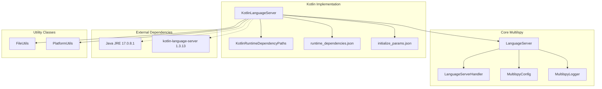
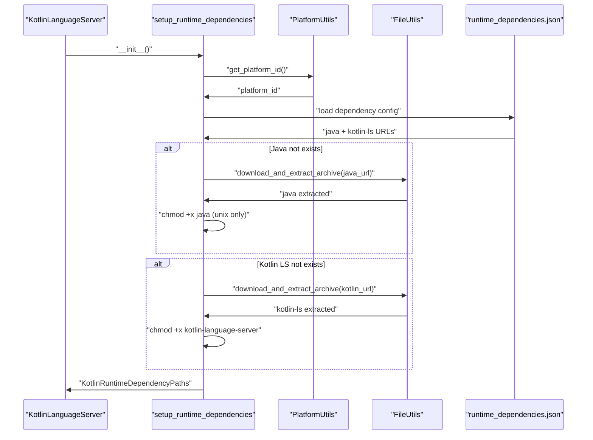
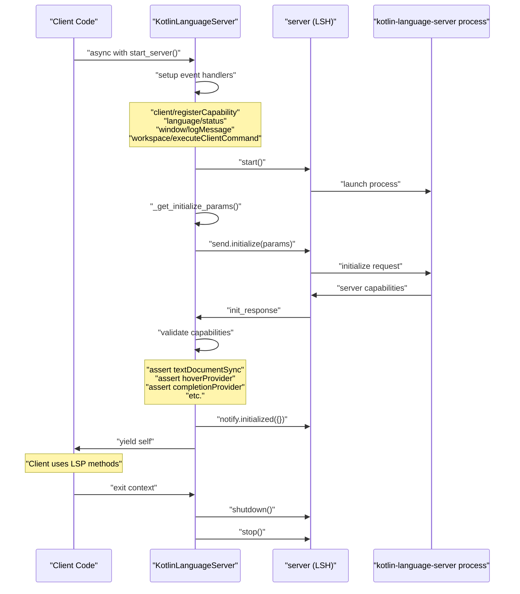

<!-- source: DeepWiki mcp.deepwiki.com · repo microsoft/multilspy · page 3.1 Kotlin Language Server · fetched 2026-10-26 -->

# Kotlin Language Server

<details>
<summary>Relevant source files</summary>

The following files were used as context for generating this wiki page:

- [README.md](README.md)
- [src/multilspy/language_servers/kotlin_language_server/initialize_params.json](src/multilspy/language_servers/kotlin_language_server/initialize_params.json)
- [src/multilspy/language_servers/kotlin_language_server/kotlin_language_server.py](src/multilspy/language_servers/kotlin_language_server/kotlin_language_server.py)
- [src/multilspy/language_servers/kotlin_language_server/runtime_dependencies.json](src/multilspy/language_servers/kotlin_language_server/runtime_dependencies.json)

</details>


This document covers the Kotlin-specific implementation of multilspy's language server integration. The `KotlinLanguageServer` class provides Kotlin language support by managing the [fwcd/kotlin-language-server](https://github.com/fwcd/kotlin-language-server) external process, including automatic dependency management for Java runtime and language server binaries across multiple platforms.

For general language server architecture concepts, see [Core Architecture](#2). For usage examples with Kotlin projects, see [Basic Usage](#4.1).

## Architecture Overview

The `KotlinLanguageServer` extends the base `LanguageServer` class and implements Kotlin-specific functionality through a sophisticated runtime dependency management system and custom initialization parameters.

**Class Hierarchy and Dependencies**


Sources: [src/multilspy/language_servers/kotlin_language_server/kotlin_language_server.py:34-58]()

## Runtime Dependencies Management

The Kotlin Language Server requires two key runtime dependencies: a Java runtime environment and the Kotlin Language Server binary. The system automatically downloads and configures these dependencies based on the detected platform.

**Dependency Setup Flow**


### Platform Support

The implementation supports five platform combinations with platform-specific Java runtime distributions:

| Platform | Java Distribution | Executable Path |
|----------|-------------------|-----------------|
| `win-x64` | `java@win32-x64-1.23.0.vsix` | `extension/jre/17.0.8.1-win32-x86_64/bin/java.exe` |
| `linux-x64` | `java@linux-x64-1.23.0.vsix` | `extension/jre/17.0.8.1-linux-x86_64/bin/java` |
| `linux-arm64` | `java@linux-arm64-1.23.0.vsix` | `extension/jre/17.0.8.1-linux-aarch64/bin/java` |
| `osx-x64` | `java@darwin-x64-1.23.0.vsix` | `extension/jre/17.0.8.1-macosx-x86_64/bin/java` |
| `osx-arm64` | `java@darwin-arm64-1.23.0.vsix` | `extension/jre/17.0.8.1-macosx-aarch64/bin/java` |

Sources: [src/multilspy/language_servers/kotlin_language_server/runtime_dependencies.json:9-41]()

### Dependency Storage Structure

Dependencies are stored in a predictable directory structure within the language server module:

```
kotlin_language_server/
├── static/
│   ├── java/
│   │   └── extension/jre/17.0.8.1-{platform}/
│   │       └── bin/java[.exe]
│   └── server/
│       └── bin/
│           └── kotlin-language-server[.bat]
```

Sources: [src/multilspy/language_servers/kotlin_language_server/kotlin_language_server.py:78-108]()

## Initialization Process

The Kotlin Language Server uses a comprehensive initialization process that configures workspace folders, client capabilities, and Kotlin-specific settings.

**Server Startup Sequence**


### Required Server Capabilities

The initialization process validates that the Kotlin Language Server supports the following capabilities:

- `textDocumentSync` - Document synchronization
- `hoverProvider` - Hover information
- `completionProvider` - Code completion
- `signatureHelpProvider` - Signature help
- `definitionProvider` - Go to definition
- `referencesProvider` - Find references
- `documentSymbolProvider` - Document symbols
- `workspaceSymbolProvider` - Workspace symbols  
- `semanticTokensProvider` - Semantic tokens

Sources: [src/multilspy/language_servers/kotlin_language_server/kotlin_language_server.py:213-222]()

## Key Implementation Details

### KotlinRuntimeDependencyPaths Dataclass

The `KotlinRuntimeDependencyPaths` dataclass encapsulates the paths to runtime dependencies:

```python
@dataclasses.dataclass
class KotlinRuntimeDependencyPaths:
    java_path: str           # Path to java executable
    java_home_path: str      # JAVA_HOME directory path  
    kotlin_executable_path: str  # Path to kotlin-language-server script
```

Sources: [src/multilspy/language_servers/kotlin_language_server/kotlin_language_server.py:24-32]()

### Process Launch Configuration

The language server process is launched with specific environment variables and command configuration:

- **Command**: Direct path to `kotlin-language-server` script (`.bat` on Windows)
- **Environment**: `JAVA_HOME` set to the downloaded Java runtime directory
- **Working Directory**: Repository root path

Sources: [src/multilspy/language_servers/kotlin_language_server/kotlin_language_server.py:46-58]()

### Notification and Request Handlers

The implementation registers several handlers for Kotlin Language Server specific notifications:

| Handler Type | Method | Purpose |
|--------------|--------|---------|
| Request | `client/registerCapability` | Handle capability registration |
| Notification | `language/status` | Handle language status updates |
| Notification | `window/logMessage` | Handle server log messages |
| Request | `workspace/executeClientCommand` | Handle client command execution |
| Notification | `$/progress` | Handle progress notifications |
| Notification | `textDocument/publishDiagnostics` | Handle diagnostic messages |
| Notification | `language/actionableNotification` | Handle actionable notifications |

Sources: [src/multilspy/language_servers/kotlin_language_server/kotlin_language_server.py:194-200]()

### Configuration Parameters

The Kotlin Language Server uses extensive initialization options defined in `initialize_params.json`, including:

- **Diagnostics**: Enabled with level 4 severity and 250ms debounce time
- **Completion**: Snippets enabled  
- **Formatting**: Uses `ktfmt` formatter with Google style
- **Compiler**: JVM target set to default
- **Indexing**: Enabled for workspace symbols
- **Scripts**: Build script support enabled

Sources: [src/multilspy/language_servers/kotlin_language_server/initialize_params.json:471-517]()

---

