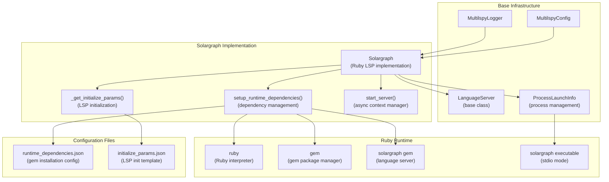
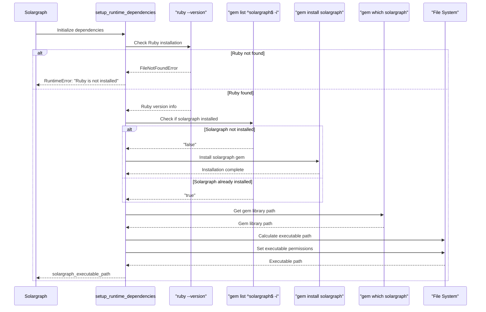
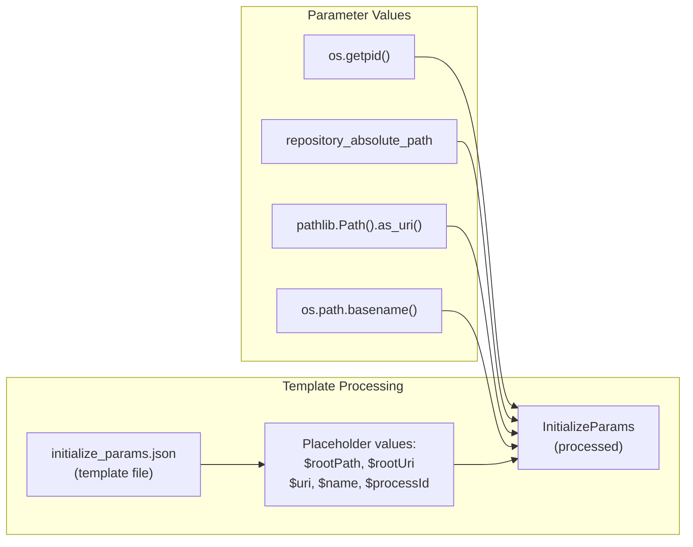
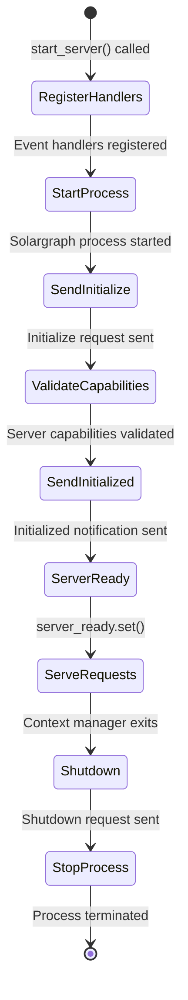

<!-- source: DeepWiki mcp.deepwiki.com · repo microsoft/multilspy · page 3.2 Solargraph (Ruby) Language Server · fetched 2026-10-26 -->

# Solargraph (Ruby) Language Server

<details>
<summary>Relevant source files</summary>

The following files were used as context for generating this wiki page:

- [src/multilspy/language_servers/solargraph/initialize_params.json](src/multilspy/language_servers/solargraph/initialize_params.json)
- [src/multilspy/language_servers/solargraph/runtime_dependencies.json](src/multilspy/language_servers/solargraph/runtime_dependencies.json)
- [src/multilspy/language_servers/solargraph/solargraph.py](src/multilspy/language_servers/solargraph/solargraph.py)
- [tests/multilspy/test_multilspy_ruby.py](tests/multilspy/test_multilspy_ruby.py)
- [tests/multilspy/test_sync_multilspy_ruby.py](tests/multilspy/test_sync_multilspy_ruby.py)

</details>


This document covers the Ruby language server implementation in multilspy using Solargraph. The `Solargraph` class provides Ruby-specific instantiation of the base `LanguageServer` class, handling Ruby runtime dependencies, Solargraph gem installation, and Ruby-specific LSP protocol extensions.

For general language server architecture concepts, see [Core Architecture](#2). For information about other language server implementations, see [Language Server Implementations](#3).

## Overview

The Solargraph implementation enables Ruby language support through the Solargraph gem, which provides LSP functionality for Ruby codebases. This implementation automatically manages Ruby runtime verification, Solargraph gem installation, and handles Ruby-specific LSP protocol extensions.

**Solargraph Class Architecture**



Sources: [src/multilspy/language_servers/solargraph/solargraph.py:25-44]()

## Runtime Dependency Management

The Solargraph implementation includes sophisticated Ruby runtime management that verifies Ruby installation and automatically installs the Solargraph gem if needed.

**Dependency Setup Process**



The dependency management process follows these key steps:

| Step | Command | Purpose |
|------|---------|---------|
| Ruby Verification | `ruby --version` | Ensures Ruby interpreter is available |
| Gem Check | `gem list ^solargraph$ -i` | Checks if Solargraph gem is installed |
| Gem Installation | `gem install solargraph -v 0.51.1` | Installs specific Solargraph version |
| Path Resolution | `gem which solargraph` | Locates gem installation directory |
| Executable Setup | File system operations | Sets up executable path and permissions |

Sources: [src/multilspy/language_servers/solargraph/solargraph.py:46-89](), [src/multilspy/language_servers/solargraph/runtime_dependencies.json:1-11]()

## LSP Initialization Process

The Solargraph implementation customizes the LSP initialization process with Ruby-specific parameters and event handlers.

**Initialization Parameter Configuration**

The `_get_initialize_params()` method processes a template to create Ruby-specific LSP initialization parameters:



Sources: [src/multilspy/language_servers/solargraph/solargraph.py:90-112](), [src/multilspy/language_servers/solargraph/initialize_params.json:1-15]()

## LSP Event Handlers

The Solargraph implementation registers custom event handlers for Ruby-specific LSP protocol extensions:

| Handler | LSP Method | Purpose |
|---------|------------|---------|
| `register_capability_handler` | `client/registerCapability` | Handles dynamic capability registration |
| `lang_status_handler` | `language/status` | Monitors Solargraph service status |
| `window_log_message` | `window/logMessage` | Processes server log messages |
| `execute_client_command_handler` | `workspace/executeClientCommand` | Handles workspace commands |
| `do_nothing` handlers | Various notifications | Ignores non-essential notifications |

The status handler specifically waits for `ServiceReady` status before marking the server as ready:

```python
if params["type"] == "ServiceReady" and params["message"] == "ServiceReady":
    self.service_ready_event.set()
```

Sources: [src/multilspy/language_servers/solargraph/solargraph.py:129-159]()

## Server Startup Flow

The `start_server()` async context manager orchestrates the complete Solargraph server lifecycle:

**Server Lifecycle Management**



The initialization process validates specific Solargraph capabilities:

- `textDocumentSync` mode must equal `2` (incremental sync)
- `completionProvider` must support resolve and trigger characters `[".", ":", "@"]`

Sources: [src/multilspy/language_servers/solargraph/solargraph.py:114-189]()

## Usage Examples

The Solargraph implementation supports both synchronous and asynchronous usage patterns, as demonstrated in the test suites:

**Asynchronous Usage:**
```python
async with lsp.start_server():
    result = await lsp.request_definition("app/controllers/feed_controller.rb", 11, 23)
    symbols = await lsp.request_document_symbols("app/controllers/application_controller.rb")
```

**Synchronous Usage:**
```python
with lsp.start_server():
    result = lsp.request_definition("app/controllers/feed_controller.rb", 11, 23)
    symbols = lsp.request_document_symbols("app/controllers/application_controller.rb")
```

The test suite validates core LSP functionality including:
- Document symbol extraction
- Definition requests with cross-file resolution
- Reference finding across Ruby class hierarchies

Sources: [tests/multilspy/test_multilspy_ruby.py:16-61](), [tests/multilspy/test_sync_multilspy_ruby.py:72-114]()

---

