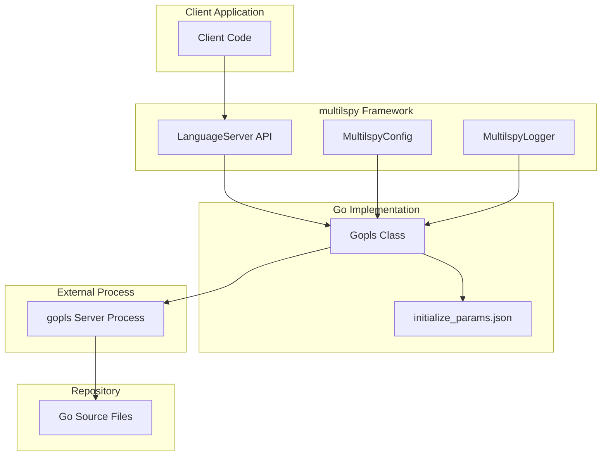
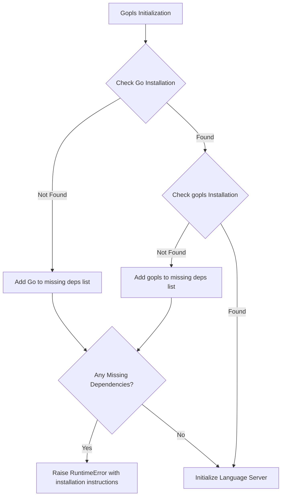
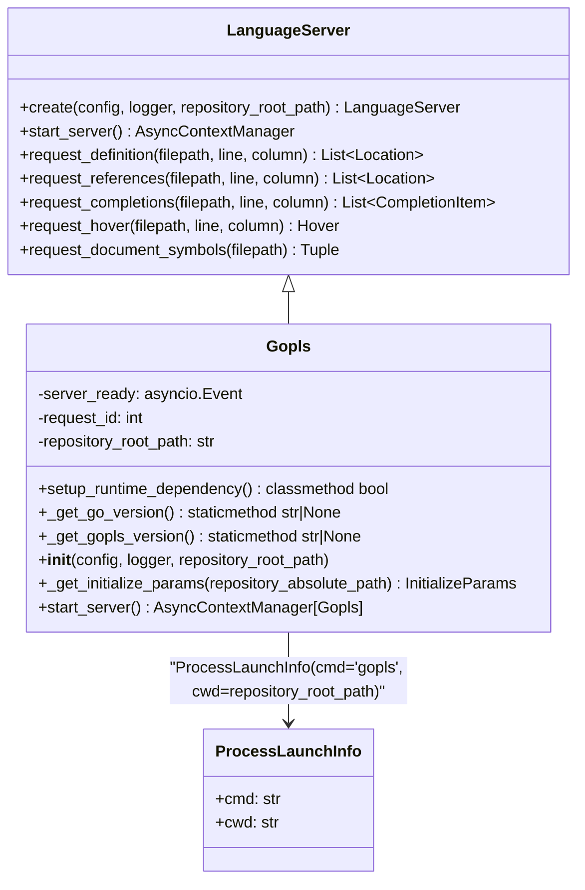
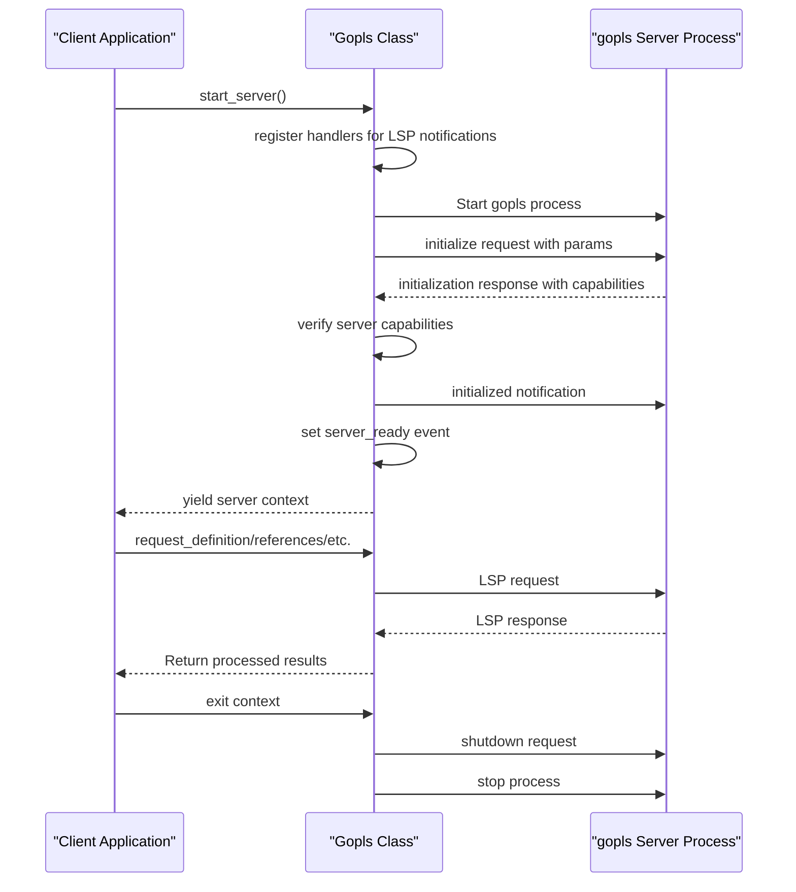

<!-- source: DeepWiki mcp.deepwiki.com · repo microsoft/multilspy · page 3.3 Golang Support · fetched 2026-10-26 -->

# Golang Support

<details>
<summary>Relevant source files</summary>

The following files were used as context for generating this wiki page:

- [.github/workflows/publish-to-pypi.yaml](.github/workflows/publish-to-pypi.yaml)
- [src/multilspy/language_servers/gopls/gopls.py](src/multilspy/language_servers/gopls/gopls.py)
- [src/multilspy/language_servers/gopls/initialize_params.json](src/multilspy/language_servers/gopls/initialize_params.json)
- [tests/multilspy/test_multilspy_go.py](tests/multilspy/test_multilspy_go.py)

</details>


This document details how multilspy integrates with the Go programming language through the gopls language server. It covers the architecture, setup requirements, features, and implementation details of Go language support in multilspy.

For general information about the LSP client architecture, see [Core Architecture](#2).

## Architecture Overview

The Go language support in multilspy is implemented through integration with gopls, the official language server for the Go programming language developed by the Go team. The `Gopls` class extends the base `LanguageServer` class to provide Go-specific functionality.

### Go Language Server Integration Architecture



Sources: [src/multilspy/language_servers/gopls/gopls.py:1-152]()

## Setup and Requirements

The Go language support in multilspy requires two external dependencies:

1. **Go programming language**: The Go compiler and standard library
2. **gopls language server**: The official Go language server 

Unlike some other language servers in multilspy, gopls is not automatically downloaded. It must be installed on the system where multilspy is running.

### Dependency Verification Flow



Sources: [src/multilspy/language_servers/gopls/gopls.py:45-68]()

The `Gopls` class checks for these dependencies at initialization using the `setup_runtime_dependency()` method. If either dependency is missing, multilspy raises a `RuntimeError` with helpful installation instructions:

```python
missing_deps = []
if not go_version:
    missing_deps.append(("Go", "https://golang.org/doc/install"))
if not gopls_version:
    missing_deps.append(("gopls", "https://pkg.go.dev/golang.org/x/tools/gopls#section-readme"))
```

Sources: [src/multilspy/language_servers/gopls/gopls.py:54-60]()

## Class Implementation

The `Gopls` class implements Go-specific functionality for the multilspy framework:



Sources: [src/multilspy/language_servers/gopls/gopls.py:17-82]()

Key methods of the `Gopls` class include:

- `_get_go_version()`: Checks if Go is installed by running `go version`
- `_get_gopls_version()`: Checks if gopls is installed by running `gopls version`
- `setup_runtime_dependency()`: Verifies both dependencies are available
- `_get_initialize_params()`: Loads initialization parameters from JSON and customizes them
- `start_server()`: Starts the gopls process and initializes the connection

## Server Initialization and Communication

When a client starts a Go language server, the following sequence occurs:



Sources: [src/multilspy/language_servers/gopls/gopls.py:108-151]()

The initialization parameters are defined in `initialize_params.json` and include:

| Category | Capabilities |
|----------|-------------|
| Text Document | Synchronization, Completion, Definition |
| Completion Item | Snippet support |
| Workspace | Workspace folders, Configuration changes |

Sources: [src/multilspy/language_servers/gopls/initialize_params.json:1-36]()

## Features and Capabilities

The Go language support in multilspy provides the following LSP features:

| Feature | Description | Method |
|---------|-------------|--------|
| Go to Definition | Navigate to symbol definitions | `request_definition()` |
| Find References | Find all references to a symbol | `request_references()` |
| Code Completion | Get completion suggestions | `request_completions()` |
| Hover Information | Get documentation on hover | `request_hover()` |
| Document Symbols | Get symbols from a file | `request_document_symbols()` |

## Usage Example

Below is an example of using multilspy with a Go project:

```python
from multilspy import LanguageServer
from multilspy.multilspy_config import Language, MultilspyConfig

# Create configuration and language server instance for Go
config = MultilspyConfig(Language.GO)
lsp = LanguageServer.create(config, logger, source_directory)

async with lsp.start_server():
    # Wait for server to be fully initialized
    await lsp.server_ready.wait()
    
    # Get definition of a symbol
    definitions = await lsp.request_definition("path/to/file.go", line, column)
    
    # Find references to a symbol
    references = await lsp.request_references("path/to/file.go", line, column)
    
    # Get hover information
    hover_info = await lsp.request_hover("path/to/file.go", line, column)
    
    # Get document symbols
    symbols = await lsp.request_document_symbols("path/to/file.go")
```

The test suite demonstrates these features using the golang/example repository:

```python
# Test finding definition of 'reverse' package import
result = await lsp.request_definition(path, 29, 8)
assert "reverse" in result[0]["relativePath"]

# Test finding references to the 'name' variable
result = await lsp.request_references(path, 61, 5)
assert len(result) == 5

# Test getting hover information for 'name' variable
result = await lsp.request_hover(path, 59, 5)
assert "var name string" in result["contents"]["value"]

# Test getting document symbols
result = await lsp.request_document_symbols(path)
assert [symbol["name"] for symbol in result[0]] == ["usage", "greeting", "reverseFlag", "main"]
```

Sources: [tests/multilspy/test_multilspy_go.py:1-99]()

## Continuous Integration Support

The multilspy CI/CD pipeline includes Go language support testing. The workflow:

1. Sets up Go 1.21 using GitHub Actions' `setup-go` action
2. Installs the gopls language server via `go install golang.org/x/tools/gopls@latest`
3. Runs tests that verify the Go language server functionality

Sources: [.github/workflows/publish-to-pypi.yaml:16-22]()

This ensures that the Go language server integration remains functional across updates to the multilspy library.

---

