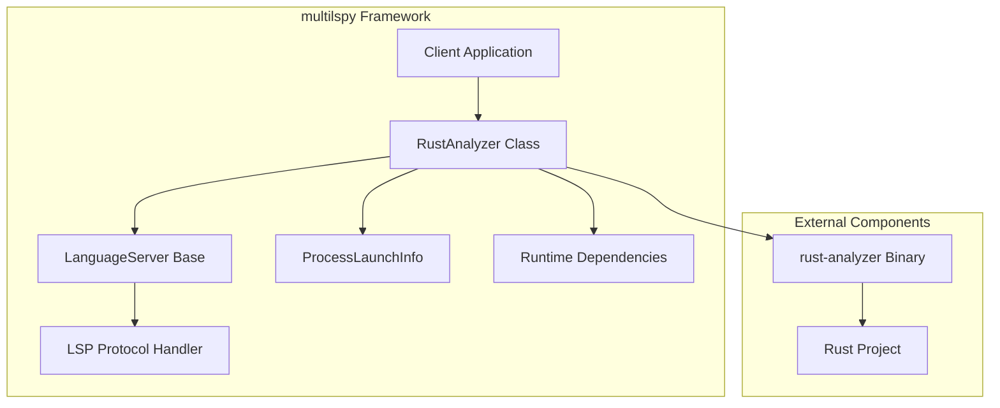
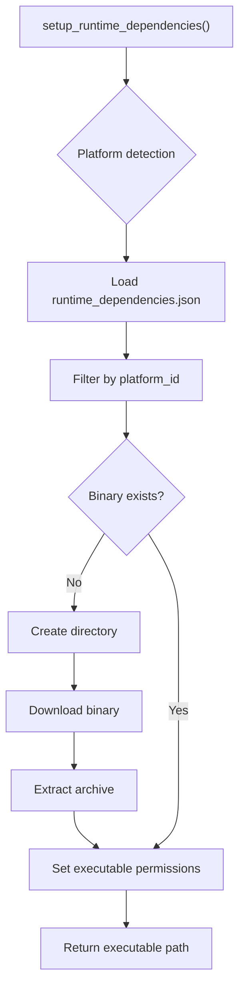
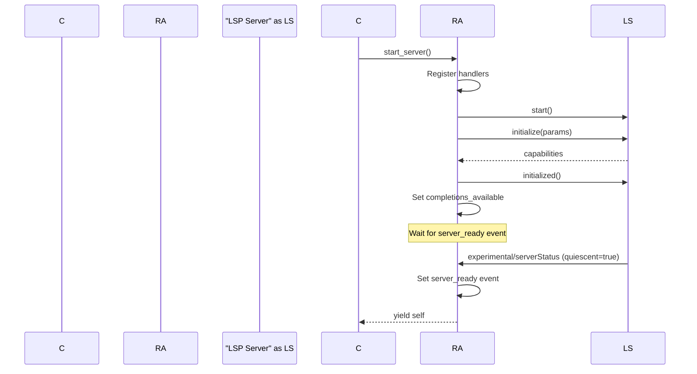
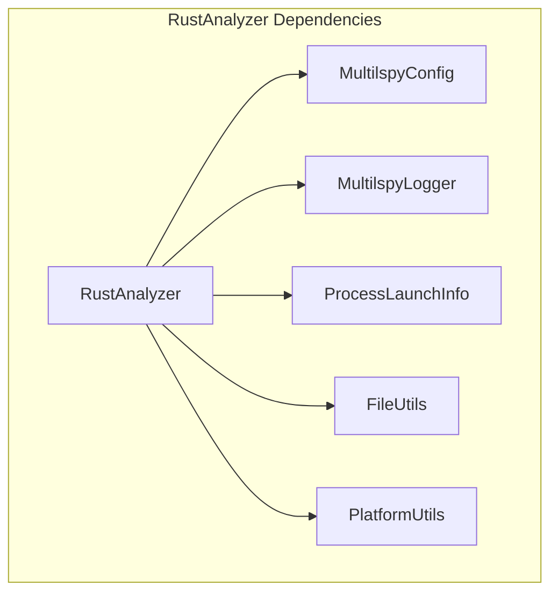

<!-- source: DeepWiki mcp.deepwiki.com · repo microsoft/multilspy · page 3.4 Rust Analyzer · fetched 2026-10-26 -->

# Rust Analyzer

<details>
<summary>Relevant source files</summary>

The following files were used as context for generating this wiki page:

- [src/multilspy/language_servers/eclipse_jdtls/eclipse_jdtls.py](src/multilspy/language_servers/eclipse_jdtls/eclipse_jdtls.py)
- [src/multilspy/language_servers/eclipse_jdtls/runtime_dependencies.json](src/multilspy/language_servers/eclipse_jdtls/runtime_dependencies.json)
- [src/multilspy/language_servers/rust_analyzer/runtime_dependencies.json](src/multilspy/language_servers/rust_analyzer/runtime_dependencies.json)
- [src/multilspy/language_servers/rust_analyzer/rust_analyzer.py](src/multilspy/language_servers/rust_analyzer/rust_analyzer.py)
- [src/multilspy/lsp_protocol_handler/lsp_constants.py](src/multilspy/lsp_protocol_handler/lsp_constants.py)
- [tests/multilspy/test_multilspy_rust.py](tests/multilspy/test_multilspy_rust.py)
- [tests/multilspy/test_sync_multilspy_rust.py](tests/multilspy/test_sync_multilspy_rust.py)

</details>


## Purpose and Scope

This page documents multilspy's integration with the Rust Analyzer language server. It covers how multilspy interfaces with Rust Analyzer to provide language intelligence features for Rust code, including the initialization process, runtime dependency management, and supported capabilities.

For information about other language servers supported by multilspy, see [Language Server Implementations](#3).

Sources: [src/multilspy/language_servers/rust_analyzer/rust_analyzer.py:1-5]()

## Architecture Overview

The Rust Analyzer integration in multilspy is implemented through the `RustAnalyzer` class, which inherits from the base `LanguageServer` class. This inheritance structure allows the Rust Analyzer implementation to leverage common LSP functionality while providing Rust-specific initializations and configurations.

### Class Hierarchy

```mermaid
classDiagram
    class "LanguageServer" {
        +create(config, logger, repository_root_path)
        +start_server()
        +request_definition(filepath, line, column)
        +request_references(filepath, line, column)
        +request_completions(filepath, line, column)
        +request_document_symbols(filepath)
        +request_hover(filepath, line, column)
        +open_file(filepath)
    }
    
    class "RustAnalyzer" {
        -server_ready: asyncio.Event
        +setup_runtime_dependencies(logger, config)
        +_get_initialize_params(repository_absolute_path)
    }
    
    LanguageServer <|-- RustAnalyzer : extends
```

Sources: [src/multilspy/language_servers/rust_analyzer/rust_analyzer.py:23-26](), [src/multilspy/language_servers/rust_analyzer/rust_analyzer.py:28-40]()

### Component Interactions

The diagram below illustrates how the Rust Analyzer component interacts with other parts of the multilspy framework:



Sources: [src/multilspy/language_servers/rust_analyzer/rust_analyzer.py:28-40](), [src/multilspy/language_servers/rust_analyzer/rust_analyzer.py:42-79]()

## Initialization Process

### Runtime Dependency Management

The Rust Analyzer component in multilspy manages its runtime dependencies by downloading the appropriate Rust Analyzer binary for the current platform if it doesn't already exist locally.



Sources: [src/multilspy/language_servers/rust_analyzer/rust_analyzer.py:42-79](), [src/multilspy/language_servers/rust_analyzer/runtime_dependencies.json:1-29]()

### Server Startup Sequence

The startup sequence for the Rust Analyzer server involves registering various notification and request handlers, initializing the server, and waiting for it to be ready:



Sources: [src/multilspy/language_servers/rust_analyzer/rust_analyzer.py:105-182]()

## Supported Platforms

The Rust Analyzer component supports multiple platforms with platform-specific binaries:

| Platform | Binary Name | Archive Type |
|----------|-------------|--------------|
| macOS ARM64 | rust_analyzer | gz |
| Linux x64 | rust_analyzer | gz |
| Windows x64 | rust-analyzer.exe | zip |

Sources: [src/multilspy/language_servers/rust_analyzer/runtime_dependencies.json:3-28]()

## Capabilities and Features

The Rust Analyzer integration in multilspy supports various LSP features, including:

1. Definitions - Finding the definition of a symbol
2. References - Finding all references to a symbol
3. Completions - Code completion suggestions
4. Workspace symbols - Finding symbols across the workspace
5. Text editing - Modifying document content

The code completions feature supports the following trigger characters:
- `:` (colon)
- `.` (dot)
- `'` (single quote)
- `(` (opening parenthesis)

Sources: [src/multilspy/language_servers/rust_analyzer/rust_analyzer.py:166-173](), [tests/multilspy/test_multilspy_rust.py:93-128]()

## Usage Examples

### Finding Definitions

```python
# Example of finding the definition of a symbol
async with lsp.start_server():
    result = await lsp.request_definition("src/browser/bridge.rs", 132, 18)
    # result contains the location of the definition
```

Sources: [tests/multilspy/test_multilspy_rust.py:34-43]()

### Finding References

```python
# Example of finding all references to a symbol
async with lsp.start_server():
    result = await lsp.request_references("src/input/tty.rs", 43, 15)
    # result contains a list of locations where the symbol is referenced
```

Sources: [tests/multilspy/test_multilspy_rust.py:45-73]()

### Workspace Symbol Search

```python
# Example of searching for symbols in the workspace
async with lsp.start_server():
    result = await lsp.request_workspace_symbol("parse_or_run")
    # result contains matching symbols across the workspace
```

Sources: [tests/multilspy/test_multilspy_rust.py:75-90]()

### Completion Requests

```python
# Example of requesting completions
async with lsp.start_server():
    with lsp.open_file(filepath):
        response = await lsp.request_completions(filepath, 10, 40, allow_incomplete=True)
        # response contains completion items
```

Sources: [tests/multilspy/test_multilspy_rust.py:110-128]()

## Implementation Details

### Notification and Request Handlers

The Rust Analyzer implementation registers several handlers for LSP notifications and requests:

| Method | Handler | Purpose |
|--------|---------|---------|
| client/registerCapability | register_capability_handler | Handle capability registration |
| language/status | lang_status_handler | Track server status |
| window/logMessage | window_log_message | Log messages from the server |
| workspace/executeClientCommand | execute_client_command_handler | Execute client commands |
| $/progress | do_nothing | Ignore progress notifications |
| textDocument/publishDiagnostics | do_nothing | Ignore diagnostic notifications |
| language/actionableNotification | do_nothing | Ignore actionable notifications |
| experimental/serverStatus | check_experimental_status | Track quiescent state |

Sources: [src/multilspy/language_servers/rust_analyzer/rust_analyzer.py:120-155]()

### Synchronous API

In addition to the asynchronous API, multilspy provides a synchronous wrapper for the Rust Analyzer through the `SyncLanguageServer` class, making it easier to use in synchronous contexts:

```python
# Example of using the synchronous API
with lsp.start_server():
    result = lsp.request_definition("src/browser/bridge.rs", 132, 18)
```

Sources: [tests/multilspy/test_sync_multilspy_rust.py:27-38]()

## Integration with Core Components

The Rust Analyzer class integrates with several core components of the multilspy framework:

1. **MultilspyConfig** - Provides configuration options
2. **MultilspyLogger** - Handles logging
3. **ProcessLaunchInfo** - Manages process launching
4. **FileUtils and PlatformUtils** - Utility classes for file operations and platform detection



Sources: [src/multilspy/language_servers/rust_analyzer/rust_analyzer.py:5-20](), [src/multilspy/language_servers/rust_analyzer/rust_analyzer.py:28-40]()

---

