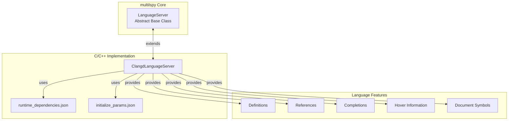
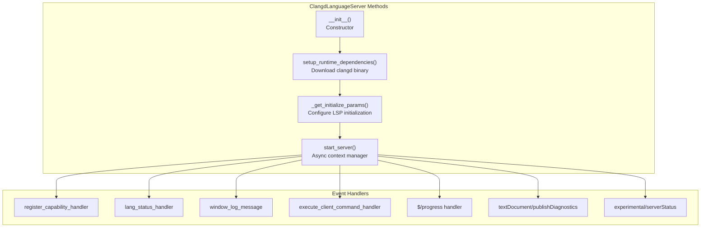
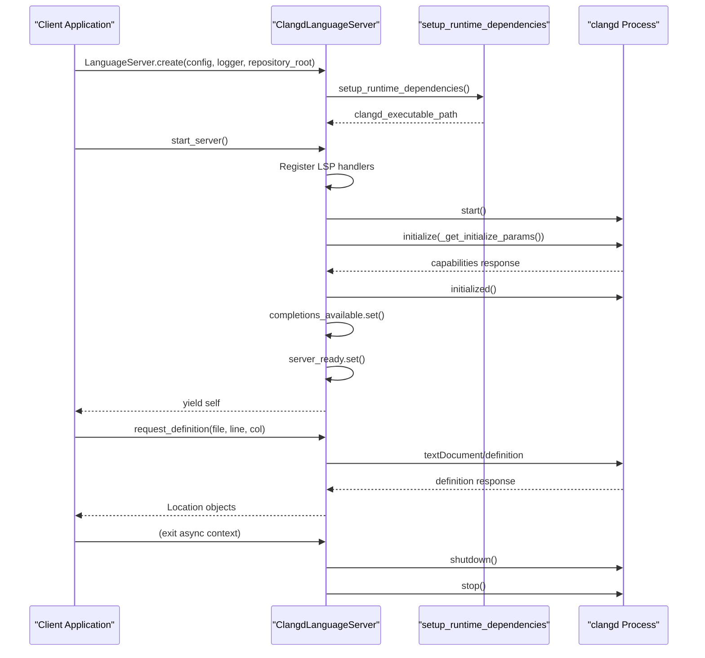
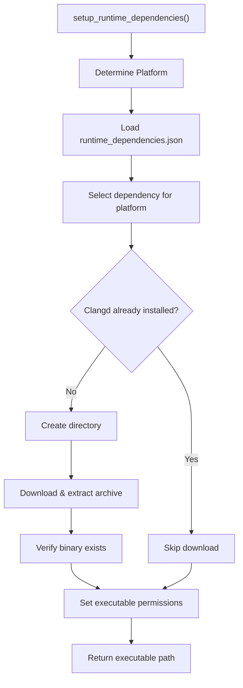
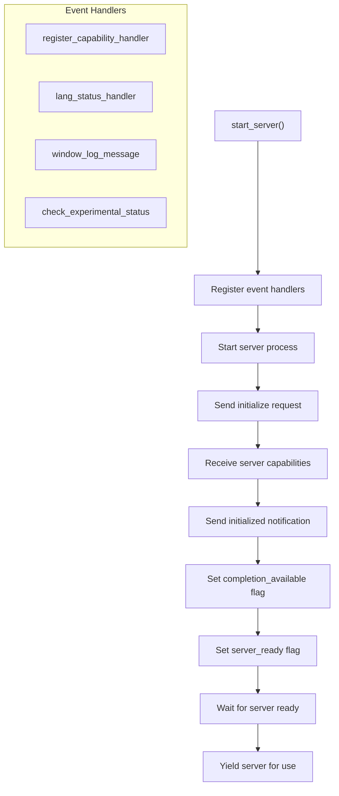

<!-- source: DeepWiki mcp.deepwiki.com · repo microsoft/multilspy · page 3.5 C/C++ Support with Clangd · fetched 2026-10-26 -->

# C/C++ Support with Clangd

<details>
<summary>Relevant source files</summary>

The following files were used as context for generating this wiki page:

- [src/multilspy/language_servers/clangd_language_server/clangd_language_server.py](src/multilspy/language_servers/clangd_language_server/clangd_language_server.py)
- [src/multilspy/language_servers/clangd_language_server/initialize_params.json](src/multilspy/language_servers/clangd_language_server/initialize_params.json)
- [src/multilspy/language_servers/clangd_language_server/runtime_dependencies.json](src/multilspy/language_servers/clangd_language_server/runtime_dependencies.json)
- [tests/multilspy/test_multilspy_clangd.py](tests/multilspy/test_multilspy_clangd.py)

</details>


## Purpose and Scope

This document details how multilspy integrates with the Clangd language server to provide C and C++ language support. It covers the implementation details of the `ClangdLanguageServer` class, runtime dependency management, configuration requirements, and usage patterns. For general information about the language server architecture, see [Core Architecture](#2).

## Overview

The C/C++ support in multilspy is implemented through the `ClangdLanguageServer` class, which extends the base `LanguageServer` class. This integration enables multilspy to provide language intelligence features for C and C++ codebases using the Clangd language server.



Sources: [src/multilspy/language_servers/clangd_language_server/clangd_language_server.py:23-42]()

## ClangdLanguageServer Implementation

The `ClangdLanguageServer` class extends the base `LanguageServer` class to provide C/C++ specific functionality using Clangd version 19.1.2. It manages the complete lifecycle from dependency setup to LSP communication.

### Class Structure and Initialization



The `ClangdLanguageServer` constructor calls `setup_runtime_dependencies()` to ensure the clangd binary is available, then initializes the base class with a `ProcessLaunchInfo` pointing to the clangd executable.

Sources: [src/multilspy/language_servers/clangd_language_server/clangd_language_server.py:23-42]()

### Server Lifecycle Management



Sources: [src/multilspy/language_servers/clangd_language_server/clangd_language_server.py:110-189]()

### Key Components

1. **Constructor** - Sets up runtime dependencies via `setup_runtime_dependencies()` and configures the `ProcessLaunchInfo` with the clangd executable path
2. **Runtime Dependencies** - Downloads and configures Clangd 19.1.2 binary for the target platform  
3. **Initialization Parameters** - Configures LSP client capabilities using `_get_initialize_params()` 
4. **Event Handling** - Registers handlers for LSP notifications including capability registration, status updates, and experimental features

Sources: [src/multilspy/language_servers/clangd_language_server/clangd_language_server.py:23-42](), [src/multilspy/language_servers/clangd_language_server/clangd_language_server.py:44-84](), [src/multilspy/language_servers/clangd_language_server/clangd_language_server.py:86-108]()

## Runtime Dependency Management

The `ClangdLanguageServer` class automatically manages Clangd runtime dependencies. It determines the current platform, downloads the appropriate Clangd binary if needed, and ensures it's executable.

| Platform | Binary Name | Source URL |
|----------|------------|------------|
| Linux x64 | `clangd` | GitHub release (v19.1.2) |
| Windows x64 | `clangd.exe` | GitHub release (v19.1.2) |
| macOS Arm64 | `clangd` | GitHub release (v19.1.2) |

The dependency management process:



Sources: [src/multilspy/language_servers/clangd_language_server/clangd_language_server.py:44-84](), [src/multilspy/language_servers/clangd_language_server/runtime_dependencies.json:1-29]()

## Clangd Configuration Requirements

For Clangd to work effectively, it requires a `compile_commands.json` file at the root of the project. This file contains the compilation database that tells Clangd how source files are compiled, including:

- Compiler options
- Include paths
- Macro definitions

This is crucial for accurate code intelligence, as Clangd needs to understand the build configuration to correctly parse C/C++ code.

### Generating compile_commands.json

There are several ways to generate this file:

1. **CMake**:
   ```
   cmake -DCMAKE_EXPORT_COMPILE_COMMANDS=1 -S . -B build
   ln -s build/compile_commands.json .
   ```

2. **Other build systems**:
   - For Make: Use Bear or Intercept-Build
   - For Bazel: Use `--aspects` and Bazel toolchains
   - For custom build systems: Generate the file manually

Sources: [tests/multilspy/test_multilspy_clangd.py:15-33]()

## Usage Example

The following example demonstrates how to use `ClangdLanguageServer`:

1. Ensure `compile_commands.json` is present at the root of your C/C++ project
2. Create a language server instance using the `LanguageServer.create()` factory method
3. Use the async context manager to start and stop the server
4. Make requests for language features

```python
# Create language server for C++
lsp = LanguageServer.create(config, logger, source_directory)

async with lsp.start_server():
    # Find definition of a symbol
    definitions = await lsp.request_definition("src/file.cpp", 10, 15)
    
    # Find references to a symbol
    references = await lsp.request_references("src/file.cpp", 10, 15)
    
    # Get hover information
    hover_info = await lsp.request_hover("src/file.cpp", 10, 15)
    
    # Get document symbols (functions, classes, etc.)
    symbols = await lsp.request_document_symbols("src/file.cpp")
```

Sources: [tests/multilspy/test_multilspy_clangd.py:36-71]()

## Initialization and Communication Flow

When the `ClangdLanguageServer` is started, it follows this sequence:



Sources: [src/multilspy/language_servers/clangd_language_server/clangd_language_server.py:110-189]()

## Troubleshooting

Common issues when working with Clangd:

1. **Missing compile_commands.json**: The most common issue with Clangd is an absent or incorrect compilation database. Without this file, Clangd cannot resolve includes, macros, or understand the project structure.

2. **Large Project Performance**: For larger codebases, building the index can take time. The server may not provide full functionality immediately on startup. Consider running Clangd multiple times to ensure the index is properly built.

3. **Platform Compatibility**: The `ClangdLanguageServer` supports Linux x64, Windows x64, and macOS Arm64. Using it on unsupported platforms will raise an exception.

Sources: [src/multilspy/language_servers/clangd_language_server/clangd_language_server.py:23-28](), [src/multilspy/language_servers/clangd_language_server/clangd_language_server.py:54-58]()

## Conclusion

The `ClangdLanguageServer` implementation in multilspy provides a robust, cross-platform solution for C/C++ language intelligence features. It handles the complexity of downloading, configuring, and communicating with Clangd, while exposing a clean, consistent API through the base `LanguageServer` interface.

For a complete understanding of using multilspy across different languages, see [Using multilspy](#4).

---

