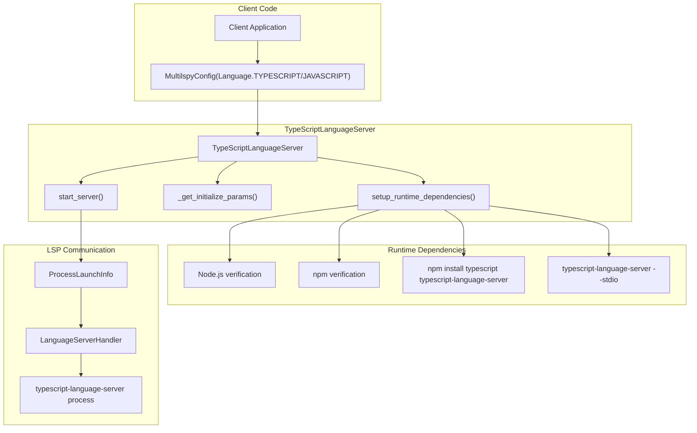
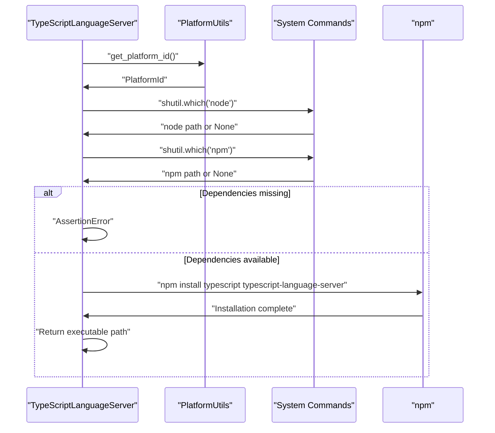
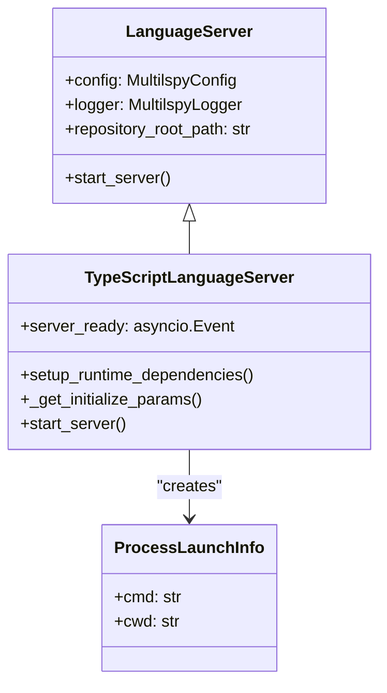
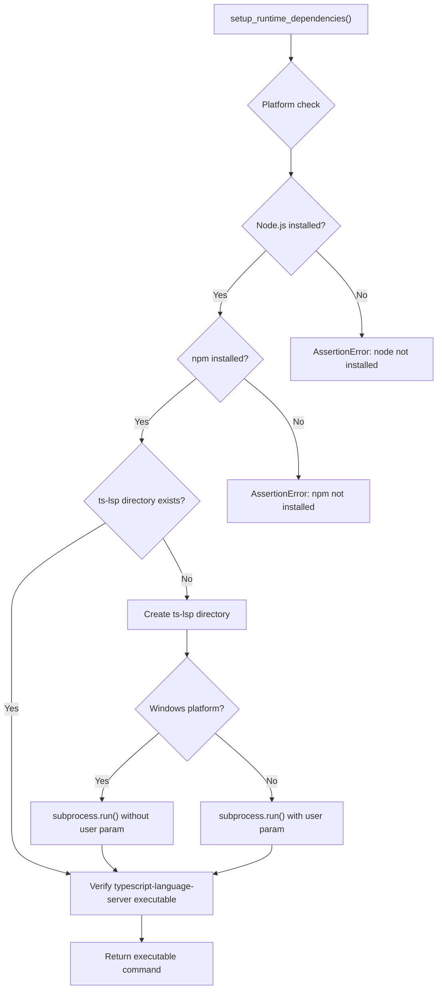
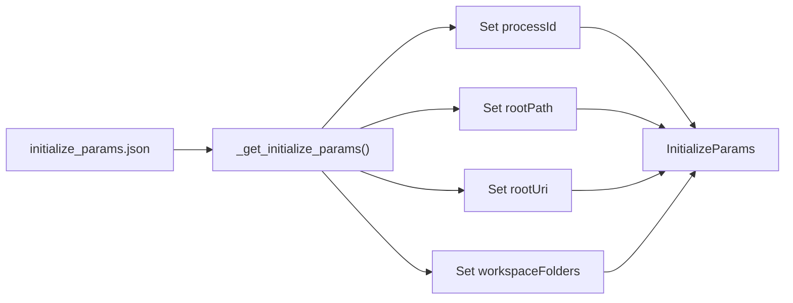
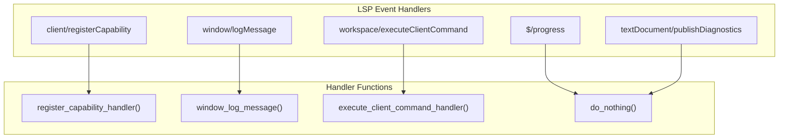

<!-- source: DeepWiki mcp.deepwiki.com · repo microsoft/multilspy · page 3.6 TypeScript/JavaScript Language Server · fetched 2026-10-26 -->

# TypeScript/JavaScript Language Server

<details>
<summary>Relevant source files</summary>

The following files were used as context for generating this wiki page:

- [src/multilspy/language_servers/typescript_language_server/typescript_language_server.py](src/multilspy/language_servers/typescript_language_server/typescript_language_server.py)
- [tests/multilspy/test_multilspy_javascript.py](tests/multilspy/test_multilspy_javascript.py)
- [tests/multilspy/test_multilspy_typescript.py](tests/multilspy/test_multilspy_typescript.py)
- [tests/multilspy/test_sync_multilspy_javascript.py](tests/multilspy/test_sync_multilspy_javascript.py)

</details>


This page documents multilspy's TypeScript and JavaScript language support implementation through the `typescript-language-server` npm package. This implementation provides LSP capabilities for both TypeScript and JavaScript codebases by managing Node.js dependencies and configuring the language server for optimal performance.

For general language server architecture concepts, see [Core Architecture](#2). For information about other language implementations, see [Language Server Implementations](#3).

## Architecture Overview

The TypeScript/JavaScript language server implementation follows multilspy's standard pattern while managing Node.js-specific runtime dependencies. The system automatically downloads and configures the required npm packages when needed.



**Sources:** [src/multilspy/language_servers/typescript_language_server/typescript_language_server.py:28-44]()

## Runtime Dependency Management

The TypeScript language server requires Node.js and npm to be installed on the system. The `setup_runtime_dependencies` method handles dependency verification and package installation.

### Dependency Verification Process



The dependency management process performs these steps:

| Step | Description | Implementation |
|------|-------------|----------------|
| Platform Check | Validates supported platforms | [typescript_language_server.py:51-62]() |
| Node.js Verification | Ensures Node.js is installed and in PATH | [typescript_language_server.py:73-74]() |
| npm Verification | Ensures npm is installed and in PATH | [typescript_language_server.py:75-76]() |
| Package Installation | Installs TypeScript and language server packages | [typescript_language_server.py:78-103]() |
| Executable Path | Returns command to launch language server | [typescript_language_server.py:105-107]() |

**Sources:** [src/multilspy/language_servers/typescript_language_server/typescript_language_server.py:47-107]()

## TypeScriptLanguageServer Class

The `TypeScriptLanguageServer` class extends the base `LanguageServer` class and provides TypeScript-specific configuration and initialization.

### Class Structure



### Key Methods

The `TypeScriptLanguageServer` class implements several key methods:

- `setup_runtime_dependencies()`: Manages Node.js dependency installation
- `_get_initialize_params()`: Configures LSP initialization parameters
- `start_server()`: Handles server startup and capability registration

**Sources:** [src/multilspy/language_servers/typescript_language_server/typescript_language_server.py:28-203]()

## Platform Support and Installation

The TypeScript language server supports multiple platforms with platform-specific installation handling.

### Supported Platforms

| Platform | Platform ID | Special Handling |
|----------|-------------|------------------|
| Linux x64 | `LINUX_x64` | Unix user permissions |
| Linux ARM64 | `LINUX_arm64` | Unix user permissions |
| macOS x64 | `OSX_x64` | Unix user permissions |
| macOS ARM64 | `OSX_arm64` | Unix user permissions |
| Windows x64 | `WIN_x64` | No user parameter in subprocess |
| Windows ARM64 | `WIN_arm64` | No user parameter in subprocess |

### Platform-Specific Installation



**Sources:** [src/multilspy/language_servers/typescript_language_server/typescript_language_server.py:82-103]()

## Initialization and Configuration

The TypeScript language server uses specific initialization parameters and capability configurations to optimize performance for TypeScript and JavaScript projects.

### Initialize Parameters

The `_get_initialize_params` method loads configuration from `initialize_params.json` and customizes it for the specific repository:



### Server Capabilities

During initialization, the server validates specific TypeScript language server capabilities:

| Capability | Expected Value | Purpose |
|------------|----------------|---------|
| `textDocumentSync` | `2` | Incremental document synchronization |
| `completionProvider.triggerCharacters` | `['.', '"', "'", '/', '@', '<']` | Auto-completion triggers |
| `completionProvider.resolveProvider` | `true` | Completion item resolution support |

**Sources:** [src/multilspy/language_servers/typescript_language_server/typescript_language_server.py:109-131](), [src/multilspy/language_servers/typescript_language_server/typescript_language_server.py:184-190]()

## Event Handling and Notifications

The `start_server` method registers several LSP event handlers for TypeScript-specific functionality:

### LSP Event Handlers



**Sources:** [src/multilspy/language_servers/typescript_language_server/typescript_language_server.py:148-171]()

## Usage Examples

The TypeScript language server supports both TypeScript and JavaScript projects through the same implementation.

### TypeScript Usage

```python
# From test case
code_language = Language.TYPESCRIPT
lsp = LanguageServer.create(config, logger, source_directory)

async with lsp.start_server():
    # Request definition for TypeScript file
    result = await lsp.request_definition("packages/server/src/core/router.ts", 194, 8)
    # Request references
    result = await lsp.request_references("packages/server/src/core/router.ts", 194, 8)
```

### JavaScript Usage

```python
# From test case  
code_language = Language.JAVASCRIPT
lsp = SyncLanguageServer.create(config, logger, source_directory)

with lsp.start_server():
    # Request definition for JavaScript file
    result = lsp.request_definition("lib/csv/csv.js", 108, 3)
    # Request references
    result = lsp.request_references("lib/csv/csv.js", 108, 3)
```

**Sources:** [tests/multilspy/test_multilspy_typescript.py:14-54](), [tests/multilspy/test_multilspy_javascript.py:10-54](), [tests/multilspy/test_sync_multilspy_javascript.py:10-49]()

---

