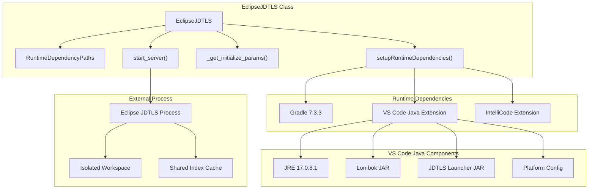
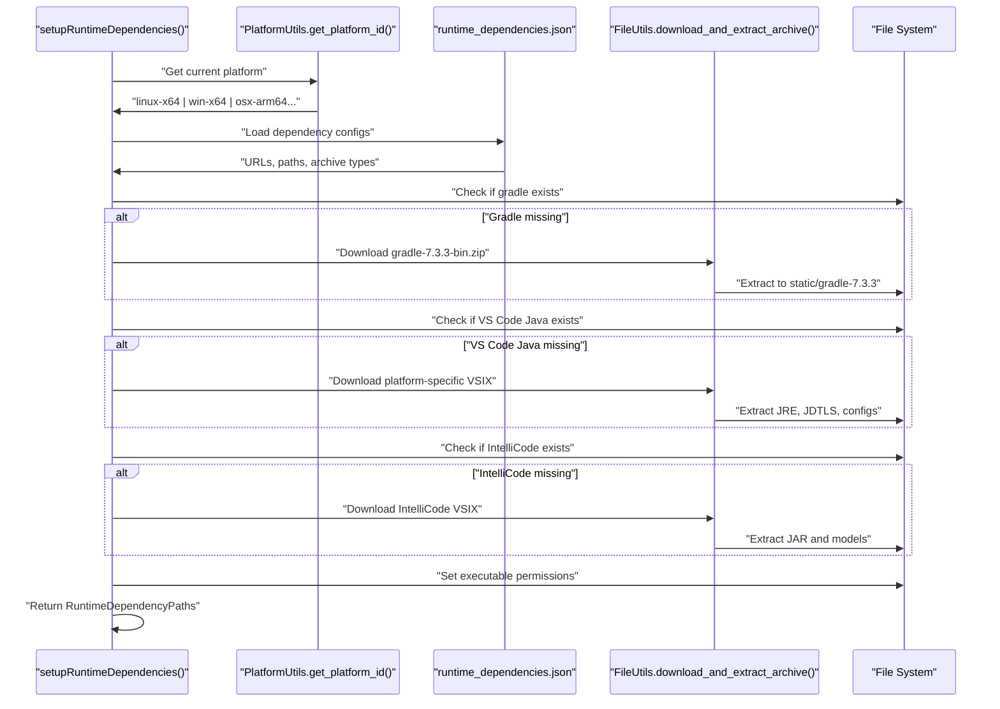
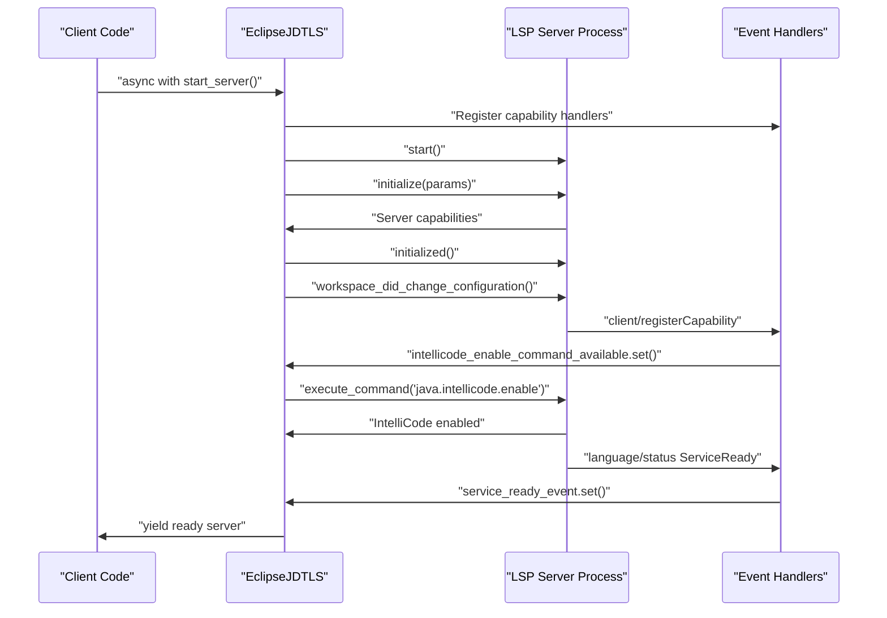

<!-- source: DeepWiki mcp.deepwiki.com · repo microsoft/multilspy · page 3.7 Java Support (Eclipse JDTLS) · fetched 2026-10-26 -->

# Java Support (Eclipse JDTLS)

<details>
<summary>Relevant source files</summary>

The following files were used as context for generating this wiki page:

- [src/multilspy/language_servers/eclipse_jdtls/eclipse_jdtls.py](src/multilspy/language_servers/eclipse_jdtls/eclipse_jdtls.py)
- [src/multilspy/language_servers/eclipse_jdtls/runtime_dependencies.json](src/multilspy/language_servers/eclipse_jdtls/runtime_dependencies.json)
- [src/multilspy/language_servers/rust_analyzer/runtime_dependencies.json](src/multilspy/language_servers/rust_analyzer/runtime_dependencies.json)
- [src/multilspy/language_servers/rust_analyzer/rust_analyzer.py](src/multilspy/language_servers/rust_analyzer/rust_analyzer.py)

</details>


This document covers multilspy's Java language support implementation through Eclipse JDT Language Server (JDTLS). It details the complex dependency management, initialization process, and runtime configuration required for Java development tooling.

For general language server architecture, see [Core Architecture](#2). For basic usage patterns, see [Using multilspy](#4).

## Overview

The `EclipseJDTLS` class provides Java language support by managing the Eclipse JDT Language Server, which offers features like code completion, symbol navigation, and diagnostics for Java projects. This implementation handles complex dependency management including Java runtime, Gradle build tool, Lombok annotation processing, and Microsoft IntelliCode integration.

**Key Components:**
- `EclipseJDTLS` class extending `LanguageServer`
- `RuntimeDependencyPaths` dataclass for dependency tracking
- Platform-specific dependency resolution
- Workspace isolation and configuration management

Sources: [src/multilspy/language_servers/eclipse_jdtls/eclipse_jdtls.py:44-47]()

## Architecture Overview



Sources: [src/multilspy/language_servers/eclipse_jdtls/eclipse_jdtls.py:28-42](), [src/multilspy/language_servers/eclipse_jdtls/eclipse_jdtls.py:142-241]()

## Runtime Dependencies

The Java language server requires multiple platform-specific dependencies managed through the `runtime_dependencies.json` configuration:

| Component | Purpose | Platform Variants |
|-----------|---------|------------------|
| **Gradle** | Build tool for Java projects | Platform-agnostic v7.3.3 |
| **VS Code Java Extension** | Contains JRE, JDTLS, configs | darwin-arm64, osx-arm64, osx-x64, linux-arm64, linux-x64, win-x64 |
| **IntelliCode** | AI-assisted code completion | Platform-agnostic |

### Dependency Resolution Flow



Sources: [src/multilspy/language_servers/eclipse_jdtls/runtime_dependencies.json:1-72](), [src/multilspy/language_servers/eclipse_jdtls/eclipse_jdtls.py:142-241]()

## Implementation Details

### RuntimeDependencyPaths Dataclass

The `RuntimeDependencyPaths` dataclass tracks all required component locations:

```python
@dataclasses.dataclass
class RuntimeDependencyPaths:
    gradle_path: str
    lombok_jar_path: str
    jre_path: str
    jre_home_path: str
    jdtls_launcher_jar_path: str
    jdtls_readonly_config_path: str
    intellicode_jar_path: str
    intellisense_members_path: str
```

Sources: [src/multilspy/language_servers/eclipse_jdtls/eclipse_jdtls.py:28-42]()

### Platform-Specific Configuration

The dependency resolution handles platform differences in the VS Code Java extension structure:

| Platform | JRE Path Pattern | Config Directory |
|----------|------------------|------------------|
| **linux-x64** | `extension/jre/17.0.8.1-linux-x86_64/bin/java` | `config_linux` |
| **win-x64** | `extension/jre/17.0.8.1-win32-x86_64/bin/java.exe` | `config_win` |
| **osx-x64** | `extension/jre/17.0.8.1-macosx-x86_64/bin/java` | `config_mac` |
| **osx-arm64** | Uses x64 JRE with arm64 config | `config_mac_arm` |

Sources: [src/multilspy/language_servers/eclipse_jdtls/runtime_dependencies.json:20-60]()

### JVM Process Configuration

The Eclipse JDTLS process is launched with extensive JVM configuration:

**Memory Settings:**
- `-Xmx3G` - Maximum heap size of 3GB
- `-Xms100m` - Initial heap size of 100MB
- `-XX:+UseParallelGC` - Parallel garbage collection

**Module System Configuration:**
- `--add-modules=ALL-SYSTEM` - Add all system modules
- `--add-opens java.base/java.util=ALL-UNNAMED` - Open java.util for reflection
- `--add-opens java.base/java.lang=ALL-UNNAMED` - Open java.lang for reflection

**Eclipse-Specific Settings:**
- `-Declipse.application=org.eclipse.jdt.ls.core.id1` - Eclipse application ID
- `-Djava.lsp.joinOnCompletion=true` - LSP completion behavior
- `-javaagent:{lombok_jar_path}` - Lombok annotation processing

Sources: [src/multilspy/language_servers/eclipse_jdtls/eclipse_jdtls.py:100-134]()

## Initialization Process

### Workspace Isolation

Each `EclipseJDTLS` instance creates an isolated workspace using UUID-based directory names:

```python
ws_dir = str(PurePath(
    MultilspySettings.get_language_server_directory(),
    "EclipseJDTLS",
    "workspaces", 
    uuid.uuid4().hex,
))
```

**Directory Structure:**
- `data_dir` - Eclipse workspace data
- `config_path` - Instance-specific configuration (copied from readonly)
- `shared_cache_location` - Global shared index cache

Sources: [src/multilspy/language_servers/eclipse_jdtls/eclipse_jdtls.py:58-86]()

### Initialization Parameters

The `_get_initialize_params()` method configures Eclipse JDTLS with:

**Runtime Configuration:**
- Java runtime paths from `RuntimeDependencyPaths`
- Gradle home directory setting
- IntelliCode bundle registration

**Workspace Settings:**
- Project root URI and workspace folders
- Import configurations for Gradle projects
- Bundle loading for extensions

Sources: [src/multilspy/language_servers/eclipse_jdtls/eclipse_jdtls.py:242-305]()

## Server Lifecycle

### Startup Sequence



### Event Handlers

The server registers multiple LSP event handlers:

| Handler | Method | Purpose |
|---------|--------|---------|
| `register_capability_handler` | `client/registerCapability` | Enable completions and commands |
| `lang_status_handler` | `language/status` | Track service readiness |
| `execute_client_command_handler` | `workspace/executeClientCommand` | Handle bundle reload commands |
| `window_log_message` | `window/logMessage` | Log server messages |

Sources: [src/multilspy/language_servers/eclipse_jdtls/eclipse_jdtls.py:307-406]()

### IntelliCode Integration

The startup process includes IntelliCode activation:

1. Wait for `java.intellicode.enable` command registration
2. Execute command with IntelliSense members path
3. Enable AI-assisted code completion features

Sources: [src/multilspy/language_servers/eclipse_jdtls/eclipse_jdtls.py:387-398]()

---

