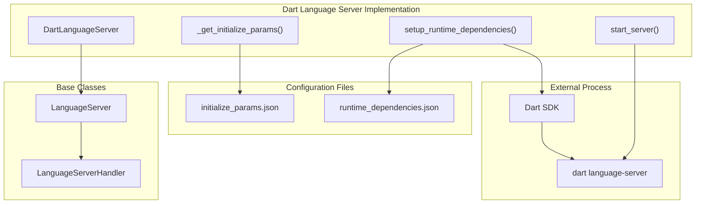
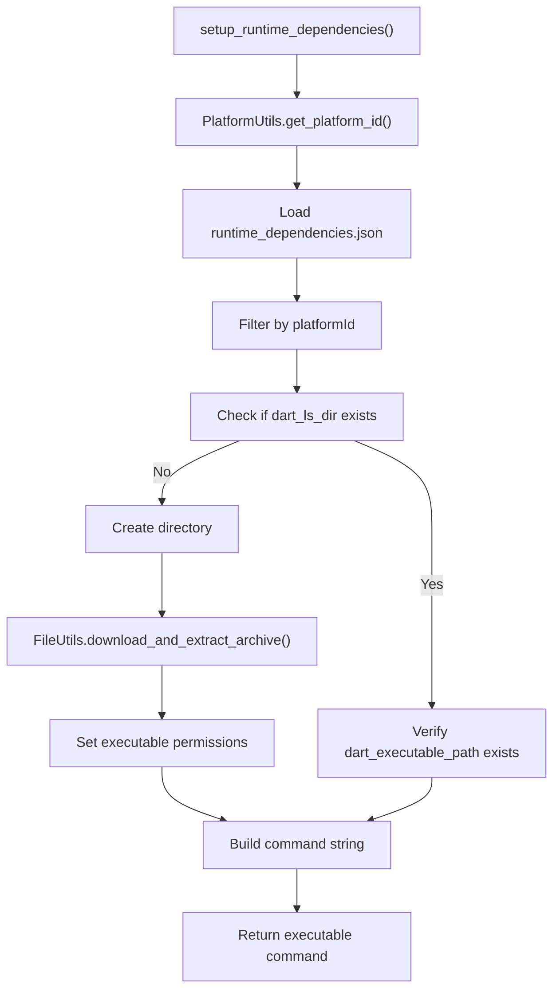
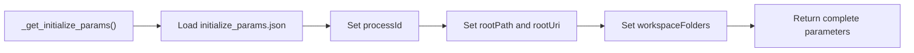
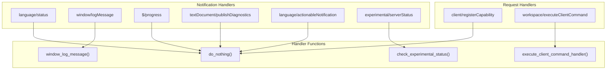
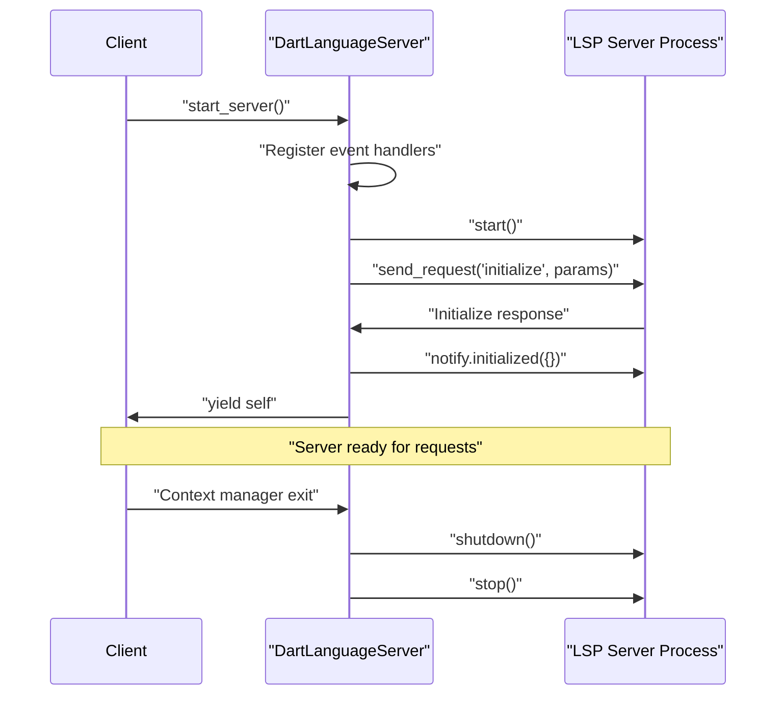
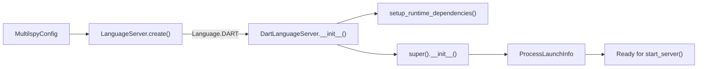
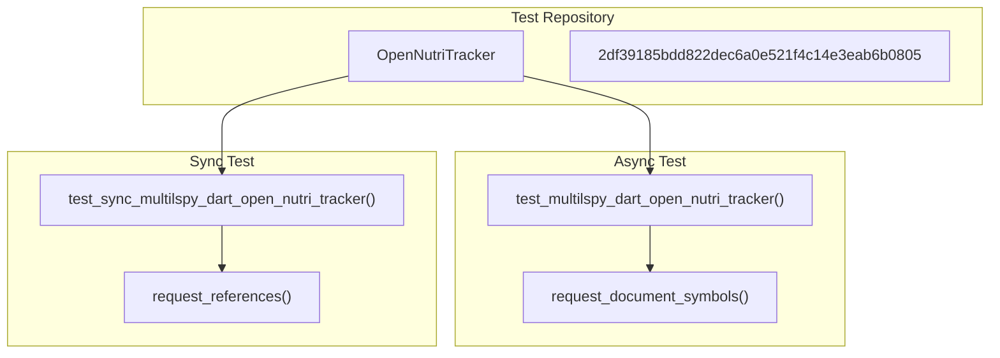

<!-- source: DeepWiki mcp.deepwiki.com · repo microsoft/multilspy · page 3.8 Dart Language Server · fetched 2026-10-26 -->

# Dart Language Server

<details>
<summary>Relevant source files</summary>

The following files were used as context for generating this wiki page:

- [src/multilspy/language_servers/dart_language_server/dart_language_server.py](src/multilspy/language_servers/dart_language_server/dart_language_server.py)
- [src/multilspy/language_servers/dart_language_server/initialize_params.json](src/multilspy/language_servers/dart_language_server/initialize_params.json)
- [src/multilspy/language_servers/dart_language_server/runtime_dependencies.json](src/multilspy/language_servers/dart_language_server/runtime_dependencies.json)
- [tests/multilspy/test_multilspy_dart.py](tests/multilspy/test_multilspy_dart.py)
- [tests/multilspy/test_sync_multilspy_dart.py](tests/multilspy/test_sync_multilspy_dart.py)

</details>


This document covers the Dart language server implementation in multilspy, which provides LSP (Language Server Protocol) support for Dart projects through the official Dart SDK's language server. This implementation handles Dart SDK management, initialization parameters, and Dart-specific LSP communication patterns.

For general language server architecture concepts, see [Core Architecture](#2). For information about other language implementations, see [Language Server Implementations](#3).

## Overview

The `DartLanguageServer` class extends the base `LanguageServer` class to provide Dart-specific functionality. It automatically manages the Dart SDK as a runtime dependency and configures the language server with Dart-specific initialization parameters and event handlers.



**Dart Language Server Architecture**

Sources: [src/multilspy/language_servers/dart_language_server/dart_language_server.py:14-31]()

## Runtime Dependency Management

The Dart language server implementation includes sophisticated runtime dependency management that automatically downloads and configures the Dart SDK for the current platform.

### Dependency Configuration

The runtime dependencies are defined in a JSON configuration file that specifies platform-specific download URLs and binary paths:

| Field | Description | Example Value |
|-------|-------------|---------------|
| `id` | Unique identifier | `"DartLanguageServer"` |
| `description` | Human-readable description | `"Dart Language Server for Linux (x64)"` |
| `url` | Download URL for platform | `"https://storage.googleapis.com/dart-archive/channels/stable/release/3.7.1/sdk/dartsdk-linux-x64-release.zip"` |
| `platformId` | Target platform identifier | `"linux-x64"` |
| `archiveType` | Archive format | `"zip"` |
| `binaryName` | Path to executable within archive | `"dart-sdk/bin/dart"` |



**Runtime Dependency Setup Flow**

Sources: [src/multilspy/language_servers/dart_language_server/dart_language_server.py:33-61](), [src/multilspy/language_servers/dart_language_server/runtime_dependencies.json:1-13]()

### Binary Command Construction

The `setup_runtime_dependencies` method constructs the final executable command by combining the Dart SDK path with language server arguments:

```
{dart_executable_path} language-server --client-id multilspy.dart --client-version 1.2
```

This command launches the Dart language server with multilspy-specific client identification.

Sources: [src/multilspy/language_servers/dart_language_server/dart_language_server.py:61]()

## Initialization Parameters

The Dart language server uses a comprehensive set of initialization parameters that configure its behavior for optimal integration with multilspy.

### Core Initialization Configuration

| Parameter | Value | Purpose |
|-----------|-------|---------|
| `onlyAnalyzeProjectsWithOpenFiles` | `false` | Analyze entire project, not just open files |
| `suggestFromUnimportedLibraries` | `true` | Enable suggestions from unimported libraries |
| `closingLabels` | `false` | Disable closing label annotations |
| `outline` | `false` | Disable outline view |
| `flutterOutline` | `false` | Disable Flutter-specific outline |
| `allowOpenUri` | `false` | Disable URI opening capabilities |



**Parameter Construction Flow**

Sources: [src/multilspy/language_servers/dart_language_server/dart_language_server.py:64-90](), [src/multilspy/language_servers/dart_language_server/initialize_params.json:1-23]()

## LSP Communication and Event Handling

The `DartLanguageServer` implements several Dart-specific LSP event handlers to manage the communication protocol effectively.

### Request and Notification Handlers

The server registers handlers for various LSP requests and notifications during startup:



**Dart LSP Event Handler Registration**

### Server Lifecycle Management

The `start_server` method implements the complete server lifecycle with proper initialization and cleanup:



**Dart Language Server Lifecycle**

Sources: [src/multilspy/language_servers/dart_language_server/dart_language_server.py:92-147]()

## Integration with Multilspy Framework

The `DartLanguageServer` integrates with the multilspy framework through the standard `LanguageServer.create()` factory method and follows the established patterns for language server implementations.

### Factory Integration



**Factory Pattern Integration**

### Testing and Usage Examples

The implementation is thoroughly tested with both asynchronous and synchronous interfaces:



**Test Coverage Structure**

The tests validate core LSP functionality including document symbol extraction and reference finding across Dart source files.

Sources: [tests/multilspy/test_multilspy_dart.py:15-77](), [tests/multilspy/test_sync_multilspy_dart.py:11-64]()

---

