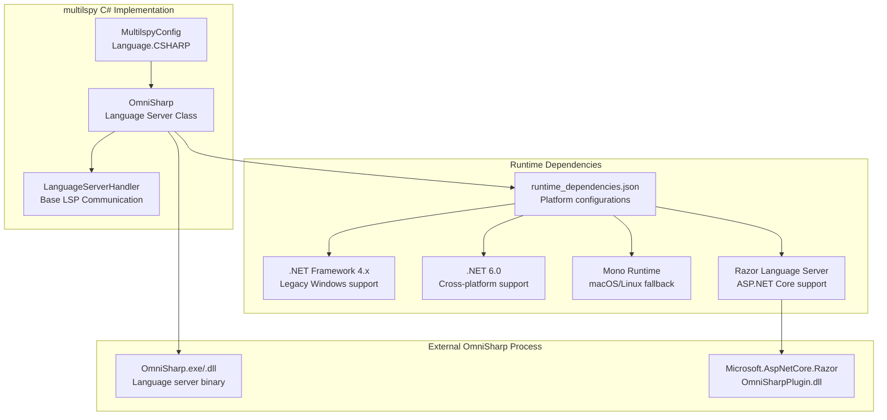
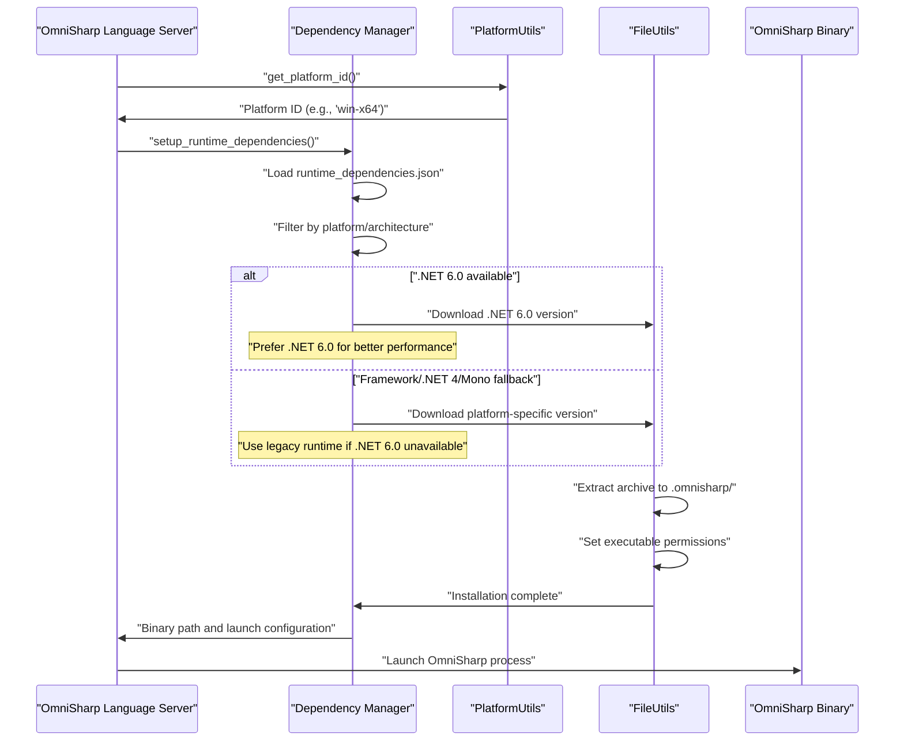
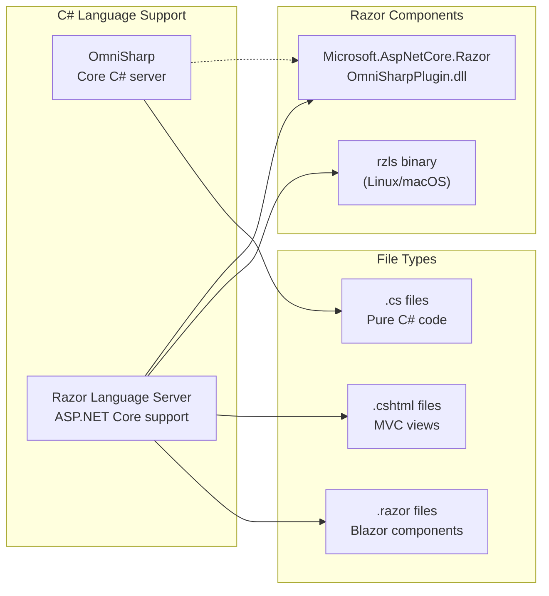
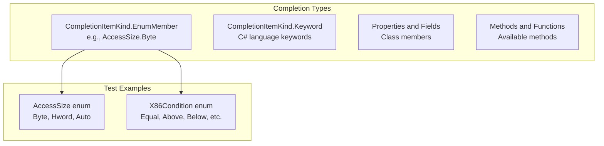

<!-- source: DeepWiki mcp.deepwiki.com · repo microsoft/multilspy · page 3.9 C# Support (OmniSharp) · fetched 2026-10-26 -->

# C# Support (OmniSharp)

<details>
<summary>Relevant source files</summary>

The following files were used as context for generating this wiki page:

- [src/multilspy/language_servers/omnisharp/runtime_dependencies.json](src/multilspy/language_servers/omnisharp/runtime_dependencies.json)
- [tests/multilspy/test_multilspy_csharp.py](tests/multilspy/test_multilspy_csharp.py)
- [tests/multilspy/test_sync_multilspy_csharp.py](tests/multilspy/test_sync_multilspy_csharp.py)

</details>


This document covers multilspy's implementation of C# language support through the OmniSharp language server. It details the runtime dependency management, platform-specific configurations, and LSP capabilities available for C# codebases.

For general language server architecture information, see [Core Architecture](#2). For information about other supported languages, see [Supported Languages](#1.2).

## OmniSharp Language Server Overview

The C# support in multilspy is implemented through the `OmniSharp` class, which extends the base `LanguageServer` functionality to work with Microsoft's OmniSharp language server. OmniSharp provides comprehensive C# language features including IntelliSense, go-to-definition, find references, and code completion.



**Sources:** [src/multilspy/language_servers/omnisharp/runtime_dependencies.json:1-441](), [tests/multilspy/test_multilspy_csharp.py:1-145]()

## Runtime Dependencies and Platform Support

The OmniSharp implementation includes sophisticated cross-platform dependency management through a comprehensive runtime dependencies configuration. The system supports multiple .NET runtime versions and platform combinations.

### Platform and Architecture Matrix

| Platform | Architecture | .NET Framework 4 | .NET 6.0 | Mono | Binary Name |
|----------|-------------|------------------|----------|------|-------------|
| Windows  | x86         | ✓               | ✓        | ✗    | `OmniSharp.exe` |
| Windows  | x64         | ✓               | ✓        | ✗    | `OmniSharp.exe` |
| Windows  | arm64       | ✓               | ✓        | ✗    | `OmniSharp.exe` |
| macOS    | x64         | ✗               | ✓        | ✓    | `run` (Mono) |
| macOS    | arm64       | ✗               | ✓        | ✓    | `run` (Mono) |
| Linux    | x86         | ✗               | ✗        | ✓    | `run` |
| Linux    | x64         | ✗               | ✓        | ✓    | `OmniSharp` |
| Linux    | arm64       | ✗               | ✓        | ✓    | `run` |
| Linux musl| x64        | ✗               | ✓        | ✗    | `OmniSharp.dll` |
| Linux musl| arm64      | ✗               | ✓        | ✗    | `OmniSharp.dll` |

**Sources:** [src/multilspy/language_servers/omnisharp/runtime_dependencies.json:1-441]()

### Dependency Resolution Process



**Sources:** [src/multilspy/language_servers/omnisharp/runtime_dependencies.json:2-441]()

## OmniSharp Version and Configuration

The current implementation uses **OmniSharp version 1.39.13** across all platforms. Each runtime dependency entry includes integrity hashes for security verification and specific installation paths to avoid conflicts between different .NET versions.

### Installation Paths Structure

```
.omnisharp/
├── 1.39.13/                    # .NET Framework 4 / Mono versions
│   ├── OmniSharp.exe           # Windows executable
│   ├── run                     # Unix shell script
│   └── mono.{platform}         # Platform-specific Mono runtime
└── 1.39.13-net6.0/            # .NET 6.0 versions
    ├── OmniSharp.dll           # Cross-platform .NET assembly
    └── OmniSharp               # Linux native executable
```

**Sources:** [src/multilspy/language_servers/omnisharp/runtime_dependencies.json:8-227]()

## Razor Language Server Integration

The OmniSharp implementation includes support for ASP.NET Core Razor pages through a separate Razor Language Server component. This provides enhanced IntelliSense and language features for `.razor` and `.cshtml` files.



**Sources:** [src/multilspy/language_servers/omnisharp/runtime_dependencies.json:302-439]()

## Supported LSP Capabilities

The OmniSharp implementation supports the core LSP capabilities tested in the multilspy test suite:

### Core Language Features

| Feature | Method | Test Coverage |
|---------|--------|---------------|
| Go to Definition | `request_definition()` | ✓ |
| Find References | `request_references()` | ✓ |
| Code Completion | `request_completions()` | ✓ |
| File Management | `open_file()`, `delete_text_between_positions()` | ✓ |

### Completion Support

The completion system supports various C# language constructs:



**Sources:** [tests/multilspy/test_multilspy_csharp.py:113-144](), [tests/multilspy/test_sync_multilspy_csharp.py:29-64]()

## Usage Example

The following demonstrates typical usage patterns for the C# language server:

```python
# Asynchronous usage
async with lsp.start_server():
    # Request definition for a symbol
    result = await lsp.request_definition("src/Example.cs", 176, 44)
    
    # Find all references to a symbol  
    references = await lsp.request_references("src/Constants.cs", 15, 40)
    
    # Get code completions with file management
    with lsp.open_file("src/CodeGenerator.cs"):
        completions = await lsp.request_completions("src/CodeGenerator.cs", 1352, 21)
        enum_completions = [c["completionText"] for c in completions 
                           if c["kind"] == CompletionItemKind.EnumMember]
```

**Sources:** [tests/multilspy/test_multilspy_csharp.py:34-115](), [tests/multilspy/test_sync_multilspy_csharp.py:24-38]()

## Integration with multilspy Architecture

The OmniSharp implementation follows the standard multilspy language server pattern, integrating with the core `LanguageServerHandler` and supporting both synchronous and asynchronous APIs through `SyncLanguageServer` and `LanguageServer` respectively.

**Sources:** [tests/multilspy/test_multilspy_csharp.py:7-29](), [tests/multilspy/test_sync_multilspy_csharp.py:7-24]()

---

