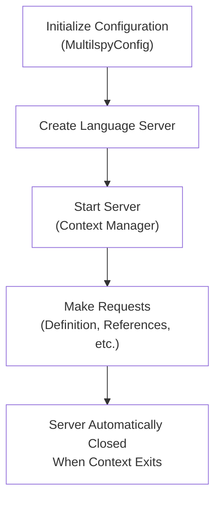
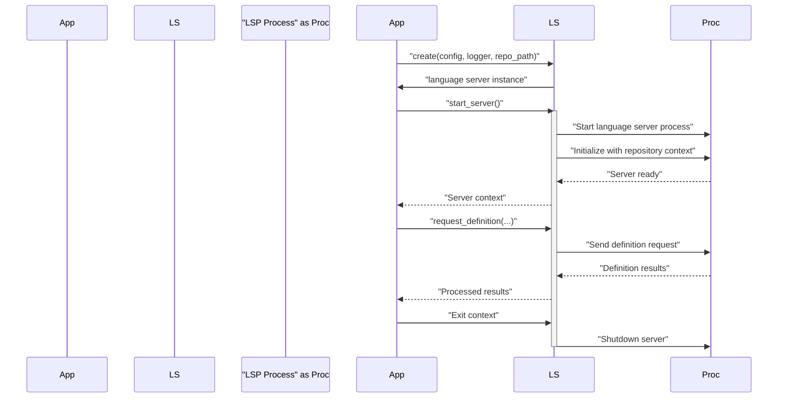

<!-- source: DeepWiki mcp.deepwiki.com · repo microsoft/multilspy · page 4 Using multilspy · fetched 2026-10-26 -->

# Using multilspy

<details>
<summary>Relevant source files</summary>

The following files were used as context for generating this wiki page:

- [.github/workflows/test-workflow.yaml](.github/workflows/test-workflow.yaml)
- [src/multilspy/language_server.py](src/multilspy/language_server.py)
- [tests/multilspy/test_multilspy_kotlin.py](tests/multilspy/test_multilspy_kotlin.py)
- [tests/multilspy/test_sync_multilspy_kotlin.py](tests/multilspy/test_sync_multilspy_kotlin.py)

</details>


This page provides detailed information about how to use multilspy in real applications. It covers practical usage patterns, initialization, and making various language server requests. For language-specific implementation details, see [Language Server Implementations](#3).

## Overview of multilspy Usage

multilspy provides both synchronous and asynchronous APIs for interacting with language servers. The primary workflow involves:

1. Creating and configuring a language server instance
2. Starting the server
3. Making requests to the server (definitions, references, completions, etc.)
4. Properly closing the server when finished



Sources: [README.md:54-95]()

## Setting Up multilspy

Before making any requests, you need to initialize the configuration and create a language server instance.

### Basic Setup

```python
from multilspy import SyncLanguageServer
from multilspy.multilspy_config import MultilspyConfig
from multilspy.multilspy_logger import MultilspyLogger

# Create configuration
config = MultilspyConfig.from_dict({"code_language": "java"})

# Create logger
logger = MultilspyLogger()

# Create language server
lsp = SyncLanguageServer.create(config, logger, "/path/to/repository/root")
```

The configuration can specify various parameters, with `code_language` being the most important one. Supported languages include:

| Language | Server Used |
|----------|-------------|
| java | Eclipse JDTLS |
| python | jedi-language-server |
| rust | Rust Analyzer |
| csharp | OmniSharp / RazorSharp |
| typescript | TypeScriptLanguageServer |
| javascript | TypeScriptLanguageServer |
| go | gopls |
| dart | Dart |
| ruby | Solargraph |
| kotlin | KotlinLanguageServer |
| cpp | clangd |

Sources: [README.md:38-52](), [README.md:54-63]()

## Synchronous vs. Asynchronous API

multilspy offers both synchronous and asynchronous interfaces to accommodate different application requirements.

```mermaid
classDiagram
    class "SyncLanguageServer" {
        +create(config, logger, repository_root_path)
        +start_server()
        +request_definition(filepath, line, column)
        +request_references(filepath, line, column)
        +request_completions(filepath, line, column)
        +request_document_symbols(filepath)
        +request_hover(filepath, line, column)
    }
    
    class "LanguageServer" {
        +create(config, logger, repository_root_path)
        +start_server()
        +request_definition(filepath, line, column)
        +request_references(filepath, line, column)
        +request_completions(filepath, line, column)
        +request_document_symbols(filepath)
        +request_hover(filepath, line, column)
    }
    
    "SyncLanguageServer" --> "LanguageServer" : wraps
```

### Synchronous API Example

```python
from multilspy import SyncLanguageServer

# Setup config and logger as shown previously
lsp = SyncLanguageServer.create(config, logger, "/path/to/repository/root")

with lsp.start_server():
    # All server requests are synchronous
    result = lsp.request_definition("path/to/file.java", 10, 15)
    # Process result
```

### Asynchronous API Example

```python
import asyncio
from multilspy import LanguageServer

# Setup config and logger as shown previously
lsp = LanguageServer.create(config, logger, "/path/to/repository/root")

async def main():
    async with lsp.start_server():
        # All server requests are asynchronous
        result = await lsp.request_definition("path/to/file.java", 10, 15)
        # Process result

asyncio.run(main())
```

Sources: [README.md:54-95]()

## Server Lifecycle Management

multilspy uses context managers to handle server lifecycle, ensuring proper startup and shutdown of language servers.



Sources: [README.md:54-95](), [tests/multilspy/test_multilspy_clangd.py:35-71]()

## Making Language Server Requests

multilspy provides several methods to access language server capabilities.

### Finding Definitions

Find where a symbol is defined:

```python
# Synchronous
with lsp.start_server():
    # Find definition of symbol at line 163, column 4
    definitions = lsp.request_definition("path/to/file.java", 163, 4)
    for definition in definitions:
        print(f"Definition found in {definition['relativePath']} at line {definition['range']['start']['line']}")

# Asynchronous
async with lsp.start_server():
    definitions = await lsp.request_definition("path/to/file.java", 163, 4)
```

### Finding References

Find all references to a symbol:

```python
with lsp.start_server():
    references = lsp.request_references("path/to/file.java", 163, 4)
    for reference in references:
        print(f"Reference found in {reference['relativePath']} at line {reference['range']['start']['line']}")
```

### Getting Completions

Get code completion suggestions at a specific location:

```python
with lsp.start_server():
    completions = lsp.request_completions("path/to/file.java", 163, 4)
    for completion in completions:
        print(f"Completion: {completion['label']} - {completion['detail']}")
```

### Getting Document Symbols

Retrieve all symbols defined in a file:

```python
with lsp.start_server():
    symbols = lsp.request_document_symbols("path/to/file.java")
    for symbol in symbols:
        print(f"Symbol: {symbol['name']} ({symbol['kind']}) at line {symbol['range']['start']['line']}")
```

### Getting Hover Information

Get hover information for a symbol:

```python
with lsp.start_server():
    hover_info = lsp.request_hover("path/to/file.java", 163, 4)
    if hover_info and 'contents' in hover_info:
        print(f"Hover info: {hover_info['contents']}")
```

Sources: [README.md:54-82](), [tests/multilspy/test_multilspy_clangd.py:35-71]()

## Language-Specific Examples

### C/C++ with clangd

When working with C/C++ projects using clangd, you need to ensure that a `compile_commands.json` file exists in the project root. This file helps clangd understand how the project is compiled.

```python
import os
from multilspy import LanguageServer
from multilspy.multilspy_config import MultilspyConfig, Language

# Create configuration for C++
config = MultilspyConfig.from_dict({"code_language": Language.CPP})
logger = MultilspyLogger()

# Ensure compile_commands.json exists
def create_compile_commands_file(source_directory_path):
    cwd = os.getcwd()
    os.chdir(source_directory_path)
    os.system('cmake -DCMAKE_EXPORT_COMPILE_COMMANDS=1 -S . -B build')
    os.system('cmake --build build')
    os.system('ln -s build/compile_commands.json .')
    os.chdir(cwd)

# Create compile_commands.json if needed
create_compile_commands_file("/path/to/cpp/project")

# Create and use language server
lsp = LanguageServer.create(config, logger, "/path/to/cpp/project")
async with lsp.start_server():
    # Make requests as shown in previous examples
```

Sources: [tests/multilspy/test_multilspy_clangd.py:15-33](), [tests/multilspy/test_multilspy_clangd.py:35-71]()

## Advanced Usage Patterns

### Working with Files in Context

multilspy provides an `open_file` context manager for operations on specific files:

```python
with lsp.start_server():
    with lsp.open_file("path/to/file.java"):
        # Make requests on the opened file
        symbols = lsp.request_document_symbols("path/to/file.java")
```

### Error Handling

It's important to handle potential errors when working with language servers:

```python
try:
    with lsp.start_server():
        result = lsp.request_definition("path/to/file.java", 163, 4)
except Exception as e:
    print(f"Language server error: {e}")
    # Handle the error appropriately
```

Sources: [README.md:54-95]()

## Application in AI4Code Scenarios

multilspy has been successfully used in AI-assisted code generation and maintenance contexts, including:

1. **Monitor-Guided Decoding**: Using multilspy to find results of static analyses to guide the token-by-token generation of code with LLMs, ensuring all generated identifiers are valid in the repository context.

2. **Test Repair**: Using multilspy to gather static information about code to help repair test cases.

3. **Repository-Level Coding Agents**: Using multilspy to gather repository-wide context for AI agents that work with entire codebases.

Sources: [README.md:102-110]()

---

