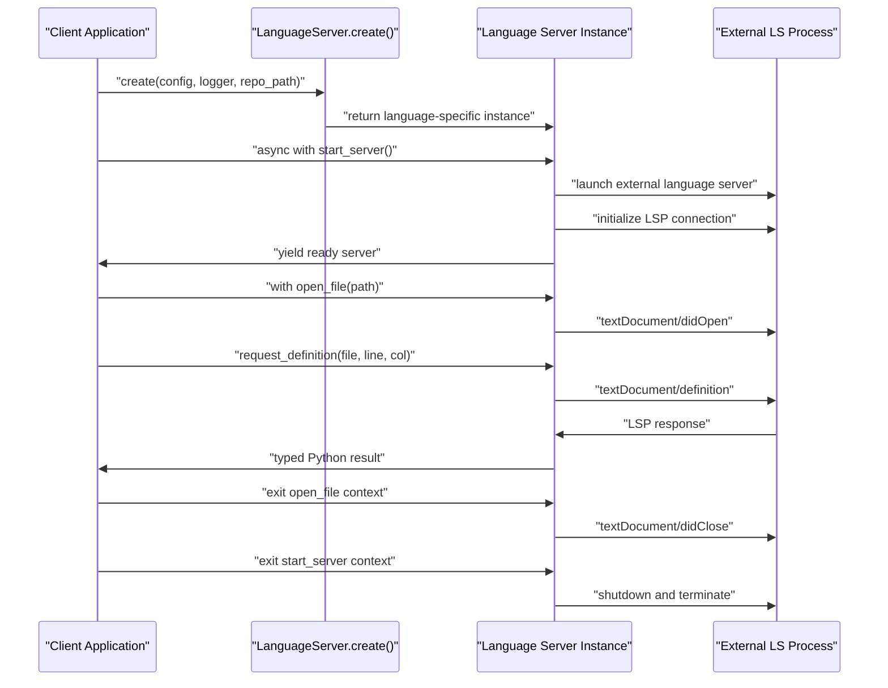
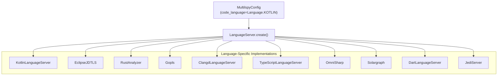
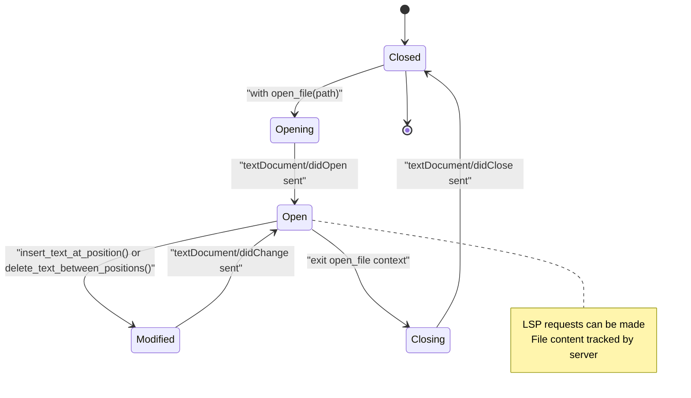

<!-- source: DeepWiki mcp.deepwiki.com · repo microsoft/multilspy · page 4.1 Basic Usage · fetched 2026-10-26 -->

# Basic Usage

<details>
<summary>Relevant source files</summary>

The following files were used as context for generating this wiki page:

- [src/multilspy/language_server.py](src/multilspy/language_server.py)
- [tests/multilspy/test_multilspy_csharp.py](tests/multilspy/test_multilspy_csharp.py)
- [tests/multilspy/test_sync_multilspy_csharp.py](tests/multilspy/test_sync_multilspy_csharp.py)

</details>


This document covers the fundamental workflow for using multilspy to interact with language servers. It explains how to create language server instances, manage their lifecycle, and perform basic operations like opening files and making LSP requests.

For advanced LSP operations like definitions and references, see [Working with Definitions and References](#4.2). For configuration options, see [Configuration System](#1.3). For language-specific setup requirements, see [Language Server Implementations](#3).

## Core Workflow Overview

The basic multilspy workflow follows a consistent pattern regardless of the target programming language. The process involves creating a language server instance, starting the server process, opening files, and making LSP requests.

**Basic Multilspy Workflow**


Sources: [src/multilspy/language_server.py:182-198](), [src/multilspy/language_server.py:202-254]()

## Creating Language Server Instances

Language server instances are created using the factory method `LanguageServer.create()` or `SyncLanguageServer.create()`. The factory automatically selects the appropriate language-specific implementation based on the configuration.

**Language Server Factory Pattern**


### Asynchronous Interface

```python
from multilspy import LanguageServer
from multilspy.multilspy_config import MultilspyConfig, Language
from multilspy.multilspy_logger import MultilspyLogger

# Create configuration
config = MultilspyConfig(code_language=Language.KOTLIN)
logger = MultilspyLogger()

# Create language server instance
lsp = LanguageServer.create(config, logger, "/path/to/repository")
```

### Synchronous Interface

```python
from multilspy import SyncLanguageServer

# Create synchronous wrapper
sync_lsp = SyncLanguageServer.create(config, logger, "/path/to/repository")
```

The factory method maps `Language` enum values to specific implementation classes. Each language server implementation handles its own dependency management and initialization requirements.

Sources: [src/multilspy/language_server.py:62-128](), [src/multilspy/language_server.py:702-717]()

## Server Lifecycle Management

Language servers must be explicitly started and stopped using context managers. This ensures proper initialization of the external language server process and clean shutdown when operations complete.

### Asynchronous Server Management

```python
async with lsp.start_server():
    # Server is running and ready for requests
    result = await lsp.request_definition("src/Main.kt", 10, 5)
    # Server automatically shuts down on context exit
```

### Synchronous Server Management

```python
with sync_lsp.start_server():
    # Server is running and ready for requests  
    result = sync_lsp.request_definition("src/Main.kt", 10, 5)
    # Server automatically shuts down on context exit
```

The `start_server()` context manager handles the complete server lifecycle including process startup, LSP initialization handshake, and graceful shutdown.

Sources: [src/multilspy/language_server.py:181-198](), [src/multilspy/language_server.py:762-778]()

## File Management

Before making any LSP requests for a specific file, that file must be opened using the `open_file()` context manager. This informs the language server about the file content and enables accurate analysis.

**File Lifecycle Management**


### Opening Files

```python
with lsp.open_file("src/Example.kt"):
    # File is now open in the language server
    # Can make LSP requests for this file
    definitions = await lsp.request_definition("src/Example.kt", 15, 20)
    # File automatically closed on context exit
```

The `open_file()` method uses reference counting to handle nested contexts efficiently. Multiple contexts can open the same file, and the file is only closed when all references are released.

### File Content Management

Multilspy maintains an in-memory buffer (`LSPFileBuffer`) for each open file, tracking content changes and version numbers:

```python
# Read current file content as known by language server
content = lsp.get_open_file_text("src/Example.kt")

# Insert text and get updated cursor position
new_position = lsp.insert_text_at_position("src/Example.kt", 10, 5, "new code")

# Delete text between positions
deleted_text = lsp.delete_text_between_positions("src/Example.kt", start_pos, end_pos)
```

Sources: [src/multilspy/language_server.py:202-254](), [src/multilspy/language_server.py:34-54](), [src/multilspy/language_server.py:255-305]()

## Making Basic LSP Requests

Once a language server is started and files are opened, you can make various LSP requests. All request methods return typed Python objects rather than raw LSP protocol responses.

### Available Request Types

| Method | Purpose | Returns |
|--------|---------|---------|
| `request_definition()` | Find symbol definitions | `List[Location]` |
| `request_references()` | Find symbol references | `List[Location]` |  
| `request_completions()` | Get code completions | `List[CompletionItem]` |
| `request_document_symbols()` | Get file symbols | `Tuple[List[UnifiedSymbolInformation], TreeRepr]` |
| `request_hover()` | Get hover information | `Hover` or `None` |
| `request_workspace_symbol()` | Search workspace symbols | `List[UnifiedSymbolInformation]` or `None` |

### Example Request Usage

```python
# Find where a symbol is defined
definitions = await lsp.request_definition("src/Main.kt", 25, 10)
for definition in definitions:
    print(f"Defined in {definition['relativePath']} at line {definition['range']['start']['line']}")

# Find all references to a symbol  
references = await lsp.request_references("src/Main.kt", 25, 10)
print(f"Found {len(references)} references")

# Get code completions at cursor position
completions = await lsp.request_completions("src/Main.kt", 30, 15)
for item in completions:
    print(f"Completion: {item['completionText']}")
```

All requests require the file to be opened first and use zero-based line and column numbers following LSP conventions.

Sources: [src/multilspy/language_server.py:367-442](), [src/multilspy/language_server.py:444-490](), [src/multilspy/language_server.py:492-584]()

## Complete Usage Example

Here's a complete example demonstrating the full workflow with error handling:

### Asynchronous Example

```python
import asyncio
from multilspy import LanguageServer
from multilspy.multilspy_config import MultilspyConfig, Language  
from multilspy.multilspy_logger import MultilspyLogger

async def analyze_code():
    # Setup
    config = MultilspyConfig(code_language=Language.KOTLIN)
    logger = MultilspyLogger()
    lsp = LanguageServer.create(config, logger, "/path/to/kotlin/project")
    
    try:
        async with lsp.start_server():
            with lsp.open_file("src/main/kotlin/Main.kt"):
                # Find definitions
                definitions = await lsp.request_definition("src/main/kotlin/Main.kt", 10, 5)
                print(f"Found {len(definitions)} definitions")
                
                # Get completions
                completions = await lsp.request_completions("src/main/kotlin/Main.kt", 15, 10)
                print(f"Found {len(completions)} completions")
                
    except Exception as e:
        logger.log(f"Error: {e}", logging.ERROR)

# Run the analysis
asyncio.run(analyze_code())
```

### Synchronous Example  

```python
from multilspy import SyncLanguageServer
from multilspy.multilspy_config import MultilspyConfig, Language
from multilspy.multilspy_logger import MultilspyLogger

# Setup
config = MultilspyConfig(code_language=Language.KOTLIN)
logger = MultilspyLogger()
sync_lsp = SyncLanguageServer.create(config, logger, "/path/to/kotlin/project")

try:
    with sync_lsp.start_server():
        with sync_lsp.open_file("src/main/kotlin/Main.kt"):
            # Find definitions
            definitions = sync_lsp.request_definition("src/main/kotlin/Main.kt", 10, 5)
            print(f"Found {len(definitions)} definitions")
            
            # Get completions
            completions = sync_lsp.request_completions("src/main/kotlin/Main.kt", 15, 10)
            print(f"Found {len(completions)} completions")
            
except Exception as e:
    logger.log(f"Error: {e}", logging.ERROR)
```

Sources: [tests/multilspy/test_multilspy_csharp.py:28-35](), [tests/multilspy/test_sync_multilspy_csharp.py:24-28]()

---

