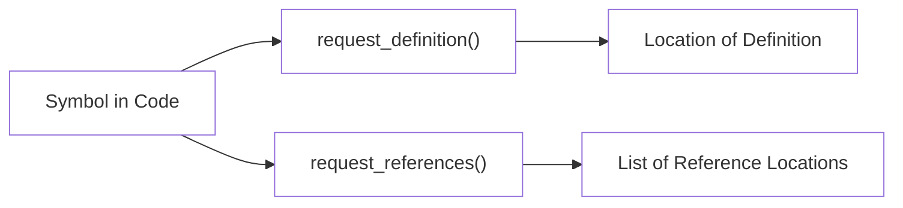
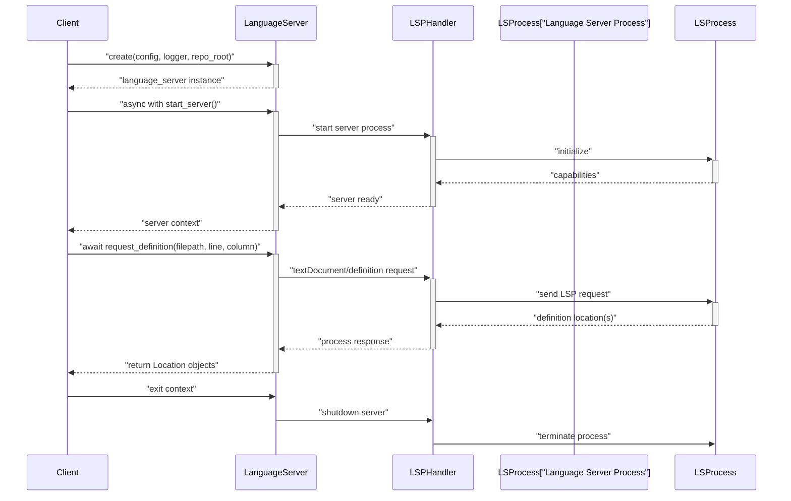
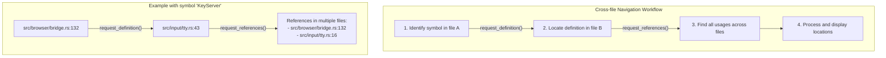
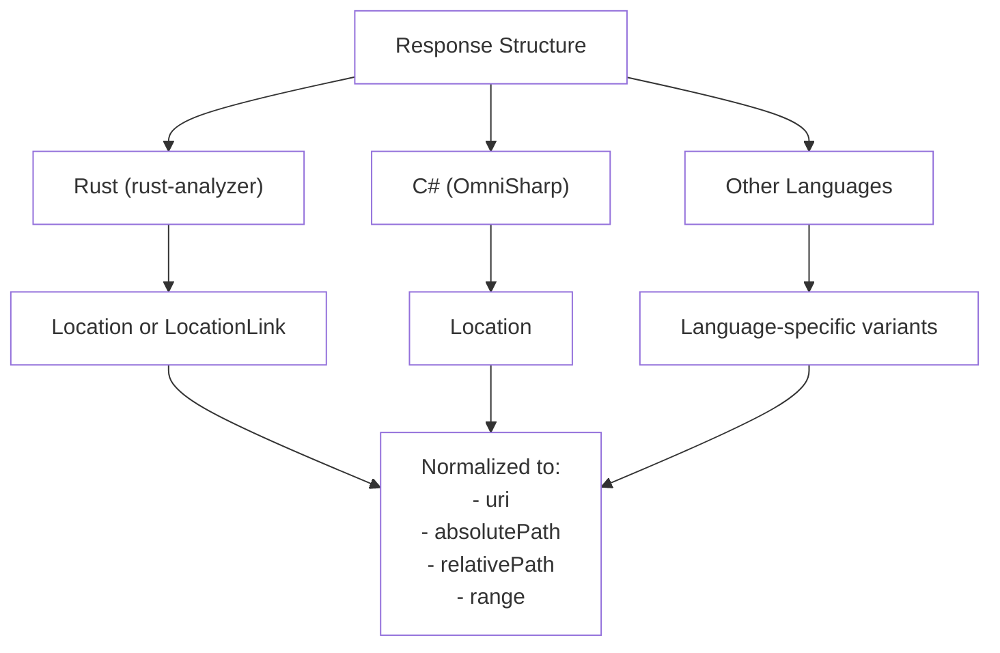

<!-- source: DeepWiki mcp.deepwiki.com · repo microsoft/multilspy · page 4.2 Working with Definitions and References · fetched 2026-10-26 -->

# Working with Definitions and References

<details>
<summary>Relevant source files</summary>

The following files were used as context for generating this wiki page:

- [src/multilspy/lsp_protocol_handler/lsp_constants.py](src/multilspy/lsp_protocol_handler/lsp_constants.py)
- [tests/multilspy/test_multilspy_javascript.py](tests/multilspy/test_multilspy_javascript.py)
- [tests/multilspy/test_multilspy_rust.py](tests/multilspy/test_multilspy_rust.py)
- [tests/multilspy/test_multilspy_typescript.py](tests/multilspy/test_multilspy_typescript.py)
- [tests/multilspy/test_sync_multilspy_javascript.py](tests/multilspy/test_sync_multilspy_javascript.py)
- [tests/multilspy/test_sync_multilspy_rust.py](tests/multilspy/test_sync_multilspy_rust.py)

</details>


This document explains how to use multilspy to find definitions and references in code across multiple programming languages. These features form the foundation of code navigation capabilities in IDEs and developer tools. 

For information about code completion functionality, see [Code Completion](#4.3). For details on retrieving document symbols and hover information, see [Document Symbols and Hover Information](#4.4).

## 1. Understanding Definitions and References

In code navigation:

- **Definition**: The location where an entity (function, variable, class, etc.) is defined or declared
- **References**: Locations where an entity is used or called throughout the codebase

### Definition and Reference Flow



Sources: [tests/multilspy/test_multilspy_rust.py:34-43](), [tests/multilspy/test_multilspy_rust.py:45-73]()

## 2. API Overview

multilspy provides both synchronous and asynchronous APIs for requesting definitions and references.

### Definition and Reference Request Methods

| Method | API Type | Description |
|--------|----------|-------------|
| `request_definition(filepath, line, column)` | Async | Returns list of locations where the symbol at the given position is defined |
| `request_references(filepath, line, column)` | Async | Returns list of locations where the symbol at the given position is referenced |
| `request_definition(filepath, line, column)` | Sync | Synchronous version of the definition request |
| `request_references(filepath, line, column)` | Sync | Synchronous version of the references request |

Sources: [tests/multilspy/test_multilspy_rust.py:34-73](), [tests/multilspy/test_sync_multilspy_rust.py:28-67]()

### Response Structure

Both methods return a list of location objects with the following structure:

```
[
    {
        "uri": "file:///path/to/file",
        "absolutePath": "/path/to/file",
        "relativePath": "path/to/file",
        "range": {
            "start": {"line": lineNumber, "character": columnNumber},
            "end": {"line": lineNumber, "character": columnNumber}
        }
    },
    ...
]
```

Sources: [tests/multilspy/test_multilspy_rust.py:36-43](), [tests/multilspy/test_multilspy_rust.py:47-73]()

## 3. Using the Asynchronous API

The asynchronous API is implemented in the `LanguageServer` class and must be used with `async/await` syntax.

### Definition Request Example



Sources: [tests/multilspy/test_multilspy_rust.py:17-43]()

### Code Example

```python
async with lsp.start_server():
    # Request definition of symbol at line 132, column 18
    result = await lsp.request_definition("src/browser/bridge.rs", 132, 18)
    
    # Process result
    if result:
        definition = result[0]
        print(f"Definition found in: {definition['relativePath']}")
        print(f"At position: {definition['range']['start']}")
```

Sources: [tests/multilspy/test_multilspy_rust.py:33-43]()

### References Request Example

```python
async with lsp.start_server():
    # Request references of symbol at line 43, column 15
    result = await lsp.request_references("src/input/tty.rs", 43, 15)
    
    # Process results
    for reference in result:
        print(f"Reference found in: {reference['relativePath']}")
        print(f"At position: {reference['range']['start']}")
```

Sources: [tests/multilspy/test_multilspy_rust.py:45-73]()

## 4. Using the Synchronous API

For synchronous code, multilspy provides the `SyncLanguageServer` class which wraps the asynchronous API.

### Definition Request Example

```python
with lsp.start_server():
    # Request definition of symbol at line 132, column 18
    result = lsp.request_definition("src/browser/bridge.rs", 132, 18)
    
    # Process result
    if result:
        definition = result[0]
        print(f"Definition found in: {definition['relativePath']}")
        print(f"At position: {definition['range']['start']}")
```

Sources: [tests/multilspy/test_sync_multilspy_rust.py:27-37]()

### References Request Example

```python
with lsp.start_server():
    # Request references of symbol at line 43, column 15
    result = lsp.request_references("src/input/tty.rs", 43, 15)
    
    # Process results
    for reference in result:
        print(f"Reference found in: {reference['relativePath']}")
        print(f"At position: {reference['range']['start']}")
```

Sources: [tests/multilspy/test_sync_multilspy_rust.py:39-67]()

## 5. Practical Example: Cross-file Code Navigation

The following diagram illustrates the typical workflow of finding a definition and then finding all references to the same symbol:



Sources: [tests/multilspy/test_multilspy_rust.py:34-73]()

### Complete Navigation Example

```python
# Initialize language server
lsp = LanguageServer.create(config, logger, repository_root)

async with lsp.start_server():
    # 1. Find definition of a symbol
    definition_results = await lsp.request_definition("src/browser/bridge.rs", 132, 18)
    
    if definition_results:
        definition = definition_results[0]
        definition_file = definition["relativePath"]
        definition_line = definition["range"]["start"]["line"]
        definition_char = definition["range"]["start"]["character"]
        
        print(f"Definition found in {definition_file} at line {definition_line}, character {definition_char}")
        
        # 2. Find all references to the same symbol
        reference_results = await lsp.request_references(
            definition_file, 
            definition_line, 
            definition_char
        )
        
        print(f"Found {len(reference_results)} references:")
        for ref in reference_results:
            ref_file = ref["relativePath"]
            ref_line = ref["range"]["start"]["line"]
            ref_char = ref["range"]["start"]["character"]
            print(f"- {ref_file}:{ref_line}:{ref_char}")
```

Sources: [tests/multilspy/test_multilspy_rust.py:34-73]()

## 6. Language-specific Considerations

Definition and reference finding works across all supported languages in multilspy, but with some language-specific considerations:

### Response Structure by Language



Sources: [tests/multilspy/test_multilspy_rust.py:34-73](), [tests/multilspy/test_multilspy_csharp.py:35-70]()

### Example: Language-specific Response Processing

Different language servers may return slightly different response formats, but multilspy normalizes these responses to a consistent format:

```python
# Example of processing results in a language-agnostic way
def process_locations(locations):
    for location in locations:
        # All locations have these fields regardless of language server
        file_path = location["relativePath"]
        start_line = location["range"]["start"]["line"]
        start_char = location["range"]["start"]["character"]
        end_line = location["range"]["end"]["line"]
        end_char = location["range"]["end"]["character"]
        
        # Process the location...
```

Sources: [tests/multilspy/test_multilspy_rust.py:50-52](), [tests/multilspy/test_multilspy_csharp.py:51-53]()

## 7. Integration with File Manipulation

multilspy allows you to combine definition and reference functionality with file manipulation for more complex workflows:

### Example: Find and Edit References

```python
async with lsp.start_server():
    # Open a file for editing
    with lsp.open_file(filepath):
        # Find all references
        references = await lsp.request_references(filepath, line, column)
        
        # Process each reference
        for ref in references:
            ref_file = ref["relativePath"]
            ref_range = ref["range"]
            
            # Open the file with the reference
            with lsp.open_file(ref_file):
                # Modify the referenced code
                lsp.delete_text_between_positions(
                    ref_file,
                    Position(line=ref_range["start"]["line"], character=ref_range["start"]["character"]),
                    Position(line=ref_range["end"]["line"], character=ref_range["end"]["character"])
                )
                
                # Insert new text
                lsp.insert_text_at_position(
                    ref_file,
                    Position(line=ref_range["start"]["line"], character=ref_range["start"]["character"]),
                    "new_symbol_name"
                )
```

Sources: [tests/multilspy/test_multilspy_rust.py:110-119]()

## 8. Best Practices

### Performance Considerations

- Request definitions and references only when needed, as these operations can be resource-intensive
- Process the results incrementally if dealing with a large number of references
- Consider using the synchronous API for simpler applications and the asynchronous API for more complex UI interactions

### Error Handling

```python
try:
    result = await lsp.request_definition(filepath, line, column)
    if not result:
        print("No definition found")
    else:
        process_definition(result[0])
except Exception as e:
    print(f"Error finding definition: {e}")
```

Sources: [tests/multilspy/test_multilspy_rust.py:34-43]()

## Summary

The multilspy library provides a powerful and consistent API for finding definitions and references across multiple programming languages. By following the patterns described in this document, you can implement robust code navigation features in your applications regardless of the target language.

---

