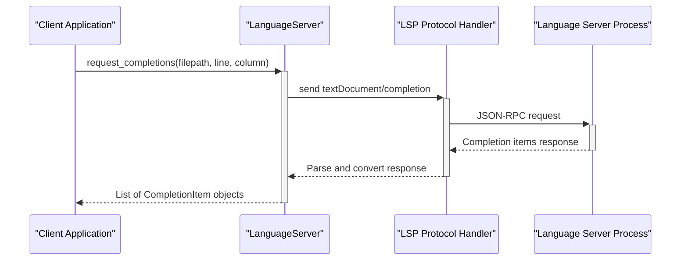
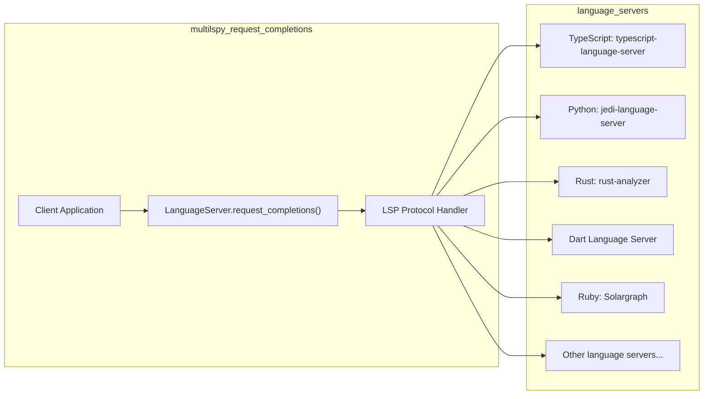

<!-- source: DeepWiki mcp.deepwiki.com · repo microsoft/multilspy · page 4.3 Code Completion · fetched 2026-10-26 -->

# Code Completion

<details>
<summary>Relevant source files</summary>

The following files were used as context for generating this wiki page:

- [src/multilspy/lsp_protocol_handler/lsp_constants.py](src/multilspy/lsp_protocol_handler/lsp_constants.py)
- [tests/multilspy/test_multilspy_csharp.py](tests/multilspy/test_multilspy_csharp.py)
- [tests/multilspy/test_multilspy_rust.py](tests/multilspy/test_multilspy_rust.py)
- [tests/multilspy/test_sync_multilspy_csharp.py](tests/multilspy/test_sync_multilspy_csharp.py)
- [tests/multilspy/test_sync_multilspy_rust.py](tests/multilspy/test_sync_multilspy_rust.py)

</details>


Code completion is a crucial feature of the multilspy library that enables client applications to request intelligent code suggestions from language servers. This page documents how code completion is implemented in the multilspy system and how developers can use this feature in their applications. For information about other code intelligence features like definitions and references, see [Working with Definitions and References](#4.2).

## Overview of Code Completion

Code completion (also known as IntelliSense or auto-completion) provides context-aware suggestions as developers type code. In multilspy, this functionality is exposed through the `request_completions` method available in both the `LanguageServer` and `SyncLanguageServer` classes.



Sources: Overall system architecture diagrams

## Requesting Completions

The `request_completions` method takes a file path, line number, and column position as parameters and returns a list of completion items that are contextually relevant to that position in the code.

### Using the Asynchronous API

```python
# Create a language server instance
lsp = LanguageServer.create(config, logger, repository_root_path)

# Open a server connection using an async context manager
async with lsp.start_server():
    # Request completions at position line 10, column 15 in my_file.py
    completions = await lsp.request_completions("my_file.py", 10, 15)
    
    # Process the completion items
    for item in completions:
        print(f"{item['label']}: {item['detail']}")
```

### Using the Synchronous API

```python
# Create a synchronous language server instance
lsp = SyncLanguageServer.create(config, logger, repository_root_path)

# Open a server connection using a context manager
with lsp.start_server():
    # Request completions at position line 10, column 15 in my_file.py
    completions = lsp.request_completions("my_file.py", 10, 15)
    
    # Process the completion items
    for item in completions:
        print(f"{item['label']}: {item['detail']}")
```

Sources: System architecture diagram, class hierarchy

## CompletionItem Structure

The completion items returned by `request_completions` follow the Language Server Protocol specification and typically contain the following properties:

| Property | Description |
|----------|-------------|
| `label` | The text to be displayed in the completion list |
| `kind` | The kind of completion item (method, class, variable, etc.) |
| `detail` | Additional details (e.g., function signature, type information) |
| `documentation` | Documentation for the item (if available) |
| `sortText` | Text used for sorting the item in the completion list |
| `insertText` | The text to be inserted when selecting this item |
| `textEdit` | A text edit that will be applied when selecting this item |
| `additionalTextEdits` | Additional edits to be applied (e.g., for adding imports) |

Note that not all language servers provide all of these properties for each completion item.

Sources: Language Server Protocol specification, type definitions

## Language-Specific Completion Features

Each language server implemented in multilspy provides different completion capabilities based on the features of the underlying language server.



Sources: Language server implementations, initialization parameters

### TypeScript/JavaScript

The TypeScript language server provides intelligent code completion including:
- Auto-imports for modules and symbols
- Method signature completion
- JSDoc-based completion
- Type-aware suggestions

The initialization parameters for TypeScript include settings that affect completion behavior, such as import suggestions and module resolution.

Sources: [tests/multilspy/test_multilspy_typescript.py](), [tests/multilspy/test_multilspy_javascript.py]()

### Dart

The Dart language server supports:
- Flutter widget completions
- Auto-imports for packages and libraries
- Type-aware suggestions
- Code snippets

The initialization parameters specifically control aspects of code completion:

```json
{
    "initializationOptions": {
        "suggestFromUnimportedLibraries": true,
        ...
    }
}
```

This setting enables the server to suggest completions from libraries that haven't been imported yet, which can be particularly useful for discovering new APIs.

Sources: [src/multilspy/language_servers/dart_language_server/initialize_params.json:7-14](), [tests/multilspy/test_multilspy_dart.py](), [tests/multilspy/test_sync_multilspy_dart.py]()

## Best Practices

For the best code completion experience with multilspy:

1. **Open files before requesting completions**: Use the `open_file` context manager to ensure the language server has the most up-to-date content.

2. **Consider caching**: Code completion requests can be frequent, so consider implementing a caching strategy for completion results.

3. **Handle async properly**: When using the async API, ensure you properly manage the event loop and await completion requests.

4. **Filter and sort results**: Language servers may return many completion items, so implement client-side filtering and sorting for better user experience.

5. **Handle errors gracefully**: If a language server is unavailable or returns an error, provide fallback completion options or a clear error message.

Sources: API design patterns, language server implementation details

## Common Issues and Troubleshooting

- **Empty completion results**: Ensure the file is properly opened in the language server and that the cursor position is in a valid location for completions.

- **Slow completion response**: For large files or complex projects, code completion may take longer. Consider implementing a timeout mechanism.

- **Incorrect import paths**: Some language servers need proper configuration to resolve import paths correctly. Verify that the repository root path is correctly set.

- **Missing language-specific features**: Not all language servers implement the same set of features. Consult the language server documentation for supported capabilities.

Sources: Error handling patterns, performance considerations

---

