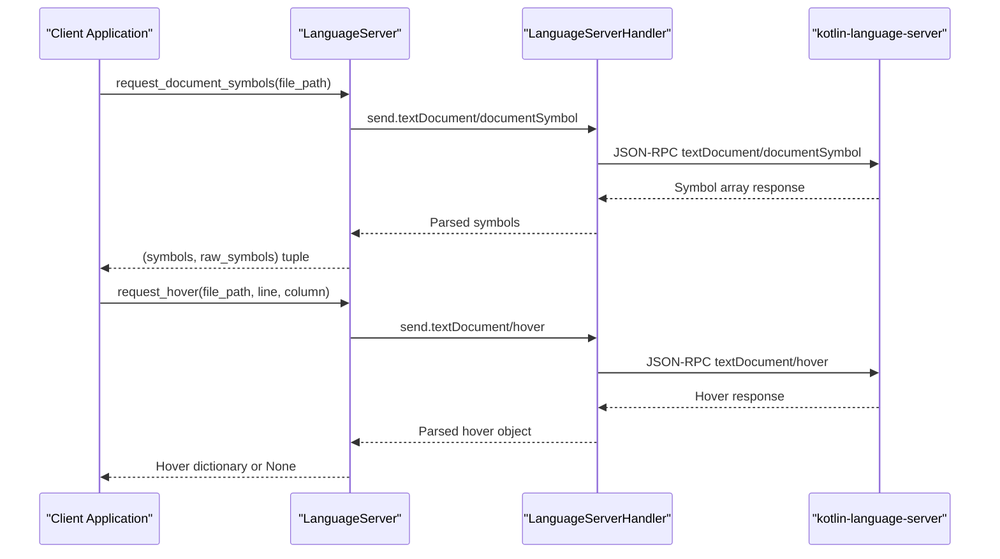
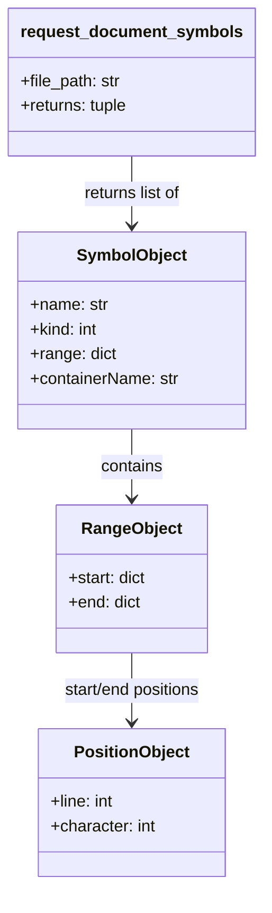
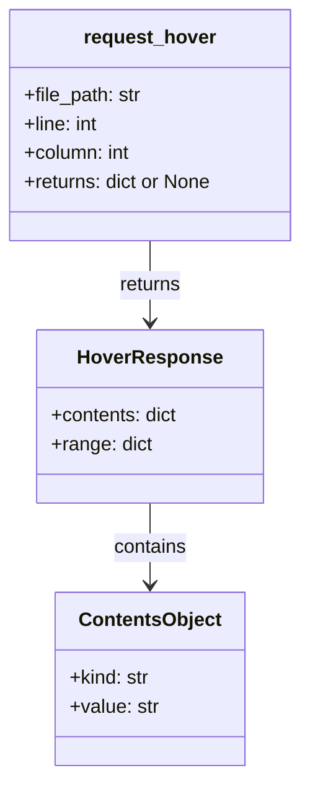

<!-- source: DeepWiki mcp.deepwiki.com · repo microsoft/multilspy · page 4.4 Document Symbols and Hover Information · fetched 2026-10-26 -->

# Document Symbols and Hover Information

<details>
<summary>Relevant source files</summary>

The following files were used as context for generating this wiki page:

- [.github/workflows/test-workflow.yaml](.github/workflows/test-workflow.yaml)
- [src/multilspy/language_servers/dart_language_server/dart_language_server.py](src/multilspy/language_servers/dart_language_server/dart_language_server.py)
- [src/multilspy/language_servers/dart_language_server/initialize_params.json](src/multilspy/language_servers/dart_language_server/initialize_params.json)
- [src/multilspy/language_servers/dart_language_server/runtime_dependencies.json](src/multilspy/language_servers/dart_language_server/runtime_dependencies.json)
- [tests/multilspy/test_multilspy_dart.py](tests/multilspy/test_multilspy_dart.py)
- [tests/multilspy/test_multilspy_kotlin.py](tests/multilspy/test_multilspy_kotlin.py)
- [tests/multilspy/test_sync_multilspy_dart.py](tests/multilspy/test_sync_multilspy_dart.py)
- [tests/multilspy/test_sync_multilspy_kotlin.py](tests/multilspy/test_sync_multilspy_kotlin.py)

</details>


This page documents the `request_document_symbols` and `request_hover` methods available in both `LanguageServer` and `SyncLanguageServer` classes. These methods provide programmatic access to code structure information and contextual details about code elements.

## Overview

Document symbols represent structural elements within source files (classes, methods, variables, etc.). Hover information provides contextual details when positioned over specific code locations. Both features are implemented via LSP requests to external language server processes.

| Method | Purpose | Returns |
|--------|---------|---------|
| `request_document_symbols(file_path)` | Retrieve structural elements from a file | Tuple of (processed_symbols, raw_response) |
| `request_hover(file_path, line, column)` | Get contextual information at position | Dictionary with hover content or None |

### Request Flow Through multilspy Architecture



Sources: [tests/multilspy/test_multilspy_kotlin.py:25-26](), [tests/multilspy/test_multilspy_kotlin.py:117]()

## Document Symbols

The `request_document_symbols` method extracts structural information from source files. Each symbol contains metadata about code elements including their names, types, and source locations.

### Symbol Kinds

Symbol kinds are represented as integer constants defined by the LSP specification:

| Kind | Value | Description |
|------|-------|-------------|
| Class | 5 | Class definitions |
| Property | 7 | Class properties and fields |
| Object | 9 | Object/companion object definitions |
| Function | 12 | Function and method definitions |

Sources: [tests/multilspy/test_multilspy_kotlin.py:32-47]()

### Document Symbol Structure



**Kotlin Example from DocumentSymbols.kt:**
- `DocumentSymbols` class (kind=5) at line 0
- `aProperty` property (kind=7) 
- `aFunction` function (kind=12)
- Two companion objects (kind=9)

Sources: [tests/multilspy/test_multilspy_kotlin.py:28-48]()

### API Usage

Both `LanguageServer` and `SyncLanguageServer` provide the same interface:

#### Asynchronous API
```python
async with lsp.start_server():
    result = await lsp.request_document_symbols(test_file)
    symbols = result[0]  # Processed symbols list
    raw_symbols = result[1]  # Raw server response
```

#### Synchronous API  
```python
with lsp.start_server():
    result = lsp.request_document_symbols(test_file)
    symbols = result[0]  # Processed symbols list
    raw_symbols = result[1]  # Raw server response
```

**Return Format:**
- **Tuple[0]**: List of symbol dictionaries with normalized structure
- **Tuple[1]**: Raw response from external language server

Sources: [tests/multilspy/test_multilspy_kotlin.py:25-26](), [tests/multilspy/test_sync_multilspy_kotlin.py:24-25]()

### Symbol Object Fields

| Field | Type | Required | Description |
|-------|------|----------|-------------|
| `name` | string | Yes | Symbol identifier |
| `kind` | int | Yes | LSP symbol kind constant |
| `range` | object | Yes | Source location with start/end positions |
| `containerName` | string | No | Parent symbol name |

**Example from Kotlin test:** `DocumentSymbols.kt` produces 5 symbols:
```python
# Class symbol assertion
class_symbol = next((s for s in symbols if s["name"] == "DocumentSymbols" and s["kind"] == 5), None)
assert class_symbol["range"]["start"]["line"] == 0

# Property symbol assertion  
property_symbol = next((s for s in symbols if s["name"] == "aProperty"), None)
assert property_symbol["kind"] == 7  # Property kind

# Function symbol assertion
function_symbol = next((s for s in symbols if s["name"] == "aFunction"), None)  
assert function_symbol["kind"] == 12  # Function kind
```

Sources: [tests/multilspy/test_multilspy_kotlin.py:32-44]()

## Hover Information

The `request_hover` method retrieves contextual information for specific source locations. This includes type signatures, documentation, and other metadata about code elements at the specified position.

### Hover Request Parameters

| Parameter | Type | Description | Example |
|-----------|------|-------------|---------|
| `file_path` | string | Path to source file | `"server/src/test/resources/hover/Literals.kt"` |
| `line` | int | 0-based line number | `2` |
| `column` | int | 0-based character position | `19` |

Sources: [tests/multilspy/test_multilspy_kotlin.py:117]()

### Hover Response Structure



**Kotlin Example:** Hovering over `stringLiteral` at position (2, 19):
```python
hover_result["contents"]["kind"] == "markdown"
hover_result["contents"]["value"]  # Contains "```kotlin\nval stringLiteral: String"
```

Sources: [tests/multilspy/test_multilspy_kotlin.py:125-127]()

### API Usage

#### Asynchronous API
```python
async with lsp.start_server():
    hover_result = await lsp.request_hover(test_file, 2, 19)
    if hover_result is not None:
        content_kind = hover_result["contents"]["kind"]  # "markdown"
        content_value = hover_result["contents"]["value"]  # Type info
```

#### Synchronous API
```python
with lsp.start_server():
    hover_result = lsp.request_hover(test_file, 2, 19)
    if hover_result is not None:
        content_kind = hover_result["contents"]["kind"]  # "markdown"
        content_value = hover_result["contents"]["value"]  # Type info
```

**Return Value:**
- `None` if no hover information available at position
- Dictionary containing `contents` and optional `range` fields

Sources: [tests/multilspy/test_multilspy_kotlin.py:117-122](), [tests/multilspy/test_sync_multilspy_kotlin.py:122]()

### Response Format

| Field | Type | Required | Description |
|-------|------|----------|-------------|
| `contents` | object | Yes | Hover content with kind and value |
| `range` | object | No | Position range for hover |

#### Contents Object Structure

| Field | Type | Description |
|-------|------|-------------|
| `kind` | string | Content format ("markdown", "plaintext") |
| `value` | string | Actual hover text content |

**Kotlin Hover Example:**
```python
# Assertion from test case
assert hover_result["contents"]["kind"] == "markdown"
assert "```kotlin" in hover_result["contents"]["value"]
assert "val stringLiteral: String" in hover_result["contents"]["value"]
```

The `value` field contains formatted text including:
- Type signatures in code blocks
- Documentation strings  
- Variable/parameter information

Sources: [tests/multilspy/test_multilspy_kotlin.py:119-127]()

## Language Server Examples

### KotlinLanguageServer

Tests use the `kotlin-language-server` repository with specific test files:
- **Document Symbols**: `server/src/test/resources/symbols/DocumentSymbols.kt` 
- **Hover**: `server/src/test/resources/hover/Literals.kt`

**Symbol Output Example:**
```python
# From test assertions
assert len(symbols) == 5  # Total symbols found
class_symbol = next((s for s in symbols if s["name"] == "DocumentSymbols" and s["kind"] == 5), None)
companion_symbols = [s for s in symbols if s["name"] == "DocumentSymbols" and s["kind"] == 9]
assert len(companion_symbols) == 2  # Two companion objects
```

**Hover Output Example:**
```python
# Kotlin-specific markdown format
assert hover_result["contents"]["kind"] == "markdown"
assert "```kotlin" in hover_result["contents"]["value"]
assert "val stringLiteral: String" in hover_result["contents"]["value"]
```

Sources: [tests/multilspy/test_multilspy_kotlin.py:15-48](), [tests/multilspy/test_multilspy_kotlin.py:106-127]()

### DartLanguageServer

Tests use the `OpenNutriTracker` repository with `copy_or_delete_dialog.dart`:

**Symbol Output Example:**
```python
# From test assertions - 3 symbols total
symbols == [
    {"name": "CopyOrDeleteDialog", "location": {"range": {"start": {"line": 3, "character": 6}}}},
    {"containerName": "CopyOrDeleteDialog", "name": "CopyOrDeleteDialog", "location": {"range": {"start": {"line": 4, "character": 8}}}},
    {"containerName": "CopyOrDeleteDialog", "name": "build", "location": {"range": {"start": {"line": 7, "character": 9}}}}
]
```

Configuration in [dart_language_server.py:24-31]() shows runtime dependency setup and executable path construction for the Dart SDK.

Sources: [tests/multilspy/test_multilspy_dart.py:30-76](), [src/multilspy/language_servers/dart_language_server/dart_language_server.py:24-31]()

## Use Cases

Document symbols and hover information are essential for building developer tools such as:

1. **Code Outline/Structure Views**: Display a hierarchical view of the code structure based on document symbols
2. **Quick Navigation**: Jump to specific symbols within a file
3. **Tooltip Information**: Show type information and documentation when hovering over code elements
4. **Smart Symbol Search**: Implement symbol-based search functionality
5. **Code Analyzers**: Build tools that analyze code structure and relationships

### Practical Example

A complete example of retrieving and using both document symbols and hover information:

```python
from multilspy import LanguageServer
from multilspy.multilspy_config import Language, MultilspyConfig
from multilspy.multilspy_logger import MultilspyLogger
import asyncio

async def analyze_code_file(file_path, repo_path):
    config = MultilspyConfig(code_language=Language.GO)
    logger = MultilspyLogger()
    
    lsp = LanguageServer.create(config, logger, repo_path)
    
    async with lsp.start_server():
        # Wait for server initialization
        await lsp.server_ready.wait()
        
        # Get document symbols
        symbols_result = await lsp.request_document_symbols(file_path)
        symbols = symbols_result[0]
        
        print(f"File structure of {file_path}:")
        for symbol in symbols:
            prefix = "  " if "containerName" in symbol else ""
            print(f"{prefix}{symbol['name']} ({symbol['location']['range']['start']['line']}:{symbol['location']['range']['start']['character']})")
        
        # Get hover information for specific positions
        for symbol in symbols:
            line = symbol['location']['range']['start']['line']
            column = symbol['location']['range']['start']['character']
            hover_info = await lsp.request_hover(file_path, line, column)
            
            if hover_info:
                print(f"\nHover information for {symbol['name']}:")
                print(hover_info['contents']['value'])

# Example usage
asyncio.run(analyze_code_file("main.go", "/path/to/repo"))
```

Sources: [tests/multilspy/test_multilspy_go.py:14-98](), [tests/multilspy/test_multilspy_dart.py:15-76]()

## Summary

The document symbols and hover information capabilities in multilspy provide a powerful way to access structural and contextual information from code files across multiple programming languages. By leveraging the Language Server Protocol, multilspy offers a consistent interface that works with various language servers while preserving language-specific features.

---

