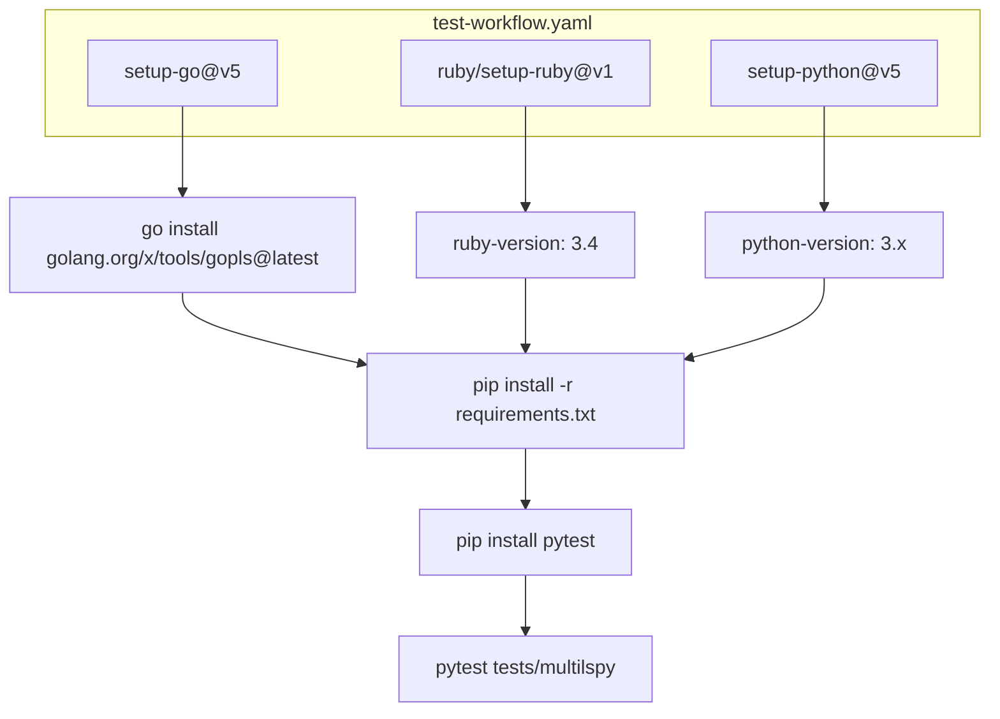
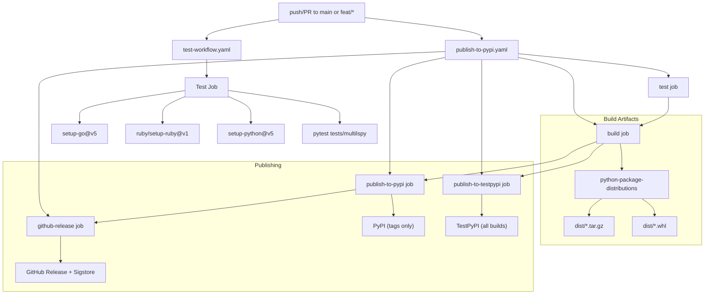
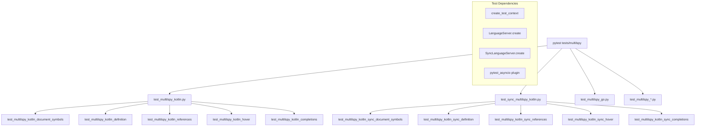
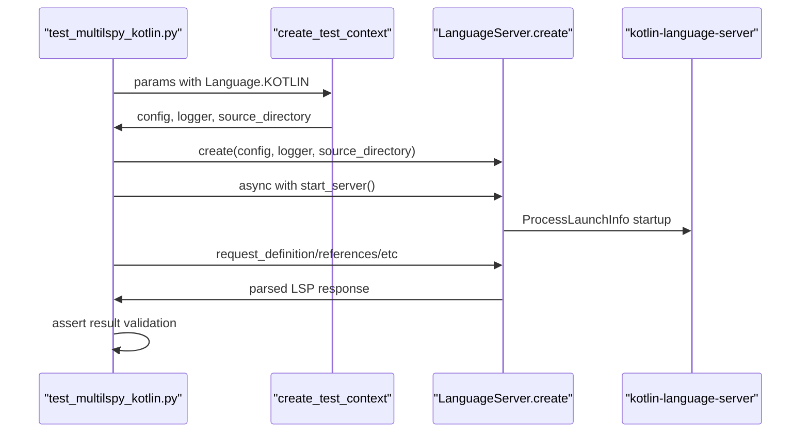
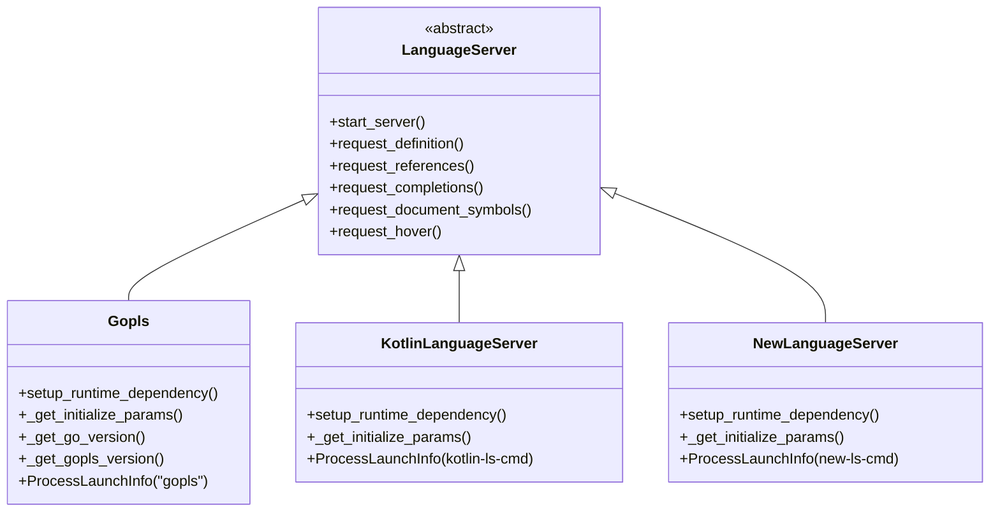
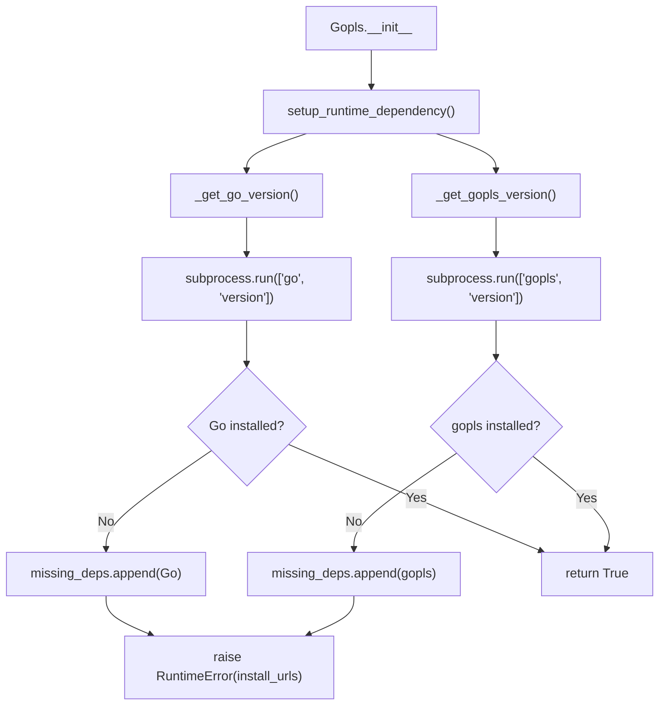

<!-- source: DeepWiki mcp.deepwiki.com · repo microsoft/multilspy · page 5 Contributing · fetched 2026-10-26 -->

# Contributing

<details>
<summary>Relevant source files</summary>

The following files were used as context for generating this wiki page:

- [.github/workflows/publish-to-pypi.yaml](.github/workflows/publish-to-pypi.yaml)
- [.github/workflows/test-workflow.yaml](.github/workflows/test-workflow.yaml)
- [src/multilspy/language_servers/gopls/gopls.py](src/multilspy/language_servers/gopls/gopls.py)
- [src/multilspy/language_servers/gopls/initialize_params.json](src/multilspy/language_servers/gopls/initialize_params.json)
- [tests/multilspy/test_multilspy_go.py](tests/multilspy/test_multilspy_go.py)
- [tests/multilspy/test_multilspy_kotlin.py](tests/multilspy/test_multilspy_kotlin.py)
- [tests/multilspy/test_sync_multilspy_kotlin.py](tests/multilspy/test_sync_multilspy_kotlin.py)

</details>


This guide provides information for developers who want to contribute to the multilspy project. It covers development environment setup, CI/CD workflows, testing framework, and guidelines for extending multilspy with new language server implementations.

multilspy uses a sophisticated CI/CD pipeline with GitHub Actions for testing across multiple language ecosystems and publishing to PyPI with security signing. The project includes comprehensive test coverage for all supported language servers.

## Development Environment Setup

To contribute to multilspy, you'll need to set up a development environment that matches the CI pipeline requirements.

### Prerequisites

Based on the CI workflow configuration:

- Python 3.x
- Git
- Go 1.21+ (for testing `Gopls` implementation)
- Ruby 3.4+ (for testing `Solargraph` implementation)

### CI/CD Environment Replication

**GitHub Actions Workflow Environment Setup**


### Local Development Setup

1. **Clone and setup virtual environment**:
   ```bash
   git clone https://github.com/microsoft/multilspy.git
   cd multilspy
   python -m venv .venv
   source .venv/bin/activate  # On Windows: .venv\Scripts\activate
   ```

2. **Install dependencies matching CI**:
   ```bash
   pip install --upgrade pip
   pip install -r requirements.txt
   pip install pytest
   ```

3. **Install language server dependencies**:
   ```bash
   # Go and gopls (matches CI setup)
   go install golang.org/x/tools/gopls@latest
   
   # Ruby 3.4+ for Solargraph testing
   gem install solargraph
   ```

Sources: [.github/workflows/test-workflow.yaml:16-37](), [.github/workflows/publish-to-pypi.yaml:17-38]()

## CI/CD Workflows

multilspy uses GitHub Actions for automated testing, building, and publishing. The workflows are triggered on push and pull requests.

**GitHub Actions Workflow Architecture**


### Workflow Triggers

| Workflow | Trigger | Purpose |
|----------|---------|---------|
| `test-workflow.yaml` | Push/PR to `main`, `feat/*` | Run comprehensive tests |
| `publish-to-pypi.yaml` | Push to `main`, tags `v*` | Build and publish packages |

### Branching Strategy

- `main` branch: stable code, triggers TestPyPI publishing
- `feat/*` branches: feature development, triggers testing only  
- `v*` tags: triggers PyPI production release with GitHub Release

Sources: [.github/workflows/test-workflow.yaml:3-8](), [.github/workflows/publish-to-pypi.yaml:3-8]()

## Testing Framework

multilspy uses pytest with both async and sync test suites covering all language server implementations.

**Test Architecture: Language Server Test Coverage**


### Test Structure and Implementation

**Core Test Pattern**


### Test Repository Configuration

| Language | Test Repository | Commit Hash |
|----------|----------------|-------------|
| Kotlin | `kotlin-language-server` | `8418fb560a4013c3e02c942797e9c877affa0a51` |
| Go | `golang/example` | `1bcfdd08c5584d89507e37be70af63c72eb8c16f` |

### Running Tests

```bash
# Run all language server tests
pytest tests/multilspy

# Run specific language tests  
pytest tests/multilspy/test_multilspy_kotlin.py::test_multilspy_kotlin_definition

# Run with async support
pytest tests/multilspy -v --tb=short
```

### Adding New Language Server Tests

When implementing a new language server, create both async and sync test files:

1. **Async tests**: `test_multilspy_{language}.py`
2. **Sync tests**: `test_sync_multilspy_{language}.py`

**Required test methods for each language server**:
- `test_multilspy_{lang}_document_symbols`
- `test_multilspy_{lang}_definition` 
- `test_multilspy_{lang}_references`
- `test_multilspy_{lang}_hover`
- `test_multilspy_{lang}_completions`

Sources: [tests/multilspy/test_multilspy_kotlin.py:14-161](), [tests/multilspy/test_sync_multilspy_kotlin.py:11-167](), [tests/multilspy/test_multilspy_go.py:14-99]()

## Extending multilspy

Adding new language server support requires implementing the `LanguageServer` base class with specific methods for runtime dependencies and LSP initialization.

**Language Server Implementation Pattern**


### Implementation Requirements

**Required Methods for New Language Server**

| Method | Purpose | Example Implementation |
|--------|---------|----------------------|
| `setup_runtime_dependency()` | Verify/install language server binary | Check binary existence, raise `RuntimeError` if missing |
| `_get_initialize_params()` | LSP initialization configuration | Load from `initialize_params.json`, set `rootPath`, `rootUri` |
| `__init__()` | Constructor with `ProcessLaunchInfo` | Call `super().__init__()` with command and working directory |

### Runtime Dependency Management

**Example: Gopls Runtime Dependency Checking**


### Initialize Parameters Configuration

Language servers require LSP initialization parameters. Create `initialize_params.json` with:

```json
{
    "processId": "os.getpid()",
    "rootPath": "$rootPath", 
    "rootUri": "$rootUri",
    "capabilities": {
        "textDocument": {
            "definition": {"dynamicRegistration": true},
            "completion": {"dynamicRegistration": true}
        }
    },
    "workspaceFolders": [{"uri": "$uri", "name": "$name"}]
}
```

### Adding to LanguageServer Factory

Register new language server in `LanguageServer.create()` method:

```python
if config.code_language == Language.NEW_LANGUAGE:
    return NewLanguageServer(config, logger, repository_root_path)
```

Sources: [src/multilspy/language_servers/gopls/gopls.py:44-68](), [src/multilspy/language_servers/gopls/gopls.py:84-106](), [src/multilspy/language_servers/gopls/initialize_params.json:1-36]()

## Code Style Guidelines

When contributing to multilspy, follow these code style guidelines:

1. Format code according to PEP 8
2. Use type hints for all function parameters and return values
3. Write docstrings for all public methods and classes
4. Keep functions small and focused on a single responsibility
5. Use descriptive variable and function names

## Pull Request Process

1. Create a pull request from your feature branch to the `main` branch
2. Ensure the CI pipeline passes (tests will run automatically)
3. Address any review comments
4. Once approved, your changes will be merged into `main`

The PR should include:
- A clear description of the changes
- Any relevant documentation updates
- Tests for new functionality
- Adherence to code style guidelines

Sources: [.github/workflows/test-workflow.yaml:9-37]()

## Common Issues and Solutions

### Language Server Installation Problems

If you encounter issues with language server binaries:

1. Check that the runtime dependencies are correctly specified
2. Verify that the download URLs are still valid
3. Ensure proper permissions are set for executable files

### Test Failures

If tests fail:

1. Verify your development environment matches the required dependencies
2. Check that language servers are installed and configured correctly
3. Look for version conflicts between dependencies

By following these guidelines, you can effectively contribute to the multilspy project and help extend its capabilities to support additional language servers and features.

---

