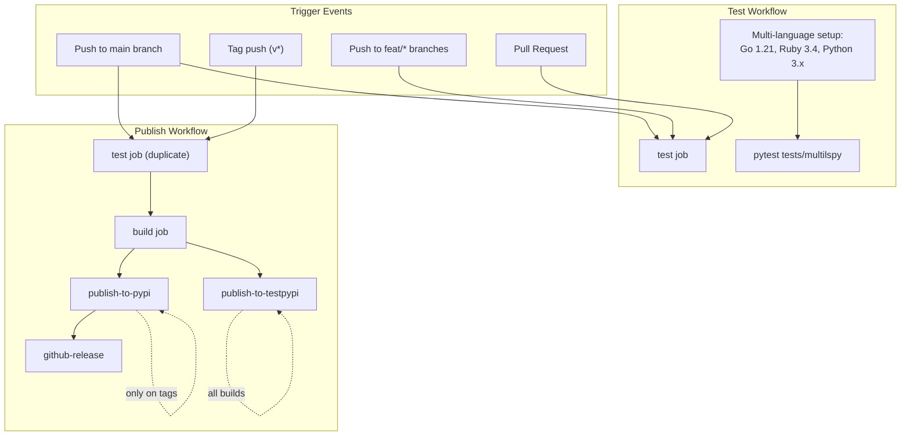
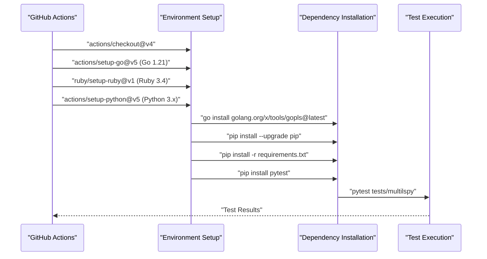
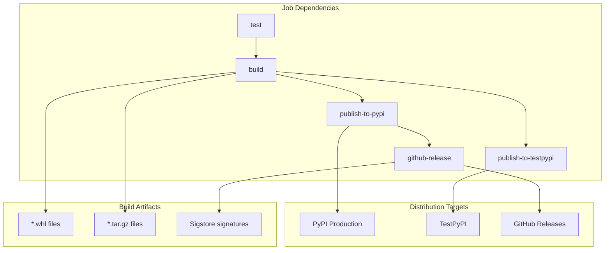
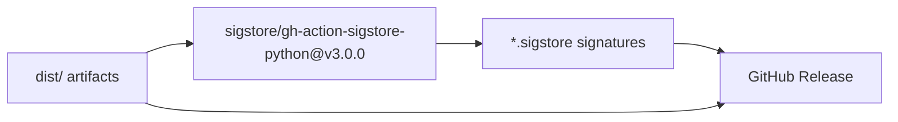
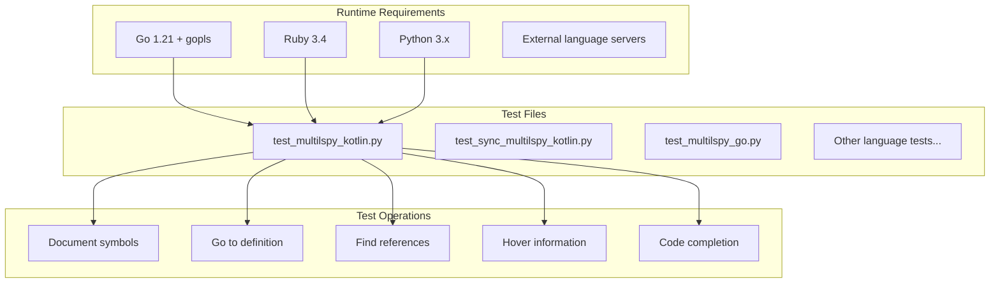

<!-- source: DeepWiki mcp.deepwiki.com · repo microsoft/multilspy · page 5.1 CI/CD Workflows · fetched 2026-10-26 -->

# CI/CD Workflows

<details>
<summary>Relevant source files</summary>

The following files were used as context for generating this wiki page:

- [.github/workflows/publish-to-pypi.yaml](.github/workflows/publish-to-pypi.yaml)
- [.github/workflows/test-workflow.yaml](.github/workflows/test-workflow.yaml)
- [src/multilspy/language_servers/gopls/gopls.py](src/multilspy/language_servers/gopls/gopls.py)
- [src/multilspy/language_servers/gopls/initialize_params.json](src/multilspy/language_servers/gopls/initialize_params.json)
- [tests/multilspy/test_multilspy_go.py](tests/multilspy/test_multilspy_go.py)
- [tests/multilspy/test_multilspy_kotlin.py](tests/multilspy/test_multilspy_kotlin.py)
- [tests/multilspy/test_sync_multilspy_kotlin.py](tests/multilspy/test_sync_multilspy_kotlin.py)

</details>


This document covers the automated Continuous Integration and Continuous Deployment (CI/CD) infrastructure for multilspy. The CI/CD system handles automated testing across multiple programming language environments, package building, security signing, and publishing to multiple distribution channels.

For information about the testing framework and test implementation details, see [Testing Framework](#5.2). For development environment setup, see [Development Environment](#5.3).

## Overview

The multilspy project implements a comprehensive CI/CD pipeline using GitHub Actions that supports testing across multiple language ecosystems and automated publishing with security controls. The system consists of two primary workflows that handle different aspects of the release cycle.



**CI/CD Pipeline Architecture**

The system uses a two-workflow approach where the test workflow runs on every code change, while the publish workflow only runs on main branch pushes and creates releases only for tagged versions.

Sources: [.github/workflows/test-workflow.yaml:1-38](), [.github/workflows/publish-to-pypi.yaml:1-159]()

## Test Workflow

The test workflow (`test-workflow.yaml`) provides comprehensive testing across the supported language ecosystems. The workflow demonstrates the complexity of testing a multi-language LSP client by setting up runtime environments for multiple programming languages.



**Test Environment Setup Sequence**

### Language Runtime Dependencies

The test environment requires multiple language runtimes to support testing all language server implementations:

| Language | Version | Installation Method | Purpose |
|----------|---------|-------------------|---------|
| Go | 1.21 | `actions/setup-go@v5` | Required for `gopls` language server |
| Ruby | 3.4 | `ruby/setup-ruby@v1` | Required for Solargraph gem installation |
| Python | 3.x | `actions/setup-python@v5` | Primary runtime for multilspy |

The workflow explicitly installs `gopls` using `go install golang.org/x/tools/gopls@latest`, demonstrating the pattern where some language servers must be installed globally rather than managed through multilspy's runtime dependency system.

Sources: [.github/workflows/test-workflow.yaml:14-37]()

## Publishing Pipeline

The publish workflow (`publish-to-pypi.yaml`) implements a sophisticated multi-stage publishing process with security controls and multiple distribution targets.



**Publishing Job Dependencies and Artifacts**

### Build Process

The build job uses the standard Python packaging toolchain:

- `python3 -m pip install build --user` - Installs the PyPA build tool
- `python3 -m build` - Creates both wheel (`.whl`) and source distribution (`.tar.gz`) 
- `actions/upload-artifact@v4` - Stores artifacts for downstream jobs

### Conditional Publishing Logic

The publishing logic implements different behaviors based on trigger conditions:

| Condition | PyPI Production | TestPyPI | GitHub Release |
|-----------|----------------|----------|----------------|
| Tag push (`refs/tags/`) | ✅ Publish | ✅ Publish | ✅ Create |
| Main branch push | ❌ Skip | ✅ Publish | ❌ Skip |

This is implemented using GitHub Actions conditional expressions like `if: startsWith(github.ref, 'refs/tags/')` in the PyPI publishing job.

Sources: [.github/workflows/publish-to-pypi.yaml:40-89](), [.github/workflows/publish-to-pypi.yaml:134-159]()

## Security and Signing

The CI/CD pipeline implements modern security practices including trusted publishing and cryptographic signing.

### Trusted Publishing

The workflow uses PyPA's trusted publishing mechanism instead of API tokens:

```yaml
permissions:
  id-token: write  # IMPORTANT: mandatory for trusted publishing
```

This eliminates the need to store PyPI API tokens as secrets and provides stronger security guarantees through OIDC-based authentication.

### Sigstore Integration

The `github-release` job implements supply chain security using Sigstore:



**Sigstore Signing Process**

The signing process creates cryptographic attestations for both wheel and source distributions, which can be verified by consumers to ensure package integrity and authenticity.

Sources: [.github/workflows/publish-to-pypi.yaml:76-77](), [.github/workflows/publish-to-pypi.yaml:99-133]()

## Testing Infrastructure Integration

The CI/CD workflows integrate with multilspy's comprehensive testing infrastructure, which spans multiple language ecosystems. The test execution pattern demonstrates the complexity of testing a multi-language LSP client.

### Test Execution Pattern



**Test Infrastructure Dependencies**

The test suite validates core LSP functionality across different language servers, requiring both the runtime environments and the actual language server binaries to be available during test execution.

### External Language Server Dependencies

Some language servers like `gopls` are installed globally during CI setup, while others are managed through multilspy's runtime dependency system. This hybrid approach reflects the different distribution models of various language servers:

- **Global installation**: `gopls` via `go install` 
- **Runtime management**: Kotlin Language Server, rust-analyzer, etc. downloaded automatically
- **System dependencies**: Ruby gems, Node.js packages installed on-demand

Sources: [tests/multilspy/test_multilspy_kotlin.py:1-162](), [tests/multilspy/test_multilspy_go.py:1-99](), [.github/workflows/test-workflow.yaml:16-22]()

---

