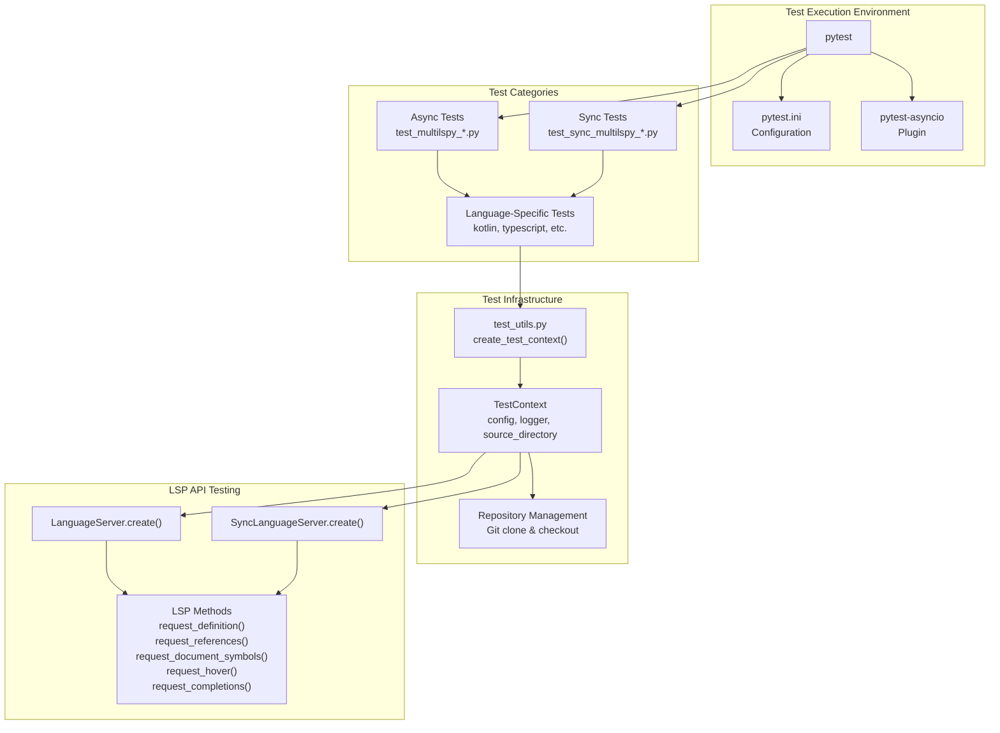
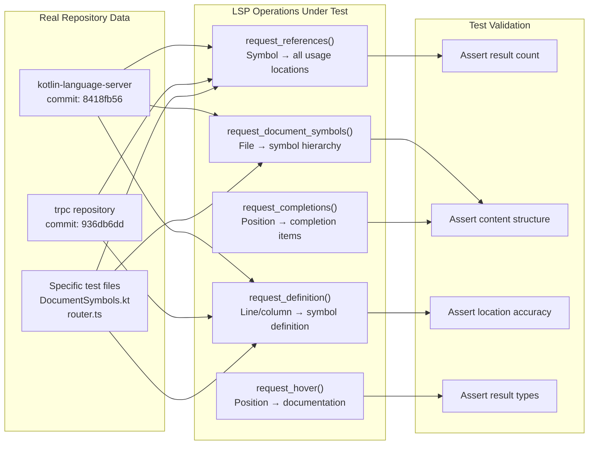
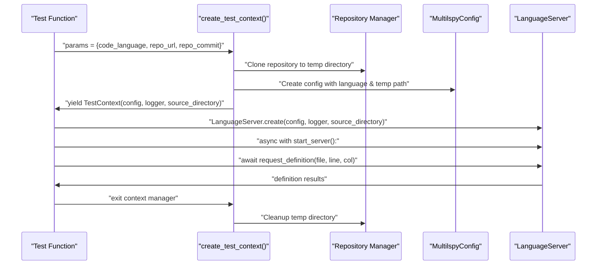
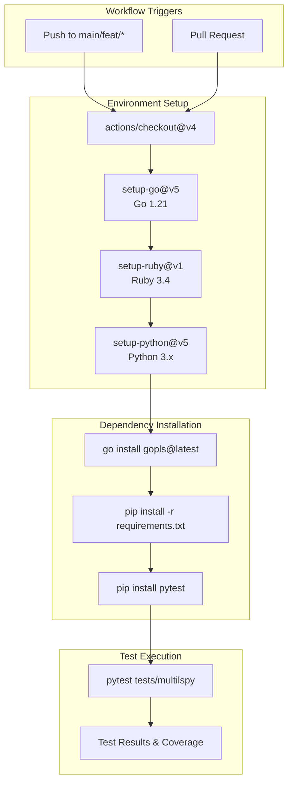
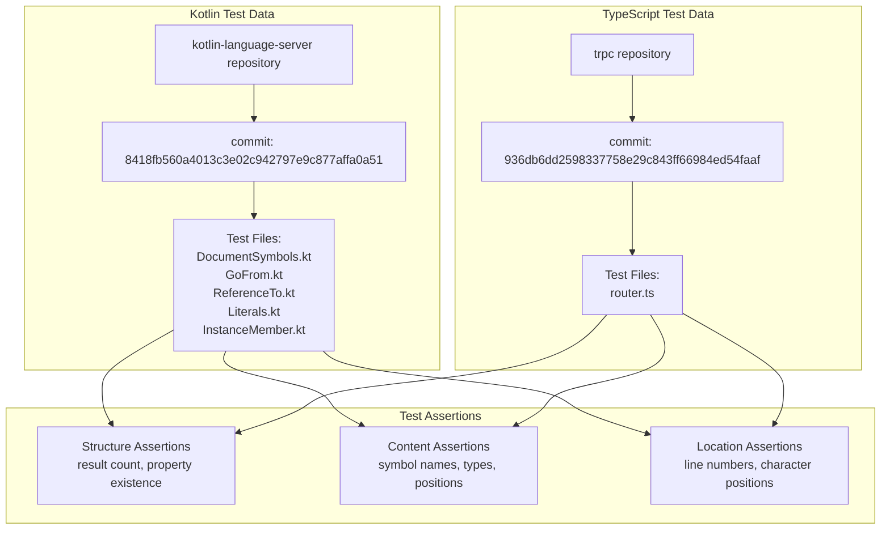

<!-- source: DeepWiki mcp.deepwiki.com · repo microsoft/multilspy · page 5.2 Testing Framework · fetched 2026-10-26 -->

# Testing Framework

Relevant source files

The following files were used as context for generating this wiki page:

- [.github/workflows/test-workflow.yaml](.github/workflows/test-workflow.yaml)
- [tests/multilspy/test_multilspy_kotlin.py](tests/multilspy/test_multilspy_kotlin.py)
- [tests/multilspy/test_sync_multilspy_kotlin.py](tests/multilspy/test_sync_multilspy_kotlin.py)
- [tests/multilspy/test_sync_multilspy_typescript.py](tests/multilspy/test_sync_multilspy_typescript.py)
- [tests/pytest.ini](tests/pytest.ini)

## Purpose and Scope

The Testing Framework provides comprehensive test coverage for all supported language servers in multilspy, ensuring reliable LSP functionality across multiple programming languages and platforms. This framework includes unit tests, integration tests, and continuous integration workflows that validate both synchronous and asynchronous APIs.

For information about the CI/CD workflows and deployment processes, see [CI/CD Workflows](#5.1). For details about setting up the development environment, see [Development Environment](#5.3).

## Test Architecture Overview

The testing framework is built around pytest with asyncio support, organized into language-specific test modules that validate core LSP operations across real-world codebases.

**Test Architecture Flow**
This diagram shows how pytest orchestrates the execution of language-specific tests through the test infrastructure, ultimately validating LSP operations on real codebases.

Sources: [tests/pytest.ini:1-24](), [tests/multilspy/test_multilspy_kotlin.py:1-162](), [tests/multilspy/test_sync_multilspy_kotlin.py:1-168]()

## Test Categories and Structure

### Language-Specific Test Modules

Tests are organized by programming language, with each language having dedicated test modules for both asynchronous and synchronous API validation.

| Test Module | Language | API Type | Key Operations Tested |
|-------------|----------|----------|----------------------|
| `test_multilspy_kotlin.py` | Kotlin | Async | definitions, references, symbols, hover, completions |
| `test_sync_multilspy_kotlin.py` | Kotlin | Sync | definitions, references, symbols, hover, completions |
| `test_sync_multilspy_typescript.py` | TypeScript | Sync | definitions, references |

### Core LSP Operation Tests

Each language test module validates the following LSP operations using real repository data:

**LSP Operation Testing Matrix**
This diagram illustrates how each LSP operation is validated against specific assertions using real repository data as test fixtures.

Sources: [tests/multilspy/test_multilspy_kotlin.py:14-161](), [tests/multilspy/test_sync_multilspy_typescript.py:10-50]()

### Test Context Management

The `create_test_context()` function provides standardized test setup and teardown, managing repository cloning and language server configuration.

**Test Context Lifecycle**
This sequence diagram shows how test contexts manage repository setup and cleanup while providing isolated test environments.

Sources: [tests/multilspy/test_multilspy_kotlin.py:20-22](), [tests/multilspy/test_sync_multilspy_kotlin.py:20-21]()

## CI/CD Integration

### GitHub Actions Workflow

The test workflow sets up multi-language environments and executes the full test suite on every push and pull request.

**CI/CD Test Pipeline**
This diagram shows the automated testing pipeline that validates multilspy across multiple language environments.

Sources: [.github/workflows/test-workflow.yaml:1-38]()

### Multi-Language Environment Requirements

The CI workflow installs language-specific tools required for testing different language servers:

| Language | Tool | Version | Installation Method |
|----------|------|---------|-------------------|
| Go | `gopls` | latest | `go install golang.org/x/tools/gopls@latest` |
| Ruby | Ruby | 3.4 | `setup-ruby@v1` |
| Python | Python | 3.x | `setup-python@v5` |

Sources: [.github/workflows/test-workflow.yaml:16-29]()

## Pytest Configuration

The pytest configuration enables asyncio support and defines test discovery patterns for the multilspy test suite.

### Configuration Settings

Key configuration options in `pytest.ini`:

- **Asyncio Mode**: `asyncio_mode = auto` enables automatic asyncio test detection
- **Test Paths**: `testpaths = tests` limits test discovery to the tests directory
- **File Patterns**: `python_files = test_*.py` defines test file naming convention
- **Function Patterns**: `python_functions = test_*` defines test function naming
- **Python Path**: Includes `../src/` and `tests/multilspy` for module resolution
- **Verbosity**: `--verbose --capture=no` provides detailed test output

Sources: [tests/pytest.ini:1-24]()

## Test Data and Assertions

### Repository-Based Test Fixtures

Tests use real, pinned repository commits as test data to ensure consistent and meaningful validation:

**Test Data Sources and Validation**
This diagram shows how tests use pinned repository commits as reliable test fixtures for validating LSP functionality.

Sources: [tests/multilspy/test_multilspy_kotlin.py:16-19](), [tests/multilspy/test_sync_multilspy_typescript.py:14-18]()

### Assertion Patterns

Tests follow consistent assertion patterns to validate LSP responses:

**Symbol Definition Tests**:
- Verify result count: `assert len(definition_result) == 1`
- Validate file paths: `assert definition["relativePath"].endswith("GoFrom.kt")`
- Check position accuracy: `assert definition["range"]["start"]["line"] == 6`

**Reference Tests**:
- Confirm reference count: `assert len(references) == 2`
- Validate cross-file references: `assert any("ReferenceFrom.kt" in path for path in reference_paths)`
- Check position precision: `assert ref_from["range"]["start"]["character"] == 20`

**Document Symbol Tests**:
- Verify symbol hierarchy: `assert len(symbols) == 5`
- Validate symbol types: `assert property_symbol["kind"] == 7`
- Check symbol names: `assert function_symbol["name"] == "aFunction"`

Sources: [tests/multilspy/test_multilspy_kotlin.py:51-103](), [tests/multilspy/test_sync_multilspy_kotlin.py:49-106]()

---

