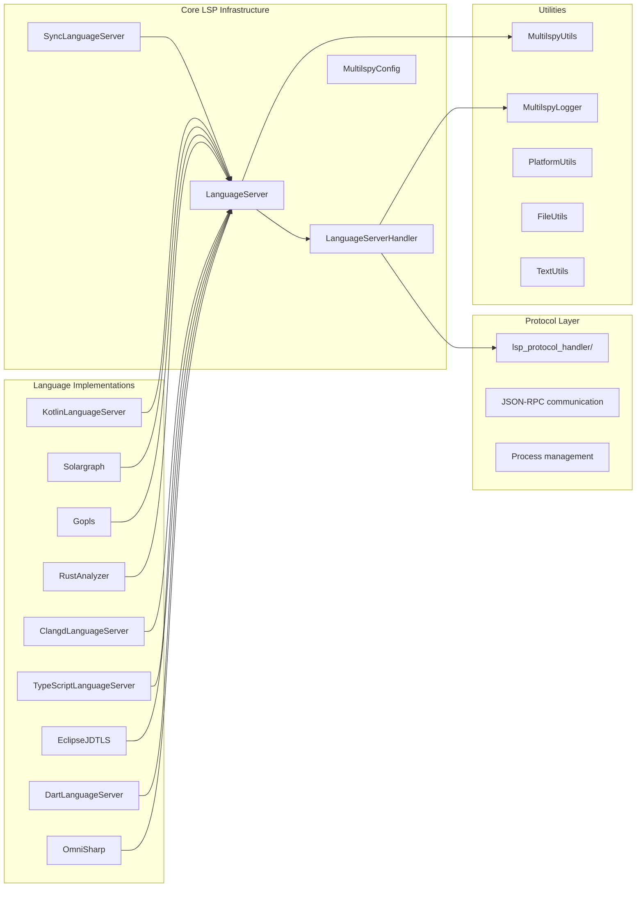
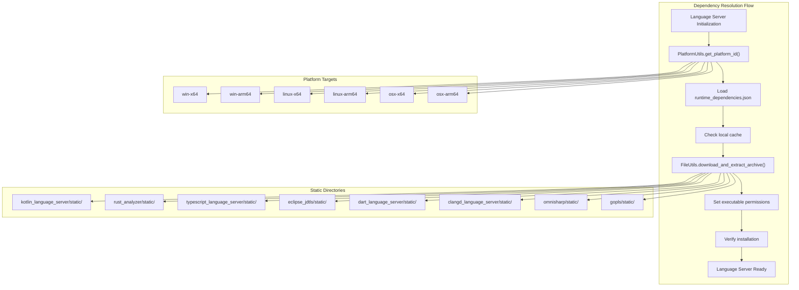

<!-- source: DeepWiki mcp.deepwiki.com · repo microsoft/multilspy · page 5.3 Development Environment · fetched 2026-10-26 -->

# Development Environment

<details>
<summary>Relevant source files</summary>

The following files were used as context for generating this wiki page:

- [.gitignore](.gitignore)
- [requirements.txt](requirements.txt)

</details>


This document provides guidance for setting up a development environment for multilspy, understanding the project structure, and contributing to the codebase. It covers the technical setup required to develop, test, and contribute to the multilspy Language Server Protocol client library.

For information about the testing framework and running tests, see [Testing Framework](#5.2). For CI/CD pipeline details, see [CI/CD Workflows](#5.1).

## Project Structure Overview

The multilspy project follows a modular architecture with clear separation between core LSP functionality and language-specific implementations. The project structure reflects this organization:

### Directory Structure

```mermaid
graph TD
    ROOT["multilspy/"]
    SRC["src/"]
    MULTILSPY["multilspy/"]
    
    CORE_FILES["Core Files"]
    LS["language_server.py"]
    LSH["language_server_handler.py"]
    SLS["sync_language_server.py"]
    CONFIG["multilspy_config.py"]
    LOGGER["multilspy_logger.py"]
    UTILS["multilspy_utils.py"]
    TYPES["lsp_protocol_handler/"]
    
    LANG_SERVERS["language_servers/"]
    KOTLIN["kotlin_language_server/"]
    RUBY["solargraph/"]
    GO["gopls/"]
    RUST["rust_analyzer/"]
    CPP["clangd_language_server/"]
    TS["typescript_language_server/"]
    JAVA["eclipse_jdtls/"]
    DART["dart_language_server/"]
    CSHARP["omnisharp/"]
    
    STATIC_DIRS["static/ directories"]
    RUNTIME_DEPS["runtime_dependencies.json files"]
    
    ROOT --> SRC
    SRC --> MULTILSPY
    MULTILSPY --> CORE_FILES
    MULTILSPY --> LANG_SERVERS
    
    CORE_FILES --> LS
    CORE_FILES --> LSH
    CORE_FILES --> SLS
    CORE_FILES --> CONFIG
    CORE_FILES --> LOGGER
    CORE_FILES --> UTILS
    CORE_FILES --> TYPES
    
    LANG_SERVERS --> KOTLIN
    LANG_SERVERS --> RUBY
    LANG_SERVERS --> GO
    LANG_SERVERS --> RUST
    LANG_SERVERS --> CPP
    LANG_SERVERS --> TS
    LANG_SERVERS --> JAVA
    LANG_SERVERS --> DART
    LANG_SERVERS --> CSHARP
    
    LANG_SERVERS --> STATIC_DIRS
    LANG_SERVERS --> RUNTIME_DEPS
```



**Sources:** [.gitignore:400-406]()

### Core Module Organization

The codebase is organized into distinct functional areas that map directly to Python modules:



**Sources:** [.gitignore:400-406](), system architecture diagrams

## Development Setup

### Prerequisites

Before setting up the development environment, ensure you have the following installed:

| Tool | Purpose | Version Requirement |
|------|---------|-------------------|
| Python | Core runtime | 3.8+ |
| pip | Package management | Latest |
| Git | Version control | Latest |
| Virtual environment tool | Dependency isolation | venv or virtualenv |

### Environment Setup

1. **Clone the Repository**
   ```bash
   git clone https://github.com/microsoft/multilspy.git
   cd multilspy
   ```

2. **Create Virtual Environment**
   ```bash
   python -m venv .venv
   source .venv/bin/activate  # On Windows: .venv\Scripts\activate
   ```

3. **Install Development Dependencies**
   ```bash
   pip install -r requirements.txt
   ```

4. **Install in Development Mode**
   ```bash
   pip install -e .
   ```

### Development Dependencies

The project uses several key development dependencies as defined in `requirements.txt`:

| Package | Version | Purpose |
|---------|---------|---------|
| `jedi-language-server` | 0.41.1 | Python LSP support for development |
| `pytest` | 7.3.1 | Testing framework |
| `pytest-asyncio` | 0.21.1 | Async testing support |
| `requests` | 2.32.3 | HTTP client for dependency downloads |
| `typing-extensions` | ≥4.2.0 | Enhanced type hints |
| `psutil` | ≥7.0.0,<8.0.0 | Process monitoring utilities |

**Sources:** [requirements.txt:1-6]()

### IDE Configuration

The project includes VS Code configuration that can be used as a reference:

- Workspace settings are preserved in `.vscode/settings.json`
- Task definitions in `.vscode/tasks.json`
- Debug configurations in `.vscode/launch.json`
- Recommended extensions in `.vscode/extensions.json`

**Sources:** [.gitignore:380-384]()

## Understanding the Codebase

### Runtime Dependency Management

One of the most complex aspects of multilspy is its automatic management of language server dependencies. Each language server implementation includes a `runtime_dependencies.json` file that defines platform-specific download URLs and installation procedures.



**Sources:** [.gitignore:400-406](), system architecture diagrams

### Key Development Patterns

Understanding these patterns will help when contributing to multilspy:

1. **Factory Pattern**: The `LanguageServer.create()` method instantiates language-specific implementations based on the `Language` enum
2. **Async Context Management**: Language servers implement async context managers for proper lifecycle management
3. **Platform Abstraction**: `PlatformUtils` handles cross-platform differences in binary names and paths
4. **Dependency Isolation**: Each language server manages its own dependencies in isolated `static/` directories

## Development Workflow

### Testing Setup

The project uses `pytest` with async support for comprehensive testing:

```bash
# Run all tests
pytest

# Run specific language server tests
pytest tests/test_kotlin.py

# Run with verbose output
pytest -v

# Run async tests specifically
pytest -k "async"
```

### Build Artifacts

The `.gitignore` file reveals the build system generates several types of artifacts:

| Artifact Type | Pattern | Purpose |
|---------------|---------|---------|
| Python bytecode | `__pycache__/`, `*.pyc` | Compiled Python files |
| Virtual environments | `.venv/`, `venv/` | Development dependencies |
| Static binaries | `*/static/` | Downloaded language server binaries |
| Build outputs | `[Bb]in/`, `[Oo]bj/` | Compiled artifacts |
| IDE files | `.vs/`, `.vscode/*` | Editor-specific settings |

**Sources:** [.gitignore:327-328](), [.gitignore:409-410](), [.gitignore:400-406]()

### Code Quality Tools

The project structure suggests several code quality practices:

- Type hints are extensively used (evidenced by `typing-extensions` dependency)
- Async/await patterns for LSP communication
- Process management through `psutil` for robust server lifecycle handling
- Comprehensive test coverage across all language implementations

**Sources:** [requirements.txt:5-6]()

## Contribution Guidelines

### Adding New Language Servers

When adding support for a new language server:

1. Create a new directory under `src/multilspy/language_servers/`
2. Implement a class extending `LanguageServer`
3. Add a `runtime_dependencies.json` file with platform-specific dependencies
4. Create a `static/` directory for downloaded binaries
5. Add the new language to the `Language` enum in `MultilspyConfig`
6. Update the factory method to handle the new language
7. Add comprehensive tests following the existing pattern

### Development Best Practices

- **Async Programming**: All LSP communication should use async/await patterns
- **Error Handling**: Implement robust error handling for network downloads and process management
- **Platform Support**: Ensure cross-platform compatibility for Windows, Linux, and macOS
- **Dependency Management**: Use the established `runtime_dependencies.json` pattern for external dependencies
- **Testing**: Write tests that cover both successful operations and error conditions
- **Documentation**: Update relevant wiki pages when adding new functionality

### Git Workflow

The `.gitignore` configuration shows the project follows standard Python development practices:

- Virtual environments are excluded from version control
- Build artifacts and caches are ignored
- IDE-specific files are mostly ignored (except VS Code configuration)
- Downloaded language server binaries are excluded

**Sources:** [.gitignore:327-328](), [.gitignore:380-384](), [.gitignore:400-406](), [.gitignore:409-410]()