# Page: Overview

# Overview

<details>
<summary>Relevant source files</summary>

The following files were used as context for generating this wiki page:

- [pyproject.toml](pyproject.toml)
- [src/multilspy/lsp_protocol_handler/server.py](src/multilspy/lsp_protocol_handler/server.py)
- [src/multilspy/multilspy_config.py](src/multilspy/multilspy_config.py)

</details>


## Purpose and Scope

Multilspy is a language-agnostic Language Server Protocol (LSP) client library written in Python that provides a unified interface for interacting with multiple programming language servers. It abstracts the complexity of LSP communication and process management, allowing developers to build applications that can analyze and manipulate code across different programming languages through a consistent API.

This document covers the high-level architecture, core components, and design principles of multilspy. For specific language server implementations, see [Language Server Implementations](#3). For practical usage examples, see [Using multilspy](#4).

## High-Level Architecture

Multilspy follows a layered architecture that separates low-level LSP protocol handling from high-level language-specific functionality:

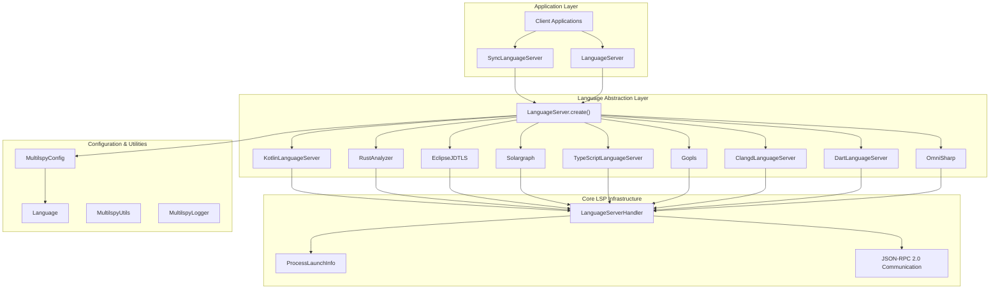

**Sources:** [src/multilspy/lsp_protocol_handler/server.py:143-179](), [src/multilspy/multilspy_config.py:8-47]()

## Core Components

### Language Server Handler

The `LanguageServerHandler` class serves as the foundation for all LSP communication. It implements the JSON-RPC 2.0 protocol over stdin/stdout pipes and manages the lifecycle of external language server processes.

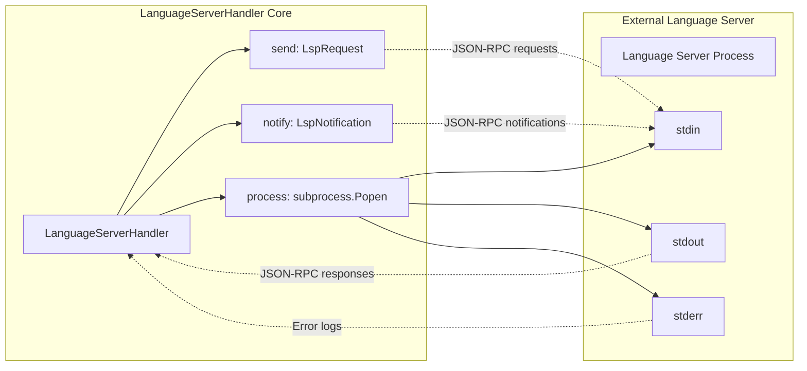

Key responsibilities include:
- Process launch and management via `ProcessLaunchInfo`
- Bidirectional JSON-RPC communication
- Request/response correlation using unique request IDs
- Asynchronous message handling and task management
- Graceful shutdown with process tree cleanup

**Sources:** [src/multilspy/lsp_protocol_handler/server.py:47-61](), [src/multilspy/lsp_protocol_handler/server.py:143-179](), [src/multilspy/lsp_protocol_handler/server.py:210-231]()

### Configuration System

The configuration system is built around two primary classes:

| Component | Purpose | Key Features |
|-----------|---------|--------------|
| `Language` | Enumeration of supported languages | String-based enum with values like `"rust"`, `"java"`, `"python"` |
| `MultilspyConfig` | Configuration parameters | Language selection, LSP tracing, process independence settings |

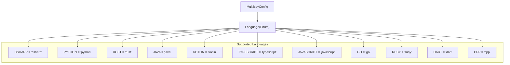

**Sources:** [src/multilspy/multilspy_config.py:8-24](), [src/multilspy/multilspy_config.py:28-46]()

## Language Server Lifecycle

The typical lifecycle of a language server interaction follows this pattern:

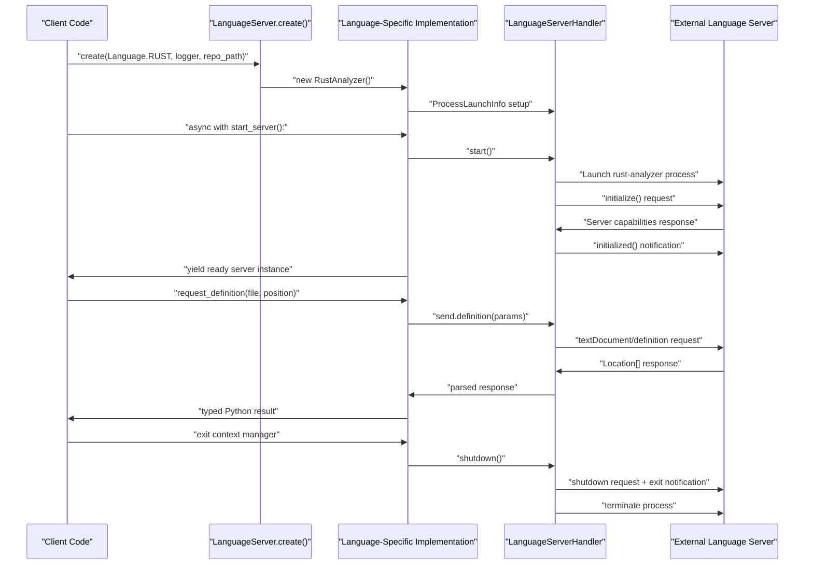

**Sources:** [src/multilspy/lsp_protocol_handler/server.py:210-231](), [src/multilspy/lsp_protocol_handler/server.py:343-355](), [src/multilspy/lsp_protocol_handler/server.py:460-473]()

## Project Metadata and Distribution

Multilspy is distributed as a Python package with the following characteristics:

| Attribute | Value |
|-----------|-------|
| Package Name | `multilspy` |
| Current Version | `0.0.15` |
| Python Requirements | `>=3.8, <4.0` |
| Build System | `flit_core` |
| Distribution | PyPI, TestPyPI, GitHub Releases |

### Key Dependencies

- `jedi-language-server==0.41.3` - Python language server
- `requests==2.32.3` - HTTP library for dependency downloads
- `typing-extensions>=4.2.0` - Enhanced type annotations
- `psutil (>=7.0.0,<8.0.0)` - Process management utilities

**Sources:** [pyproject.toml:6-14](), [pyproject.toml:30-35]()

## Supported Programming Languages

Multilspy provides first-class support for 11 programming languages through their respective language servers:

| Language | Enum Value | External Language Server |
|----------|------------|-------------------------|
| C# | `Language.CSHARP` | OmniSharp |
| Python | `Language.PYTHON` | jedi-language-server |
| Rust | `Language.RUST` | rust-analyzer |
| Java | `Language.JAVA` | Eclipse JDT Language Server |
| Kotlin | `Language.KOTLIN` | kotlin-language-server |
| TypeScript | `Language.TYPESCRIPT` | typescript-language-server |
| JavaScript | `Language.JAVASCRIPT` | typescript-language-server |
| Go | `Language.GO` | gopls |
| Ruby | `Language.RUBY` | Solargraph |
| Dart | `Language.DART` | Dart Language Server |
| C++ | `Language.CPP` | clangd |

Each language implementation handles the specific requirements, dependency management, and configuration needed for its corresponding external language server.

**Sources:** [src/multilspy/multilspy_config.py:8-24](), [pyproject.toml:12-28]()

## Design Principles

Multilspy is designed around several key principles:

1. **Language Agnosticism**: A unified API that abstracts language-specific differences
2. **Asynchronous by Default**: Built on asyncio for high-performance concurrent operations  
3. **Automatic Dependency Management**: Runtime download and setup of language server binaries
4. **Process Isolation**: Independent language server processes with proper lifecycle management
5. **Type Safety**: Comprehensive type annotations and LSP protocol type definitions
6. **Cross-Platform Support**: Windows, Linux, and macOS compatibility with platform-specific binary management

These principles enable multilspy to serve as a foundation for building sophisticated code analysis tools that work across multiple programming languages without requiring users to manually install and configure individual language servers.

**Sources:** [src/multilspy/lsp_protocol_handler/server.py:175-179](), [src/multilspy/multilspy_config.py:28-36]()

---

# Page: Installation and Setup

# Installation and Setup

<details>
<summary>Relevant source files</summary>

The following files were used as context for generating this wiki page:

- [pyproject.toml](pyproject.toml)
- [requirements.txt](requirements.txt)
- [src/multilspy/lsp_protocol_handler/server.py](src/multilspy/lsp_protocol_handler/server.py)

</details>


This document covers installing multilspy and setting up your development environment to use the library. It includes system requirements, package installation, runtime dependency management, and basic configuration. 

For information about specific language server configurations, see [Supported Languages](#1.2). For detailed configuration options, see [Configuration System](#1.3). For runtime dependency details, see [Runtime Dependency Management](#2.5).

## Purpose and Scope

multilspy is a language-agnostic LSP client library that automatically manages language server binaries and their runtime dependencies across platforms. This setup guide covers the initial installation process and explains how multilspy's dependency management system works during first use.

## System Requirements

### Python Environment

multilspy requires Python 3.8 or higher but less than 4.0, as specified in [pyproject.toml:14](). The library is distributed as a Python package with the following core dependencies:

| Dependency | Version | Purpose |
|------------|---------|---------|
| `jedi-language-server` | 0.41.3 | Python language server |
| `requests` | 2.32.3 | HTTP downloads for language server binaries |
| `typing-extensions` | >=4.2.0 | Enhanced typing support |
| `psutil` | >=7.0.0,<8.0.0 | Process management |

### Platform Support

multilspy supports the following platforms through its runtime dependency management system:

- **Windows**: win-x64, win-arm64
- **Linux**: linux-x64, linux-arm64  
- **macOS**: osx-x64, osx-arm64

## Package Installation

### Install from PyPI

```bash
pip install multilspy
```

### Install from Source

```bash
git clone https://github.com/microsoft/multilspy
cd multilspy
pip install -e .
```

### Verify Installation

```python
import multilspy
from multilspy import LanguageServer
from multilspy.multilspy_config import Language

# Verify core classes are available
print(f"multilspy version: {multilspy.__version__}")
print(f"Supported languages: {list(Language)}")
```

Sources: [pyproject.toml:6-35]()

## Runtime Dependency Management System

multilspy automatically downloads and manages language server binaries when you first use a specific language. This eliminates the need for manual installation of external language servers.

### Dependency Download Process

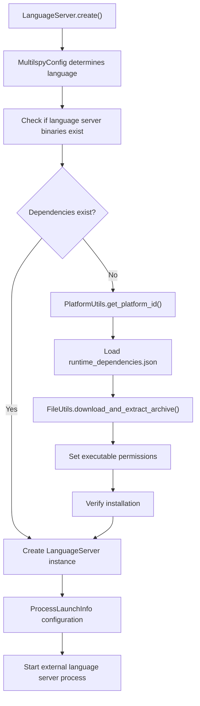

**Runtime Dependency Management Flow**
This diagram shows how multilspy automatically handles language server setup during first use.

Sources: [Architecture diagrams from context]()

### Language Server Binary Management

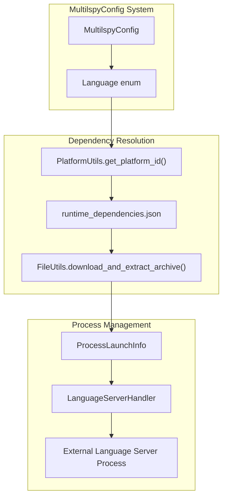

**Core Installation Components**
This diagram maps the key classes involved in multilspy's installation and dependency management.

Sources: [src/multilspy/lsp_protocol_handler/server.py:47-61]()

## Basic Configuration

### Language Selection

multilspy uses the `Language` enum to specify which language server to use:

```python
from multilspy.multilspy_config import Language

# Available languages (examples)
Language.PYTHON     # Uses jedi-language-server
Language.KOTLIN     # Downloads kotlin-language-server + JDK
Language.RUST       # Downloads rust-analyzer binary
Language.TYPESCRIPT # Downloads Node.js + typescript-language-server
Language.JAVA       # Downloads Eclipse JDT LS + dependencies
```

### Creating Language Server Instances

The `LanguageServer.create()` factory method handles all setup automatically:

```python
import asyncio
from multilspy import LanguageServer
from multilspy.multilspy_config import Language

async def setup_language_server():
    # This will automatically download dependencies if needed
    language_server = LanguageServer.create(
        config=Language.KOTLIN,
        logger=None,  # Optional logger function
        repo_path="/path/to/your/project"
    )
    
    async with language_server.start_server():
        # Language server is ready for use
        pass
```

### Process Launch Configuration

The `ProcessLaunchInfo` class from [src/multilspy/lsp_protocol_handler/server.py:47-61]() configures how external language servers are launched:

```python
@dataclasses.dataclass
class ProcessLaunchInfo:
    cmd: str                                    # Command to launch
    env: Dict[str, str] = dataclasses.field(default_factory=dict)  # Environment variables
    cwd: str = os.getcwd()                     # Working directory
```

Sources: [src/multilspy/lsp_protocol_handler/server.py:47-61]()

## First Run Behavior

### Automatic Dependency Download

On first use of a language, multilspy will:

1. **Detect Platform**: Use `PlatformUtils.get_platform_id()` to determine your system
2. **Load Configuration**: Read language-specific settings from `runtime_dependencies.json`
3. **Download Binaries**: Fetch platform-appropriate language server binaries
4. **Extract and Configure**: Set up binaries with correct permissions and paths
5. **Verify Installation**: Ensure the language server can be launched

### Storage Locations

Downloaded language server binaries are stored in a cache directory managed by multilspy. The exact location varies by platform but follows standard conventions for application data.

### Network Requirements

Initial setup requires internet connectivity to download language server binaries. Once downloaded, multilspy can work offline.

## Troubleshooting Common Issues

### Python Version Compatibility

Ensure you're using Python 3.8+ but less than 4.0:

```bash
python --version  # Should show 3.8.x through 3.11.x
```

### Permission Issues

On Unix-like systems, multilspy automatically sets executable permissions on downloaded binaries. If you encounter permission errors, verify that your user has write access to the cache directory.

### Network/Proxy Issues

If downloads fail due to network restrictions, check your firewall and proxy settings. multilspy uses the `requests` library, which respects standard HTTP proxy environment variables.

### Platform Detection

If automatic platform detection fails, check that your system is among the supported platforms listed in the requirements section.

Sources: [pyproject.toml:14](), [requirements.txt:1-7]()

---

# Page: Supported Languages

# Supported Languages

<details>
<summary>Relevant source files</summary>

The following files were used as context for generating this wiki page:

- [README.md](README.md)
- [src/multilspy/language_servers/kotlin_language_server/initialize_params.json](src/multilspy/language_servers/kotlin_language_server/initialize_params.json)
- [src/multilspy/language_servers/kotlin_language_server/kotlin_language_server.py](src/multilspy/language_servers/kotlin_language_server/kotlin_language_server.py)
- [src/multilspy/language_servers/kotlin_language_server/runtime_dependencies.json](src/multilspy/language_servers/kotlin_language_server/runtime_dependencies.json)
- [src/multilspy/multilspy_config.py](src/multilspy/multilspy_config.py)

</details>


This page provides a comprehensive list of all programming languages supported by multilspy and their respective language servers. These language servers enable multilspy to perform static analyses such as finding symbol definitions, references, and providing code completions across multiple languages using a consistent interface. For information about how to configure these language servers, see [Configuration System](#1.3).

## Language Support Overview

multilspy supports multiple programming languages through the Language Server Protocol (LSP), which allows it to communicate with language-specific servers in a standardized way. Each language server provides specialized static analysis capabilities for its respective language.

### Supported Language and Server Mapping

The following diagram illustrates the languages supported by multilspy and their corresponding language servers:

**Language Server Factory Pattern**

```mermaid
graph TB
    subgraph "Language Enum Values"
        JAVA["Language.JAVA"]
        PYTHON["Language.PYTHON"]
        RUST["Language.RUST"]
        CSHARP["Language.CSHARP"]
        TYPESCRIPT["Language.TYPESCRIPT"]
        JAVASCRIPT["Language.JAVASCRIPT"]
        GO["Language.GO"]
        RUBY["Language.RUBY"]
        DART["Language.DART"]
        KOTLIN["Language.KOTLIN"]
        CPP["Language.CPP"]
    end
    
    subgraph "Implementation Classes"
        JDTLS["EclipseJDTLS"]
        JEDI["JediServer"]
        RUSTANALYZER["RustAnalyzer"]
        OMNISHARP["OmniSharp"]
        TSLS["TypeScriptLanguageServer"]
        GOPLS["Gopls"]
        SOLARGRAPH["Solargraph"]
        DARTLS["DartLanguageServer"]
        KOTLINLS["KotlinLanguageServer"]
        CLANGD["ClangdLanguageServer"]
    end
    
    subgraph "External Processes"
        ECLIPSE["Eclipse JDTLS binary"]
        JEDIBINARY["jedi-language-server"]
        RUSTBINARY["rust-analyzer"]
        OMNISHARPBINARY["OmniSharp binary"]
        TSBINARY["typescript-language-server"]
        GOPLSBINARY["gopls binary"]
        SOLARGRAPHGEM["solargraph gem"]
        DARTSDK["Dart SDK"]
        KOTLINBINARY["kotlin-language-server"]
        CLANGDBINARY["clangd binary"]
    end
    
    JAVA --> JDTLS --> ECLIPSE
    PYTHON --> JEDI --> JEDIBINARY
    RUST --> RUSTANALYZER --> RUSTBINARY
    CSHARP --> OMNISHARP --> OMNISHARPBINARY
    TYPESCRIPT --> TSLS --> TSBINARY
    JAVASCRIPT --> TSLS
    GO --> GOPLS --> GOPLSBINARY
    RUBY --> SOLARGRAPH --> SOLARGRAPHGEM
    DART --> DARTLS --> DARTSDK
    KOTLIN --> KOTLINLS --> KOTLINBINARY
    CPP --> CLANGD --> CLANGDBINARY
```

Sources: [README.md:38-52](), [src/multilspy/multilspy_config.py:8-24]()

## Comprehensive Language Support Table

The following table provides details about all programming languages currently supported by multilspy and their respective language servers:

| Language | Language Server | Implementation Class | Description |
|----------|-----------------|---------------------|-------------|
| Java | Eclipse JDTLS | `EclipseJDTLS` | Full-featured Java language server from Eclipse project |
| Python | jedi-language-server | `JediServer` | Python server bundled with multilspy |
| Rust | Rust Analyzer | `RustAnalyzer` | Provides semantic code intelligence for Rust |
| C# | OmniSharp / RazorSharp | `OmniSharp` | .NET language server for C# projects |
| TypeScript | TypeScriptLanguageServer | `TypeScriptLanguageServer` | Official TypeScript server, also handles JavaScript |
| JavaScript | TypeScriptLanguageServer | `TypeScriptLanguageServer` | Uses same server as TypeScript |
| Go | gopls | `Gopls` | Official Go language server from the Go team |
| Ruby | Solargraph | `Solargraph` | Ruby gem-based language server with code intelligence |
| Dart | Dart | `DartLanguageServer` | Official Dart language server, supports Flutter |
| Kotlin | KotlinLanguageServer | `KotlinLanguageServer` | JVM-based Kotlin language support |
| C/C++ | clangd | `ClangdLanguageServer` | LLVM-based language server for C and C++ |

Sources: [README.md:38-52](), [src/multilspy/multilspy_config.py:8-24]()

## Language Server Class Hierarchy

In multilspy, each supported language has a corresponding implementation that extends the abstract `LanguageServer` class. This architecture allows for language-specific handling while maintaining a consistent interface.

**Language Server Implementation Architecture**

```mermaid
classDiagram
    class LanguageServer {
        +create(config, logger, repository_root_path)$ LanguageServer
        +start_server() AsyncContextManager
        +request_definition(filepath, line, column) List~Location~
        +request_references(filepath, line, column) List~Location~
        +request_completions(filepath, line, column) List~CompletionItem~
        +request_document_symbols(filepath) Tuple
        +request_hover(filepath, line, column) Hover
        +open_file(filepath) ContextManager
        #MultilspyConfig config
        #MultilspyLogger logger
        #ProcessLaunchInfo process_launch_info
    }
    
    class KotlinLanguageServer {
        +setup_runtime_dependencies() KotlinRuntimeDependencyPaths
        +_get_initialize_params() InitializeParams
        -runtime_dependency_paths KotlinRuntimeDependencyPaths
    }
    
    class RustAnalyzer {
        +setup_runtime_dependencies()
        +_get_initialize_params() InitializeParams
    }
    
    class JediServer {
        +_get_initialize_params() InitializeParams
    }
    
    class Solargraph {
        +setup_runtime_dependencies()
        +_get_initialize_params() InitializeParams
    }
    
    class EclipseJDTLS {
        +setup_runtime_dependencies()
        +_get_initialize_params() InitializeParams
    }
    
    class TypeScriptLanguageServer {
        +setup_runtime_dependencies()
        +_get_initialize_params() InitializeParams
    }
    
    class ProcessLaunchInfo {
        +cmd str
        +env dict
        +cwd str
    }
    
    class MultilspyConfig {
        +code_language Language
        +trace_lsp_communication bool
        +start_independent_lsp_process bool
    }
    
    LanguageServer <|-- KotlinLanguageServer
    LanguageServer <|-- RustAnalyzer
    LanguageServer <|-- JediServer
    LanguageServer <|-- Solargraph
    LanguageServer <|-- EclipseJDTLS
    LanguageServer <|-- TypeScriptLanguageServer
    LanguageServer o-- ProcessLaunchInfo
    LanguageServer o-- MultilspyConfig
```

Sources: [src/multilspy/language_servers/kotlin_language_server/kotlin_language_server.py:34-58](), [src/multilspy/multilspy_config.py:28-36]()

## Language Configuration

multilspy determines which language server to use based on the `code_language` parameter in the `MultilspyConfig` object. The supported languages are defined in the `Language` enum:

**Supported Language Values**

| Enum Value | String Value | Language Server Class |
|------------|--------------|----------------------|
| `Language.CSHARP` | `"csharp"` | `OmniSharp` |
| `Language.PYTHON` | `"python"` | `JediServer` |
| `Language.RUST` | `"rust"` | `RustAnalyzer` |
| `Language.JAVA` | `"java"` | `EclipseJDTLS` |
| `Language.KOTLIN` | `"kotlin"` | `KotlinLanguageServer` |
| `Language.TYPESCRIPT` | `"typescript"` | `TypeScriptLanguageServer` |
| `Language.JAVASCRIPT` | `"javascript"` | `TypeScriptLanguageServer` |
| `Language.GO` | `"go"` | `Gopls` |
| `Language.RUBY` | `"ruby"` | `Solargraph` |
| `Language.DART` | `"dart"` | `DartLanguageServer` |
| `Language.CPP` | `"cpp"` | `ClangdLanguageServer` |

The `Language` enum inherits from both `str` and `Enum`, allowing direct string comparison:

```python
# Both work equivalently
config = MultilspyConfig.from_dict({"code_language": "kotlin"})
config = MultilspyConfig.from_dict({"code_language": Language.KOTLIN})
```

Sources: [src/multilspy/multilspy_config.py:8-26]()

### Language Selection Example

To create a language server for a specific language:

```python
from multilspy import SyncLanguageServer
from multilspy.multilspy_config import MultilspyConfig
from multilspy.multilspy_logger import MultilspyLogger

# Specify language in config
config = MultilspyConfig.from_dict({"code_language": "java"})
logger = MultilspyLogger()

# Create language server instance
lsp = SyncLanguageServer.create(config, logger, "/path/to/repository/root")

# Use the language server
with lsp.start_server():
    # Make requests to the language server
    definitions = lsp.request_definition("path/to/file.java", 10, 15)
```

Sources: [README.md:54-95]()

## Runtime Dependencies Management

Most language servers require platform-specific runtime dependencies that multilspy manages automatically. The `KotlinLanguageServer` provides a concrete example of this process:

**Kotlin Runtime Dependency Management Flow**

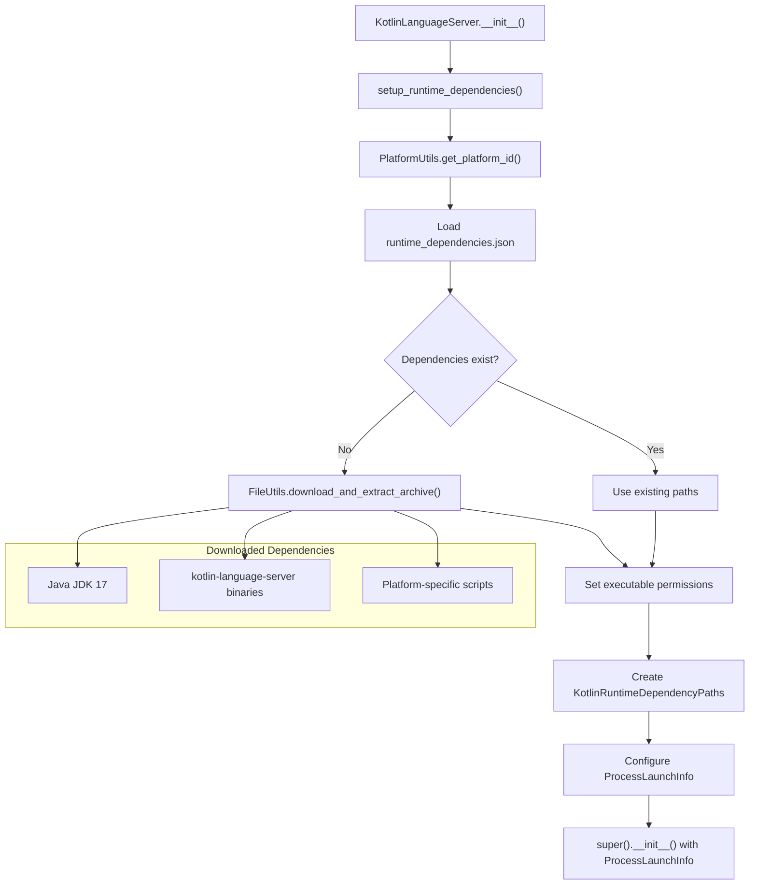

**Platform-Specific Dependency Configuration**

The `runtime_dependencies.json` file defines platform-specific URLs and paths:

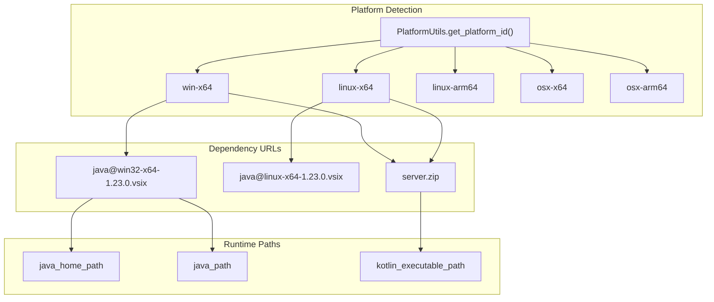

Key dependency management features:

- **Automatic Download**: `FileUtils.download_and_extract_archive()` handles platform-specific binary downloads
- **Path Management**: `KotlinRuntimeDependencyPaths` stores Java and Kotlin executable paths
- **Permission Setting**: Unix platforms get executable permissions via `os.chmod()`
- **Environment Variables**: `ProcessLaunchInfo` configures `JAVA_HOME` for the Kotlin server process
- **Caching**: Dependencies are stored in `static/` directories to avoid repeated downloads

Languages with runtime dependency management:
- **Kotlin**: Java JDK + kotlin-language-server binaries
- **Rust**: rust-analyzer binary
- **TypeScript**: Node.js + npm packages  
- **Java**: Gradle + JRE + Eclipse JDTLS + IntelliCode
- **C#**: OmniSharp binary + .NET runtime
- **Ruby**: Solargraph gem installation
- **Dart**: Dart SDK

**Python Exception**: `jedi-language-server` is bundled directly with multilspy and requires no external dependencies.

Sources: [src/multilspy/language_servers/kotlin_language_server/kotlin_language_server.py:60-131](), [src/multilspy/language_servers/kotlin_language_server/runtime_dependencies.json:1-42]()

## Language Features

All supported language servers implement the core Language Server Protocol features, though the exact capabilities may vary by language. The common features available across all languages include:

1. **Definition Finding**: Locate the definition of a symbol
2. **Reference Finding**: Find all references to a symbol
3. **Code Completion**: Get context-aware completion suggestions
4. **Document Symbols**: Retrieve the symbol structure of a document
5. **Hover Information**: Get information about a symbol on hover

These features are accessed through the common `LanguageServer` API methods, ensuring consistent usage patterns regardless of the underlying language.

Sources: [README.md:17-23]()

---

# Page: Configuration System

# Configuration System

<details>
<summary>Relevant source files</summary>

The following files were used as context for generating this wiki page:

- [src/multilspy/multilspy_config.py](src/multilspy/multilspy_config.py)

</details>


This document explains multilspy's configuration system, including the `Language` enum that defines supported programming languages and the `MultilspyConfig` class that controls language server behavior. The configuration system provides a centralized way to specify which language server to use and how it should operate.

For information about language-specific implementations and their setup requirements, see [Supported Languages](#1.2). For details about runtime dependency management controlled by these configurations, see [Runtime Dependency Management](#2.5).

## Language Enumeration

The `Language` enum serves as the central registry of all programming languages supported by multilspy. Each enum value maps to a specific language server implementation and corresponds to a concrete language server class.

```mermaid
graph TD
    LanguageEnum["Language(str, Enum)"] --> CSHARP["CSHARP = 'csharp'"]
    LanguageEnum --> PYTHON["PYTHON = 'python'"]
    LanguageEnum --> RUST["RUST = 'rust'"]
    LanguageEnum --> JAVA["JAVA = 'java'"]
    LanguageEnum --> KOTLIN["KOTLIN = 'kotlin'"]
    LanguageEnum --> TYPESCRIPT["TYPESCRIPT = 'typescript'"]
    LanguageEnum --> JAVASCRIPT["JAVASCRIPT = 'javascript'"]
    LanguageEnum --> GO["GO = 'go'"]
    LanguageEnum --> RUBY["RUBY = 'ruby'"]
    LanguageEnum --> DART["DART = 'dart'"]
    LanguageEnum --> CPP["CPP = 'cpp'"]
    
    CSHARP --> OmniSharpImpl["OmniSharp implementation"]
    RUST --> RustAnalyzerImpl["RustAnalyzer implementation"]
    JAVA --> EclipseJDTLSImpl["EclipseJDTLS implementation"]
    KOTLIN --> KotlinLSImpl["KotlinLanguageServer implementation"]
    TYPESCRIPT --> TypeScriptLSImpl["TypeScriptLanguageServer implementation"]
    JAVASCRIPT --> TypeScriptLSImpl
    GO --> GoplsImpl["Gopls implementation"]
    RUBY --> SolargraphImpl["Solargraph implementation"]
    DART --> DartLSImpl["DartLanguageServer implementation"]
    CPP --> ClangdImpl["ClangdLanguageServer implementation"]
```

The `Language` enum inherits from both `str` and `Enum`, allowing enum values to be used directly as strings. The `__str__` method returns the enum's string value, enabling seamless integration with string-based APIs.

**Sources:** [src/multilspy/multilspy_config.py:8-26]()

## MultilspyConfig Dataclass

The `MultilspyConfig` dataclass encapsulates all configuration parameters needed to initialize and control language server behavior. It provides both direct instantiation and dictionary-based construction methods.

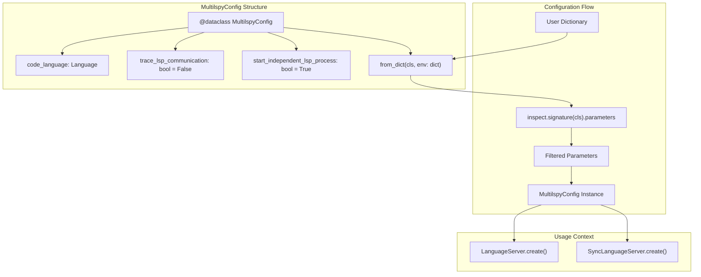

**Sources:** [src/multilspy/multilspy_config.py:28-46]()

## Configuration Parameters

### Required Parameters

| Parameter | Type | Purpose |
|-----------|------|---------|
| `code_language` | `Language` | Specifies which language server implementation to instantiate |

### Optional Parameters

| Parameter | Type | Default | Purpose |
|-----------|------|---------|---------|
| `trace_lsp_communication` | `bool` | `False` | Enables logging of LSP JSON-RPC messages for debugging |
| `start_independent_lsp_process` | `bool` | `True` | Controls whether to launch language server in separate process |

### Configuration Parameter Details

**`code_language`**: This required parameter determines which language-specific implementation will be created. The value directly maps to one of the supported language server implementations through the factory pattern.

**`trace_lsp_communication`**: When enabled, this parameter causes the LSP communication layer to log all JSON-RPC messages exchanged with the language server. This is primarily useful for debugging LSP protocol issues or understanding language server behavior.

**`start_independent_lsp_process`**: This parameter controls the process management strategy. When `True` (default), the language server runs in a separate process, providing better isolation and stability. When `False`, the language server may run in the same process if supported by the implementation.

**Sources:** [src/multilspy/multilspy_config.py:33-35]()

## Configuration Construction

### Direct Instantiation

```python
config = MultilspyConfig(
    code_language=Language.KOTLIN,
    trace_lsp_communication=True,
    start_independent_lsp_process=True
)
```

### Dictionary-Based Construction

The `from_dict` class method provides flexible configuration from dictionary sources, automatically filtering parameters based on the dataclass signature:

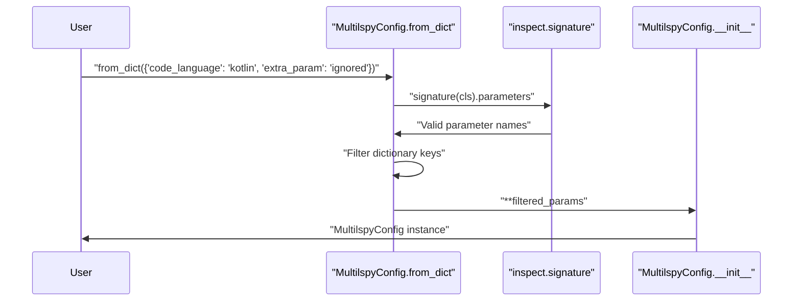

The `from_dict` method uses Python's `inspect` module to introspect the dataclass constructor signature, ensuring only valid parameters are passed while ignoring unknown dictionary keys.

**Sources:** [src/multilspy/multilspy_config.py:37-46]()

## Integration with Language Server Factory

The configuration system integrates directly with the language server factory pattern. The `code_language` parameter determines which language-specific implementation class is instantiated, while other parameters control the behavior of the resulting language server instance.

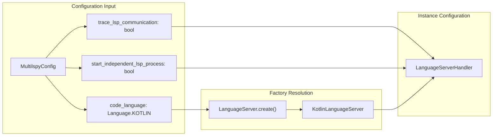

**Sources:** [src/multilspy/multilspy_config.py:28-46]()

---

# Page: Core Architecture

# Core Architecture

<details>
<summary>Relevant source files</summary>

The following files were used as context for generating this wiki page:

- [pyproject.toml](pyproject.toml)
- [src/multilspy/language_server.py](src/multilspy/language_server.py)
- [src/multilspy/lsp_protocol_handler/server.py](src/multilspy/lsp_protocol_handler/server.py)

</details>


This document describes the core architectural design of multilspy, including its layered structure, key classes, and how they interact to provide a language-agnostic LSP client interface. For information about specific language server implementations, see [Language Server Implementations](#3). For details about configuration and setup, see [Configuration System](#1.3).

## Layered Architecture Overview

Multilspy is built using a layered architecture that abstracts LSP protocol complexity and provides both synchronous and asynchronous interfaces for client applications.

### Architecture Layers

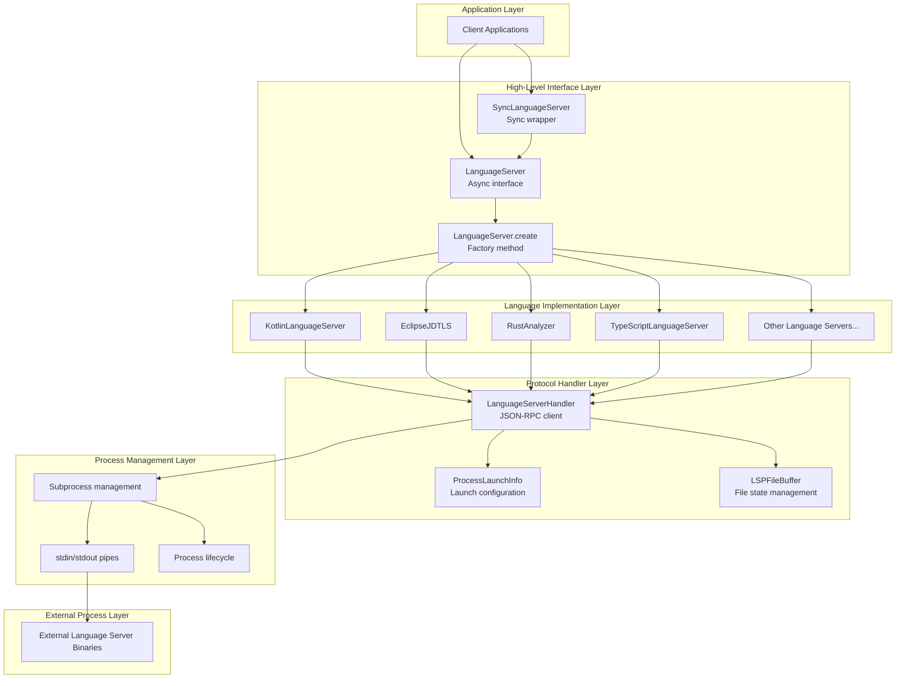

Sources: [src/multilspy/language_server.py:56-198](), [src/multilspy/lsp_protocol_handler/server.py:143-179]()

## Core Classes and Responsibilities

### LanguageServer Class

The `LanguageServer` class serves as the primary asynchronous interface for LSP communication.

| Component | Responsibility | Key Methods |
|-----------|---------------|-------------|
| `LanguageServer` | Main async LSP interface | `create()`, `start_server()`, `request_definition()`, `request_references()` |
| `SyncLanguageServer` | Synchronous wrapper | Same methods as `LanguageServer` but blocking |
| `LanguageServerHandler` | Low-level LSP protocol | `start()`, `stop()`, `send_request()`, `send_notification()` |
| `LSPFileBuffer` | File state tracking | Manages file contents, versions, and reference counts |

Sources: [src/multilspy/language_server.py:56-61](), [src/multilspy/language_server.py:690-694](), [src/multilspy/lsp_protocol_handler/server.py:143-179](), [src/multilspy/language_server.py:34-54]()

### Factory Pattern Implementation

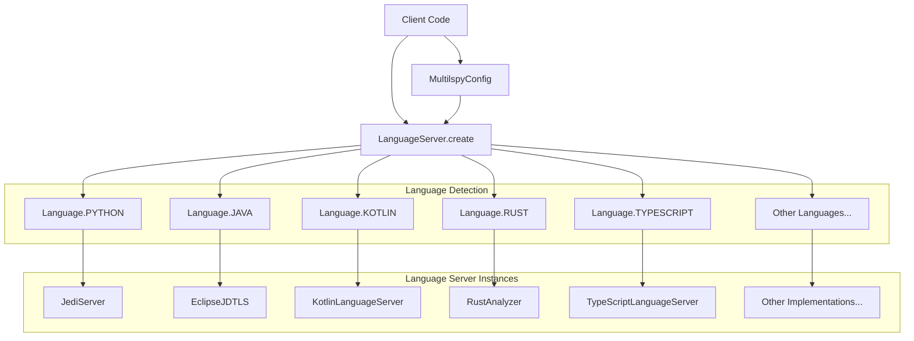

The factory method `LanguageServer.create()` examines the `config.code_language` field and instantiates the appropriate language-specific server implementation.

Sources: [src/multilspy/language_server.py:62-127]()

## LSP Protocol Handler Architecture

### LanguageServerHandler Components

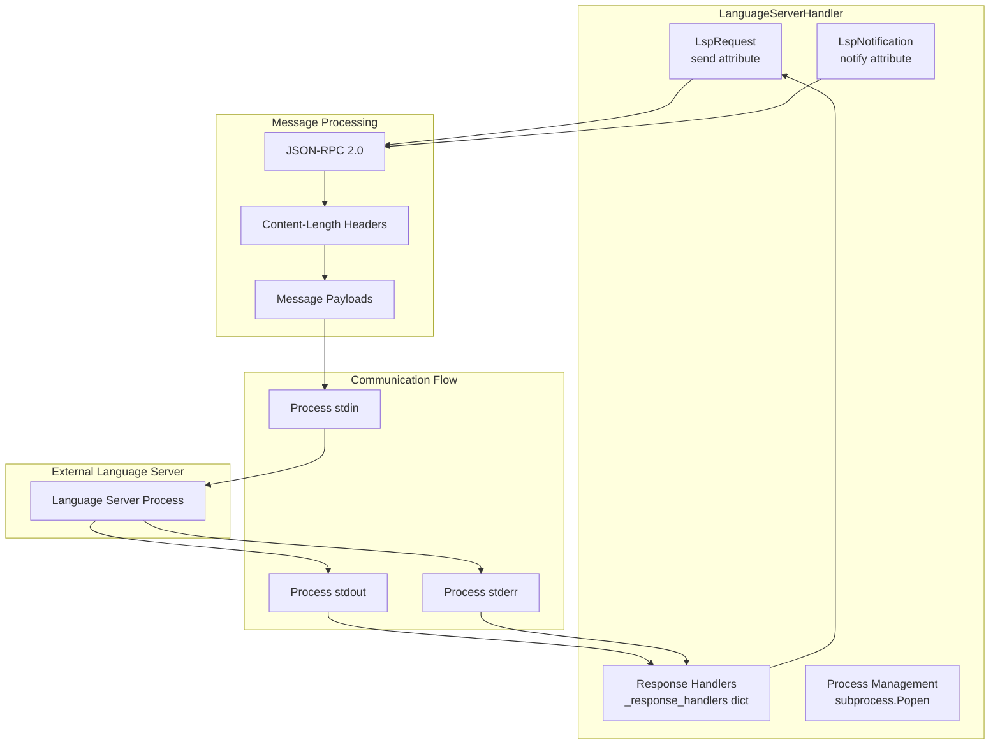

Sources: [src/multilspy/lsp_protocol_handler/server.py:181-209](), [src/multilspy/lsp_protocol_handler/server.py:363-389](), [src/multilspy/lsp_protocol_handler/server.py:99-105]()

### ProcessLaunchInfo Configuration

The `ProcessLaunchInfo` dataclass encapsulates process launch parameters:

```mermaid
graph LR
    PLI[ProcessLaunchInfo]
    CMD[cmd: str<br/>Launch command]
    ENV[env: Dict[str, str]<br/>Environment variables]
    CWD[cwd: str<br/>Working directory]
    
    PLI --> CMD
    PLI --> ENV
    PLI --> CWD
```

Sources: [src/multilspy/lsp_protocol_handler/server.py:47-61]()

## File Buffer Management System

### LSPFileBuffer Lifecycle

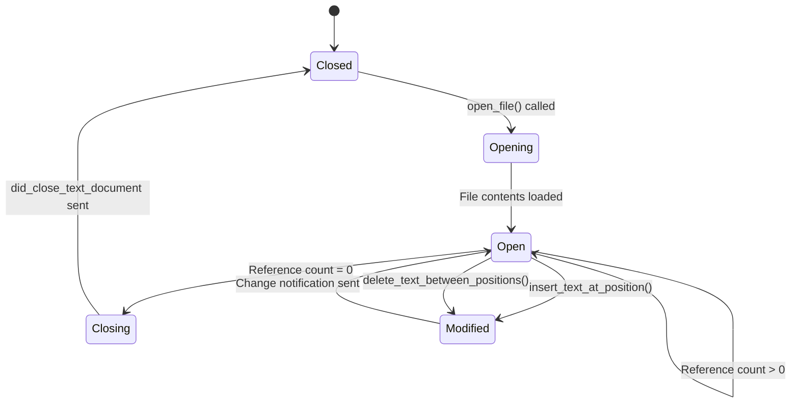

The `LSPFileBuffer` class tracks file state with reference counting to support nested file operations:

| Field | Purpose |
|-------|---------|
| `uri` | File URI for LSP communication |
| `contents` | Current file contents in memory |
| `version` | Document version for change tracking |
| `language_id` | Language identifier for syntax |
| `ref_count` | Reference count for nested opens |

Sources: [src/multilspy/language_server.py:34-54](), [src/multilspy/language_server.py:202-253]()

## Synchronous Wrapper Architecture

### SyncLanguageServer Implementation

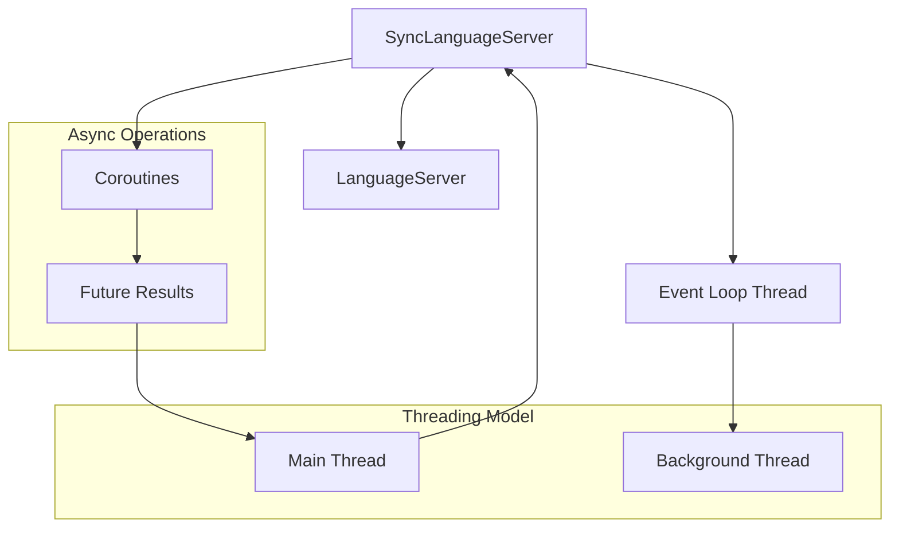

The `SyncLanguageServer` uses `asyncio.run_coroutine_threadsafe()` to bridge synchronous and asynchronous interfaces, running the async operations in a dedicated event loop thread.

Sources: [src/multilspy/language_server.py:689-872](), [src/multilspy/language_server.py:762-777]()

## Process Lifecycle Management

### Startup and Shutdown Sequence

```mermaid
sequenceDiagram
    participant Client
    participant LS as LanguageServer
    participant LSH as LanguageServerHandler
    participant Proc as External Process
    
    Client->>LS: start_server()
    LS->>LSH: start()
    LSH->>Proc: create_subprocess_shell()
    LSH->>LSH: create tasks for stdout/stderr
    LSH->>Proc: LSP initialize request
    Proc->>LSH: Server capabilities response
    LSH->>Proc: initialized notification
    LS->>Client: yield ready server
    
    Note over Client,Proc: Normal LSP operations...
    
    Client->>LS: exit context manager
    LS->>LSH: shutdown()
    LSH->>Proc: shutdown request
    LSH->>Proc: exit notification
    LSH->>LSH: _cancel_pending_tasks()
    LSH->>Proc: terminate/kill process
    LSH->>LSH: cleanup pipes and handles
```

The process management includes robust cleanup with timeouts and fallback mechanisms for process termination.

Sources: [src/multilspy/lsp_protocol_handler/server.py:210-232](), [src/multilspy/lsp_protocol_handler/server.py:233-248](), [src/multilspy/lsp_protocol_handler/server.py:265-341](), [src/multilspy/language_server.py:181-198]()

---

# Page: LanguageServer Class

# LanguageServer Class

<details>
<summary>Relevant source files</summary>

The following files were used as context for generating this wiki page:

- [src/multilspy/language_server.py](src/multilspy/language_server.py)

</details>


## Overview

The `LanguageServer` class is the central component of multilspy, providing a language-agnostic interface to the Language Server Protocol (LSP). It serves as the primary API entry point for clients that need to interact with language servers across multiple programming languages. This abstract class defines the contract for all language-specific implementations and manages communication with the underlying language server processes.

For the synchronous version of this interface, see [SyncLanguageServer](#2.2).

LanguageServer Class Hierarchy

```mermaid
classDiagram
    class LanguageServer {
        +create(config, logger, repository_root_path) LanguageServer$
        +__init__(config, logger, repository_root_path, process_launch_info, language_id)
        +start_server() AsyncIterator~LanguageServer~
        +open_file(relative_file_path) Iterator~None~
        +request_definition(relative_file_path, line, column) List~Location~
        +request_references(relative_file_path, line, column) List~Location~
        +request_completions(relative_file_path, line, column, allow_incomplete) List~CompletionItem~
        +request_document_symbols(relative_file_path) Tuple
        +request_hover(relative_file_path, line, column) Union~Hover, None~
        +request_workspace_symbol(query) Union~List~UnifiedSymbolInformation~, None~
        +insert_text_at_position(relative_file_path, line, column, text) Position
        +delete_text_between_positions(relative_file_path, start, end) str
        +get_open_file_text(relative_file_path) str
        -server LanguageServerHandler
        -open_file_buffers Dict~str, LSPFileBuffer~
        -completions_available asyncio.Event
    }
    
    class SyncLanguageServer {
        +create(config, logger, repository_root_path, timeout) SyncLanguageServer$
        +__init__(language_server, timeout)
        +start_server() Iterator~SyncLanguageServer~
        +open_file(relative_file_path) Iterator~None~
        +request_definition(file_path, line, column) List~Location~
        +request_references(file_path, line, column) List~Location~
        +request_completions(relative_file_path, line, column, allow_incomplete) List~CompletionItem~
        +request_document_symbols(relative_file_path) Tuple
        +request_hover(relative_file_path, line, column) Union~Hover, None~
        +request_workspace_symbol(query) Union~List~UnifiedSymbolInformation~, None~
        -language_server LanguageServer
        -loop asyncio.AbstractEventLoop
        -timeout Optional~int~
    }
    
    class LSPFileBuffer {
        +uri str
        +contents str
        +version int
        +language_id str
        +ref_count int
    }
    
    class JediServer {
        +setup_runtime_dependencies()
    }
    
    class EclipseJDTLS {
        +setup_runtime_dependencies()
    }
    
    class KotlinLanguageServer {
        +setup_runtime_dependencies()
    }
    
    class RustAnalyzer {
        +setup_runtime_dependencies()
    }
    
    class TypeScriptLanguageServer {
        +setup_runtime_dependencies()
    }
    
    class Gopls {
        +setup_runtime_dependencies()
    }
    
    class Solargraph {
        +setup_runtime_dependencies()
    }
    
    class DartLanguageServer {
        +setup_runtime_dependencies()
    }
    
    class ClangdLanguageServer {
        +setup_runtime_dependencies()
    }
    
    class OmniSharp {
        +setup_runtime_dependencies()
    }
    
    SyncLanguageServer --> LanguageServer : "wraps"
    LanguageServer --> LSPFileBuffer : "manages"
    LanguageServer <|-- JediServer : "extends"
    LanguageServer <|-- EclipseJDTLS : "extends"
    LanguageServer <|-- KotlinLanguageServer : "extends"
    LanguageServer <|-- RustAnalyzer : "extends"
    LanguageServer <|-- TypeScriptLanguageServer : "extends"
    LanguageServer <|-- Gopls : "extends"
    LanguageServer <|-- Solargraph : "extends"
    LanguageServer <|-- DartLanguageServer : "extends"
    LanguageServer <|-- ClangdLanguageServer : "extends"
    LanguageServer <|-- OmniSharp : "extends"
```

Sources: [src/multilspy/language_server.py:34-54](), [src/multilspy/language_server.py:56-688](), [src/multilspy/language_server.py:689-872]()

## Factory Method Pattern

The `LanguageServer` class implements the factory method pattern through its `create` static method. This method instantiates the appropriate language-specific implementation based on the provided configuration.

Factory Method Implementation Flow

```mermaid
flowchart TD
    Client["Client Code"] -->|"LanguageServer.create(config, logger, repository_root_path)"| FactoryMethod["LanguageServer.create()"]
    FactoryMethod -->|"config.code_language"| LanguageSwitch{"config.code_language"}
    
    LanguageSwitch -->|"Language.PYTHON"| ImportJedi["from multilspy.language_servers.jedi_language_server.jedi_server import JediServer"]
    LanguageSwitch -->|"Language.JAVA"| ImportJDTLS["from multilspy.language_servers.eclipse_jdtls.eclipse_jdtls import EclipseJDTLS"]
    LanguageSwitch -->|"Language.KOTLIN"| ImportKotlin["from multilspy.language_servers.kotlin_language_server.kotlin_language_server import KotlinLanguageServer"]
    LanguageSwitch -->|"Language.RUST"| ImportRust["from multilspy.language_servers.rust_analyzer.rust_analyzer import RustAnalyzer"]
    LanguageSwitch -->|"Language.CSHARP"| ImportOmni["from multilspy.language_servers.omnisharp.omnisharp import OmniSharp"]
    LanguageSwitch -->|"Language.TYPESCRIPT/JAVASCRIPT"| ImportTS["from multilspy.language_servers.typescript_language_server.typescript_language_server import TypeScriptLanguageServer"]
    LanguageSwitch -->|"Language.GO"| ImportGo["from multilspy.language_servers.gopls.gopls import Gopls"]
    LanguageSwitch -->|"Language.RUBY"| ImportRuby["from multilspy.language_servers.solargraph.solargraph import Solargraph"]
    LanguageSwitch -->|"Language.DART"| ImportDart["from multilspy.language_servers.dart_language_server.dart_language_server import DartLanguageServer"]
    LanguageSwitch -->|"Language.CPP"| ImportClang["from multilspy.language_servers.clangd_language_server.clangd_language_server import ClangdLanguageServer"]
    
    ImportJedi --> CreateJedi["return JediServer(config, logger, repository_root_path)"]
    ImportJDTLS --> CreateJDTLS["return EclipseJDTLS(config, logger, repository_root_path)"]
    ImportKotlin --> CreateKotlin["return KotlinLanguageServer(config, logger, repository_root_path)"]
    ImportRust --> CreateRust["return RustAnalyzer(config, logger, repository_root_path)"]
    ImportOmni --> CreateOmni["return OmniSharp(config, logger, repository_root_path)"]
    ImportTS --> CreateTS["return TypeScriptLanguageServer(config, logger, repository_root_path)"]
    ImportGo --> CreateGo["return Gopls(config, logger, repository_root_path)"]
    ImportRuby --> CreateRuby["return Solargraph(config, logger, repository_root_path)"]
    ImportDart --> CreateDart["return DartLanguageServer(config, logger, repository_root_path)"]
    ImportClang --> CreateClang["return ClangdLanguageServer(config, logger, repository_root_path)"]
    
    CreateJedi --> Return["return LanguageServer instance"]
    CreateJDTLS --> Return
    CreateKotlin --> Return
    CreateRust --> Return
    CreateOmni --> Return
    CreateTS --> Return
    CreateGo --> Return
    CreateRuby --> Return
    CreateDart --> Return
    CreateClang --> Return
    
    Return --> Client
    
    LanguageSwitch -->|"else"| LogError["logger.log(f'Language {config.code_language} is not supported', logging.ERROR)"]
    LogError --> RaiseException["raise MultilspyException(f'Language {config.code_language} is not supported')"]
```

Sources: [src/multilspy/language_server.py:62-127]()

### Supported Language Implementations

The `create` method supports multiple language-specific implementations:

| Language | Language Server | Implementation Class |
|----------|-----------------|----------------------|
| Python | Jedi Language Server | `JediServer` |
| Java | Eclipse JDTLS | `EclipseJDTLS` |
| Kotlin | Kotlin Language Server | `KotlinLanguageServer` |
| Rust | Rust Analyzer | `RustAnalyzer` |
| C# | OmniSharp | `OmniSharp` |
| TypeScript/JavaScript | TypeScript Language Server | `TypeScriptLanguageServer` |
| Go | gopls | `Gopls` |
| Ruby | Solargraph | `Solargraph` |
| Dart | Dart Language Server | `DartLanguageServer` |
| C/C++ | clangd | `ClangdLanguageServer` |

Sources: [src/multilspy/language_server.py:76-124]()

## Initialization and Server Lifecycle

The `LanguageServer` class manages the lifecycle of the underlying language server process. It uses an asynchronous context manager pattern to ensure proper startup and shutdown of the server.

LanguageServer Lifecycle and Communication

```mermaid
sequenceDiagram
    participant Client as "Client Code"
    participant LS as "LanguageServer"
    participant LSHandler as "LanguageServerHandler"
    participant ExtProcess as "External Language Server Process"
    
    Client->>LS: LanguageServer.create(config, logger, repository_root_path)
    LS->>LS: __init__(config, logger, repository_root_path, process_launch_info, language_id)
    LS->>LSHandler: LanguageServerHandler(process_launch_info, logger, start_independent_lsp_process)
    LS-->>Client: language_server instance
    
    Client->>+LS: async with start_server()
    LS->>LS: self.server_started = True
    LS-->>Client: yield self
    
    Client->>LS: with open_file(relative_file_path)
    LS->>LS: FileUtils.read_file(absolute_file_path)
    LS->>LS: LSPFileBuffer(uri, contents, version=0, language_id, ref_count=1)
    LS->>LSHandler: server.notify.did_open_text_document(textDocument)
    LSHandler->>ExtProcess: LSP textDocument/didOpen notification
    LS-->>Client: yield (file opened)
    
    Client->>LS: request_definition(relative_file_path, line, column)
    LS->>LSHandler: server.send.definition(textDocument, position)
    LSHandler->>ExtProcess: LSP textDocument/definition request
    ExtProcess-->>LSHandler: Location[] or LocationLink[] response
    LSHandler-->>LS: parsed response
    LS->>LS: convert to multilspy_types.Location[]
    LS-->>Client: List[multilspy_types.Location]
    
    Client->>LS: insert_text_at_position(relative_file_path, line, column, text)
    LS->>LS: file_buffer.version += 1
    LS->>LS: TextUtils.get_index_from_line_col(contents, line, column)
    LS->>LS: update file_buffer.contents
    LS->>LSHandler: server.notify.did_change_text_document(textDocument, contentChanges)
    LSHandler->>ExtProcess: LSP textDocument/didChange notification
    LS-->>Client: new Position
    
    Client->>LS: exit open_file context
    LS->>LS: file_buffer.ref_count -= 1
    LS->>LSHandler: server.notify.did_close_text_document(textDocument)
    LSHandler->>ExtProcess: LSP textDocument/didClose notification
    LS->>LS: del open_file_buffers[uri]
    
    Client->>-LS: exit start_server context
    LS->>LS: self.server_started = False
    LS->>LSHandler: shutdown process
    LSHandler->>ExtProcess: terminate
```

Sources: [src/multilspy/language_server.py:129-198](), [src/multilspy/language_server.py:202-304](), [src/multilspy/language_server.py:367-442]()

## File Management

The `LanguageServer` implements a buffer system to track open files and communicate changes to the language server. The `LSPFileBuffer` dataclass is used to represent file state.

File Buffer Management System

```mermaid
classDiagram
    class LSPFileBuffer {
        +uri: str
        +contents: str
        +version: int
        +language_id: str
        +ref_count: int
    }
    
    class LanguageServer {
        -open_file_buffers: Dict[str, LSPFileBuffer]
        -repository_root_path: str
        -language_id: str
        +open_file(relative_file_path: str) Iterator[None]
        +insert_text_at_position(relative_file_path: str, line: int, column: int, text_to_be_inserted: str) Position
        +delete_text_between_positions(relative_file_path: str, start: Position, end: Position) str
        +get_open_file_text(relative_file_path: str) str
    }
    
    class LanguageServerHandler {
        +notify.did_open_text_document(params)
        +notify.did_change_text_document(params)
        +notify.did_close_text_document(params)
    }
    
    class FileUtils {
        +read_file(logger, absolute_file_path) str$
    }
    
    class TextUtils {
        +get_index_from_line_col(contents, line, column) int$
        +get_updated_position_from_line_and_column_and_edit(line, column, text) Tuple[int, int]$
    }
    
    class PathUtils {
        +uri_to_path(uri) str$
        +get_relative_path(absolute_path, repository_root_path) str$
    }
    
    LanguageServer --> LSPFileBuffer : "manages"
    LanguageServer --> LanguageServerHandler : "uses"
    LanguageServer --> FileUtils : "uses"
    LanguageServer --> TextUtils : "uses"
    LanguageServer --> PathUtils : "uses"
```

Sources: [src/multilspy/language_server.py:34-54](), [src/multilspy/language_server.py:202-365](), [src/multilspy/language_server.py:28-29]()

### File Operation Methods

The `LanguageServer` class provides several methods for file manipulation:

| Method | Description |
|--------|-------------|
| `open_file` | Opens a file in the language server. Uses a reference counting mechanism to track open status. |
| `insert_text_at_position` | Inserts text at a given position and notifies the language server. |
| `delete_text_between_positions` | Deletes text between positions and notifies the language server. |
| `get_open_file_text` | Returns the current contents of an open file. |

Sources: [src/multilspy/language_server.py:202-365]()

## LSP Request Methods

The `LanguageServer` class provides methods for common LSP requests. These methods handle communication with the language server and convert responses to appropriate types.

### Definition and Reference Requests

LSP Request Processing Flow

```mermaid
flowchart TD
    Client["Client Code"] -->|"await request_definition(relative_file_path, line, column)"| CheckServer{"self.server_started?"}
    CheckServer -->|"False"| LogError["self.logger.log('find_function_definition called before Language Server started', logging.ERROR)"]
    LogError --> RaiseException["raise MultilspyException('Language Server not started')"]
    
    CheckServer -->|"True"| OpenFileContext["with self.open_file(relative_file_path):"]
    OpenFileContext --> BuildParams["Build LSP params:\n{\n  'textDocument': {'uri': pathlib.Path(...).as_uri()},\n  'position': {'line': line, 'character': column}\n}"]
    BuildParams --> SendRequest["await self.server.send.definition(params)"]
    SendRequest --> ExternalLS["External Language Server Process"]
    ExternalLS --> ParseResponse["Parse response:\n- List[Location] or List[LocationLink]\n- Single Location"]
    
    ParseResponse --> ProcessLocations["for item in response:"]
    ProcessLocations --> CheckLocationFormat{"Location or LocationLink?"}
    
    CheckLocationFormat -->|"Location: has 'uri' and 'range'"| CreateLocation["new_item = {}\nnew_item.update(item)\nnew_item['absolutePath'] = PathUtils.uri_to_path(new_item['uri'])\nnew_item['relativePath'] = PathUtils.get_relative_path(...)"]
    CheckLocationFormat -->|"LocationLink: has 'targetUri', 'targetRange'"| CreateLocationLink["new_item = {}\nnew_item['uri'] = item['targetUri']\nnew_item['absolutePath'] = PathUtils.uri_to_path(...)\nnew_item['range'] = item['targetSelectionRange']"]
    
    CreateLocation --> AppendResult["ret.append(multilspy_types.Location(**new_item))"]
    CreateLocationLink --> AppendResult
    AppendResult --> ReturnList["return List[multilspy_types.Location]"]
    ReturnList --> Client
```

Sources: [src/multilspy/language_server.py:367-442]()

### Completion Requests

The `request_completions` method requests code completion items at a specific position and handles the complex response formats that can be returned by different language servers.

Sources: [src/multilspy/language_server.py:492-584]()

### Symbol and Hover Requests

The class also provides methods for document symbols, hover information, and workspace symbols:

| Method | Description | LSP Request |
|--------|-------------|-------------|
| `request_document_symbols` | Returns symbols in a document | textDocument/documentSymbol |
| `request_hover` | Returns hover information | textDocument/hover |
| `request_workspace_symbol` | Searches for symbols across the workspace | workspace/symbol |

Sources: [src/multilspy/language_server.py:586-687]()

## Usage Pattern

The typical usage pattern for the `LanguageServer` class follows an async context manager approach:

Typical Usage Pattern

```mermaid
flowchart TD
    Start["Start"] --> CreateConfig["config = MultilspyConfig(code_language=Language.KOTLIN)"]
    CreateConfig --> CreateLogger["logger = MultilspyLogger()"]
    CreateLogger --> CreateLS["language_server = LanguageServer.create(config, logger, repository_root_path)"]
    CreateLS --> StartServer["async with language_server.start_server():"]
    StartServer --> OpenFile["with language_server.open_file(relative_file_path):"]
    OpenFile --> RequestOps["Make LSP requests:\n- await request_definition(relative_file_path, line, column)\n- await request_references(relative_file_path, line, column)\n- await request_completions(relative_file_path, line, column)\n- await request_document_symbols(relative_file_path)\n- await request_hover(relative_file_path, line, column)\n- await request_workspace_symbol(query)"]
    RequestOps --> FileEdits{"Need file edits?"}
    FileEdits -->|"Yes"| EditOps["Edit operations:\n- insert_text_at_position(relative_file_path, line, column, text)\n- delete_text_between_positions(relative_file_path, start, end)\n- get_open_file_text(relative_file_path)"]
    FileEdits -->|"No"| CloseFile["Exit open_file context\n(triggers did_close_text_document)"]
    EditOps --> CloseFile
    CloseFile --> MakeMoreReq{"More files to process?"}
    MakeMoreReq -->|"Yes"| OpenFile
    MakeMoreReq -->|"No"| StopServer["Exit start_server context\n(triggers server shutdown)"]
    StopServer --> End["End"]
```

Sources: [src/multilspy/language_server.py:181-198](), [src/multilspy/language_server.py:202-365]()

## Implementation Details

### Constructor

The constructor takes configuration parameters but is not meant to be called directly. It initializes the LSP handler and prepares for communication with the language server.

| Parameter | Type | Description |
|-----------|------|-------------|
| `config` | `MultilspyConfig` | Configuration object containing language and settings |
| `logger` | `MultilspyLogger` | Logger instance for debugging and tracing |
| `repository_root_path` | `str` | Absolute path to the repository root |
| `process_launch_info` | `ProcessLaunchInfo` | Process launch configuration for the language server |
| `language_id` | `str` | Language identifier for LSP communication |

Key initialization steps:
- Creates `LanguageServerHandler` instance with `process_launch_info`
- Sets up LSP communication logging based on `config.trace_lsp_communication`
- Initializes `open_file_buffers` dictionary for file management
- Creates `completions_available` asyncio event for completion synchronization

Sources: [src/multilspy/language_server.py:129-176]()

### Direct Instantiation Prevention

The class implements a check to prevent direct instantiation:

```python
if type(self) == LanguageServer:
    raise MultilspyException(
        "LanguageServer is an abstract class and cannot be instantiated directly. Use LanguageServer.create method instead."
    )
```

This ensures that clients always use the factory method `LanguageServer.create()` which properly instantiates the appropriate language-specific subclass.

Sources: [src/multilspy/language_server.py:150-153]()

## Relationships with Other Components

The `LanguageServer` class interacts with several other components in the multilspy system:

```mermaid
flowchart TD
    LanguageServer["LanguageServer"] --> LSHandler["LanguageServerHandler"]
    LanguageServer --> LSPFileBuffer["LSPFileBuffer"]
    LanguageServer --> MultilspyConfig["MultilspyConfig"]
    LanguageServer --> MultilspyLogger["MultilspyLogger"]
    LanguageServer --> Types["multilspy_types"]
    LanguageServer --> Utils["PathUtils, FileUtils, TextUtils"]
    
    SyncLS["SyncLanguageServer"] --> LanguageServer
    
    JediServer["JediServer"] --> LanguageServer
    EclipseJDTLS["EclipseJDTLS"] --> LanguageServer
    KotlinLS["KotlinLanguageServer"] --> LanguageServer
    RustAnalyzer["RustAnalyzer"] --> LanguageServer
    OtherLS["Other Language Servers..."] --> LanguageServer
```

Sources: [src/multilspy/language_server.py:8-31](), [src/multilspy/language_server.py:690-872]()

---

# Page: SyncLanguageServer

# SyncLanguageServer

<details>
<summary>Relevant source files</summary>

The following files were used as context for generating this wiki page:

- [src/multilspy/language_server.py](src/multilspy/language_server.py)

</details>


## Purpose and Scope

The `SyncLanguageServer` class provides a synchronous wrapper around the asynchronous `LanguageServer` API in multilspy. It enables developers to use the Language Server Protocol (LSP) functionality in synchronous code contexts without having to manage asyncio event loops or coroutines directly. This page explains how `SyncLanguageServer` works, its API, and how it bridges the gap between synchronous application code and the asynchronous LSP communication.

For information about the underlying asynchronous `LanguageServer` class, see [LanguageServer Class](#2.1).

Sources: [src/multilspy/language_server.py:690-873]()

## Architecture and Design

`SyncLanguageServer` wraps an instance of `LanguageServer` and provides method equivalents that handle the transition between synchronous and asynchronous code. This design allows applications written in a synchronous style to seamlessly interact with language servers that communicate via asynchronous protocols.

### Relationship with LanguageServer

```mermaid
classDiagram
    class "SyncLanguageServer" {
        -LanguageServer language_server
        -asyncio.EventLoop loop
        -Thread loop_thread
        -int timeout
        +create(config, logger, repository_root_path, timeout) SyncLanguageServer
        +start_server() ContextManager
        +request_definition(filepath, line, column) List~Location~
        +request_references(filepath, line, column) List~Location~
        +request_completions(filepath, line, column) List~CompletionItem~
        +request_document_symbols(filepath) Tuple
        +request_hover(filepath, line, column) Hover
    }
    
    class "LanguageServer" {
        +create(config, logger, repository_root_path) LanguageServer
        +start_server() AsyncContextManager
        +request_definition(filepath, line, column) List~Location~
        +request_references(filepath, line, column) List~Location~
        +request_completions(filepath, line, column) List~CompletionItem~
        +request_document_symbols(filepath) Tuple
        +request_hover(filepath, line, column) Hover
    }
    
    "SyncLanguageServer" --> "LanguageServer" : wraps
```

Sources: [src/multilspy/language_server.py:696-701](), [src/multilspy/language_server.py:703-717]()

### Threading Model and Execution Flow

```mermaid
sequenceDiagram
    participant "Client" as Client
    participant "SyncLanguageServer" as SLS
    participant "EventLoop Thread" as Thread
    participant "LanguageServer" as LS
    participant "LSP Server Process" as LSP
    
    Client->>+SLS: create()
    SLS->>LS: create()
    LS-->>SLS: language_server instance
    SLS-->>-Client: sync_language_server instance
    
    Client->>+SLS: start_server()
    SLS->>SLS: create event loop
    SLS->>Thread: start event loop thread
    activate Thread
    SLS->>LS: start_server()
    LS->>LSP: initialize connection
    LSP-->>LS: server ready
    LS-->>SLS: server started
    SLS-->>-Client: yield self
    
    Client->>+SLS: request_definition(file, line, col)
    SLS->>Thread: run_coroutine_threadsafe(request_definition)
    Thread->>LS: await request_definition(file, line, col)
    LS->>LSP: textDocument/definition request
    LSP-->>LS: definition response
    LS-->>Thread: location objects
    Thread-->>SLS: future.result()
    SLS-->>-Client: location objects
    
    Client->>+SLS: exit context
    SLS->>LS: stop server
    LS->>LSP: shutdown request
    LSP-->>LS: server stopped
    LS-->>SLS: server stopped
    SLS->>Thread: stop event loop
    deactivate Thread
    SLS-->>-Client: return
```

Sources: [src/multilspy/language_server.py:763-777](), [src/multilspy/language_server.py:779-873]()

## Initialization and Setup

The `SyncLanguageServer` class is initialized with an instance of `LanguageServer` and an optional timeout parameter. It provides a factory method `create()` that creates a language-specific `LanguageServer` instance based on the provided configuration.

### Class Constructor

```python
def __init__(self, language_server: LanguageServer, timeout: Optional[int] = None):
    self.language_server = language_server
    self.loop = None
    self.loop_thread = None
    self.timeout = timeout
```

Sources: [src/multilspy/language_server.py:696-701]()

### Factory Method

The `create()` class method provides a convenient way to create a `SyncLanguageServer` instance for a specific programming language:

```python
@classmethod
def create(
    cls, config: MultilspyConfig, logger: MultilspyLogger, repository_root_path: str, timeout: Optional[int] = None
) -> "SyncLanguageServer":
    return SyncLanguageServer(LanguageServer.create(config, logger, repository_root_path), timeout=timeout)
```

Sources: [src/multilspy/language_server.py:703-717]()

## The Start Server Context Manager

The `start_server()` method is a context manager that handles the initialization and shutdown of the language server process. It:

1. Creates a new asyncio event loop
2. Starts a dedicated thread to run that loop
3. Starts the underlying language server in the loop
4. On exit, stops the language server and thread properly

```python
@contextmanager
def start_server(self) -> Iterator["SyncLanguageServer"]:
    self.loop = asyncio.new_event_loop()
    loop_thread = threading.Thread(target=self.loop.run_forever, daemon=True)
    loop_thread.start()
    ctx = self.language_server.start_server()
    asyncio.run_coroutine_threadsafe(ctx.__aenter__(), loop=self.loop).result()
    yield self
    asyncio.run_coroutine_threadsafe(ctx.__aexit__(None, None, None), loop=self.loop).result()
    self.loop.call_soon_threadsafe(self.loop.stop)
    loop_thread.join()
```

Sources: [src/multilspy/language_server.py:763-777]()

## Synchronous API Methods

`SyncLanguageServer` mirrors the API of `LanguageServer` but makes all methods synchronous. It achieves this by running each asynchronous method in the dedicated event loop using `asyncio.run_coroutine_threadsafe()` and then waiting for the result.

### Overview of Available Methods

| Method | Description | LSP Endpoint |
|--------|-------------|--------------|
| `request_definition()` | Find definitions of a symbol | textDocument/definition |
| `request_references()` | Find references to a symbol | textDocument/references |
| `request_completions()` | Get code completions | textDocument/completion |
| `request_document_symbols()` | Get all symbols in a document | textDocument/documentSymbol |
| `request_hover()` | Get hover information for a symbol | textDocument/hover |
| `request_workspace_symbol()` | Find symbols across the workspace | workspace/symbol |
| `open_file()` | Open a document for editing | textDocument/didOpen |
| `insert_text_at_position()` | Insert text at a position | textDocument/didChange |
| `delete_text_between_positions()` | Delete text between positions | textDocument/didChange |
| `get_open_file_text()` | Get the current text of an open file | - |

Sources: [src/multilspy/language_server.py:720-872]()

### Method Implementation Pattern

Each method follows a consistent pattern of calling the corresponding async method on the wrapped `LanguageServer` instance using `asyncio.run_coroutine_threadsafe()` and waiting for the result with an optional timeout:

```python
def request_definition(self, file_path: str, line: int, column: int) -> List[multilspy_types.Location]:
    result = asyncio.run_coroutine_threadsafe(
        self.language_server.request_definition(file_path, line, column), self.loop
    ).result(timeout=self.timeout)
    return result
```

Sources: [src/multilspy/language_server.py:779-793]()

## Timeout Handling

The `SyncLanguageServer` class supports timeout configuration, which limits the maximum time to wait for language server responses. This helps prevent applications from hanging indefinitely when language servers become unresponsive.

If a timeout occurs, a `TimeoutError` exception is raised.

```mermaid
flowchart TD
    A["Client calls synchronous method"] --> B{"Timeout set?"}
    B -->|"Yes"| C["Run async method with timeout"]
    B -->|"No"| D["Run async method without timeout"]
    C --> E{"Response received in time?"}
    E -->|"Yes"| F["Return result"]
    E -->|"No"| G["Raise TimeoutError"]
    D --> F
```

Sources: [src/multilspy/language_server.py:696-701](), [tests/multilspy/test_sync_multilspy_timeout.py:12-34]()

## Example Usage

The following example demonstrates how to use `SyncLanguageServer` to find definitions in a Python file:

```python
from multilspy import SyncLanguageServer
from multilspy.multilspy_config import MultilspyConfig, Language
from multilspy.multilspy_logger import MultilspyLogger

# Create configuration
config = MultilspyConfig(code_language=Language.PYTHON)
logger = MultilspyLogger()
repository_path = "/path/to/repository"

# Create the language server with a 5-second timeout
lsp = SyncLanguageServer.create(config, logger, repository_path, timeout=5)

# Start the server and make requests
with lsp.start_server():
    # Open a file before making requests
    with lsp.open_file("src/example.py"):
        # Find definitions of a symbol at line 10, column 15
        definitions = lsp.request_definition("src/example.py", 10, 15)
        
        # Print the locations of definitions
        for definition in definitions:
            print(f"Definition found at {definition['relativePath']}:{definition['range']['start']['line']}")
```

Sources: [src/multilspy/language_server.py:703-717](), [src/multilspy/language_server.py:763-793]()

## Relationship to Broader System Architecture

`SyncLanguageServer` plays a vital role in the multilspy architecture by allowing synchronous code to interact with asynchronous language servers.

```mermaid
flowchart TD
    subgraph "Client Applications"
        SyncClient["Synchronous Clients"]
        AsyncClient["Asynchronous Clients"]
    end
    
    subgraph "multilspy Framework"
        SLS["SyncLanguageServer"]
        LS["LanguageServer"]
    end
    
    subgraph "Language Server Processes"
        PythonLS["Jedi Server"]
        JavaLS["Eclipse JDTLS"]
        RustLS["Rust Analyzer"]
        KotlinLS["Kotlin LS"]
        OtherLS["Other LS..."]
    end
    
    SyncClient --> SLS
    AsyncClient --> LS
    SLS --> LS
    LS --> PythonLS
    LS --> JavaLS
    LS --> RustLS
    LS --> KotlinLS
    LS --> OtherLS
```

Sources: [src/multilspy/language_server.py:62-127](), [src/multilspy/language_server.py:690-701]()

---

# Page: LSP Protocol Handler

# LSP Protocol Handler

<details>
<summary>Relevant source files</summary>

The following files were used as context for generating this wiki page:

- [pyproject.toml](pyproject.toml)
- [src/multilspy/lsp_protocol_handler/lsp_types.py](src/multilspy/lsp_protocol_handler/lsp_types.py)
- [src/multilspy/lsp_protocol_handler/server.py](src/multilspy/lsp_protocol_handler/server.py)
- [src/multilspy/multilspy_logger.py](src/multilspy/multilspy_logger.py)

</details>


This document covers the low-level LSP communication layer, JSON-RPC 2.0 implementation, and external language server process management. The LSP Protocol Handler provides the foundational infrastructure that enables multilspy to communicate with external language servers through the standardized Language Server Protocol.

For information about the high-level language server interfaces, see [LanguageServer Class](#2.1) and [SyncLanguageServer](#2.2). For details about LSP types and utilities, see [Types and Utilities](#2.4).

## Architecture Overview

The LSP Protocol Handler implements a JSON-RPC 2.0 client that manages the complete lifecycle of communication with external language server processes. It sits between the high-level multilspy APIs and the external language server binaries.

### Core Architecture

```mermaid
graph TB
    subgraph "High-Level APIs"
        LS["LanguageServer"]
        SLS["SyncLanguageServer"]
    end
    
    subgraph "LSP Protocol Handler"
        LSH["LanguageServerHandler"]
        PLI["ProcessLaunchInfo"]
        REQ["LspRequest"]
        NOT["LspNotification"]
    end
    
    subgraph "JSON-RPC Layer"
        MSG["Message Creation"]
        PARSE["Message Parsing"]
        ERR["Error Handling"]
    end
    
    subgraph "Process Management"
        PROC["subprocess.Popen"]
        STDIO["stdin/stdout pipes"]
        LIFECYCLE["Process Lifecycle"]
    end
    
    subgraph "External Process"
        EXT_LS["kotlin-language-server<br/>rust-analyzer<br/>gopls<br/>etc."]
    end
    
    LS --> LSH
    SLS --> LSH
    LSH --> PLI
    LSH --> REQ
    LSH --> NOT
    LSH --> MSG
    LSH --> PARSE
    LSH --> ERR
    LSH --> PROC
    PROC --> STDIO
    STDIO --> EXT_LS
    LIFECYCLE --> PROC
```

Sources: [src/multilspy/lsp_protocol_handler/server.py:143-179]()

### Communication Flow

```mermaid
sequenceDiagram
    participant Client as "Client Code"
    participant LSH as "LanguageServerHandler"
    participant Process as "External LS Process"
    
    Client->>LSH: "LanguageServerHandler(ProcessLaunchInfo)"
    LSH->>LSH: "__init__()"
    
    Client->>LSH: "start()"
    LSH->>Process: "asyncio.create_subprocess_shell()"
    LSH->>LSH: "run_forever() task"
    LSH->>LSH: "run_forever_stderr() task"
    
    Client->>LSH: "send.initialize(params)"
    LSH->>LSH: "send_request('initialize', params)"
    LSH->>Process: "JSON-RPC request via stdin"
    Process->>LSH: "JSON-RPC response via stdout"
    LSH->>Client: "parsed response"
    
    Client->>LSH: "notify.initialized()"
    LSH->>Process: "JSON-RPC notification via stdin"
    
    Client->>LSH: "shutdown()"
    LSH->>Process: "shutdown request + exit notification"
    LSH->>LSH: "stop tasks and cleanup"
```

Sources: [src/multilspy/lsp_protocol_handler/server.py:210-232](), [src/multilspy/lsp_protocol_handler/server.py:343-355](), [src/multilspy/lsp_protocol_handler/server.py:460-473]()

## Core Components

### LanguageServerHandler Class

The `LanguageServerHandler` is the central class that manages all LSP communication and process lifecycle.

**Key Attributes:**
- `send`: `LspRequest` object for sending requests and awaiting responses
- `notify`: `LspNotification` object for sending notifications 
- `process`: `subprocess.Popen` object representing the language server process
- `_response_handlers`: Dictionary mapping request IDs to `Request` objects
- `on_request_handlers`: Callbacks for handling server requests to client
- `on_notification_handlers`: Callbacks for handling server notifications

**Process Management Methods:**
```python
async def start() -> None          # Launch the language server process
async def stop() -> None           # Terminate and cleanup the process  
async def shutdown() -> None       # Graceful LSP shutdown sequence
```

**Communication Methods:**
```python
async def send_request(method: str, params: dict) -> Any    # Send request, await response
def send_notification(method: str, params: dict) -> None    # Send notification (no response)
def send_response(request_id: Any, params: dict) -> None    # Respond to server request
def send_error_response(request_id: Any, err: Error) -> None # Send error response
```

Sources: [src/multilspy/lsp_protocol_handler/server.py:143-179](), [src/multilspy/lsp_protocol_handler/server.py:210-232](), [src/multilspy/lsp_protocol_handler/server.py:460-473]()

### ProcessLaunchInfo

Configuration class that encapsulates all information needed to launch a language server process:

```python
@dataclasses.dataclass
class ProcessLaunchInfo:
    cmd: str                           # Command to launch the process
    env: Dict[str, str] = {}          # Environment variables
    cwd: str = os.getcwd()            # Working directory
```

Sources: [src/multilspy/lsp_protocol_handler/server.py:47-61]()

### Error Handling

The `Error` class provides LSP-compliant error representation:

```python
class Error(Exception):
    def __init__(self, code: ErrorCodes, message: str) -> None
    def to_lsp(self) -> StringDict        # Convert to LSP error format
    def from_lsp(cls, d: StringDict) -> "Error"  # Parse from LSP error
```

Error codes are defined in the LSP specification and available through the `ErrorCodes` enum.

Sources: [src/multilspy/lsp_protocol_handler/server.py:63-77](), [src/multilspy/lsp_protocol_handler/lsp_types.py:109-121]()

## JSON-RPC Message Protocol

### Message Format

All communication follows the JSON-RPC 2.0 specification with LSP-specific content-length headers:

```
Content-Length: <length>\r\n
Content-Type: application/vscode-jsonrpc; charset=utf-8\r\n
\r\n
<JSON-RPC message body>
```

### Message Creation Functions

```python
def make_request(method: str, request_id: Any, params: PayloadLike) -> StringDict
def make_notification(method: str, params: PayloadLike) -> StringDict  
def make_response(request_id: Any, params: PayloadLike) -> StringDict
def make_error_response(request_id: Any, err: Error) -> StringDict
```

### Message Processing Pipeline

```mermaid
graph LR
    subgraph "Outbound Messages"
        CREATE["create_message()"]
        ENCODE["UTF-8 encoding"]
        SEND["process.stdin.writelines()"]
    end
    
    subgraph "Inbound Messages"
        READ["process.stdout.readline()"]
        PARSE_HEADER["content_length()"]
        READ_BODY["readexactly(num_bytes)"]
        DECODE["JSON decode"]
        HANDLE["_receive_payload()"]
    end
    
    CREATE --> ENCODE
    ENCODE --> SEND
    
    READ --> PARSE_HEADER
    PARSE_HEADER --> READ_BODY
    READ_BODY --> DECODE
    DECODE --> HANDLE
```

Sources: [src/multilspy/lsp_protocol_handler/server.py:99-106](), [src/multilspy/lsp_protocol_handler/server.py:132-141](), [src/multilspy/lsp_protocol_handler/server.py:363-389]()

## Process Management

### Process Lifecycle

The `LanguageServerHandler` manages the complete lifecycle of external language server processes with robust cleanup and error handling.

### Process Launch

```python
async def start(self) -> None:
    child_proc_env = os.environ.copy()
    child_proc_env.update(self.process_launch_info.env)
    
    self.process = await asyncio.create_subprocess_shell(
        self.process_launch_info.cmd,
        stdout=asyncio.subprocess.PIPE,
        stdin=asyncio.subprocess.PIPE, 
        stderr=asyncio.subprocess.PIPE,
        env=child_proc_env,
        cwd=self.process_launch_info.cwd,
        start_new_session=self.start_independent_lsp_process
    )
```

The `start_new_session` parameter controls whether the language server runs in an independent process group, affecting signal handling behavior.

Sources: [src/multilspy/lsp_protocol_handler/server.py:210-232]()

### Process Termination

The cleanup process follows a careful sequence to avoid deadlocks and ensure all resources are properly released:

```mermaid
graph TD
    STOP["stop()"] --> CANCEL["_cancel_pending_tasks()"]
    CANCEL --> CLEANUP["_cleanup_process()"]
    CLEANUP --> CLOSE_STDIN["Close stdin pipe"]
    CLOSE_STDIN --> TERMINATE["_terminate_or_kill_process()"]
    TERMINATE --> SIGNAL_TREE["Signal process tree"]
    SIGNAL_TREE --> WAIT["Wait with timeout"]
    WAIT --> KILL_TREE["Force kill if needed"]
    KILL_TREE --> CLOSE_PIPES["Close stdout/stderr"]
    CLOSE_PIPES --> DELAY["Sleep 0.5s for OS cleanup"]
```

The termination logic uses `psutil` to handle process trees, ensuring that child processes spawned by the language server are also properly terminated.

Sources: [src/multilspy/lsp_protocol_handler/server.py:233-248](), [src/multilspy/lsp_protocol_handler/server.py:265-341]()

### Asynchronous Task Management

Two main background tasks handle continuous communication:

- `run_forever()`: Reads from `process.stdout` and handles incoming messages
- `run_forever_stderr()`: Reads from `process.stderr` for logging

Both tasks are managed through the `tasks` dictionary and properly cancelled during shutdown.

Sources: [src/multilspy/lsp_protocol_handler/server.py:363-389](), [src/multilspy/lsp_protocol_handler/server.py:391-402]()

## Request/Response Handling

### Request Management

The handler maintains a mapping of request IDs to `Request` objects that track pending requests:

```python
class Request:
    def __init__(self) -> None:
        self.cv = asyncio.Condition()     # Condition variable for waiting
        self.result: Optional[PayloadLike] = None
        self.error: Optional[Error] = None
        
    async def on_result(self, params: PayloadLike) -> None
    async def on_error(self, err: Error) -> None
```

### Message Routing

Incoming messages are routed based on their structure:

```mermaid
graph TD
    RECEIVE["_receive_payload()"] --> CHECK_METHOD{"Has 'method'?"}
    CHECK_METHOD -->|Yes| CHECK_ID{"Has 'id'?"}
    CHECK_METHOD -->|No| CHECK_RESPONSE_ID{"Has 'id'?"}
    
    CHECK_ID -->|Yes| REQUEST["_request_handler()"]
    CHECK_ID -->|No| NOTIFICATION["_notification_handler()"]
    
    CHECK_RESPONSE_ID -->|Yes| RESPONSE["_response_handler()"]
    CHECK_RESPONSE_ID -->|No| UNKNOWN["Log unknown payload"]
    
    REQUEST --> CALLBACK1["Call registered handler"]
    NOTIFICATION --> CALLBACK2["Call registered handler"]
    RESPONSE --> COMPLETE["Complete pending request"]
```

Sources: [src/multilspy/lsp_protocol_handler/server.py:417-434](), [src/multilspy/lsp_protocol_handler/server.py:510-521](), [src/multilspy/lsp_protocol_handler/server.py:522-544](), [src/multilspy/lsp_protocol_handler/server.py:546-573]()

## Integration with High-Level APIs

The `LanguageServerHandler` provides the foundation for higher-level language server implementations. Language-specific servers inherit from this class and add their own initialization logic and capability management.

The `send` and `notify` attributes expose `LspRequest` and `LspNotification` objects that provide typed methods for all standard LSP requests and notifications, bridging the low-level JSON-RPC handling with the typed LSP protocol.

Sources: [src/multilspy/lsp_protocol_handler/server.py:193-194](), [src/multilspy/lsp_protocol_handler/lsp_requests.py]()

---

# Page: Types and Utilities

# Types and Utilities

<details>
<summary>Relevant source files</summary>

The following files were used as context for generating this wiki page:

- [src/multilspy/language_servers/typescript_language_server/runtime_dependencies.json](src/multilspy/language_servers/typescript_language_server/runtime_dependencies.json)
- [src/multilspy/lsp_protocol_handler/lsp_types.py](src/multilspy/lsp_protocol_handler/lsp_types.py)
- [src/multilspy/multilspy_logger.py](src/multilspy/multilspy_logger.py)
- [src/multilspy/multilspy_types.py](src/multilspy/multilspy_types.py)
- [src/multilspy/multilspy_utils.py](src/multilspy/multilspy_utils.py)

</details>


This page documents the type definitions, utility functions, and supporting infrastructure that form the foundation of multilspy's architecture. These components provide LSP protocol abstraction, cross-platform compatibility, logging capabilities, and various helper functions used throughout the codebase.

For information about the low-level LSP protocol communication, see [LSP Protocol Handler](#2.3). For details about the high-level language server interfaces, see [LanguageServer Class](#2.1) and [SyncLanguageServer](#2.2).

## LSP Type System

Multilspy implements a two-layer type system to provide both LSP protocol compliance and version independence. The system consists of raw LSP protocol types and multilspy-specific wrapper types that ensure API stability.

### LSP Protocol Types

The foundation layer contains auto-generated Python types corresponding to the LSP 3.17.0 specification. These types are located in [src/multilspy/lsp_protocol_handler/lsp_types.py:1-2969]() and provide complete coverage of the Language Server Protocol.

```mermaid
graph TB
    subgraph "LSP Protocol Types"
        LSP_CORE["Core LSP Types<br/>Position, Range, Location"]
        LSP_COMP["Completion Types<br/>CompletionItem, CompletionList"]
        LSP_SYM["Symbol Types<br/>SymbolKind, SymbolInformation"]
        LSP_DIAG["Diagnostic Types<br/>Diagnostic, DiagnosticSeverity"]
        LSP_ENUM["Enums & Constants<br/>MessageType, ErrorCodes"]
    end
    
    subgraph "Generated from LSP Spec"
        SPEC["LSP v3.17.0<br/>TypeScript definitions"]
    end
    
    SPEC --> LSP_CORE
    SPEC --> LSP_COMP
    SPEC --> LSP_SYM
    SPEC --> LSP_DIAG
    SPEC --> LSP_ENUM
```

**Key LSP Protocol Types:**

| Type Category | Examples | Purpose |
|---------------|----------|---------|
| Core Types | `Position`, `Range`, `Location` | Document positioning and ranges |
| Completion | `CompletionItem`, `CompletionItemKind` | Code completion functionality |
| Symbols | `SymbolKind`, `SymbolTag` | Code symbol representation |
| Diagnostics | `DiagnosticSeverity`, `DiagnosticTag` | Error and warning reporting |
| Protocol | `ErrorCodes`, `MessageType` | LSP communication protocol |

Sources: [src/multilspy/lsp_protocol_handler/lsp_types.py:1-2969]()

### Multilspy Wrapper Types

The abstraction layer provides stable, version-independent types that insulate multilspy users from LSP protocol changes. These wrapper types are defined in [src/multilspy/multilspy_types.py:1-283]().

```mermaid
graph LR
    subgraph "Multilspy Types"
        POS["Position<br/>line: Uint<br/>character: Uint"]
        RANGE["Range<br/>start: Position<br/>end: Position"]
        LOC["Location<br/>uri: DocumentUri<br/>range: Range<br/>absolutePath: str<br/>relativePath: str"]
    end
    
    subgraph "Enhanced Features"
        LOC_EXT["Extended Location<br/>+ absolutePath<br/>+ relativePath"]
        UNIFIED["UnifiedSymbolInformation<br/>Combines DocumentSymbol<br/>+ WorkspaceSymbol"]
    end
    
    POS --> RANGE
    RANGE --> LOC
    LOC --> LOC_EXT
    LOC --> UNIFIED
```

**Enhanced Location Type:**
The multilspy `Location` type extends the basic LSP location with additional path information:

```python
class Location(TypedDict):
    uri: DocumentUri
    range: Range
    absolutePath: str
    relativePath: Union[str, None]
```

**Unified Symbol Information:**
The `UnifiedSymbolInformation` type combines document and workspace symbol information into a single interface:

```python
class UnifiedSymbolInformation(TypedDict):
    name: str
    kind: SymbolKind
    location: NotRequired[Location]
    containerName: NotRequired[str]
    detail: NotRequired[str]
    range: NotRequired[Range]
    selectionRange: NotRequired[Range]
```

Sources: [src/multilspy/multilspy_types.py:15-214]()

## Utility Classes

Multilspy provides several utility classes that handle common operations across the codebase. These utilities are organized by functional area and provide cross-platform compatibility.

### Text Processing Utilities

The `TextUtils` class provides functions for converting between different text position representations:

```mermaid
graph LR
    subgraph "TextUtils Methods"
        INDEX["get_index_from_line_col()<br/>Convert line,col to index"]
        LINECOL["get_line_col_from_index()<br/>Convert index to line,col"]
        UPDATE["get_updated_position_from_line_and_column_and_edit()<br/>Calculate position after edit"]
    end
    
    TEXT["Text Content"] --> INDEX
    TEXT --> LINEOL
    INDEX --> LINEOL
    UPDATE --> POS_NEW["Updated Position"]
```

**Key Methods:**
- `get_line_col_from_index(text: str, index: int) -> Tuple[int, int]` - Converts zero-based string index to line/column coordinates
- `get_index_from_line_col(text: str, line: int, col: int) -> int` - Converts line/column coordinates to string index
- `get_updated_position_from_line_and_column_and_edit()` - Calculates cursor position after text insertion

Sources: [src/multilspy/multilspy_utils.py:21-68]()

### Path and URI Management

The `PathUtils` class handles cross-platform path operations and URI conversions:

```mermaid
graph TB
    subgraph "PathUtils Operations"
        URI_CONV["uri_to_path()<br/>Convert LSP URI to file path"]
        REL_PATH["get_relative_path()<br/>Calculate relative paths"]
    end
    
    subgraph "Platform Support"
        WINDOWS["Windows<br/>file:///C:/path"]
        LINUX["Linux<br/>file:///home/path"]
        OSX["macOS<br/>file:///Users/path"]
    end
    
    URI_CONV --> WINDOWS
    URI_CONV --> LINUX
    URI_CONV --> OSX
```

**URI to Path Conversion:**
The `uri_to_path()` method handles platform-specific URI-to-path conversion, supporting Windows drive letters and Unix-style paths.

Sources: [src/multilspy/multilspy_utils.py:70-101]()

### File Operations

The `FileUtils` class provides robust file I/O operations with error handling and encoding detection:

```mermaid
graph TD
    subgraph "FileUtils Methods"
        READ["read_file()<br/>Multi-encoding support"]
        DOWNLOAD["download_file()<br/>HTTP downloads"]
        EXTRACT["download_and_extract_archive()<br/>Archive handling"]
    end
    
    subgraph "Supported Formats"
        ENCODINGS["utf-8-sig, utf-16"]
        ARCHIVES["zip, tar, gztar, bztar, xztar, gz"]
    end
    
    READ --> ENCODINGS
    EXTRACT --> ARCHIVES
```

**Archive Extraction Support:**
The file utilities support multiple archive formats for dependency management:
- Standard formats: `zip`, `tar`, `gztar`, `bztar`, `xztar`
- Compressed formats: `zip.gz`, `gz`

Sources: [src/multilspy/multilspy_utils.py:102-176]()

## Platform Detection System

Multilspy includes sophisticated platform detection to handle cross-platform compatibility and dependency management.

### Platform Identification

```mermaid
graph TB
    subgraph "Platform Detection"
        DETECT["PlatformUtils.get_platform_id()"]
        SYS["platform.system()"]
        ARCH["platform.machine()"]
        LIBC["platform.libc_ver()"]
    end
    
    subgraph "Supported Platforms"
        WIN["Windows<br/>win-x64, win-arm64"]
        LINUX["Linux<br/>linux-x64, linux-arm64<br/>linux-musl-x64, linux-musl-arm64"]
        OSX["macOS<br/>osx-x64, osx-arm64"]
    end
    
    DETECT --> SYS
    DETECT --> ARCH
    DETECT --> LIBC
    SYS --> WIN
    SYS --> LINUX
    SYS --> OSX
```

**Platform ID Generation:**
The system generates platform identifiers by combining:
- Operating system: `Windows` → `win`, `Darwin` → `osx`, `Linux` → `linux`
- Architecture: `AMD64`/`x86_64` → `x64`, `aarch64`/`arm64` → `arm64`
- C library (Linux only): Non-glibc systems get suffixed (e.g., `linux-musl-x64`)

### .NET Runtime Detection

For C# language server support, multilspy detects available .NET runtimes:

```mermaid
graph LR
    subgraph "DotnetVersion Detection"
        DOTNET["dotnet --list-runtimes"]
        MONO["mono --version"]
        VERSIONS["V4, V6, V7, V8, VMONO"]
    end
    
    DOTNET --> VERSIONS
    MONO --> VERSIONS
```

Sources: [src/multilspy/multilspy_utils.py:177-258]()

## Logging System

The multilspy logging system provides structured, contextual logging with caller information tracking.

### Logger Architecture

```mermaid
graph TB
    subgraph "MultilspyLogger"
        LOGGER["MultilspyLogger<br/>Python logging wrapper"]
        LOGLINE["LogLine TypedDict<br/>Structured log format"]
        INSPECT["inspect module<br/>Caller tracking"]
    end
    
    subgraph "Log Structure"
        TIME["time: timestamp"]
        LEVEL["level: log level"]
        CALLER["caller_file: source file"]
        FUNC["caller_name: function"]
        LINE["caller_line: line number"]
        MSG["message: log content"]
    end
    
    LOGGER --> LOGLINE
    LOGLINE --> TIME
    LOGLINE --> LEVEL
    LOGLINE --> CALLER
    LOGLINE --> FUNC
    LOGLINE --> LINE
    LOGLINE --> MSG
    INSPECT --> CALLER
    INSPECT --> FUNC
    INSPECT --> LINE
```

**Log Entry Format:**
Each log entry contains structured information as JSON:

```python
class LogLine(TypedDict):
    time: str
    level: str
    caller_file: str
    caller_name: str
    caller_line: int
    message: str
```

**Automatic Caller Detection:**
The logger uses Python's `inspect` module to automatically capture caller information, providing precise debugging context without manual instrumentation.

Sources: [src/multilspy/multilspy_logger.py:1-60]()

## Integration and Usage Patterns

### Type System Integration

```mermaid
graph TD
    subgraph "Type Flow"
        LSP_PROTO["LSP Protocol Types<br/>Raw server responses"]
        CONVERSION["Type Conversion<br/>Protocol → Multilspy"]
        MULTILSPY_TYPES["Multilspy Types<br/>User-facing API"]
        CLIENT["Client Application"]
    end
    
    subgraph "Utility Integration"
        PATH_UTILS["PathUtils<br/>URI conversion"]
        FILE_UTILS["FileUtils<br/>Path resolution"]
        PLATFORM["PlatformUtils<br/>System detection"]
    end
    
    LSP_PROTO --> CONVERSION
    CONVERSION --> MULTILSPY_TYPES
    MULTILSPY_TYPES --> CLIENT
    
    CONVERSION --> PATH_UTILS
    PATH_UTILS --> FILE_UTILS
    PLATFORM --> FILE_UTILS
```

**Type Conversion Pipeline:**
1. LSP servers return raw protocol types
2. LanguageServerHandler converts to multilspy types
3. Path utilities resolve URIs to absolute/relative paths
4. Enhanced types provide additional context to clients

### Cross-Platform Dependency Management

The utilities work together to provide seamless cross-platform operation:

```mermaid
graph LR
    subgraph "Dependency Resolution"
        PLATFORM_ID["PlatformUtils.get_platform_id()"]
        RUNTIME_JSON["runtime_dependencies.json"]
        DOWNLOAD["FileUtils.download_and_extract_archive()"]
        BINARY["Platform-specific binaries"]
    end
    
    PLATFORM_ID --> RUNTIME_JSON
    RUNTIME_JSON --> DOWNLOAD
    DOWNLOAD --> BINARY
```

This integration enables automatic downloading and setup of language server dependencies based on the detected platform, ensuring multilspy works consistently across Windows, macOS, and Linux systems.

Sources: [src/multilspy/multilspy_utils.py:1-259](), [src/multilspy/multilspy_types.py:1-283](), [src/multilspy/multilspy_logger.py:1-60](), [src/multilspy/lsp_protocol_handler/lsp_types.py:1-100]()

---

# Page: Runtime Dependency Management

# Runtime Dependency Management

<details>
<summary>Relevant source files</summary>

The following files were used as context for generating this wiki page:

- [README.md](README.md)
- [src/multilspy/language_servers/kotlin_language_server/initialize_params.json](src/multilspy/language_servers/kotlin_language_server/initialize_params.json)
- [src/multilspy/language_servers/kotlin_language_server/kotlin_language_server.py](src/multilspy/language_servers/kotlin_language_server/kotlin_language_server.py)
- [src/multilspy/language_servers/kotlin_language_server/runtime_dependencies.json](src/multilspy/language_servers/kotlin_language_server/runtime_dependencies.json)
- [src/multilspy/language_servers/typescript_language_server/runtime_dependencies.json](src/multilspy/language_servers/typescript_language_server/runtime_dependencies.json)
- [src/multilspy/multilspy_types.py](src/multilspy/multilspy_types.py)
- [src/multilspy/multilspy_utils.py](src/multilspy/multilspy_utils.py)

</details>


Runtime Dependency Management is multilspy's system for automatically downloading, configuring, and managing language server binaries and their runtime dependencies across different platforms. This system enables multilspy to work out-of-the-box without requiring users to manually install and configure language servers.

For information about the high-level language server architecture, see [Core Architecture](#2). For details about specific language server implementations, see [Language Server Implementations](#3).

## Platform Detection and Support

multilspy uses a sophisticated platform detection system to identify the current operating system and architecture, then downloads the appropriate binaries for each platform.

### Platform Detection Flow

```mermaid
graph TD
    Start["PlatformUtils.get_platform_id()"] --> DetectSystem["platform.system()"]
    DetectSystem --> DetectMachine["platform.machine()"]
    DetectMachine --> DetectBitness["platform.architecture()[0]"]
    
    DetectSystem --> Windows["Windows"]
    DetectSystem --> Darwin["Darwin (macOS)"]
    DetectSystem --> Linux["Linux"]
    
    Windows --> WinArch["AMD64/x86_64 → win-x64<br/>aarch64/arm64 → win-arm64"]
    Darwin --> MacArch["x86_64 → osx-x64<br/>arm64 → osx-arm64"]
    Linux --> LinuxArch["x86_64 → linux-x64<br/>aarch64 → linux-arm64"]
    
    LinuxArch --> CheckLibc["Check libc_ver()"]
    CheckLibc --> GlibcCheck{"glibc?"}
    GlibcCheck -->|Yes| StandardLinux["linux-x64/linux-arm64"]
    GlibcCheck -->|No| MuslLinux["linux-musl-x64/linux-musl-arm64"]
    
    WinArch --> PlatformId["PlatformId enum value"]
    MacArch --> PlatformId
    StandardLinux --> PlatformId
    MuslLinux --> PlatformId
```

### Supported Platform Matrix

| Platform | Architectures | Platform ID |
|----------|--------------|-------------|
| Windows | x64, ARM64 | `win-x64`, `win-arm64` |
| macOS | x64, ARM64 | `osx-x64`, `osx-arm64` |
| Linux | x64, ARM64 | `linux-x64`, `linux-arm64` |
| Linux (musl) | x64, ARM64 | `linux-musl-x64`, `linux-musl-arm64` |

Sources: [src/multilspy/multilspy_utils.py:203-227]()

## Dependency Configuration Structure

Each language server defines its runtime dependencies through JSON configuration files that specify platform-specific download URLs, archive types, and installation paths.

### Configuration Schema

```mermaid
graph LR
    Config["runtime_dependencies.json"] --> RuntimeDep["runtimeDependency"]
    Config --> PlatformDeps["Platform-specific dependencies"]
    
    RuntimeDep --> URL["url"]
    RuntimeDep --> ArchiveType["archiveType"]
    RuntimeDep --> Description["description"]
    
    PlatformDeps --> WinDep["win-x64"]
    PlatformDeps --> LinuxDep["linux-x64"] 
    PlatformDeps --> MacDep["osx-x64"]
    PlatformDeps --> ArmDeps["arm64 variants"]
    
    WinDep --> PlatformURL["url"]
    WinDep --> PlatformPaths["executable paths"]
    WinDep --> PlatformArchive["archiveType"]
```

### Example: Kotlin Language Server Dependencies

The Kotlin language server requires both Java runtime and the Kotlin language server binary:

| Component | Platform | URL Source | Archive Type |
|-----------|----------|------------|--------------|
| Java JRE | win-x64 | Red Hat VSCode Java extension | zip |
| Java JRE | linux-x64 | Red Hat VSCode Java extension | zip |
| Java JRE | osx-arm64 | Red Hat VSCode Java extension | zip |
| Kotlin LS | All platforms | GitHub releases | zip |

Sources: [src/multilspy/language_servers/kotlin_language_server/runtime_dependencies.json:1-42]()

## Download and Setup Process

The runtime dependency management process follows a consistent pattern across all language servers, implemented through the `setup_runtime_dependencies` method.

### Dependency Setup Flow

```mermaid
sequenceDiagram
    participant LS as "LanguageServer.__init__"
    participant Setup as "setup_runtime_dependencies"
    participant Platform as "PlatformUtils"
    participant Config as "runtime_dependencies.json"
    participant FileUtils as "FileUtils"
    participant FS as "File System"
    
    LS->>Setup: Call setup method
    Setup->>Platform: get_platform_id()
    Platform-->>Setup: PlatformId enum
    
    Setup->>Config: Load JSON configuration
    Config-->>Setup: Dependency definitions
    
    Setup->>FS: Create static directories
    Setup->>Setup: Check if binaries exist
    
    alt Binary missing
        Setup->>FileUtils: download_and_extract_archive()
        FileUtils->>FileUtils: download_file()
        FileUtils->>FileUtils: unpack_archive()
        FileUtils-->>Setup: Extraction complete
        Setup->>FS: Set executable permissions
    end
    
    Setup->>Setup: Verify installation
    Setup-->>LS: RuntimeDependencyPaths
```

### Archive Type Support

multilspy supports multiple archive formats through `FileUtils.download_and_extract_archive`:

| Archive Type | Description | Example Usage |
|--------------|-------------|---------------|
| `zip` | Standard ZIP archives | Most Windows binaries |
| `tar` | TAR archives | Linux source distributions |
| `gztar` | Gzipped TAR | Linux precompiled binaries |
| `zip.gz` | Gzipped ZIP | Special compressed formats |
| `gz` | Single gzipped files | Individual executables |

Sources: [src/multilspy/multilspy_utils.py:142-176]()

## Language Server Dependency Types

Different language servers use different dependency management strategies based on their ecosystem requirements.

### Dependency Management Strategies

```mermaid
graph TD
    subgraph "Binary Download Strategy"
        KotlinLS["KotlinLanguageServer"]
        RustLS["RustAnalyzer"] 
        JavaLS["EclipseJDTLS"]
        KotlinLS --> JavaBinary["Java JRE download"]
        KotlinLS --> KotlinBinary["Kotlin LS binary"]
        RustLS --> RustBinary["rust-analyzer binary"]
        JavaLS --> GradleBinary["Gradle + JRE + JDTLS"]
    end
    
    subgraph "Package Manager Strategy"
        TypeScriptLS["TypeScriptLanguageServer"]
        TypeScriptLS --> NPMInstall["npm install typescript"]
        TypeScriptLS --> NPMInstall2["npm install typescript-language-server"]
    end
    
    subgraph "System Dependency Strategy"
        RubyLS["Solargraph"]
        GoLS["Gopls"]
        RubyLS --> GemInstall["gem install solargraph"]
        GoLS --> GoInstall["go install gopls"]
    end
```

### Kotlin Language Server Implementation

The Kotlin language server demonstrates the most complex dependency setup, requiring both Java runtime and the language server binary:

```mermaid
graph TB
    Setup["setup_runtime_dependencies()"] --> LoadConfig["Load runtime_dependencies.json"]
    LoadConfig --> CreateDirs["Create static/java and static/server dirs"]
    
    CreateDirs --> CheckJava{"Java binary exists?"}
    CheckJava -->|No| DownloadJava["Download platform-specific JRE"]
    CheckJava -->|Yes| CheckKotlin{"Kotlin LS script exists?"}
    
    DownloadJava --> ExtractJava["Extract to static/java/"]
    ExtractJava --> SetJavaPerms["Set java executable permissions"]
    SetJavaPerms --> CheckKotlin
    
    CheckKotlin -->|No| DownloadKotlin["Download Kotlin LS zip"]
    CheckKotlin -->|Yes| CreatePaths["Create KotlinRuntimeDependencyPaths"]
    
    DownloadKotlin --> ExtractKotlin["Extract to static/server/"]
    ExtractKotlin --> SetKotlinPerms["Set script executable permissions"]
    SetKotlinPerms --> CreatePaths
    
    CreatePaths --> Return["Return paths object"]
```

Sources: [src/multilspy/language_servers/kotlin_language_server/kotlin_language_server.py:60-131]()

## File Organization and Permissions

multilspy organizes downloaded dependencies in a predictable directory structure within each language server's module directory.

### Directory Structure

```mermaid
graph TD
    LanguageServer["language_servers/kotlin_language_server/"] --> Static["static/"]
    Static --> Java["java/"]
    Static --> Server["server/"]
    
    Java --> JavaExt["extension/jre/17.0.8.1-linux-x86_64/"]
    JavaExt --> JavaBin["bin/java"]
    
    Server --> ServerBin["bin/"]
    ServerBin --> KotlinScript["kotlin-language-server"]
    ServerBin --> KotlinBat["kotlin-language-server.bat"]
    
    LanguageServer --> ConfigFile["runtime_dependencies.json"]
    LanguageServer --> InitParams["initialize_params.json"]
```

### Permission Management

On Unix-like systems, multilspy automatically sets executable permissions for downloaded binaries:

| File Type | Permission | Octal | Purpose |
|-----------|------------|-------|---------|
| Java executable | `0o755` | 755 | Allow execution by owner, group, others |
| Script files | `S_IRUSR \| S_IWUSR \| S_IXUSR \| S_IRGRP \| S_IXGRP \| S_IROTH \| S_IXOTH` | 755 | Standard executable permissions |

Sources: [src/multilspy/language_servers/kotlin_language_server/kotlin_language_server.py:94-119]()

## Process Launch Configuration

After dependency setup, multilspy configures the `ProcessLaunchInfo` object that defines how to launch the language server process.

### Launch Configuration Components

```mermaid
graph LR
    RuntimePaths["KotlinRuntimeDependencyPaths"] --> Command["Command string"]
    RuntimePaths --> Environment["Environment variables"]
    Command --> ProcessLaunch["ProcessLaunchInfo"]
    Environment --> ProcessLaunch
    ProcessLaunch --> ServerStart["Language server startup"]
    
    Command --> ExecutablePath["kotlin_executable_path"]
    Environment --> JavaHome["JAVA_HOME"]
    Environment --> WorkingDir["repository_root_path"]
```

The resulting `ProcessLaunchInfo` contains:
- **cmd**: Full path to the language server executable or script
- **env**: Environment variables including `JAVA_HOME` for Java-based servers
- **cwd**: Working directory set to the repository root

Sources: [src/multilspy/language_servers/kotlin_language_server/kotlin_language_server.py:46-58]()

---

# Page: Language Server Implementations

# Language Server Implementations

<details>
<summary>Relevant source files</summary>

The following files were used as context for generating this wiki page:

- [README.md](README.md)
- [src/multilspy/language_servers/kotlin_language_server/initialize_params.json](src/multilspy/language_servers/kotlin_language_server/initialize_params.json)
- [src/multilspy/language_servers/kotlin_language_server/kotlin_language_server.py](src/multilspy/language_servers/kotlin_language_server/kotlin_language_server.py)
- [src/multilspy/language_servers/kotlin_language_server/runtime_dependencies.json](src/multilspy/language_servers/kotlin_language_server/runtime_dependencies.json)
- [src/multilspy/language_servers/solargraph/solargraph.py](src/multilspy/language_servers/solargraph/solargraph.py)
- [tests/multilspy/test_multilspy_ruby.py](tests/multilspy/test_multilspy_ruby.py)
- [tests/multilspy/test_sync_multilspy_ruby.py](tests/multilspy/test_sync_multilspy_ruby.py)

</details>


This document covers how multilspy implements language-specific extensions of the base `LanguageServer` class to support different programming languages and their corresponding language servers. Each implementation handles the unique requirements, dependencies, and configuration needed for its specific language server while following common architectural patterns.

For information about the core `LanguageServer` class and base architecture, see [Core Architecture](#2). For detailed documentation of specific language implementations, see sections [3.1](#3.1) through [3.9](#3.9).

## Common Architecture Pattern

All language server implementations in multilspy follow a consistent pattern by extending the base `LanguageServer` class. Each implementation is responsible for:

- Setting up runtime dependencies and external binaries
- Configuring language-specific initialization parameters  
- Managing the server process lifecycle
- Handling language-specific LSP protocol variations

```mermaid
classDiagram
    class LanguageServer {
        +config: MultilspyConfig
        +logger: MultilspyLogger
        +repository_root_path: str
        +start_server()
        +request_definition()
        +request_references()
        +request_completions()
    }
    
    class KotlinLanguageServer {
        +runtime_dependency_paths: KotlinRuntimeDependencyPaths
        +setup_runtime_dependencies()
        +_get_initialize_params()
        +start_server()
    }
    
    class Solargraph {
        +server_ready: Event
        +setup_runtime_dependencies()
        +_get_initialize_params()
        +start_server()
    }
    
    class ClangdLanguageServer {
        +setup_runtime_dependencies()
        +_get_initialize_params()
    }
    
    class RustAnalyzer {
        +setup_runtime_dependencies()
        +_get_initialize_params()
    }
    
    class EclipseJDTLS {
        +setup_runtime_dependencies()
        +_get_initialize_params()
    }
    
    LanguageServer <|-- KotlinLanguageServer
    LanguageServer <|-- Solargraph
    LanguageServer <|-- ClangdLanguageServer
    LanguageServer <|-- RustAnalyzer
    LanguageServer <|-- EclipseJDTLS
```

Sources: [src/multilspy/language_servers/kotlin_language_server/kotlin_language_server.py:34-58](), [src/multilspy/language_servers/solargraph/solargraph.py:25-44]()

## Runtime Dependency Management

Each language server implementation manages its own external dependencies through a standardized dependency management system. This includes downloading platform-specific binaries, runtime environments, and language servers themselves.

### Dependency Configuration System

Language servers use JSON configuration files to define their runtime dependencies with platform-specific URLs and installation requirements:

```mermaid
flowchart TD
    Config["runtime_dependencies.json"] --> PlatformDetection["PlatformUtils.get_platform_id()"]
    PlatformDetection --> Dependencies["Platform-specific URLs & paths"]
    Dependencies --> Download["FileUtils.download_and_extract_archive()"]
    Download --> Setup["Binary setup & permissions"]
    Setup --> Validation["Dependency validation"]
    
    subgraph "Platform Support"
        Win64["win-x64"]
        WinArm["win-arm64"] 
        Linux64["linux-x64"]
        LinuxArm["linux-arm64"]
        OSX64["osx-x64"]
        OSXArm["osx-arm64"]
    end
    
    PlatformDetection --> Win64
    PlatformDetection --> WinArm
    PlatformDetection --> Linux64
    PlatformDetection --> LinuxArm
    PlatformDetection --> OSX64
    PlatformDetection --> OSXArm
```

Sources: [src/multilspy/language_servers/kotlin_language_server/runtime_dependencies.json:1-42](), [src/multilspy/language_servers/kotlin_language_server/kotlin_language_server.py:60-131]()

### Complex Dependency Chains

Some language servers require multiple runtime dependencies. For example, the Kotlin Language Server requires both a JDK and the kotlin-language-server binary:

| Dependency Type | Purpose | Platform Variants |
|----------------|---------|-------------------|
| Java Runtime | JDK for kotlin-language-server execution | 6 platform-specific downloads |
| Kotlin Language Server | Main language server binary | Single cross-platform archive |
| Solargraph Gem | Ruby language server | Installed via `gem install` |
| Rust Analyzer | Rust language server binary | Platform-specific executables |

Sources: [src/multilspy/language_servers/kotlin_language_server/kotlin_language_server.py:74-131](), [src/multilspy/language_servers/solargraph/solargraph.py:67-88]()

## Initialization and Lifecycle

Each language server implementation customizes the initialization process through language-specific parameters and lifecycle management.

### Initialization Parameter Customization

Language servers define their initialization parameters in JSON configuration files that are processed and customized for each repository:

```mermaid
sequenceDiagram
    participant Impl as "Language Implementation"
    participant Config as "initialize_params.json"
    participant LSP as "LSP Server Process"
    participant Handler as "Event Handlers"
    
    Impl->>Config: Load base parameters
    Impl->>Config: Replace template values
    Note over Config: "$rootPath" -> actual path<br/>"$rootUri" -> file URI
    Impl->>LSP: send.initialize(params)
    LSP->>Impl: Server capabilities response
    Impl->>Handler: Register notification handlers
    Impl->>LSP: notify.initialized({})
    Impl->>Impl: Set completion/ready flags
```

Sources: [src/multilspy/language_servers/kotlin_language_server/kotlin_language_server.py:133-168](), [src/multilspy/language_servers/solargraph/solargraph.py:90-112]()

### Server Lifecycle Management

Language server implementations handle the complete server lifecycle through async context managers:

```mermaid
stateDiagram-v2
    [*] --> Dependencies: setup_runtime_dependencies()
    Dependencies --> ProcessLaunch: ProcessLaunchInfo creation
    ProcessLaunch --> ServerStart: start_server() context
    ServerStart --> Initialize: server.start()
    Initialize --> Capabilities: send.initialize()
    Capabilities --> Ready: notify.initialized()
    Ready --> Serving: yield server instance
    Serving --> Shutdown: context exit
    Shutdown --> Stopped: server.stop()
    Stopped --> [*]
    
    note right of Dependencies: Download binaries<br/>Set permissions<br/>Validate installation
    note right of Initialize: Send init params<br/>Receive capabilities<br/>Register handlers
```

Sources: [src/multilspy/language_servers/kotlin_language_server/kotlin_language_server.py:170-235](), [src/multilspy/language_servers/solargraph/solargraph.py:114-189]()

## Platform Support Matrix

Language server implementations provide comprehensive cross-platform support with platform-specific optimizations:

| Language Server | Windows x64 | Windows ARM64 | Linux x64 | Linux ARM64 | macOS x64 | macOS ARM64 |
|----------------|-------------|---------------|-----------|-------------|-----------|-------------|
| KotlinLanguageServer | ✓ | ✓ | ✓ | ✓ | ✓ | ✓ |
| Solargraph | ✓* | ✓* | ✓* | ✓* | ✓* | ✓* |
| ClangdLanguageServer | ✓ | ✓ | ✓ | ✓ | ✓ | ✓ |
| RustAnalyzer | ✓ | ✓ | ✓ | ✓ | ✓ | ✓ |
| EclipseJDTLS | ✓ | ✓ | ✓ | ✓ | ✓ | ✓ |

*Requires system Ruby installation

Sources: [src/multilspy/language_servers/kotlin_language_server/kotlin_language_server.py:64-67](), [src/multilspy/language_servers/solargraph/solargraph.py:57-65]()

## Implementation Examples

### Kotlin Language Server Implementation

The `KotlinLanguageServer` demonstrates complex dependency management with both Java runtime and language server binary requirements:

- **Runtime Dependencies**: Downloads platform-specific JDK and kotlin-language-server archives
- **Environment Setup**: Configures `JAVA_HOME` and executable permissions  
- **Process Configuration**: Uses platform-specific script files (.bat on Windows, shell scripts on Unix)
- **Initialization**: Comprehensive capability validation and workspace folder configuration

Sources: [src/multilspy/language_servers/kotlin_language_server/kotlin_language_server.py:39-58](), [src/multilspy/language_servers/kotlin_language_server/kotlin_language_server.py:100-131]()

### Solargraph (Ruby) Implementation

The `Solargraph` class showcases dependency management for language servers distributed through language-specific package managers:

- **System Requirements**: Validates Ruby installation before proceeding
- **Gem Management**: Installs solargraph gem if not present using `gem install`
- **Path Resolution**: Locates gem executable through `gem which` command
- **Event Handling**: Registers handlers for Ruby-specific LSP notifications like `language/status`

Sources: [src/multilspy/language_servers/solargraph/solargraph.py:31-44](), [src/multilspy/language_servers/solargraph/solargraph.py:67-88](), [src/multilspy/language_servers/solargraph/solargraph.py:128-160]()

---

# Page: Kotlin Language Server

# Kotlin Language Server

<details>
<summary>Relevant source files</summary>

The following files were used as context for generating this wiki page:

- [README.md](README.md)
- [src/multilspy/language_servers/kotlin_language_server/initialize_params.json](src/multilspy/language_servers/kotlin_language_server/initialize_params.json)
- [src/multilspy/language_servers/kotlin_language_server/kotlin_language_server.py](src/multilspy/language_servers/kotlin_language_server/kotlin_language_server.py)
- [src/multilspy/language_servers/kotlin_language_server/runtime_dependencies.json](src/multilspy/language_servers/kotlin_language_server/runtime_dependencies.json)

</details>


This document covers the Kotlin-specific implementation of multilspy's language server integration. The `KotlinLanguageServer` class provides Kotlin language support by managing the [fwcd/kotlin-language-server](https://github.com/fwcd/kotlin-language-server) external process, including automatic dependency management for Java runtime and language server binaries across multiple platforms.

For general language server architecture concepts, see [Core Architecture](#2). For usage examples with Kotlin projects, see [Basic Usage](#4.1).

## Architecture Overview

The `KotlinLanguageServer` extends the base `LanguageServer` class and implements Kotlin-specific functionality through a sophisticated runtime dependency management system and custom initialization parameters.

**Class Hierarchy and Dependencies**
```mermaid
graph TB
    subgraph "Core Multilspy"
        LS["LanguageServer"]
        LSH["LanguageServerHandler"]
        Config["MultilspyConfig"]
        Logger["MultilspyLogger"]
    end
    
    subgraph "Kotlin Implementation"
        KLS["KotlinLanguageServer"]
        KRuntimePaths["KotlinRuntimeDependencyPaths"]
        RuntimeDeps["runtime_dependencies.json"]
        InitParams["initialize_params.json"]
    end
    
    subgraph "External Dependencies"
        JavaRuntime["Java JRE 17.0.8.1"]
        KotlinLS["kotlin-language-server 1.3.13"]
    end
    
    subgraph "Utility Classes"
        FileUtils["FileUtils"]
        PlatformUtils["PlatformUtils"]
    end
    
    KLS --> LS
    KLS --> KRuntimePaths
    KLS --> RuntimeDeps
    KLS --> InitParams
    KLS --> FileUtils
    KLS --> PlatformUtils
    
    LS --> LSH
    LS --> Config
    LS --> Logger
    
    KLS -.-> JavaRuntime
    KLS -.-> KotlinLS
```

Sources: [src/multilspy/language_servers/kotlin_language_server/kotlin_language_server.py:34-58]()

## Runtime Dependencies Management

The Kotlin Language Server requires two key runtime dependencies: a Java runtime environment and the Kotlin Language Server binary. The system automatically downloads and configures these dependencies based on the detected platform.

**Dependency Setup Flow**
```mermaid
sequenceDiagram
    participant KLS as "KotlinLanguageServer"
    participant Setup as "setup_runtime_dependencies"
    participant Platform as "PlatformUtils"
    participant FileUtils as "FileUtils"
    participant DepConfig as "runtime_dependencies.json"
    
    KLS->>Setup: "__init__()"
    Setup->>Platform: "get_platform_id()"
    Platform->>Setup: "platform_id"
    
    Setup->>DepConfig: "load dependency config"
    DepConfig->>Setup: "java + kotlin-ls URLs"
    
    alt Java not exists
        Setup->>FileUtils: "download_and_extract_archive(java_url)"
        FileUtils->>Setup: "java extracted"
        Setup->>Setup: "chmod +x java (unix only)"
    end
    
    alt Kotlin LS not exists  
        Setup->>FileUtils: "download_and_extract_archive(kotlin_url)"
        FileUtils->>Setup: "kotlin-ls extracted"
        Setup->>Setup: "chmod +x kotlin-language-server"
    end
    
    Setup->>KLS: "KotlinRuntimeDependencyPaths"
```

### Platform Support

The implementation supports five platform combinations with platform-specific Java runtime distributions:

| Platform | Java Distribution | Executable Path |
|----------|-------------------|-----------------|
| `win-x64` | `java@win32-x64-1.23.0.vsix` | `extension/jre/17.0.8.1-win32-x86_64/bin/java.exe` |
| `linux-x64` | `java@linux-x64-1.23.0.vsix` | `extension/jre/17.0.8.1-linux-x86_64/bin/java` |
| `linux-arm64` | `java@linux-arm64-1.23.0.vsix` | `extension/jre/17.0.8.1-linux-aarch64/bin/java` |
| `osx-x64` | `java@darwin-x64-1.23.0.vsix` | `extension/jre/17.0.8.1-macosx-x86_64/bin/java` |
| `osx-arm64` | `java@darwin-arm64-1.23.0.vsix` | `extension/jre/17.0.8.1-macosx-aarch64/bin/java` |

Sources: [src/multilspy/language_servers/kotlin_language_server/runtime_dependencies.json:9-41]()

### Dependency Storage Structure

Dependencies are stored in a predictable directory structure within the language server module:

```
kotlin_language_server/
├── static/
│   ├── java/
│   │   └── extension/jre/17.0.8.1-{platform}/
│   │       └── bin/java[.exe]
│   └── server/
│       └── bin/
│           └── kotlin-language-server[.bat]
```

Sources: [src/multilspy/language_servers/kotlin_language_server/kotlin_language_server.py:78-108]()

## Initialization Process

The Kotlin Language Server uses a comprehensive initialization process that configures workspace folders, client capabilities, and Kotlin-specific settings.

**Server Startup Sequence**
```mermaid
sequenceDiagram
    participant Client as "Client Code"
    participant KLS as "KotlinLanguageServer"
    participant Server as "server (LSH)"
    participant KotlinLS as "kotlin-language-server process"
    
    Client->>KLS: "async with start_server()"
    
    KLS->>KLS: "setup event handlers"
    Note over KLS: "client/registerCapability"<br/>"language/status"<br/>"window/logMessage"<br/>"workspace/executeClientCommand"
    
    KLS->>Server: "start()"
    Server->>KotlinLS: "launch process"
    
    KLS->>KLS: "_get_initialize_params()"
    KLS->>Server: "send.initialize(params)"
    Server->>KotlinLS: "initialize request"
    KotlinLS->>Server: "server capabilities"
    Server->>KLS: "init_response"
    
    KLS->>KLS: "validate capabilities"
    Note over KLS: "assert textDocumentSync"<br/>"assert hoverProvider"<br/>"assert completionProvider"<br/>"etc."
    
    KLS->>Server: "notify.initialized({})"
    KLS->>Client: "yield self"
    
    Note over Client: "Client uses LSP methods"
    
    Client->>KLS: "exit context"
    KLS->>Server: "shutdown()"
    KLS->>Server: "stop()"
```

### Required Server Capabilities

The initialization process validates that the Kotlin Language Server supports the following capabilities:

- `textDocumentSync` - Document synchronization
- `hoverProvider` - Hover information
- `completionProvider` - Code completion
- `signatureHelpProvider` - Signature help
- `definitionProvider` - Go to definition
- `referencesProvider` - Find references
- `documentSymbolProvider` - Document symbols
- `workspaceSymbolProvider` - Workspace symbols  
- `semanticTokensProvider` - Semantic tokens

Sources: [src/multilspy/language_servers/kotlin_language_server/kotlin_language_server.py:213-222]()

## Key Implementation Details

### KotlinRuntimeDependencyPaths Dataclass

The `KotlinRuntimeDependencyPaths` dataclass encapsulates the paths to runtime dependencies:

```python
@dataclasses.dataclass
class KotlinRuntimeDependencyPaths:
    java_path: str           # Path to java executable
    java_home_path: str      # JAVA_HOME directory path  
    kotlin_executable_path: str  # Path to kotlin-language-server script
```

Sources: [src/multilspy/language_servers/kotlin_language_server/kotlin_language_server.py:24-32]()

### Process Launch Configuration

The language server process is launched with specific environment variables and command configuration:

- **Command**: Direct path to `kotlin-language-server` script (`.bat` on Windows)
- **Environment**: `JAVA_HOME` set to the downloaded Java runtime directory
- **Working Directory**: Repository root path

Sources: [src/multilspy/language_servers/kotlin_language_server/kotlin_language_server.py:46-58]()

### Notification and Request Handlers

The implementation registers several handlers for Kotlin Language Server specific notifications:

| Handler Type | Method | Purpose |
|--------------|--------|---------|
| Request | `client/registerCapability` | Handle capability registration |
| Notification | `language/status` | Handle language status updates |
| Notification | `window/logMessage` | Handle server log messages |
| Request | `workspace/executeClientCommand` | Handle client command execution |
| Notification | `$/progress` | Handle progress notifications |
| Notification | `textDocument/publishDiagnostics` | Handle diagnostic messages |
| Notification | `language/actionableNotification` | Handle actionable notifications |

Sources: [src/multilspy/language_servers/kotlin_language_server/kotlin_language_server.py:194-200]()

### Configuration Parameters

The Kotlin Language Server uses extensive initialization options defined in `initialize_params.json`, including:

- **Diagnostics**: Enabled with level 4 severity and 250ms debounce time
- **Completion**: Snippets enabled  
- **Formatting**: Uses `ktfmt` formatter with Google style
- **Compiler**: JVM target set to default
- **Indexing**: Enabled for workspace symbols
- **Scripts**: Build script support enabled

Sources: [src/multilspy/language_servers/kotlin_language_server/initialize_params.json:471-517]()

---

# Page: Solargraph (Ruby) Language Server

# Solargraph (Ruby) Language Server

<details>
<summary>Relevant source files</summary>

The following files were used as context for generating this wiki page:

- [src/multilspy/language_servers/solargraph/initialize_params.json](src/multilspy/language_servers/solargraph/initialize_params.json)
- [src/multilspy/language_servers/solargraph/runtime_dependencies.json](src/multilspy/language_servers/solargraph/runtime_dependencies.json)
- [src/multilspy/language_servers/solargraph/solargraph.py](src/multilspy/language_servers/solargraph/solargraph.py)
- [tests/multilspy/test_multilspy_ruby.py](tests/multilspy/test_multilspy_ruby.py)
- [tests/multilspy/test_sync_multilspy_ruby.py](tests/multilspy/test_sync_multilspy_ruby.py)

</details>


This document covers the Ruby language server implementation in multilspy using Solargraph. The `Solargraph` class provides Ruby-specific instantiation of the base `LanguageServer` class, handling Ruby runtime dependencies, Solargraph gem installation, and Ruby-specific LSP protocol extensions.

For general language server architecture concepts, see [Core Architecture](#2). For information about other language server implementations, see [Language Server Implementations](#3).

## Overview

The Solargraph implementation enables Ruby language support through the Solargraph gem, which provides LSP functionality for Ruby codebases. This implementation automatically manages Ruby runtime verification, Solargraph gem installation, and handles Ruby-specific LSP protocol extensions.

**Solargraph Class Architecture**

```mermaid
graph TB
    subgraph "Base Infrastructure"
        LanguageServer["LanguageServer<br/>(base class)"]
        ProcessLaunchInfo["ProcessLaunchInfo<br/>(process management)"]
        MultilspyConfig["MultilspyConfig"]
        MultilspyLogger["MultilspyLogger"]
    end
    
    subgraph "Solargraph Implementation"
        Solargraph["Solargraph<br/>(Ruby LSP implementation)"]
        setup_runtime_dependencies["setup_runtime_dependencies()<br/>(dependency management)"]
        get_initialize_params["_get_initialize_params()<br/>(LSP initialization)"]
        start_server["start_server()<br/>(async context manager)"]
    end
    
    subgraph "Configuration Files"
        runtime_deps["runtime_dependencies.json<br/>(gem installation config)"]
        init_params["initialize_params.json<br/>(LSP init template)"]
    end
    
    subgraph "Ruby Runtime"
        ruby_binary["ruby<br/>(Ruby interpreter)"]
        gem_command["gem<br/>(gem package manager)"]
        solargraph_gem["solargraph gem<br/>(language server)"]
        solargraph_executable["solargraph executable<br/>(stdio mode)"]
    end
    
    MultilspyConfig --> Solargraph
    MultilspyLogger --> Solargraph
    Solargraph --> LanguageServer
    Solargraph --> setup_runtime_dependencies
    Solargraph --> get_initialize_params
    Solargraph --> start_server
    
    setup_runtime_dependencies --> runtime_deps
    setup_runtime_dependencies --> ruby_binary
    setup_runtime_dependencies --> gem_command
    setup_runtime_dependencies --> solargraph_gem
    
    get_initialize_params --> init_params
    
    Solargraph --> ProcessLaunchInfo
    ProcessLaunchInfo --> solargraph_executable
```

Sources: [src/multilspy/language_servers/solargraph/solargraph.py:25-44]()

## Runtime Dependency Management

The Solargraph implementation includes sophisticated Ruby runtime management that verifies Ruby installation and automatically installs the Solargraph gem if needed.

**Dependency Setup Process**

```mermaid
sequenceDiagram
    participant Solargraph
    participant setup_runtime_dependencies
    participant ruby_binary as "ruby --version"
    participant gem_list as "gem list ^solargraph$ -i"
    participant gem_install as "gem install solargraph"
    participant gem_which as "gem which solargraph"
    participant filesystem as "File System"
    
    Solargraph->>setup_runtime_dependencies: Initialize dependencies
    setup_runtime_dependencies->>ruby_binary: Check Ruby installation
    
    alt Ruby not found
        ruby_binary-->>setup_runtime_dependencies: FileNotFoundError
        setup_runtime_dependencies-->>Solargraph: RuntimeError: "Ruby is not installed"
    else Ruby found
        ruby_binary-->>setup_runtime_dependencies: Ruby version info
        setup_runtime_dependencies->>gem_list: Check if solargraph installed
        
        alt Solargraph not installed
            gem_list-->>setup_runtime_dependencies: "false"
            setup_runtime_dependencies->>gem_install: Install solargraph gem
            gem_install-->>setup_runtime_dependencies: Installation complete
        else Solargraph already installed
            gem_list-->>setup_runtime_dependencies: "true"
        end
        
        setup_runtime_dependencies->>gem_which: Get gem library path
        gem_which-->>setup_runtime_dependencies: Gem library path
        setup_runtime_dependencies->>filesystem: Calculate executable path
        setup_runtime_dependencies->>filesystem: Set executable permissions
        filesystem-->>setup_runtime_dependencies: Executable path
        setup_runtime_dependencies-->>Solargraph: solargraph_executable_path
    end
```

The dependency management process follows these key steps:

| Step | Command | Purpose |
|------|---------|---------|
| Ruby Verification | `ruby --version` | Ensures Ruby interpreter is available |
| Gem Check | `gem list ^solargraph$ -i` | Checks if Solargraph gem is installed |
| Gem Installation | `gem install solargraph -v 0.51.1` | Installs specific Solargraph version |
| Path Resolution | `gem which solargraph` | Locates gem installation directory |
| Executable Setup | File system operations | Sets up executable path and permissions |

Sources: [src/multilspy/language_servers/solargraph/solargraph.py:46-89](), [src/multilspy/language_servers/solargraph/runtime_dependencies.json:1-11]()

## LSP Initialization Process

The Solargraph implementation customizes the LSP initialization process with Ruby-specific parameters and event handlers.

**Initialization Parameter Configuration**

The `_get_initialize_params()` method processes a template to create Ruby-specific LSP initialization parameters:

```mermaid
graph LR
    subgraph "Template Processing"
        template["initialize_params.json<br/>(template file)"]
        placeholders["Placeholder values:<br/>$rootPath, $rootUri<br/>$uri, $name, $processId"]
        params["InitializeParams<br/>(processed)"]
    end
    
    subgraph "Parameter Values"
        processId["os.getpid()"]
        rootPath["repository_absolute_path"]
        rootUri["pathlib.Path().as_uri()"]
        workspaceName["os.path.basename()"]
    end
    
    template --> placeholders
    processId --> params
    rootPath --> params
    rootUri --> params
    workspaceName --> params
    placeholders --> params
```

Sources: [src/multilspy/language_servers/solargraph/solargraph.py:90-112](), [src/multilspy/language_servers/solargraph/initialize_params.json:1-15]()

## LSP Event Handlers

The Solargraph implementation registers custom event handlers for Ruby-specific LSP protocol extensions:

| Handler | LSP Method | Purpose |
|---------|------------|---------|
| `register_capability_handler` | `client/registerCapability` | Handles dynamic capability registration |
| `lang_status_handler` | `language/status` | Monitors Solargraph service status |
| `window_log_message` | `window/logMessage` | Processes server log messages |
| `execute_client_command_handler` | `workspace/executeClientCommand` | Handles workspace commands |
| `do_nothing` handlers | Various notifications | Ignores non-essential notifications |

The status handler specifically waits for `ServiceReady` status before marking the server as ready:

```python
if params["type"] == "ServiceReady" and params["message"] == "ServiceReady":
    self.service_ready_event.set()
```

Sources: [src/multilspy/language_servers/solargraph/solargraph.py:129-159]()

## Server Startup Flow

The `start_server()` async context manager orchestrates the complete Solargraph server lifecycle:

**Server Lifecycle Management**

```mermaid
stateDiagram-v2
    [*] --> RegisterHandlers: start_server() called
    RegisterHandlers --> StartProcess: Event handlers registered
    StartProcess --> SendInitialize: Solargraph process started
    SendInitialize --> ValidateCapabilities: Initialize request sent
    ValidateCapabilities --> SendInitialized: Server capabilities validated
    SendInitialized --> ServerReady: Initialized notification sent
    ServerReady --> ServeRequests: server_ready.set()
    ServeRequests --> Shutdown: Context manager exits
    Shutdown --> StopProcess: Shutdown request sent
    StopProcess --> [*]: Process terminated
```

The initialization process validates specific Solargraph capabilities:

- `textDocumentSync` mode must equal `2` (incremental sync)
- `completionProvider` must support resolve and trigger characters `[".", ":", "@"]`

Sources: [src/multilspy/language_servers/solargraph/solargraph.py:114-189]()

## Usage Examples

The Solargraph implementation supports both synchronous and asynchronous usage patterns, as demonstrated in the test suites:

**Asynchronous Usage:**
```python
async with lsp.start_server():
    result = await lsp.request_definition("app/controllers/feed_controller.rb", 11, 23)
    symbols = await lsp.request_document_symbols("app/controllers/application_controller.rb")
```

**Synchronous Usage:**
```python
with lsp.start_server():
    result = lsp.request_definition("app/controllers/feed_controller.rb", 11, 23)
    symbols = lsp.request_document_symbols("app/controllers/application_controller.rb")
```

The test suite validates core LSP functionality including:
- Document symbol extraction
- Definition requests with cross-file resolution
- Reference finding across Ruby class hierarchies

Sources: [tests/multilspy/test_multilspy_ruby.py:16-61](), [tests/multilspy/test_sync_multilspy_ruby.py:72-114]()

---

# Page: Golang Support

# Golang Support

<details>
<summary>Relevant source files</summary>

The following files were used as context for generating this wiki page:

- [.github/workflows/publish-to-pypi.yaml](.github/workflows/publish-to-pypi.yaml)
- [src/multilspy/language_servers/gopls/gopls.py](src/multilspy/language_servers/gopls/gopls.py)
- [src/multilspy/language_servers/gopls/initialize_params.json](src/multilspy/language_servers/gopls/initialize_params.json)
- [tests/multilspy/test_multilspy_go.py](tests/multilspy/test_multilspy_go.py)

</details>


This document details how multilspy integrates with the Go programming language through the gopls language server. It covers the architecture, setup requirements, features, and implementation details of Go language support in multilspy.

For general information about the LSP client architecture, see [Core Architecture](#2).

## Architecture Overview

The Go language support in multilspy is implemented through integration with gopls, the official language server for the Go programming language developed by the Go team. The `Gopls` class extends the base `LanguageServer` class to provide Go-specific functionality.

### Go Language Server Integration Architecture

```mermaid
graph TD
    subgraph "Client Application"
        ClientCode["Client Code"]
    end
    
    subgraph "multilspy Framework"
        MultilspyAPI["LanguageServer API"]
        MultilspyConfig["MultilspyConfig"]
        MultilspyLogger["MultilspyLogger"]
    end
    
    subgraph "Go Implementation"
        GoplsClass["Gopls Class"]
        InitParams["initialize_params.json"]
    end
    
    subgraph "External Process"
        GoplsServer["gopls Server Process"]
    end
    
    subgraph "Repository"
        GoCode["Go Source Files"]
    end
    
    ClientCode --> MultilspyAPI
    MultilspyAPI --> GoplsClass
    MultilspyConfig --> GoplsClass
    MultilspyLogger --> GoplsClass
    GoplsClass --> InitParams
    GoplsClass --> GoplsServer
    GoplsServer --> GoCode
```

Sources: [src/multilspy/language_servers/gopls/gopls.py:1-152]()

## Setup and Requirements

The Go language support in multilspy requires two external dependencies:

1. **Go programming language**: The Go compiler and standard library
2. **gopls language server**: The official Go language server 

Unlike some other language servers in multilspy, gopls is not automatically downloaded. It must be installed on the system where multilspy is running.

### Dependency Verification Flow

```mermaid
flowchart TD
    A["Gopls Initialization"] --> B{"Check Go Installation"}
    B -->|"Not Found"| C["Add Go to missing deps list"]
    B -->|"Found"| D{"Check gopls Installation"}
    D -->|"Not Found"| E["Add gopls to missing deps list"]
    D -->|"Found"| F["Initialize Language Server"]
    C --> G{"Any Missing Dependencies?"}
    E --> G
    G -->|"Yes"| H["Raise RuntimeError with installation instructions"]
    G -->|"No"| F
```

Sources: [src/multilspy/language_servers/gopls/gopls.py:45-68]()

The `Gopls` class checks for these dependencies at initialization using the `setup_runtime_dependency()` method. If either dependency is missing, multilspy raises a `RuntimeError` with helpful installation instructions:

```python
missing_deps = []
if not go_version:
    missing_deps.append(("Go", "https://golang.org/doc/install"))
if not gopls_version:
    missing_deps.append(("gopls", "https://pkg.go.dev/golang.org/x/tools/gopls#section-readme"))
```

Sources: [src/multilspy/language_servers/gopls/gopls.py:54-60]()

## Class Implementation

The `Gopls` class implements Go-specific functionality for the multilspy framework:

```mermaid
classDiagram
    class LanguageServer {
        +create(config, logger, repository_root_path) LanguageServer
        +start_server() AsyncContextManager
        +request_definition(filepath, line, column) List~Location~
        +request_references(filepath, line, column) List~Location~
        +request_completions(filepath, line, column) List~CompletionItem~
        +request_hover(filepath, line, column) Hover
        +request_document_symbols(filepath) Tuple
    }
    
    class Gopls {
        -server_ready: asyncio.Event
        -request_id: int
        -repository_root_path: str
        +setup_runtime_dependency() classmethod bool
        +_get_go_version() staticmethod str|None
        +_get_gopls_version() staticmethod str|None
        +__init__(config, logger, repository_root_path)
        +_get_initialize_params(repository_absolute_path) InitializeParams
        +start_server() AsyncContextManager[Gopls]
    }
    
    class ProcessLaunchInfo {
        +cmd: str
        +cwd: str
    }
    
    LanguageServer <|-- Gopls
    Gopls --> ProcessLaunchInfo : "ProcessLaunchInfo(cmd='gopls', cwd=repository_root_path)"
```

Sources: [src/multilspy/language_servers/gopls/gopls.py:17-82]()

Key methods of the `Gopls` class include:

- `_get_go_version()`: Checks if Go is installed by running `go version`
- `_get_gopls_version()`: Checks if gopls is installed by running `gopls version`
- `setup_runtime_dependency()`: Verifies both dependencies are available
- `_get_initialize_params()`: Loads initialization parameters from JSON and customizes them
- `start_server()`: Starts the gopls process and initializes the connection

## Server Initialization and Communication

When a client starts a Go language server, the following sequence occurs:

```mermaid
sequenceDiagram
    participant Client as "Client Application"
    participant Gopls as "Gopls Class"
    participant Server as "gopls Server Process"
    
    Client->>Gopls: start_server()
    Gopls->>Gopls: register handlers for LSP notifications
    Gopls->>Server: Start gopls process
    Gopls->>Server: initialize request with params
    Server-->>Gopls: initialization response with capabilities
    Gopls->>Gopls: verify server capabilities
    Gopls->>Server: initialized notification
    Gopls->>Gopls: set server_ready event
    Gopls-->>Client: yield server context
    
    Client->>Gopls: request_definition/references/etc.
    Gopls->>Server: LSP request
    Server-->>Gopls: LSP response
    Gopls-->>Client: Return processed results
    
    Client->>Gopls: exit context
    Gopls->>Server: shutdown request
    Gopls->>Server: stop process
```

Sources: [src/multilspy/language_servers/gopls/gopls.py:108-151]()

The initialization parameters are defined in `initialize_params.json` and include:

| Category | Capabilities |
|----------|-------------|
| Text Document | Synchronization, Completion, Definition |
| Completion Item | Snippet support |
| Workspace | Workspace folders, Configuration changes |

Sources: [src/multilspy/language_servers/gopls/initialize_params.json:1-36]()

## Features and Capabilities

The Go language support in multilspy provides the following LSP features:

| Feature | Description | Method |
|---------|-------------|--------|
| Go to Definition | Navigate to symbol definitions | `request_definition()` |
| Find References | Find all references to a symbol | `request_references()` |
| Code Completion | Get completion suggestions | `request_completions()` |
| Hover Information | Get documentation on hover | `request_hover()` |
| Document Symbols | Get symbols from a file | `request_document_symbols()` |

## Usage Example

Below is an example of using multilspy with a Go project:

```python
from multilspy import LanguageServer
from multilspy.multilspy_config import Language, MultilspyConfig

# Create configuration and language server instance for Go
config = MultilspyConfig(Language.GO)
lsp = LanguageServer.create(config, logger, source_directory)

async with lsp.start_server():
    # Wait for server to be fully initialized
    await lsp.server_ready.wait()
    
    # Get definition of a symbol
    definitions = await lsp.request_definition("path/to/file.go", line, column)
    
    # Find references to a symbol
    references = await lsp.request_references("path/to/file.go", line, column)
    
    # Get hover information
    hover_info = await lsp.request_hover("path/to/file.go", line, column)
    
    # Get document symbols
    symbols = await lsp.request_document_symbols("path/to/file.go")
```

The test suite demonstrates these features using the golang/example repository:

```python
# Test finding definition of 'reverse' package import
result = await lsp.request_definition(path, 29, 8)
assert "reverse" in result[0]["relativePath"]

# Test finding references to the 'name' variable
result = await lsp.request_references(path, 61, 5)
assert len(result) == 5

# Test getting hover information for 'name' variable
result = await lsp.request_hover(path, 59, 5)
assert "var name string" in result["contents"]["value"]

# Test getting document symbols
result = await lsp.request_document_symbols(path)
assert [symbol["name"] for symbol in result[0]] == ["usage", "greeting", "reverseFlag", "main"]
```

Sources: [tests/multilspy/test_multilspy_go.py:1-99]()

## Continuous Integration Support

The multilspy CI/CD pipeline includes Go language support testing. The workflow:

1. Sets up Go 1.21 using GitHub Actions' `setup-go` action
2. Installs the gopls language server via `go install golang.org/x/tools/gopls@latest`
3. Runs tests that verify the Go language server functionality

Sources: [.github/workflows/publish-to-pypi.yaml:16-22]()

This ensures that the Go language server integration remains functional across updates to the multilspy library.

---

# Page: Rust Analyzer

# Rust Analyzer

<details>
<summary>Relevant source files</summary>

The following files were used as context for generating this wiki page:

- [src/multilspy/language_servers/eclipse_jdtls/eclipse_jdtls.py](src/multilspy/language_servers/eclipse_jdtls/eclipse_jdtls.py)
- [src/multilspy/language_servers/eclipse_jdtls/runtime_dependencies.json](src/multilspy/language_servers/eclipse_jdtls/runtime_dependencies.json)
- [src/multilspy/language_servers/rust_analyzer/runtime_dependencies.json](src/multilspy/language_servers/rust_analyzer/runtime_dependencies.json)
- [src/multilspy/language_servers/rust_analyzer/rust_analyzer.py](src/multilspy/language_servers/rust_analyzer/rust_analyzer.py)
- [src/multilspy/lsp_protocol_handler/lsp_constants.py](src/multilspy/lsp_protocol_handler/lsp_constants.py)
- [tests/multilspy/test_multilspy_rust.py](tests/multilspy/test_multilspy_rust.py)
- [tests/multilspy/test_sync_multilspy_rust.py](tests/multilspy/test_sync_multilspy_rust.py)

</details>


## Purpose and Scope

This page documents multilspy's integration with the Rust Analyzer language server. It covers how multilspy interfaces with Rust Analyzer to provide language intelligence features for Rust code, including the initialization process, runtime dependency management, and supported capabilities.

For information about other language servers supported by multilspy, see [Language Server Implementations](#3).

Sources: [src/multilspy/language_servers/rust_analyzer/rust_analyzer.py:1-5]()

## Architecture Overview

The Rust Analyzer integration in multilspy is implemented through the `RustAnalyzer` class, which inherits from the base `LanguageServer` class. This inheritance structure allows the Rust Analyzer implementation to leverage common LSP functionality while providing Rust-specific initializations and configurations.

### Class Hierarchy

```mermaid
classDiagram
    class "LanguageServer" {
        +create(config, logger, repository_root_path)
        +start_server()
        +request_definition(filepath, line, column)
        +request_references(filepath, line, column)
        +request_completions(filepath, line, column)
        +request_document_symbols(filepath)
        +request_hover(filepath, line, column)
        +open_file(filepath)
    }
    
    class "RustAnalyzer" {
        -server_ready: asyncio.Event
        +setup_runtime_dependencies(logger, config)
        +_get_initialize_params(repository_absolute_path)
    }
    
    LanguageServer <|-- RustAnalyzer : extends
```

Sources: [src/multilspy/language_servers/rust_analyzer/rust_analyzer.py:23-26](), [src/multilspy/language_servers/rust_analyzer/rust_analyzer.py:28-40]()

### Component Interactions

The diagram below illustrates how the Rust Analyzer component interacts with other parts of the multilspy framework:

```mermaid
graph TD
    subgraph "multilspy Framework"
        Client["Client Application"] --> RustAnalyzer["RustAnalyzer Class"]
        RustAnalyzer --> LanguageServer["LanguageServer Base"]
        RustAnalyzer --> ProcessLaunchInfo["ProcessLaunchInfo"]
        RustAnalyzer --> RuntimeDeps["Runtime Dependencies"]
        LanguageServer --> LSPHandler["LSP Protocol Handler"]
    end
    
    subgraph "External Components"
        RustAnalyzer --> RustAnalyzerBinary["rust-analyzer Binary"]
        RustAnalyzerBinary --> RustProject["Rust Project"]
    end
```

Sources: [src/multilspy/language_servers/rust_analyzer/rust_analyzer.py:28-40](), [src/multilspy/language_servers/rust_analyzer/rust_analyzer.py:42-79]()

## Initialization Process

### Runtime Dependency Management

The Rust Analyzer component in multilspy manages its runtime dependencies by downloading the appropriate Rust Analyzer binary for the current platform if it doesn't already exist locally.

```mermaid
flowchart TD
    A["setup_runtime_dependencies()"] --> B{"Platform detection"}
    B --> C["Load runtime_dependencies.json"]
    C --> D["Filter by platform_id"]
    D --> E{"Binary exists?"}
    E -->|"No"| F["Create directory"]
    F --> G["Download binary"]
    G --> H["Extract archive"]
    H --> I["Set executable permissions"]
    E -->|"Yes"| I
    I --> J["Return executable path"]
```

Sources: [src/multilspy/language_servers/rust_analyzer/rust_analyzer.py:42-79](), [src/multilspy/language_servers/rust_analyzer/runtime_dependencies.json:1-29]()

### Server Startup Sequence

The startup sequence for the Rust Analyzer server involves registering various notification and request handlers, initializing the server, and waiting for it to be ready:

```mermaid
sequenceDiagram
    participant "Client" as C
    participant "RustAnalyzer" as RA
    participant "LSP Server" as LS
    
    C->>RA: start_server()
    RA->>RA: Register handlers
    RA->>LS: start()
    RA->>LS: initialize(params)
    LS-->>RA: capabilities
    RA->>LS: initialized()
    RA->>RA: Set completions_available
    Note over RA: Wait for server_ready event
    LS->>RA: experimental/serverStatus (quiescent=true)
    RA->>RA: Set server_ready event
    RA-->>C: yield self
```

Sources: [src/multilspy/language_servers/rust_analyzer/rust_analyzer.py:105-182]()

## Supported Platforms

The Rust Analyzer component supports multiple platforms with platform-specific binaries:

| Platform | Binary Name | Archive Type |
|----------|-------------|--------------|
| macOS ARM64 | rust_analyzer | gz |
| Linux x64 | rust_analyzer | gz |
| Windows x64 | rust-analyzer.exe | zip |

Sources: [src/multilspy/language_servers/rust_analyzer/runtime_dependencies.json:3-28]()

## Capabilities and Features

The Rust Analyzer integration in multilspy supports various LSP features, including:

1. Definitions - Finding the definition of a symbol
2. References - Finding all references to a symbol
3. Completions - Code completion suggestions
4. Workspace symbols - Finding symbols across the workspace
5. Text editing - Modifying document content

The code completions feature supports the following trigger characters:
- `:` (colon)
- `.` (dot)
- `'` (single quote)
- `(` (opening parenthesis)

Sources: [src/multilspy/language_servers/rust_analyzer/rust_analyzer.py:166-173](), [tests/multilspy/test_multilspy_rust.py:93-128]()

## Usage Examples

### Finding Definitions

```python
# Example of finding the definition of a symbol
async with lsp.start_server():
    result = await lsp.request_definition("src/browser/bridge.rs", 132, 18)
    # result contains the location of the definition
```

Sources: [tests/multilspy/test_multilspy_rust.py:34-43]()

### Finding References

```python
# Example of finding all references to a symbol
async with lsp.start_server():
    result = await lsp.request_references("src/input/tty.rs", 43, 15)
    # result contains a list of locations where the symbol is referenced
```

Sources: [tests/multilspy/test_multilspy_rust.py:45-73]()

### Workspace Symbol Search

```python
# Example of searching for symbols in the workspace
async with lsp.start_server():
    result = await lsp.request_workspace_symbol("parse_or_run")
    # result contains matching symbols across the workspace
```

Sources: [tests/multilspy/test_multilspy_rust.py:75-90]()

### Completion Requests

```python
# Example of requesting completions
async with lsp.start_server():
    with lsp.open_file(filepath):
        response = await lsp.request_completions(filepath, 10, 40, allow_incomplete=True)
        # response contains completion items
```

Sources: [tests/multilspy/test_multilspy_rust.py:110-128]()

## Implementation Details

### Notification and Request Handlers

The Rust Analyzer implementation registers several handlers for LSP notifications and requests:

| Method | Handler | Purpose |
|--------|---------|---------|
| client/registerCapability | register_capability_handler | Handle capability registration |
| language/status | lang_status_handler | Track server status |
| window/logMessage | window_log_message | Log messages from the server |
| workspace/executeClientCommand | execute_client_command_handler | Execute client commands |
| $/progress | do_nothing | Ignore progress notifications |
| textDocument/publishDiagnostics | do_nothing | Ignore diagnostic notifications |
| language/actionableNotification | do_nothing | Ignore actionable notifications |
| experimental/serverStatus | check_experimental_status | Track quiescent state |

Sources: [src/multilspy/language_servers/rust_analyzer/rust_analyzer.py:120-155]()

### Synchronous API

In addition to the asynchronous API, multilspy provides a synchronous wrapper for the Rust Analyzer through the `SyncLanguageServer` class, making it easier to use in synchronous contexts:

```python
# Example of using the synchronous API
with lsp.start_server():
    result = lsp.request_definition("src/browser/bridge.rs", 132, 18)
```

Sources: [tests/multilspy/test_sync_multilspy_rust.py:27-38]()

## Integration with Core Components

The Rust Analyzer class integrates with several core components of the multilspy framework:

1. **MultilspyConfig** - Provides configuration options
2. **MultilspyLogger** - Handles logging
3. **ProcessLaunchInfo** - Manages process launching
4. **FileUtils and PlatformUtils** - Utility classes for file operations and platform detection

```mermaid
graph TD
    subgraph "RustAnalyzer Dependencies"
        RustAnalyzer["RustAnalyzer"] --> MultilspyConfig["MultilspyConfig"]
        RustAnalyzer --> MultilspyLogger["MultilspyLogger"]
        RustAnalyzer --> ProcessLaunchInfo["ProcessLaunchInfo"]
        RustAnalyzer --> FileUtils["FileUtils"]
        RustAnalyzer --> PlatformUtils["PlatformUtils"]
    end
```

Sources: [src/multilspy/language_servers/rust_analyzer/rust_analyzer.py:5-20](), [src/multilspy/language_servers/rust_analyzer/rust_analyzer.py:28-40]()

---

# Page: C/C++ Support with Clangd

# C/C++ Support with Clangd

<details>
<summary>Relevant source files</summary>

The following files were used as context for generating this wiki page:

- [src/multilspy/language_servers/clangd_language_server/clangd_language_server.py](src/multilspy/language_servers/clangd_language_server/clangd_language_server.py)
- [src/multilspy/language_servers/clangd_language_server/initialize_params.json](src/multilspy/language_servers/clangd_language_server/initialize_params.json)
- [src/multilspy/language_servers/clangd_language_server/runtime_dependencies.json](src/multilspy/language_servers/clangd_language_server/runtime_dependencies.json)
- [tests/multilspy/test_multilspy_clangd.py](tests/multilspy/test_multilspy_clangd.py)

</details>


## Purpose and Scope

This document details how multilspy integrates with the Clangd language server to provide C and C++ language support. It covers the implementation details of the `ClangdLanguageServer` class, runtime dependency management, configuration requirements, and usage patterns. For general information about the language server architecture, see [Core Architecture](#2).

## Overview

The C/C++ support in multilspy is implemented through the `ClangdLanguageServer` class, which extends the base `LanguageServer` class. This integration enables multilspy to provide language intelligence features for C and C++ codebases using the Clangd language server.

```mermaid
graph TD
    subgraph "multilspy Core"
        LS["LanguageServer<br>Abstract Base Class"]
    end
    
    subgraph "C/C++ Implementation"
        CLS["ClangdLanguageServer"]
        RTD["runtime_dependencies.json"]
        INIT["initialize_params.json"]
    end
    
    LS <-- "extends" --> CLS
    CLS -- "uses" --> RTD
    CLS -- "uses" --> INIT
    
    subgraph "Language Features"
        DEF["Definitions"]
        REF["References"]
        COMP["Completions"]
        HOV["Hover Information"]
        SYM["Document Symbols"]
    end
    
    CLS -- "provides" --> DEF
    CLS -- "provides" --> REF
    CLS -- "provides" --> COMP
    CLS -- "provides" --> HOV
    CLS -- "provides" --> SYM
```

Sources: [src/multilspy/language_servers/clangd_language_server/clangd_language_server.py:23-42]()

## ClangdLanguageServer Implementation

The `ClangdLanguageServer` class extends the base `LanguageServer` class to provide C/C++ specific functionality using Clangd version 19.1.2. It manages the complete lifecycle from dependency setup to LSP communication.

### Class Structure and Initialization

```mermaid
graph TD
    subgraph "ClangdLanguageServer Methods"
        INIT["__init__()<br/>Constructor"]
        SETUP["setup_runtime_dependencies()<br/>Download clangd binary"]
        PARAMS["_get_initialize_params()<br/>Configure LSP initialization"]
        START["start_server()<br/>Async context manager"]
    end
    
    INIT --> SETUP
    SETUP --> PARAMS
    PARAMS --> START
    
    subgraph "Event Handlers"
        REG["register_capability_handler"]
        STATUS["lang_status_handler"]
        LOG["window_log_message"]
        CMD["execute_client_command_handler"]
        PROG["$/progress handler"]
        DIAG["textDocument/publishDiagnostics"]
        EXP["experimental/serverStatus"]
    end
    
    START --> REG
    START --> STATUS
    START --> LOG
    START --> CMD
    START --> PROG
    START --> DIAG
    START --> EXP
```

The `ClangdLanguageServer` constructor calls `setup_runtime_dependencies()` to ensure the clangd binary is available, then initializes the base class with a `ProcessLaunchInfo` pointing to the clangd executable.

Sources: [src/multilspy/language_servers/clangd_language_server/clangd_language_server.py:23-42]()

### Server Lifecycle Management

```mermaid
sequenceDiagram
    participant Client as "Client Application"
    participant CLS as "ClangdLanguageServer"
    participant Deps as "setup_runtime_dependencies"
    participant Process as "clangd Process"
    
    Client->>CLS: LanguageServer.create(config, logger, repository_root)
    CLS->>Deps: setup_runtime_dependencies()
    Deps-->>CLS: clangd_executable_path
    
    Client->>CLS: start_server()
    CLS->>CLS: Register LSP handlers
    CLS->>Process: start()
    CLS->>Process: initialize(_get_initialize_params())
    Process-->>CLS: capabilities response
    CLS->>Process: initialized()
    CLS->>CLS: completions_available.set()
    CLS->>CLS: server_ready.set()
    CLS-->>Client: yield self
    
    Client->>CLS: request_definition(file, line, col)
    CLS->>Process: textDocument/definition
    Process-->>CLS: definition response
    CLS-->>Client: Location objects
    
    Client->>CLS: (exit async context)
    CLS->>Process: shutdown()
    CLS->>Process: stop()
```

Sources: [src/multilspy/language_servers/clangd_language_server/clangd_language_server.py:110-189]()

### Key Components

1. **Constructor** - Sets up runtime dependencies via `setup_runtime_dependencies()` and configures the `ProcessLaunchInfo` with the clangd executable path
2. **Runtime Dependencies** - Downloads and configures Clangd 19.1.2 binary for the target platform  
3. **Initialization Parameters** - Configures LSP client capabilities using `_get_initialize_params()` 
4. **Event Handling** - Registers handlers for LSP notifications including capability registration, status updates, and experimental features

Sources: [src/multilspy/language_servers/clangd_language_server/clangd_language_server.py:23-42](), [src/multilspy/language_servers/clangd_language_server/clangd_language_server.py:44-84](), [src/multilspy/language_servers/clangd_language_server/clangd_language_server.py:86-108]()

## Runtime Dependency Management

The `ClangdLanguageServer` class automatically manages Clangd runtime dependencies. It determines the current platform, downloads the appropriate Clangd binary if needed, and ensures it's executable.

| Platform | Binary Name | Source URL |
|----------|------------|------------|
| Linux x64 | `clangd` | GitHub release (v19.1.2) |
| Windows x64 | `clangd.exe` | GitHub release (v19.1.2) |
| macOS Arm64 | `clangd` | GitHub release (v19.1.2) |

The dependency management process:

```mermaid
flowchart TD
    A["setup_runtime_dependencies()"] --> B["Determine Platform"]
    B --> C["Load runtime_dependencies.json"]
    C --> D["Select dependency for platform"]
    D --> E{"Clangd already installed?"}
    E -->|"No"| F["Create directory"]
    F --> G["Download & extract archive"]
    G --> H["Verify binary exists"]
    E -->|"Yes"| I["Skip download"]
    H --> J["Set executable permissions"]
    I --> J
    J --> K["Return executable path"]
```

Sources: [src/multilspy/language_servers/clangd_language_server/clangd_language_server.py:44-84](), [src/multilspy/language_servers/clangd_language_server/runtime_dependencies.json:1-29]()

## Clangd Configuration Requirements

For Clangd to work effectively, it requires a `compile_commands.json` file at the root of the project. This file contains the compilation database that tells Clangd how source files are compiled, including:

- Compiler options
- Include paths
- Macro definitions

This is crucial for accurate code intelligence, as Clangd needs to understand the build configuration to correctly parse C/C++ code.

### Generating compile_commands.json

There are several ways to generate this file:

1. **CMake**:
   ```
   cmake -DCMAKE_EXPORT_COMPILE_COMMANDS=1 -S . -B build
   ln -s build/compile_commands.json .
   ```

2. **Other build systems**:
   - For Make: Use Bear or Intercept-Build
   - For Bazel: Use `--aspects` and Bazel toolchains
   - For custom build systems: Generate the file manually

Sources: [tests/multilspy/test_multilspy_clangd.py:15-33]()

## Usage Example

The following example demonstrates how to use `ClangdLanguageServer`:

1. Ensure `compile_commands.json` is present at the root of your C/C++ project
2. Create a language server instance using the `LanguageServer.create()` factory method
3. Use the async context manager to start and stop the server
4. Make requests for language features

```python
# Create language server for C++
lsp = LanguageServer.create(config, logger, source_directory)

async with lsp.start_server():
    # Find definition of a symbol
    definitions = await lsp.request_definition("src/file.cpp", 10, 15)
    
    # Find references to a symbol
    references = await lsp.request_references("src/file.cpp", 10, 15)
    
    # Get hover information
    hover_info = await lsp.request_hover("src/file.cpp", 10, 15)
    
    # Get document symbols (functions, classes, etc.)
    symbols = await lsp.request_document_symbols("src/file.cpp")
```

Sources: [tests/multilspy/test_multilspy_clangd.py:36-71]()

## Initialization and Communication Flow

When the `ClangdLanguageServer` is started, it follows this sequence:

```mermaid
flowchart TD
    A["start_server()"] --> B["Register event handlers"]
    B --> C["Start server process"]
    C --> D["Send initialize request"]
    D --> E["Receive server capabilities"]
    E --> F["Send initialized notification"]
    F --> G["Set completion_available flag"]
    G --> H["Set server_ready flag"]
    H --> I["Wait for server ready"]
    I --> J["Yield server for use"]
    
    subgraph "Event Handlers"
        EH1["register_capability_handler"]
        EH2["lang_status_handler"]
        EH3["window_log_message"]
        EH4["check_experimental_status"]
    end
```

Sources: [src/multilspy/language_servers/clangd_language_server/clangd_language_server.py:110-189]()

## Troubleshooting

Common issues when working with Clangd:

1. **Missing compile_commands.json**: The most common issue with Clangd is an absent or incorrect compilation database. Without this file, Clangd cannot resolve includes, macros, or understand the project structure.

2. **Large Project Performance**: For larger codebases, building the index can take time. The server may not provide full functionality immediately on startup. Consider running Clangd multiple times to ensure the index is properly built.

3. **Platform Compatibility**: The `ClangdLanguageServer` supports Linux x64, Windows x64, and macOS Arm64. Using it on unsupported platforms will raise an exception.

Sources: [src/multilspy/language_servers/clangd_language_server/clangd_language_server.py:23-28](), [src/multilspy/language_servers/clangd_language_server/clangd_language_server.py:54-58]()

## Conclusion

The `ClangdLanguageServer` implementation in multilspy provides a robust, cross-platform solution for C/C++ language intelligence features. It handles the complexity of downloading, configuring, and communicating with Clangd, while exposing a clean, consistent API through the base `LanguageServer` interface.

For a complete understanding of using multilspy across different languages, see [Using multilspy](#4).

---

# Page: TypeScript/JavaScript Language Server

# TypeScript/JavaScript Language Server

<details>
<summary>Relevant source files</summary>

The following files were used as context for generating this wiki page:

- [src/multilspy/language_servers/typescript_language_server/typescript_language_server.py](src/multilspy/language_servers/typescript_language_server/typescript_language_server.py)
- [tests/multilspy/test_multilspy_javascript.py](tests/multilspy/test_multilspy_javascript.py)
- [tests/multilspy/test_multilspy_typescript.py](tests/multilspy/test_multilspy_typescript.py)
- [tests/multilspy/test_sync_multilspy_javascript.py](tests/multilspy/test_sync_multilspy_javascript.py)

</details>


This page documents multilspy's TypeScript and JavaScript language support implementation through the `typescript-language-server` npm package. This implementation provides LSP capabilities for both TypeScript and JavaScript codebases by managing Node.js dependencies and configuring the language server for optimal performance.

For general language server architecture concepts, see [Core Architecture](#2). For information about other language implementations, see [Language Server Implementations](#3).

## Architecture Overview

The TypeScript/JavaScript language server implementation follows multilspy's standard pattern while managing Node.js-specific runtime dependencies. The system automatically downloads and configures the required npm packages when needed.

```mermaid
graph TB
    subgraph "Client Code"
        Client["Client Application"]
        Config["MultilspyConfig(Language.TYPESCRIPT/JAVASCRIPT)"]
    end
    
    subgraph "TypeScriptLanguageServer"
        TSLS["TypeScriptLanguageServer"]
        SetupDeps["setup_runtime_dependencies()"]
        InitParams["_get_initialize_params()"]
        StartServer["start_server()"]
    end
    
    subgraph "Runtime Dependencies"
        NodeCheck["Node.js verification"]
        NpmCheck["npm verification"]
        PackageInstall["npm install typescript typescript-language-server"]
        Executable["typescript-language-server --stdio"]
    end
    
    subgraph "LSP Communication"
        ProcessLaunch["ProcessLaunchInfo"]
        LSPHandler["LanguageServerHandler"]
        TSServer["typescript-language-server process"]
    end
    
    Client --> Config
    Config --> TSLS
    TSLS --> SetupDeps
    SetupDeps --> NodeCheck
    SetupDeps --> NpmCheck
    SetupDeps --> PackageInstall
    SetupDeps --> Executable
    
    TSLS --> InitParams
    TSLS --> StartServer
    StartServer --> ProcessLaunch
    ProcessLaunch --> LSPHandler
    LSPHandler --> TSServer
```

**Sources:** [src/multilspy/language_servers/typescript_language_server/typescript_language_server.py:28-44]()

## Runtime Dependency Management

The TypeScript language server requires Node.js and npm to be installed on the system. The `setup_runtime_dependencies` method handles dependency verification and package installation.

### Dependency Verification Process

```mermaid
sequenceDiagram
    participant TSLS as "TypeScriptLanguageServer"
    participant Platform as "PlatformUtils"
    participant System as "System Commands"
    participant NPM as "npm"
    
    TSLS->>Platform: "get_platform_id()"
    Platform->>TSLS: "PlatformId"
    
    TSLS->>System: "shutil.which('node')"
    System->>TSLS: "node path or None"
    
    TSLS->>System: "shutil.which('npm')"
    System->>TSLS: "npm path or None"
    
    alt Dependencies missing
        TSLS->>TSLS: "AssertionError"
    else Dependencies available
        TSLS->>NPM: "npm install typescript typescript-language-server"
        NPM->>TSLS: "Installation complete"
        TSLS->>TSLS: "Return executable path"
    end
```

The dependency management process performs these steps:

| Step | Description | Implementation |
|------|-------------|----------------|
| Platform Check | Validates supported platforms | [typescript_language_server.py:51-62]() |
| Node.js Verification | Ensures Node.js is installed and in PATH | [typescript_language_server.py:73-74]() |
| npm Verification | Ensures npm is installed and in PATH | [typescript_language_server.py:75-76]() |
| Package Installation | Installs TypeScript and language server packages | [typescript_language_server.py:78-103]() |
| Executable Path | Returns command to launch language server | [typescript_language_server.py:105-107]() |

**Sources:** [src/multilspy/language_servers/typescript_language_server/typescript_language_server.py:47-107]()

## TypeScriptLanguageServer Class

The `TypeScriptLanguageServer` class extends the base `LanguageServer` class and provides TypeScript-specific configuration and initialization.

### Class Structure

```mermaid
classDiagram
    class LanguageServer {
        +config: MultilspyConfig
        +logger: MultilspyLogger
        +repository_root_path: str
        +start_server()
    }
    
    class TypeScriptLanguageServer {
        +server_ready: asyncio.Event
        +setup_runtime_dependencies()
        +_get_initialize_params()
        +start_server()
    }
    
    class ProcessLaunchInfo {
        +cmd: str
        +cwd: str
    }
    
    LanguageServer <|-- TypeScriptLanguageServer
    TypeScriptLanguageServer --> ProcessLaunchInfo : "creates"
```

### Key Methods

The `TypeScriptLanguageServer` class implements several key methods:

- `setup_runtime_dependencies()`: Manages Node.js dependency installation
- `_get_initialize_params()`: Configures LSP initialization parameters
- `start_server()`: Handles server startup and capability registration

**Sources:** [src/multilspy/language_servers/typescript_language_server/typescript_language_server.py:28-203]()

## Platform Support and Installation

The TypeScript language server supports multiple platforms with platform-specific installation handling.

### Supported Platforms

| Platform | Platform ID | Special Handling |
|----------|-------------|------------------|
| Linux x64 | `LINUX_x64` | Unix user permissions |
| Linux ARM64 | `LINUX_arm64` | Unix user permissions |
| macOS x64 | `OSX_x64` | Unix user permissions |
| macOS ARM64 | `OSX_arm64` | Unix user permissions |
| Windows x64 | `WIN_x64` | No user parameter in subprocess |
| Windows ARM64 | `WIN_arm64` | No user parameter in subprocess |

### Platform-Specific Installation

```mermaid
flowchart TD
    Start["setup_runtime_dependencies()"]
    CheckPlatform{"Platform check"}
    CheckNode{"Node.js installed?"}
    CheckNPM{"npm installed?"}
    CheckDir{"ts-lsp directory exists?"}
    CreateDir["Create ts-lsp directory"]
    WindowsInstall["subprocess.run() without user param"]
    UnixInstall["subprocess.run() with user param"]
    VerifyExec["Verify typescript-language-server executable"]
    ReturnPath["Return executable command"]
    
    Start --> CheckPlatform
    CheckPlatform --> CheckNode
    CheckNode -->|No| Error1["AssertionError: node not installed"]
    CheckNode -->|Yes| CheckNPM
    CheckNPM -->|No| Error2["AssertionError: npm not installed"]
    CheckNPM -->|Yes| CheckDir
    CheckDir -->|No| CreateDir
    CheckDir -->|Yes| VerifyExec
    CreateDir --> WindowsCheck{"Windows platform?"}
    WindowsCheck -->|Yes| WindowsInstall
    WindowsCheck -->|No| UnixInstall
    WindowsInstall --> VerifyExec
    UnixInstall --> VerifyExec
    VerifyExec --> ReturnPath
```

**Sources:** [src/multilspy/language_servers/typescript_language_server/typescript_language_server.py:82-103]()

## Initialization and Configuration

The TypeScript language server uses specific initialization parameters and capability configurations to optimize performance for TypeScript and JavaScript projects.

### Initialize Parameters

The `_get_initialize_params` method loads configuration from `initialize_params.json` and customizes it for the specific repository:

```mermaid
graph LR
    JSONFile["initialize_params.json"]
    Method["_get_initialize_params()"]
    Params["InitializeParams"]
    
    JSONFile --> Method
    Method --> ProcessID["Set processId"]
    Method --> RootPath["Set rootPath"]
    Method --> RootURI["Set rootUri"]
    Method --> WorkspaceFolder["Set workspaceFolders"]
    ProcessID --> Params
    RootPath --> Params
    RootURI --> Params
    WorkspaceFolder --> Params
```

### Server Capabilities

During initialization, the server validates specific TypeScript language server capabilities:

| Capability | Expected Value | Purpose |
|------------|----------------|---------|
| `textDocumentSync` | `2` | Incremental document synchronization |
| `completionProvider.triggerCharacters` | `['.', '"', "'", '/', '@', '<']` | Auto-completion triggers |
| `completionProvider.resolveProvider` | `true` | Completion item resolution support |

**Sources:** [src/multilspy/language_servers/typescript_language_server/typescript_language_server.py:109-131](), [src/multilspy/language_servers/typescript_language_server/typescript_language_server.py:184-190]()

## Event Handling and Notifications

The `start_server` method registers several LSP event handlers for TypeScript-specific functionality:

### LSP Event Handlers

```mermaid
graph TB
    subgraph "LSP Event Handlers"
        RegisterCap["client/registerCapability"]
        LogMessage["window/logMessage"]
        ExecCommand["workspace/executeClientCommand"]
        Progress["$/progress"]
        Diagnostics["textDocument/publishDiagnostics"]
    end
    
    subgraph "Handler Functions"
        RegHandler["register_capability_handler()"]
        LogHandler["window_log_message()"]
        ExecHandler["execute_client_command_handler()"]
        DoNothing["do_nothing()"]
    end
    
    RegisterCap --> RegHandler
    LogMessage --> LogHandler
    ExecCommand --> ExecHandler
    Progress --> DoNothing
    Diagnostics --> DoNothing
```

**Sources:** [src/multilspy/language_servers/typescript_language_server/typescript_language_server.py:148-171]()

## Usage Examples

The TypeScript language server supports both TypeScript and JavaScript projects through the same implementation.

### TypeScript Usage

```python
# From test case
code_language = Language.TYPESCRIPT
lsp = LanguageServer.create(config, logger, source_directory)

async with lsp.start_server():
    # Request definition for TypeScript file
    result = await lsp.request_definition("packages/server/src/core/router.ts", 194, 8)
    # Request references
    result = await lsp.request_references("packages/server/src/core/router.ts", 194, 8)
```

### JavaScript Usage

```python
# From test case  
code_language = Language.JAVASCRIPT
lsp = SyncLanguageServer.create(config, logger, source_directory)

with lsp.start_server():
    # Request definition for JavaScript file
    result = lsp.request_definition("lib/csv/csv.js", 108, 3)
    # Request references
    result = lsp.request_references("lib/csv/csv.js", 108, 3)
```

**Sources:** [tests/multilspy/test_multilspy_typescript.py:14-54](), [tests/multilspy/test_multilspy_javascript.py:10-54](), [tests/multilspy/test_sync_multilspy_javascript.py:10-49]()

---

# Page: Java Support (Eclipse JDTLS)

# Java Support (Eclipse JDTLS)

<details>
<summary>Relevant source files</summary>

The following files were used as context for generating this wiki page:

- [src/multilspy/language_servers/eclipse_jdtls/eclipse_jdtls.py](src/multilspy/language_servers/eclipse_jdtls/eclipse_jdtls.py)
- [src/multilspy/language_servers/eclipse_jdtls/runtime_dependencies.json](src/multilspy/language_servers/eclipse_jdtls/runtime_dependencies.json)
- [src/multilspy/language_servers/rust_analyzer/runtime_dependencies.json](src/multilspy/language_servers/rust_analyzer/runtime_dependencies.json)
- [src/multilspy/language_servers/rust_analyzer/rust_analyzer.py](src/multilspy/language_servers/rust_analyzer/rust_analyzer.py)

</details>


This document covers multilspy's Java language support implementation through Eclipse JDT Language Server (JDTLS). It details the complex dependency management, initialization process, and runtime configuration required for Java development tooling.

For general language server architecture, see [Core Architecture](#2). For basic usage patterns, see [Using multilspy](#4).

## Overview

The `EclipseJDTLS` class provides Java language support by managing the Eclipse JDT Language Server, which offers features like code completion, symbol navigation, and diagnostics for Java projects. This implementation handles complex dependency management including Java runtime, Gradle build tool, Lombok annotation processing, and Microsoft IntelliCode integration.

**Key Components:**
- `EclipseJDTLS` class extending `LanguageServer`
- `RuntimeDependencyPaths` dataclass for dependency tracking
- Platform-specific dependency resolution
- Workspace isolation and configuration management

Sources: [src/multilspy/language_servers/eclipse_jdtls/eclipse_jdtls.py:44-47]()

## Architecture Overview

```mermaid
graph TB
    subgraph "EclipseJDTLS Class"
        EJDTLS["EclipseJDTLS"]
        RDP["RuntimeDependencyPaths"]
        SRD["setupRuntimeDependencies()"]
        GIP["_get_initialize_params()"]
        SS["start_server()"]
    end
    
    subgraph "Runtime Dependencies"
        GRADLE["Gradle 7.3.3"]
        VSCODE["VS Code Java Extension"]
        INTELLICODE["IntelliCode Extension"]
    end
    
    subgraph "VS Code Java Components"
        JRE["JRE 17.0.8.1"]
        LOMBOK["Lombok JAR"]
        LAUNCHER["JDTLS Launcher JAR"]
        CONFIG["Platform Config"]
    end
    
    subgraph "External Process"
        JDTLS_PROC["Eclipse JDTLS Process"]
        WORKSPACE["Isolated Workspace"]
        CACHE["Shared Index Cache"]
    end
    
    EJDTLS --> RDP
    EJDTLS --> SRD
    EJDTLS --> GIP
    EJDTLS --> SS
    
    SRD --> GRADLE
    SRD --> VSCODE
    SRD --> INTELLICODE
    
    VSCODE --> JRE
    VSCODE --> LOMBOK
    VSCODE --> LAUNCHER
    VSCODE --> CONFIG
    
    SS --> JDTLS_PROC
    JDTLS_PROC --> WORKSPACE
    JDTLS_PROC --> CACHE
```

Sources: [src/multilspy/language_servers/eclipse_jdtls/eclipse_jdtls.py:28-42](), [src/multilspy/language_servers/eclipse_jdtls/eclipse_jdtls.py:142-241]()

## Runtime Dependencies

The Java language server requires multiple platform-specific dependencies managed through the `runtime_dependencies.json` configuration:

| Component | Purpose | Platform Variants |
|-----------|---------|------------------|
| **Gradle** | Build tool for Java projects | Platform-agnostic v7.3.3 |
| **VS Code Java Extension** | Contains JRE, JDTLS, configs | darwin-arm64, osx-arm64, osx-x64, linux-arm64, linux-x64, win-x64 |
| **IntelliCode** | AI-assisted code completion | Platform-agnostic |

### Dependency Resolution Flow

```mermaid
sequenceDiagram
    participant SETUP as "setupRuntimeDependencies()"
    participant PLATFORM as "PlatformUtils.get_platform_id()"
    participant JSON as "runtime_dependencies.json"
    participant DOWNLOAD as "FileUtils.download_and_extract_archive()"
    participant FS as "File System"
    
    SETUP->>PLATFORM: "Get current platform"
    PLATFORM->>SETUP: "linux-x64 | win-x64 | osx-arm64..."
    
    SETUP->>JSON: "Load dependency configs"
    JSON->>SETUP: "URLs, paths, archive types"
    
    SETUP->>FS: "Check if gradle exists"
    alt "Gradle missing"
        SETUP->>DOWNLOAD: "Download gradle-7.3.3-bin.zip"
        DOWNLOAD->>FS: "Extract to static/gradle-7.3.3"
    end
    
    SETUP->>FS: "Check if VS Code Java exists"
    alt "VS Code Java missing"
        SETUP->>DOWNLOAD: "Download platform-specific VSIX"
        DOWNLOAD->>FS: "Extract JRE, JDTLS, configs"
    end
    
    SETUP->>FS: "Check if IntelliCode exists"
    alt "IntelliCode missing"
        SETUP->>DOWNLOAD: "Download IntelliCode VSIX"
        DOWNLOAD->>FS: "Extract JAR and models"
    end
    
    SETUP->>FS: "Set executable permissions"
    SETUP->>SETUP: "Return RuntimeDependencyPaths"
```

Sources: [src/multilspy/language_servers/eclipse_jdtls/runtime_dependencies.json:1-72](), [src/multilspy/language_servers/eclipse_jdtls/eclipse_jdtls.py:142-241]()

## Implementation Details

### RuntimeDependencyPaths Dataclass

The `RuntimeDependencyPaths` dataclass tracks all required component locations:

```python
@dataclasses.dataclass
class RuntimeDependencyPaths:
    gradle_path: str
    lombok_jar_path: str
    jre_path: str
    jre_home_path: str
    jdtls_launcher_jar_path: str
    jdtls_readonly_config_path: str
    intellicode_jar_path: str
    intellisense_members_path: str
```

Sources: [src/multilspy/language_servers/eclipse_jdtls/eclipse_jdtls.py:28-42]()

### Platform-Specific Configuration

The dependency resolution handles platform differences in the VS Code Java extension structure:

| Platform | JRE Path Pattern | Config Directory |
|----------|------------------|------------------|
| **linux-x64** | `extension/jre/17.0.8.1-linux-x86_64/bin/java` | `config_linux` |
| **win-x64** | `extension/jre/17.0.8.1-win32-x86_64/bin/java.exe` | `config_win` |
| **osx-x64** | `extension/jre/17.0.8.1-macosx-x86_64/bin/java` | `config_mac` |
| **osx-arm64** | Uses x64 JRE with arm64 config | `config_mac_arm` |

Sources: [src/multilspy/language_servers/eclipse_jdtls/runtime_dependencies.json:20-60]()

### JVM Process Configuration

The Eclipse JDTLS process is launched with extensive JVM configuration:

**Memory Settings:**
- `-Xmx3G` - Maximum heap size of 3GB
- `-Xms100m` - Initial heap size of 100MB
- `-XX:+UseParallelGC` - Parallel garbage collection

**Module System Configuration:**
- `--add-modules=ALL-SYSTEM` - Add all system modules
- `--add-opens java.base/java.util=ALL-UNNAMED` - Open java.util for reflection
- `--add-opens java.base/java.lang=ALL-UNNAMED` - Open java.lang for reflection

**Eclipse-Specific Settings:**
- `-Declipse.application=org.eclipse.jdt.ls.core.id1` - Eclipse application ID
- `-Djava.lsp.joinOnCompletion=true` - LSP completion behavior
- `-javaagent:{lombok_jar_path}` - Lombok annotation processing

Sources: [src/multilspy/language_servers/eclipse_jdtls/eclipse_jdtls.py:100-134]()

## Initialization Process

### Workspace Isolation

Each `EclipseJDTLS` instance creates an isolated workspace using UUID-based directory names:

```python
ws_dir = str(PurePath(
    MultilspySettings.get_language_server_directory(),
    "EclipseJDTLS",
    "workspaces", 
    uuid.uuid4().hex,
))
```

**Directory Structure:**
- `data_dir` - Eclipse workspace data
- `config_path` - Instance-specific configuration (copied from readonly)
- `shared_cache_location` - Global shared index cache

Sources: [src/multilspy/language_servers/eclipse_jdtls/eclipse_jdtls.py:58-86]()

### Initialization Parameters

The `_get_initialize_params()` method configures Eclipse JDTLS with:

**Runtime Configuration:**
- Java runtime paths from `RuntimeDependencyPaths`
- Gradle home directory setting
- IntelliCode bundle registration

**Workspace Settings:**
- Project root URI and workspace folders
- Import configurations for Gradle projects
- Bundle loading for extensions

Sources: [src/multilspy/language_servers/eclipse_jdtls/eclipse_jdtls.py:242-305]()

## Server Lifecycle

### Startup Sequence

```mermaid
sequenceDiagram
    participant CLIENT as "Client Code"
    participant EJDTLS as "EclipseJDTLS"
    participant SERVER as "LSP Server Process"
    participant HANDLERS as "Event Handlers"
    
    CLIENT->>EJDTLS: "async with start_server()"
    EJDTLS->>HANDLERS: "Register capability handlers"
    EJDTLS->>SERVER: "start()"
    EJDTLS->>SERVER: "initialize(params)"
    SERVER->>EJDTLS: "Server capabilities"
    EJDTLS->>SERVER: "initialized()"
    EJDTLS->>SERVER: "workspace_did_change_configuration()"
    
    SERVER->>HANDLERS: "client/registerCapability"
    HANDLERS->>EJDTLS: "intellicode_enable_command_available.set()"
    
    EJDTLS->>SERVER: "execute_command('java.intellicode.enable')"
    SERVER->>EJDTLS: "IntelliCode enabled"
    
    SERVER->>HANDLERS: "language/status ServiceReady"
    HANDLERS->>EJDTLS: "service_ready_event.set()"
    
    EJDTLS->>CLIENT: "yield ready server"
```

### Event Handlers

The server registers multiple LSP event handlers:

| Handler | Method | Purpose |
|---------|--------|---------|
| `register_capability_handler` | `client/registerCapability` | Enable completions and commands |
| `lang_status_handler` | `language/status` | Track service readiness |
| `execute_client_command_handler` | `workspace/executeClientCommand` | Handle bundle reload commands |
| `window_log_message` | `window/logMessage` | Log server messages |

Sources: [src/multilspy/language_servers/eclipse_jdtls/eclipse_jdtls.py:307-406]()

### IntelliCode Integration

The startup process includes IntelliCode activation:

1. Wait for `java.intellicode.enable` command registration
2. Execute command with IntelliSense members path
3. Enable AI-assisted code completion features

Sources: [src/multilspy/language_servers/eclipse_jdtls/eclipse_jdtls.py:387-398]()

---

# Page: Dart Language Server

# Dart Language Server

<details>
<summary>Relevant source files</summary>

The following files were used as context for generating this wiki page:

- [src/multilspy/language_servers/dart_language_server/dart_language_server.py](src/multilspy/language_servers/dart_language_server/dart_language_server.py)
- [src/multilspy/language_servers/dart_language_server/initialize_params.json](src/multilspy/language_servers/dart_language_server/initialize_params.json)
- [src/multilspy/language_servers/dart_language_server/runtime_dependencies.json](src/multilspy/language_servers/dart_language_server/runtime_dependencies.json)
- [tests/multilspy/test_multilspy_dart.py](tests/multilspy/test_multilspy_dart.py)
- [tests/multilspy/test_sync_multilspy_dart.py](tests/multilspy/test_sync_multilspy_dart.py)

</details>


This document covers the Dart language server implementation in multilspy, which provides LSP (Language Server Protocol) support for Dart projects through the official Dart SDK's language server. This implementation handles Dart SDK management, initialization parameters, and Dart-specific LSP communication patterns.

For general language server architecture concepts, see [Core Architecture](#2). For information about other language implementations, see [Language Server Implementations](#3).

## Overview

The `DartLanguageServer` class extends the base `LanguageServer` class to provide Dart-specific functionality. It automatically manages the Dart SDK as a runtime dependency and configures the language server with Dart-specific initialization parameters and event handlers.

```mermaid
graph TB
    subgraph "Dart Language Server Implementation"
        DLS["DartLanguageServer"]
        DLS_INIT["_get_initialize_params()"]
        DLS_DEPS["setup_runtime_dependencies()"]
        DLS_START["start_server()"]
    end
    
    subgraph "Base Classes"
        LS["LanguageServer"]
        LSH["LanguageServerHandler"]
    end
    
    subgraph "Configuration Files"
        INIT_JSON["initialize_params.json"]
        DEPS_JSON["runtime_dependencies.json"]
    end
    
    subgraph "External Process"
        DART_SDK["Dart SDK"]
        DART_LS["dart language-server"]
    end
    
    DLS --> LS
    LS --> LSH
    DLS_INIT --> INIT_JSON
    DLS_DEPS --> DEPS_JSON
    DLS_START --> DART_LS
    DLS_DEPS --> DART_SDK
    DART_SDK --> DART_LS
```

**Dart Language Server Architecture**

Sources: [src/multilspy/language_servers/dart_language_server/dart_language_server.py:14-31]()

## Runtime Dependency Management

The Dart language server implementation includes sophisticated runtime dependency management that automatically downloads and configures the Dart SDK for the current platform.

### Dependency Configuration

The runtime dependencies are defined in a JSON configuration file that specifies platform-specific download URLs and binary paths:

| Field | Description | Example Value |
|-------|-------------|---------------|
| `id` | Unique identifier | `"DartLanguageServer"` |
| `description` | Human-readable description | `"Dart Language Server for Linux (x64)"` |
| `url` | Download URL for platform | `"https://storage.googleapis.com/dart-archive/channels/stable/release/3.7.1/sdk/dartsdk-linux-x64-release.zip"` |
| `platformId` | Target platform identifier | `"linux-x64"` |
| `archiveType` | Archive format | `"zip"` |
| `binaryName` | Path to executable within archive | `"dart-sdk/bin/dart"` |

```mermaid
flowchart TD
    START["setup_runtime_dependencies()"] --> PLATFORM["PlatformUtils.get_platform_id()"]
    PLATFORM --> LOAD_JSON["Load runtime_dependencies.json"]
    LOAD_JSON --> FILTER["Filter by platformId"]
    FILTER --> CHECK_DIR["Check if dart_ls_dir exists"]
    CHECK_DIR -->|No| CREATE_DIR["Create directory"]
    CREATE_DIR --> DOWNLOAD["FileUtils.download_and_extract_archive()"]
    CHECK_DIR -->|Yes| VERIFY["Verify dart_executable_path exists"]
    DOWNLOAD --> CHMOD["Set executable permissions"]
    CHMOD --> BUILD_CMD["Build command string"]
    VERIFY --> BUILD_CMD
    BUILD_CMD --> RETURN["Return executable command"]
```

**Runtime Dependency Setup Flow**

Sources: [src/multilspy/language_servers/dart_language_server/dart_language_server.py:33-61](), [src/multilspy/language_servers/dart_language_server/runtime_dependencies.json:1-13]()

### Binary Command Construction

The `setup_runtime_dependencies` method constructs the final executable command by combining the Dart SDK path with language server arguments:

```
{dart_executable_path} language-server --client-id multilspy.dart --client-version 1.2
```

This command launches the Dart language server with multilspy-specific client identification.

Sources: [src/multilspy/language_servers/dart_language_server/dart_language_server.py:61]()

## Initialization Parameters

The Dart language server uses a comprehensive set of initialization parameters that configure its behavior for optimal integration with multilspy.

### Core Initialization Configuration

| Parameter | Value | Purpose |
|-----------|-------|---------|
| `onlyAnalyzeProjectsWithOpenFiles` | `false` | Analyze entire project, not just open files |
| `suggestFromUnimportedLibraries` | `true` | Enable suggestions from unimported libraries |
| `closingLabels` | `false` | Disable closing label annotations |
| `outline` | `false` | Disable outline view |
| `flutterOutline` | `false` | Disable Flutter-specific outline |
| `allowOpenUri` | `false` | Disable URI opening capabilities |

```mermaid
flowchart LR
    GET_INIT["_get_initialize_params()"] --> LOAD_JSON["Load initialize_params.json"]
    LOAD_JSON --> SET_PID["Set processId"]
    SET_PID --> SET_ROOT["Set rootPath and rootUri"]
    SET_ROOT --> SET_WORKSPACE["Set workspaceFolders"]
    SET_WORKSPACE --> RETURN_PARAMS["Return complete parameters"]
```

**Parameter Construction Flow**

Sources: [src/multilspy/language_servers/dart_language_server/dart_language_server.py:64-90](), [src/multilspy/language_servers/dart_language_server/initialize_params.json:1-23]()

## LSP Communication and Event Handling

The `DartLanguageServer` implements several Dart-specific LSP event handlers to manage the communication protocol effectively.

### Request and Notification Handlers

The server registers handlers for various LSP requests and notifications during startup:

```mermaid
graph TB
    subgraph "Request Handlers"
        REG_CAP["client/registerCapability"]
        EXEC_CMD["workspace/executeClientCommand"]
    end
    
    subgraph "Notification Handlers"
        LANG_STATUS["language/status"]
        WIN_LOG["window/logMessage"]
        PROGRESS["$/progress"]
        DIAGNOSTICS["textDocument/publishDiagnostics"]
        ACTIONABLE["language/actionableNotification"]
        EXP_STATUS["experimental/serverStatus"]
    end
    
    subgraph "Handler Functions"
        DO_NOTHING["do_nothing()"]
        EXEC_HANDLER["execute_client_command_handler()"]
        WIN_LOG_HANDLER["window_log_message()"]
        EXP_CHECK["check_experimental_status()"]
    end
    
    REG_CAP --> DO_NOTHING
    EXEC_CMD --> EXEC_HANDLER
    LANG_STATUS --> DO_NOTHING
    WIN_LOG --> WIN_LOG_HANDLER
    PROGRESS --> DO_NOTHING
    DIAGNOSTICS --> DO_NOTHING
    ACTIONABLE --> DO_NOTHING
    EXP_STATUS --> EXP_CHECK
```

**Dart LSP Event Handler Registration**

### Server Lifecycle Management

The `start_server` method implements the complete server lifecycle with proper initialization and cleanup:

```mermaid
sequenceDiagram
    participant Client
    participant DLS as "DartLanguageServer"
    participant Server as "LSP Server Process"
    
    Client->>DLS: "start_server()"
    DLS->>DLS: "Register event handlers"
    DLS->>Server: "start()"
    DLS->>Server: "send_request('initialize', params)"
    Server->>DLS: "Initialize response"
    DLS->>Server: "notify.initialized({})"
    DLS->>Client: "yield self"
    Note over Client,Server: "Server ready for requests"
    Client->>DLS: "Context manager exit"
    DLS->>Server: "shutdown()"
    DLS->>Server: "stop()"
```

**Dart Language Server Lifecycle**

Sources: [src/multilspy/language_servers/dart_language_server/dart_language_server.py:92-147]()

## Integration with Multilspy Framework

The `DartLanguageServer` integrates with the multilspy framework through the standard `LanguageServer.create()` factory method and follows the established patterns for language server implementations.

### Factory Integration

```mermaid
graph LR
    CONFIG["MultilspyConfig"] --> FACTORY["LanguageServer.create()"]
    FACTORY --> |"Language.DART"| DLS["DartLanguageServer.__init__()"]
    DLS --> SETUP["setup_runtime_dependencies()"]
    DLS --> SUPER["super().__init__()"]
    SUPER --> PLI["ProcessLaunchInfo"]
    PLI --> READY["Ready for start_server()"]
```

**Factory Pattern Integration**

### Testing and Usage Examples

The implementation is thoroughly tested with both asynchronous and synchronous interfaces:

```mermaid
graph TB
    subgraph "Test Repository"
        REPO["OpenNutriTracker"]
        COMMIT["2df39185bdd822dec6a0e521f4c14e3eab6b0805"]
    end
    
    subgraph "Async Test"
        ASYNC_TEST["test_multilspy_dart_open_nutri_tracker()"]
        DOC_SYMBOLS["request_document_symbols()"]
    end
    
    subgraph "Sync Test"
        SYNC_TEST["test_sync_multilspy_dart_open_nutri_tracker()"]
        REFERENCES["request_references()"]
    end
    
    REPO --> ASYNC_TEST
    REPO --> SYNC_TEST
    ASYNC_TEST --> DOC_SYMBOLS
    SYNC_TEST --> REFERENCES
```

**Test Coverage Structure**

The tests validate core LSP functionality including document symbol extraction and reference finding across Dart source files.

Sources: [tests/multilspy/test_multilspy_dart.py:15-77](), [tests/multilspy/test_sync_multilspy_dart.py:11-64]()

---

# Page: C# Support (OmniSharp)

# C# Support (OmniSharp)

<details>
<summary>Relevant source files</summary>

The following files were used as context for generating this wiki page:

- [src/multilspy/language_servers/omnisharp/runtime_dependencies.json](src/multilspy/language_servers/omnisharp/runtime_dependencies.json)
- [tests/multilspy/test_multilspy_csharp.py](tests/multilspy/test_multilspy_csharp.py)
- [tests/multilspy/test_sync_multilspy_csharp.py](tests/multilspy/test_sync_multilspy_csharp.py)

</details>


This document covers multilspy's implementation of C# language support through the OmniSharp language server. It details the runtime dependency management, platform-specific configurations, and LSP capabilities available for C# codebases.

For general language server architecture information, see [Core Architecture](#2). For information about other supported languages, see [Supported Languages](#1.2).

## OmniSharp Language Server Overview

The C# support in multilspy is implemented through the `OmniSharp` class, which extends the base `LanguageServer` functionality to work with Microsoft's OmniSharp language server. OmniSharp provides comprehensive C# language features including IntelliSense, go-to-definition, find references, and code completion.

```mermaid
graph TB
    subgraph "multilspy C# Implementation"
        Config["MultilspyConfig<br/>Language.CSHARP"]
        OmniSharp["OmniSharp<br/>Language Server Class"]
        LSH["LanguageServerHandler<br/>Base LSP Communication"]
    end
    
    subgraph "Runtime Dependencies"
        RuntimeDeps["runtime_dependencies.json<br/>Platform configurations"]
        DotNetFramework[".NET Framework 4.x<br/>Legacy Windows support"]
        DotNet6[".NET 6.0<br/>Cross-platform support"]
        MonoRuntime["Mono Runtime<br/>macOS/Linux fallback"]
        RazorLS["Razor Language Server<br/>ASP.NET Core support"]
    end
    
    subgraph "External OmniSharp Process"
        OmniSharpExe["OmniSharp.exe/.dll<br/>Language server binary"]
        RazorPlugin["Microsoft.AspNetCore.Razor<br/>OmniSharpPlugin.dll"]
    end
    
    Config --> OmniSharp
    OmniSharp --> LSH
    OmniSharp --> RuntimeDeps
    RuntimeDeps --> DotNetFramework
    RuntimeDeps --> DotNet6
    RuntimeDeps --> MonoRuntime
    RuntimeDeps --> RazorLS
    
    OmniSharp --> OmniSharpExe
    RazorLS --> RazorPlugin
```

**Sources:** [src/multilspy/language_servers/omnisharp/runtime_dependencies.json:1-441](), [tests/multilspy/test_multilspy_csharp.py:1-145]()

## Runtime Dependencies and Platform Support

The OmniSharp implementation includes sophisticated cross-platform dependency management through a comprehensive runtime dependencies configuration. The system supports multiple .NET runtime versions and platform combinations.

### Platform and Architecture Matrix

| Platform | Architecture | .NET Framework 4 | .NET 6.0 | Mono | Binary Name |
|----------|-------------|------------------|----------|------|-------------|
| Windows  | x86         | ✓               | ✓        | ✗    | `OmniSharp.exe` |
| Windows  | x64         | ✓               | ✓        | ✗    | `OmniSharp.exe` |
| Windows  | arm64       | ✓               | ✓        | ✗    | `OmniSharp.exe` |
| macOS    | x64         | ✗               | ✓        | ✓    | `run` (Mono) |
| macOS    | arm64       | ✗               | ✓        | ✓    | `run` (Mono) |
| Linux    | x86         | ✗               | ✗        | ✓    | `run` |
| Linux    | x64         | ✗               | ✓        | ✓    | `OmniSharp` |
| Linux    | arm64       | ✗               | ✓        | ✓    | `run` |
| Linux musl| x64        | ✗               | ✓        | ✗    | `OmniSharp.dll` |
| Linux musl| arm64      | ✗               | ✓        | ✗    | `OmniSharp.dll` |

**Sources:** [src/multilspy/language_servers/omnisharp/runtime_dependencies.json:1-441]()

### Dependency Resolution Process

```mermaid
sequenceDiagram
    participant LS as "OmniSharp Language Server"
    participant DepMgr as "Dependency Manager"
    participant Platform as "PlatformUtils"
    participant FileUtils as "FileUtils"
    participant OmniSharpBin as "OmniSharp Binary"
    
    LS->>Platform: "get_platform_id()"
    Platform->>LS: "Platform ID (e.g., 'win-x64')"
    
    LS->>DepMgr: "setup_runtime_dependencies()"
    DepMgr->>DepMgr: "Load runtime_dependencies.json"
    DepMgr->>DepMgr: "Filter by platform/architecture"
    
    alt ".NET 6.0 available"
        DepMgr->>FileUtils: "Download .NET 6.0 version"
        Note over DepMgr: "Prefer .NET 6.0 for better performance"
    else "Framework/.NET 4/Mono fallback"
        DepMgr->>FileUtils: "Download platform-specific version"
        Note over DepMgr: "Use legacy runtime if .NET 6.0 unavailable"
    end
    
    FileUtils->>FileUtils: "Extract archive to .omnisharp/"
    FileUtils->>FileUtils: "Set executable permissions"
    FileUtils->>DepMgr: "Installation complete"
    
    DepMgr->>LS: "Binary path and launch configuration"
    LS->>OmniSharpBin: "Launch OmniSharp process"
```

**Sources:** [src/multilspy/language_servers/omnisharp/runtime_dependencies.json:2-441]()

## OmniSharp Version and Configuration

The current implementation uses **OmniSharp version 1.39.13** across all platforms. Each runtime dependency entry includes integrity hashes for security verification and specific installation paths to avoid conflicts between different .NET versions.

### Installation Paths Structure

```
.omnisharp/
├── 1.39.13/                    # .NET Framework 4 / Mono versions
│   ├── OmniSharp.exe           # Windows executable
│   ├── run                     # Unix shell script
│   └── mono.{platform}         # Platform-specific Mono runtime
└── 1.39.13-net6.0/            # .NET 6.0 versions
    ├── OmniSharp.dll           # Cross-platform .NET assembly
    └── OmniSharp               # Linux native executable
```

**Sources:** [src/multilspy/language_servers/omnisharp/runtime_dependencies.json:8-227]()

## Razor Language Server Integration

The OmniSharp implementation includes support for ASP.NET Core Razor pages through a separate Razor Language Server component. This provides enhanced IntelliSense and language features for `.razor` and `.cshtml` files.

```mermaid
graph LR
    subgraph "C# Language Support"
        OmniSharp["OmniSharp<br/>Core C# server"]
        RazorLS["Razor Language Server<br/>ASP.NET Core support"]
    end
    
    subgraph "Razor Components"
        RazorBinary["rzls binary<br/>(Linux/macOS)"]
        RazorPlugin["Microsoft.AspNetCore.Razor<br/>OmniSharpPlugin.dll"]
    end
    
    subgraph "File Types"
        CSharpFiles[".cs files<br/>Pure C# code"]
        RazorFiles[".razor files<br/>Blazor components"]
        CshtmlFiles[".cshtml files<br/>MVC views"]
    end
    
    OmniSharp --> CSharpFiles
    RazorLS --> RazorFiles
    RazorLS --> CshtmlFiles
    RazorLS --> RazorBinary
    RazorLS --> RazorPlugin
    
    OmniSharp -.-> RazorPlugin
```

**Sources:** [src/multilspy/language_servers/omnisharp/runtime_dependencies.json:302-439]()

## Supported LSP Capabilities

The OmniSharp implementation supports the core LSP capabilities tested in the multilspy test suite:

### Core Language Features

| Feature | Method | Test Coverage |
|---------|--------|---------------|
| Go to Definition | `request_definition()` | ✓ |
| Find References | `request_references()` | ✓ |
| Code Completion | `request_completions()` | ✓ |
| File Management | `open_file()`, `delete_text_between_positions()` | ✓ |

### Completion Support

The completion system supports various C# language constructs:

```mermaid
graph TB
    subgraph "Completion Types"
        EnumMembers["CompletionItemKind.EnumMember<br/>e.g., AccessSize.Byte"]
        Keywords["CompletionItemKind.Keyword<br/>C# language keywords"]
        Properties["Properties and Fields<br/>Class members"]
        Methods["Methods and Functions<br/>Available methods"]
    end
    
    subgraph "Test Examples"
        AccessSize["AccessSize enum<br/>Byte, Hword, Auto"]
        X86Condition["X86Condition enum<br/>Equal, Above, Below, etc."]
    end
    
    EnumMembers --> AccessSize
    EnumMembers --> X86Condition
```

**Sources:** [tests/multilspy/test_multilspy_csharp.py:113-144](), [tests/multilspy/test_sync_multilspy_csharp.py:29-64]()

## Usage Example

The following demonstrates typical usage patterns for the C# language server:

```python
# Asynchronous usage
async with lsp.start_server():
    # Request definition for a symbol
    result = await lsp.request_definition("src/Example.cs", 176, 44)
    
    # Find all references to a symbol  
    references = await lsp.request_references("src/Constants.cs", 15, 40)
    
    # Get code completions with file management
    with lsp.open_file("src/CodeGenerator.cs"):
        completions = await lsp.request_completions("src/CodeGenerator.cs", 1352, 21)
        enum_completions = [c["completionText"] for c in completions 
                           if c["kind"] == CompletionItemKind.EnumMember]
```

**Sources:** [tests/multilspy/test_multilspy_csharp.py:34-115](), [tests/multilspy/test_sync_multilspy_csharp.py:24-38]()

## Integration with multilspy Architecture

The OmniSharp implementation follows the standard multilspy language server pattern, integrating with the core `LanguageServerHandler` and supporting both synchronous and asynchronous APIs through `SyncLanguageServer` and `LanguageServer` respectively.

**Sources:** [tests/multilspy/test_multilspy_csharp.py:7-29](), [tests/multilspy/test_sync_multilspy_csharp.py:7-24]()

---

# Page: Using multilspy

# Using multilspy

<details>
<summary>Relevant source files</summary>

The following files were used as context for generating this wiki page:

- [.github/workflows/test-workflow.yaml](.github/workflows/test-workflow.yaml)
- [src/multilspy/language_server.py](src/multilspy/language_server.py)
- [tests/multilspy/test_multilspy_kotlin.py](tests/multilspy/test_multilspy_kotlin.py)
- [tests/multilspy/test_sync_multilspy_kotlin.py](tests/multilspy/test_sync_multilspy_kotlin.py)

</details>


This page provides detailed information about how to use multilspy in real applications. It covers practical usage patterns, initialization, and making various language server requests. For language-specific implementation details, see [Language Server Implementations](#3).

## Overview of multilspy Usage

multilspy provides both synchronous and asynchronous APIs for interacting with language servers. The primary workflow involves:

1. Creating and configuring a language server instance
2. Starting the server
3. Making requests to the server (definitions, references, completions, etc.)
4. Properly closing the server when finished

```mermaid
flowchart TD
    A["Initialize Configuration\n(MultilspyConfig)"] --> B["Create Language Server"]
    B --> C["Start Server\n(Context Manager)"]
    C --> D["Make Requests\n(Definition, References, etc.)"]
    D --> E["Server Automatically Closed\nWhen Context Exits"]
    
    style A fill:white
    style B fill:white
    style C fill:white
    style D fill:white
    style E fill:white
```

Sources: [README.md:54-95]()

## Setting Up multilspy

Before making any requests, you need to initialize the configuration and create a language server instance.

### Basic Setup

```python
from multilspy import SyncLanguageServer
from multilspy.multilspy_config import MultilspyConfig
from multilspy.multilspy_logger import MultilspyLogger

# Create configuration
config = MultilspyConfig.from_dict({"code_language": "java"})

# Create logger
logger = MultilspyLogger()

# Create language server
lsp = SyncLanguageServer.create(config, logger, "/path/to/repository/root")
```

The configuration can specify various parameters, with `code_language` being the most important one. Supported languages include:

| Language | Server Used |
|----------|-------------|
| java | Eclipse JDTLS |
| python | jedi-language-server |
| rust | Rust Analyzer |
| csharp | OmniSharp / RazorSharp |
| typescript | TypeScriptLanguageServer |
| javascript | TypeScriptLanguageServer |
| go | gopls |
| dart | Dart |
| ruby | Solargraph |
| kotlin | KotlinLanguageServer |
| cpp | clangd |

Sources: [README.md:38-52](), [README.md:54-63]()

## Synchronous vs. Asynchronous API

multilspy offers both synchronous and asynchronous interfaces to accommodate different application requirements.

```mermaid
classDiagram
    class "SyncLanguageServer" {
        +create(config, logger, repository_root_path)
        +start_server()
        +request_definition(filepath, line, column)
        +request_references(filepath, line, column)
        +request_completions(filepath, line, column)
        +request_document_symbols(filepath)
        +request_hover(filepath, line, column)
    }
    
    class "LanguageServer" {
        +create(config, logger, repository_root_path)
        +start_server()
        +request_definition(filepath, line, column)
        +request_references(filepath, line, column)
        +request_completions(filepath, line, column)
        +request_document_symbols(filepath)
        +request_hover(filepath, line, column)
    }
    
    "SyncLanguageServer" --> "LanguageServer" : wraps
```

### Synchronous API Example

```python
from multilspy import SyncLanguageServer

# Setup config and logger as shown previously
lsp = SyncLanguageServer.create(config, logger, "/path/to/repository/root")

with lsp.start_server():
    # All server requests are synchronous
    result = lsp.request_definition("path/to/file.java", 10, 15)
    # Process result
```

### Asynchronous API Example

```python
import asyncio
from multilspy import LanguageServer

# Setup config and logger as shown previously
lsp = LanguageServer.create(config, logger, "/path/to/repository/root")

async def main():
    async with lsp.start_server():
        # All server requests are asynchronous
        result = await lsp.request_definition("path/to/file.java", 10, 15)
        # Process result

asyncio.run(main())
```

Sources: [README.md:54-95]()

## Server Lifecycle Management

multilspy uses context managers to handle server lifecycle, ensuring proper startup and shutdown of language servers.

```mermaid
sequenceDiagram
    participant "Application" as App
    participant "LanguageServer" as LS
    participant "LSP Process" as Proc
    
    App->>LS: "create(config, logger, repo_path)"
    LS->>App: "language server instance"
    
    App->>LS: "start_server()"
    activate LS
    LS->>Proc: "Start language server process"
    LS->>Proc: "Initialize with repository context"
    Proc-->>LS: "Server ready"
    LS-->>App: "Server context"
    
    App->>LS: "request_definition(...)"
    LS->>Proc: "Send definition request"
    Proc-->>LS: "Definition results"
    LS-->>App: "Processed results"
    
    App->>LS: "Exit context"
    LS->>Proc: "Shutdown server"
    deactivate LS
```

Sources: [README.md:54-95](), [tests/multilspy/test_multilspy_clangd.py:35-71]()

## Making Language Server Requests

multilspy provides several methods to access language server capabilities.

### Finding Definitions

Find where a symbol is defined:

```python
# Synchronous
with lsp.start_server():
    # Find definition of symbol at line 163, column 4
    definitions = lsp.request_definition("path/to/file.java", 163, 4)
    for definition in definitions:
        print(f"Definition found in {definition['relativePath']} at line {definition['range']['start']['line']}")

# Asynchronous
async with lsp.start_server():
    definitions = await lsp.request_definition("path/to/file.java", 163, 4)
```

### Finding References

Find all references to a symbol:

```python
with lsp.start_server():
    references = lsp.request_references("path/to/file.java", 163, 4)
    for reference in references:
        print(f"Reference found in {reference['relativePath']} at line {reference['range']['start']['line']}")
```

### Getting Completions

Get code completion suggestions at a specific location:

```python
with lsp.start_server():
    completions = lsp.request_completions("path/to/file.java", 163, 4)
    for completion in completions:
        print(f"Completion: {completion['label']} - {completion['detail']}")
```

### Getting Document Symbols

Retrieve all symbols defined in a file:

```python
with lsp.start_server():
    symbols = lsp.request_document_symbols("path/to/file.java")
    for symbol in symbols:
        print(f"Symbol: {symbol['name']} ({symbol['kind']}) at line {symbol['range']['start']['line']}")
```

### Getting Hover Information

Get hover information for a symbol:

```python
with lsp.start_server():
    hover_info = lsp.request_hover("path/to/file.java", 163, 4)
    if hover_info and 'contents' in hover_info:
        print(f"Hover info: {hover_info['contents']}")
```

Sources: [README.md:54-82](), [tests/multilspy/test_multilspy_clangd.py:35-71]()

## Language-Specific Examples

### C/C++ with clangd

When working with C/C++ projects using clangd, you need to ensure that a `compile_commands.json` file exists in the project root. This file helps clangd understand how the project is compiled.

```python
import os
from multilspy import LanguageServer
from multilspy.multilspy_config import MultilspyConfig, Language

# Create configuration for C++
config = MultilspyConfig.from_dict({"code_language": Language.CPP})
logger = MultilspyLogger()

# Ensure compile_commands.json exists
def create_compile_commands_file(source_directory_path):
    cwd = os.getcwd()
    os.chdir(source_directory_path)
    os.system('cmake -DCMAKE_EXPORT_COMPILE_COMMANDS=1 -S . -B build')
    os.system('cmake --build build')
    os.system('ln -s build/compile_commands.json .')
    os.chdir(cwd)

# Create compile_commands.json if needed
create_compile_commands_file("/path/to/cpp/project")

# Create and use language server
lsp = LanguageServer.create(config, logger, "/path/to/cpp/project")
async with lsp.start_server():
    # Make requests as shown in previous examples
```

Sources: [tests/multilspy/test_multilspy_clangd.py:15-33](), [tests/multilspy/test_multilspy_clangd.py:35-71]()

## Advanced Usage Patterns

### Working with Files in Context

multilspy provides an `open_file` context manager for operations on specific files:

```python
with lsp.start_server():
    with lsp.open_file("path/to/file.java"):
        # Make requests on the opened file
        symbols = lsp.request_document_symbols("path/to/file.java")
```

### Error Handling

It's important to handle potential errors when working with language servers:

```python
try:
    with lsp.start_server():
        result = lsp.request_definition("path/to/file.java", 163, 4)
except Exception as e:
    print(f"Language server error: {e}")
    # Handle the error appropriately
```

Sources: [README.md:54-95]()

## Application in AI4Code Scenarios

multilspy has been successfully used in AI-assisted code generation and maintenance contexts, including:

1. **Monitor-Guided Decoding**: Using multilspy to find results of static analyses to guide the token-by-token generation of code with LLMs, ensuring all generated identifiers are valid in the repository context.

2. **Test Repair**: Using multilspy to gather static information about code to help repair test cases.

3. **Repository-Level Coding Agents**: Using multilspy to gather repository-wide context for AI agents that work with entire codebases.

Sources: [README.md:102-110]()

---

# Page: Basic Usage

# Basic Usage

<details>
<summary>Relevant source files</summary>

The following files were used as context for generating this wiki page:

- [src/multilspy/language_server.py](src/multilspy/language_server.py)
- [tests/multilspy/test_multilspy_csharp.py](tests/multilspy/test_multilspy_csharp.py)
- [tests/multilspy/test_sync_multilspy_csharp.py](tests/multilspy/test_sync_multilspy_csharp.py)

</details>


This document covers the fundamental workflow for using multilspy to interact with language servers. It explains how to create language server instances, manage their lifecycle, and perform basic operations like opening files and making LSP requests.

For advanced LSP operations like definitions and references, see [Working with Definitions and References](#4.2). For configuration options, see [Configuration System](#1.3). For language-specific setup requirements, see [Language Server Implementations](#3).

## Core Workflow Overview

The basic multilspy workflow follows a consistent pattern regardless of the target programming language. The process involves creating a language server instance, starting the server process, opening files, and making LSP requests.

**Basic Multilspy Workflow**
```mermaid
sequenceDiagram
    participant Client as "Client Application"
    participant Factory as "LanguageServer.create()"
    participant LSInstance as "Language Server Instance"
    participant Process as "External LS Process"
    
    Client->>Factory: "create(config, logger, repo_path)"
    Factory->>LSInstance: "return language-specific instance"
    
    Client->>LSInstance: "async with start_server()"
    LSInstance->>Process: "launch external language server"
    LSInstance->>Process: "initialize LSP connection"
    LSInstance->>Client: "yield ready server"
    
    Client->>LSInstance: "with open_file(path)"
    LSInstance->>Process: "textDocument/didOpen"
    
    Client->>LSInstance: "request_definition(file, line, col)"
    LSInstance->>Process: "textDocument/definition"
    Process->>LSInstance: "LSP response"
    LSInstance->>Client: "typed Python result"
    
    Client->>LSInstance: "exit open_file context"
    LSInstance->>Process: "textDocument/didClose"
    
    Client->>LSInstance: "exit start_server context"
    LSInstance->>Process: "shutdown and terminate"
```

Sources: [src/multilspy/language_server.py:182-198](), [src/multilspy/language_server.py:202-254]()

## Creating Language Server Instances

Language server instances are created using the factory method `LanguageServer.create()` or `SyncLanguageServer.create()`. The factory automatically selects the appropriate language-specific implementation based on the configuration.

**Language Server Factory Pattern**
```mermaid
graph TD
    Config["MultilspyConfig<br/>(code_language=Language.KOTLIN)"] 
    Factory["LanguageServer.create()"]
    
    subgraph "Language-Specific Implementations"
        KotlinLS["KotlinLanguageServer"]
        JavaLS["EclipseJDTLS"] 
        RustLS["RustAnalyzer"]
        GoLS["Gopls"]
        CppLS["ClangdLanguageServer"]
        TsLS["TypeScriptLanguageServer"]
        CsLS["OmniSharp"]
        RubyLS["Solargraph"]
        DartLS["DartLanguageServer"]
        PythonLS["JediServer"]
    end
    
    Config --> Factory
    Factory --> KotlinLS
    Factory --> JavaLS
    Factory --> RustLS
    Factory --> GoLS
    Factory --> CppLS
    Factory --> TsLS
    Factory --> CsLS
    Factory --> RubyLS
    Factory --> DartLS
    Factory --> PythonLS
```

### Asynchronous Interface

```python
from multilspy import LanguageServer
from multilspy.multilspy_config import MultilspyConfig, Language
from multilspy.multilspy_logger import MultilspyLogger

# Create configuration
config = MultilspyConfig(code_language=Language.KOTLIN)
logger = MultilspyLogger()

# Create language server instance
lsp = LanguageServer.create(config, logger, "/path/to/repository")
```

### Synchronous Interface

```python
from multilspy import SyncLanguageServer

# Create synchronous wrapper
sync_lsp = SyncLanguageServer.create(config, logger, "/path/to/repository")
```

The factory method maps `Language` enum values to specific implementation classes. Each language server implementation handles its own dependency management and initialization requirements.

Sources: [src/multilspy/language_server.py:62-128](), [src/multilspy/language_server.py:702-717]()

## Server Lifecycle Management

Language servers must be explicitly started and stopped using context managers. This ensures proper initialization of the external language server process and clean shutdown when operations complete.

### Asynchronous Server Management

```python
async with lsp.start_server():
    # Server is running and ready for requests
    result = await lsp.request_definition("src/Main.kt", 10, 5)
    # Server automatically shuts down on context exit
```

### Synchronous Server Management

```python
with sync_lsp.start_server():
    # Server is running and ready for requests  
    result = sync_lsp.request_definition("src/Main.kt", 10, 5)
    # Server automatically shuts down on context exit
```

The `start_server()` context manager handles the complete server lifecycle including process startup, LSP initialization handshake, and graceful shutdown.

Sources: [src/multilspy/language_server.py:181-198](), [src/multilspy/language_server.py:762-778]()

## File Management

Before making any LSP requests for a specific file, that file must be opened using the `open_file()` context manager. This informs the language server about the file content and enables accurate analysis.

**File Lifecycle Management**
```mermaid
stateDiagram-v2
    [*] --> Closed
    Closed --> Opening: "with open_file(path)"
    Opening --> Open: "textDocument/didOpen sent"
    Open --> Modified: "insert_text_at_position() or delete_text_between_positions()"
    Modified --> Open: "textDocument/didChange sent"
    Open --> Closing: "exit open_file context"
    Closing --> Closed: "textDocument/didClose sent"
    Closed --> [*]
    
    note right of Open
        LSP requests can be made
        File content tracked by server
    end note
```

### Opening Files

```python
with lsp.open_file("src/Example.kt"):
    # File is now open in the language server
    # Can make LSP requests for this file
    definitions = await lsp.request_definition("src/Example.kt", 15, 20)
    # File automatically closed on context exit
```

The `open_file()` method uses reference counting to handle nested contexts efficiently. Multiple contexts can open the same file, and the file is only closed when all references are released.

### File Content Management

Multilspy maintains an in-memory buffer (`LSPFileBuffer`) for each open file, tracking content changes and version numbers:

```python
# Read current file content as known by language server
content = lsp.get_open_file_text("src/Example.kt")

# Insert text and get updated cursor position
new_position = lsp.insert_text_at_position("src/Example.kt", 10, 5, "new code")

# Delete text between positions
deleted_text = lsp.delete_text_between_positions("src/Example.kt", start_pos, end_pos)
```

Sources: [src/multilspy/language_server.py:202-254](), [src/multilspy/language_server.py:34-54](), [src/multilspy/language_server.py:255-305]()

## Making Basic LSP Requests

Once a language server is started and files are opened, you can make various LSP requests. All request methods return typed Python objects rather than raw LSP protocol responses.

### Available Request Types

| Method | Purpose | Returns |
|--------|---------|---------|
| `request_definition()` | Find symbol definitions | `List[Location]` |
| `request_references()` | Find symbol references | `List[Location]` |  
| `request_completions()` | Get code completions | `List[CompletionItem]` |
| `request_document_symbols()` | Get file symbols | `Tuple[List[UnifiedSymbolInformation], TreeRepr]` |
| `request_hover()` | Get hover information | `Hover` or `None` |
| `request_workspace_symbol()` | Search workspace symbols | `List[UnifiedSymbolInformation]` or `None` |

### Example Request Usage

```python
# Find where a symbol is defined
definitions = await lsp.request_definition("src/Main.kt", 25, 10)
for definition in definitions:
    print(f"Defined in {definition['relativePath']} at line {definition['range']['start']['line']}")

# Find all references to a symbol  
references = await lsp.request_references("src/Main.kt", 25, 10)
print(f"Found {len(references)} references")

# Get code completions at cursor position
completions = await lsp.request_completions("src/Main.kt", 30, 15)
for item in completions:
    print(f"Completion: {item['completionText']}")
```

All requests require the file to be opened first and use zero-based line and column numbers following LSP conventions.

Sources: [src/multilspy/language_server.py:367-442](), [src/multilspy/language_server.py:444-490](), [src/multilspy/language_server.py:492-584]()

## Complete Usage Example

Here's a complete example demonstrating the full workflow with error handling:

### Asynchronous Example

```python
import asyncio
from multilspy import LanguageServer
from multilspy.multilspy_config import MultilspyConfig, Language  
from multilspy.multilspy_logger import MultilspyLogger

async def analyze_code():
    # Setup
    config = MultilspyConfig(code_language=Language.KOTLIN)
    logger = MultilspyLogger()
    lsp = LanguageServer.create(config, logger, "/path/to/kotlin/project")
    
    try:
        async with lsp.start_server():
            with lsp.open_file("src/main/kotlin/Main.kt"):
                # Find definitions
                definitions = await lsp.request_definition("src/main/kotlin/Main.kt", 10, 5)
                print(f"Found {len(definitions)} definitions")
                
                # Get completions
                completions = await lsp.request_completions("src/main/kotlin/Main.kt", 15, 10)
                print(f"Found {len(completions)} completions")
                
    except Exception as e:
        logger.log(f"Error: {e}", logging.ERROR)

# Run the analysis
asyncio.run(analyze_code())
```

### Synchronous Example  

```python
from multilspy import SyncLanguageServer
from multilspy.multilspy_config import MultilspyConfig, Language
from multilspy.multilspy_logger import MultilspyLogger

# Setup
config = MultilspyConfig(code_language=Language.KOTLIN)
logger = MultilspyLogger()
sync_lsp = SyncLanguageServer.create(config, logger, "/path/to/kotlin/project")

try:
    with sync_lsp.start_server():
        with sync_lsp.open_file("src/main/kotlin/Main.kt"):
            # Find definitions
            definitions = sync_lsp.request_definition("src/main/kotlin/Main.kt", 10, 5)
            print(f"Found {len(definitions)} definitions")
            
            # Get completions
            completions = sync_lsp.request_completions("src/main/kotlin/Main.kt", 15, 10)
            print(f"Found {len(completions)} completions")
            
except Exception as e:
    logger.log(f"Error: {e}", logging.ERROR)
```

Sources: [tests/multilspy/test_multilspy_csharp.py:28-35](), [tests/multilspy/test_sync_multilspy_csharp.py:24-28]()

---

# Page: Working with Definitions and References

# Working with Definitions and References

<details>
<summary>Relevant source files</summary>

The following files were used as context for generating this wiki page:

- [src/multilspy/lsp_protocol_handler/lsp_constants.py](src/multilspy/lsp_protocol_handler/lsp_constants.py)
- [tests/multilspy/test_multilspy_javascript.py](tests/multilspy/test_multilspy_javascript.py)
- [tests/multilspy/test_multilspy_rust.py](tests/multilspy/test_multilspy_rust.py)
- [tests/multilspy/test_multilspy_typescript.py](tests/multilspy/test_multilspy_typescript.py)
- [tests/multilspy/test_sync_multilspy_javascript.py](tests/multilspy/test_sync_multilspy_javascript.py)
- [tests/multilspy/test_sync_multilspy_rust.py](tests/multilspy/test_sync_multilspy_rust.py)

</details>


This document explains how to use multilspy to find definitions and references in code across multiple programming languages. These features form the foundation of code navigation capabilities in IDEs and developer tools. 

For information about code completion functionality, see [Code Completion](#4.3). For details on retrieving document symbols and hover information, see [Document Symbols and Hover Information](#4.4).

## 1. Understanding Definitions and References

In code navigation:

- **Definition**: The location where an entity (function, variable, class, etc.) is defined or declared
- **References**: Locations where an entity is used or called throughout the codebase

### Definition and Reference Flow

```mermaid
graph LR
    A["Symbol in Code"] --> B["request_definition()"]
    A --> C["request_references()"]
    
    B --> D["Location of Definition"]
    C --> E["List of Reference Locations"]
    
    style A fill:none
    style B fill:none
    style C fill:none
    style D fill:none
    style E fill:none
```

Sources: [tests/multilspy/test_multilspy_rust.py:34-43](), [tests/multilspy/test_multilspy_rust.py:45-73]()

## 2. API Overview

multilspy provides both synchronous and asynchronous APIs for requesting definitions and references.

### Definition and Reference Request Methods

| Method | API Type | Description |
|--------|----------|-------------|
| `request_definition(filepath, line, column)` | Async | Returns list of locations where the symbol at the given position is defined |
| `request_references(filepath, line, column)` | Async | Returns list of locations where the symbol at the given position is referenced |
| `request_definition(filepath, line, column)` | Sync | Synchronous version of the definition request |
| `request_references(filepath, line, column)` | Sync | Synchronous version of the references request |

Sources: [tests/multilspy/test_multilspy_rust.py:34-73](), [tests/multilspy/test_sync_multilspy_rust.py:28-67]()

### Response Structure

Both methods return a list of location objects with the following structure:

```
[
    {
        "uri": "file:///path/to/file",
        "absolutePath": "/path/to/file",
        "relativePath": "path/to/file",
        "range": {
            "start": {"line": lineNumber, "character": columnNumber},
            "end": {"line": lineNumber, "character": columnNumber}
        }
    },
    ...
]
```

Sources: [tests/multilspy/test_multilspy_rust.py:36-43](), [tests/multilspy/test_multilspy_rust.py:47-73]()

## 3. Using the Asynchronous API

The asynchronous API is implemented in the `LanguageServer` class and must be used with `async/await` syntax.

### Definition Request Example

```mermaid
sequenceDiagram
    participant Client
    participant LanguageServer
    participant LSPHandler
    participant LSProcess["Language Server Process"]
    
    Client->>+LanguageServer: "create(config, logger, repo_root)"
    LanguageServer-->>-Client: "language_server instance"
    
    Client->>+LanguageServer: "async with start_server()"
    LanguageServer->>+LSPHandler: "start server process"
    LSPHandler->>+LSProcess: "initialize"
    LSProcess-->>-LSPHandler: "capabilities"
    LSPHandler-->>-LanguageServer: "server ready"
    LanguageServer-->>-Client: "server context"
    
    Client->>+LanguageServer: "await request_definition(filepath, line, column)"
    LanguageServer->>+LSPHandler: "textDocument/definition request"
    LSPHandler->>+LSProcess: "send LSP request"
    LSProcess-->>-LSPHandler: "definition location(s)"
    LSPHandler-->>-LanguageServer: "process response"
    LanguageServer-->>-Client: "return Location objects"
    
    Client->>LanguageServer: "exit context"
    LanguageServer->>LSPHandler: "shutdown server"
    LSPHandler->>LSProcess: "terminate process"
```

Sources: [tests/multilspy/test_multilspy_rust.py:17-43]()

### Code Example

```python
async with lsp.start_server():
    # Request definition of symbol at line 132, column 18
    result = await lsp.request_definition("src/browser/bridge.rs", 132, 18)
    
    # Process result
    if result:
        definition = result[0]
        print(f"Definition found in: {definition['relativePath']}")
        print(f"At position: {definition['range']['start']}")
```

Sources: [tests/multilspy/test_multilspy_rust.py:33-43]()

### References Request Example

```python
async with lsp.start_server():
    # Request references of symbol at line 43, column 15
    result = await lsp.request_references("src/input/tty.rs", 43, 15)
    
    # Process results
    for reference in result:
        print(f"Reference found in: {reference['relativePath']}")
        print(f"At position: {reference['range']['start']}")
```

Sources: [tests/multilspy/test_multilspy_rust.py:45-73]()

## 4. Using the Synchronous API

For synchronous code, multilspy provides the `SyncLanguageServer` class which wraps the asynchronous API.

### Definition Request Example

```python
with lsp.start_server():
    # Request definition of symbol at line 132, column 18
    result = lsp.request_definition("src/browser/bridge.rs", 132, 18)
    
    # Process result
    if result:
        definition = result[0]
        print(f"Definition found in: {definition['relativePath']}")
        print(f"At position: {definition['range']['start']}")
```

Sources: [tests/multilspy/test_sync_multilspy_rust.py:27-37]()

### References Request Example

```python
with lsp.start_server():
    # Request references of symbol at line 43, column 15
    result = lsp.request_references("src/input/tty.rs", 43, 15)
    
    # Process results
    for reference in result:
        print(f"Reference found in: {reference['relativePath']}")
        print(f"At position: {reference['range']['start']}")
```

Sources: [tests/multilspy/test_sync_multilspy_rust.py:39-67]()

## 5. Practical Example: Cross-file Code Navigation

The following diagram illustrates the typical workflow of finding a definition and then finding all references to the same symbol:

```mermaid
graph TB
    subgraph "Cross-file Navigation Workflow"
        A["1. Identify symbol in file A"] -->|"request_definition()"| B["2. Locate definition in file B"]
        B -->|"request_references()"| C["3. Find all usages across files"]
        C --> D["4. Process and display locations"]
    end
    
    subgraph "Example with symbol 'KeyServer'"
        E["src/browser/bridge.rs:132"] -->|"request_definition()"| F["src/input/tty.rs:43"]
        F -->|"request_references()"| G["References in multiple files:
        - src/browser/bridge.rs:132
        - src/input/tty.rs:16"]
    end
```

Sources: [tests/multilspy/test_multilspy_rust.py:34-73]()

### Complete Navigation Example

```python
# Initialize language server
lsp = LanguageServer.create(config, logger, repository_root)

async with lsp.start_server():
    # 1. Find definition of a symbol
    definition_results = await lsp.request_definition("src/browser/bridge.rs", 132, 18)
    
    if definition_results:
        definition = definition_results[0]
        definition_file = definition["relativePath"]
        definition_line = definition["range"]["start"]["line"]
        definition_char = definition["range"]["start"]["character"]
        
        print(f"Definition found in {definition_file} at line {definition_line}, character {definition_char}")
        
        # 2. Find all references to the same symbol
        reference_results = await lsp.request_references(
            definition_file, 
            definition_line, 
            definition_char
        )
        
        print(f"Found {len(reference_results)} references:")
        for ref in reference_results:
            ref_file = ref["relativePath"]
            ref_line = ref["range"]["start"]["line"]
            ref_char = ref["range"]["start"]["character"]
            print(f"- {ref_file}:{ref_line}:{ref_char}")
```

Sources: [tests/multilspy/test_multilspy_rust.py:34-73]()

## 6. Language-specific Considerations

Definition and reference finding works across all supported languages in multilspy, but with some language-specific considerations:

### Response Structure by Language

```mermaid
graph TD
    root["Response Structure"]
    
    root --> rust["Rust (rust-analyzer)"]
    root --> csharp["C# (OmniSharp)"]
    root --> other["Other Languages"]
    
    rust --> rustL["Location or LocationLink"]
    csharp --> csharpL["Location"]
    other --> otherL["Language-specific variants"]
    
    rustL --> normalized["Normalized to:
    - uri
    - absolutePath
    - relativePath
    - range"]
    csharpL --> normalized
    otherL --> normalized
    
    style root fill:none
    style rust fill:none
    style csharp fill:none
    style other fill:none
    style rustL fill:none
    style csharpL fill:none
    style otherL fill:none
    style normalized fill:none
```

Sources: [tests/multilspy/test_multilspy_rust.py:34-73](), [tests/multilspy/test_multilspy_csharp.py:35-70]()

### Example: Language-specific Response Processing

Different language servers may return slightly different response formats, but multilspy normalizes these responses to a consistent format:

```python
# Example of processing results in a language-agnostic way
def process_locations(locations):
    for location in locations:
        # All locations have these fields regardless of language server
        file_path = location["relativePath"]
        start_line = location["range"]["start"]["line"]
        start_char = location["range"]["start"]["character"]
        end_line = location["range"]["end"]["line"]
        end_char = location["range"]["end"]["character"]
        
        # Process the location...
```

Sources: [tests/multilspy/test_multilspy_rust.py:50-52](), [tests/multilspy/test_multilspy_csharp.py:51-53]()

## 7. Integration with File Manipulation

multilspy allows you to combine definition and reference functionality with file manipulation for more complex workflows:

### Example: Find and Edit References

```python
async with lsp.start_server():
    # Open a file for editing
    with lsp.open_file(filepath):
        # Find all references
        references = await lsp.request_references(filepath, line, column)
        
        # Process each reference
        for ref in references:
            ref_file = ref["relativePath"]
            ref_range = ref["range"]
            
            # Open the file with the reference
            with lsp.open_file(ref_file):
                # Modify the referenced code
                lsp.delete_text_between_positions(
                    ref_file,
                    Position(line=ref_range["start"]["line"], character=ref_range["start"]["character"]),
                    Position(line=ref_range["end"]["line"], character=ref_range["end"]["character"])
                )
                
                # Insert new text
                lsp.insert_text_at_position(
                    ref_file,
                    Position(line=ref_range["start"]["line"], character=ref_range["start"]["character"]),
                    "new_symbol_name"
                )
```

Sources: [tests/multilspy/test_multilspy_rust.py:110-119]()

## 8. Best Practices

### Performance Considerations

- Request definitions and references only when needed, as these operations can be resource-intensive
- Process the results incrementally if dealing with a large number of references
- Consider using the synchronous API for simpler applications and the asynchronous API for more complex UI interactions

### Error Handling

```python
try:
    result = await lsp.request_definition(filepath, line, column)
    if not result:
        print("No definition found")
    else:
        process_definition(result[0])
except Exception as e:
    print(f"Error finding definition: {e}")
```

Sources: [tests/multilspy/test_multilspy_rust.py:34-43]()

## Summary

The multilspy library provides a powerful and consistent API for finding definitions and references across multiple programming languages. By following the patterns described in this document, you can implement robust code navigation features in your applications regardless of the target language.

---

# Page: Code Completion

# Code Completion

<details>
<summary>Relevant source files</summary>

The following files were used as context for generating this wiki page:

- [src/multilspy/lsp_protocol_handler/lsp_constants.py](src/multilspy/lsp_protocol_handler/lsp_constants.py)
- [tests/multilspy/test_multilspy_csharp.py](tests/multilspy/test_multilspy_csharp.py)
- [tests/multilspy/test_multilspy_rust.py](tests/multilspy/test_multilspy_rust.py)
- [tests/multilspy/test_sync_multilspy_csharp.py](tests/multilspy/test_sync_multilspy_csharp.py)
- [tests/multilspy/test_sync_multilspy_rust.py](tests/multilspy/test_sync_multilspy_rust.py)

</details>


Code completion is a crucial feature of the multilspy library that enables client applications to request intelligent code suggestions from language servers. This page documents how code completion is implemented in the multilspy system and how developers can use this feature in their applications. For information about other code intelligence features like definitions and references, see [Working with Definitions and References](#4.2).

## Overview of Code Completion

Code completion (also known as IntelliSense or auto-completion) provides context-aware suggestions as developers type code. In multilspy, this functionality is exposed through the `request_completions` method available in both the `LanguageServer` and `SyncLanguageServer` classes.

```mermaid
sequenceDiagram
    participant Client as "Client Application"
    participant LS as "LanguageServer"
    participant LSP as "LSP Protocol Handler"
    participant Server as "Language Server Process"
    
    Client->>+LS: request_completions(filepath, line, column)
    LS->>+LSP: send textDocument/completion
    LSP->>+Server: JSON-RPC request
    Server-->>-LSP: Completion items response
    LSP-->>-LS: Parse and convert response
    LS-->>-Client: List of CompletionItem objects
```

Sources: Overall system architecture diagrams

## Requesting Completions

The `request_completions` method takes a file path, line number, and column position as parameters and returns a list of completion items that are contextually relevant to that position in the code.

### Using the Asynchronous API

```python
# Create a language server instance
lsp = LanguageServer.create(config, logger, repository_root_path)

# Open a server connection using an async context manager
async with lsp.start_server():
    # Request completions at position line 10, column 15 in my_file.py
    completions = await lsp.request_completions("my_file.py", 10, 15)
    
    # Process the completion items
    for item in completions:
        print(f"{item['label']}: {item['detail']}")
```

### Using the Synchronous API

```python
# Create a synchronous language server instance
lsp = SyncLanguageServer.create(config, logger, repository_root_path)

# Open a server connection using a context manager
with lsp.start_server():
    # Request completions at position line 10, column 15 in my_file.py
    completions = lsp.request_completions("my_file.py", 10, 15)
    
    # Process the completion items
    for item in completions:
        print(f"{item['label']}: {item['detail']}")
```

Sources: System architecture diagram, class hierarchy

## CompletionItem Structure

The completion items returned by `request_completions` follow the Language Server Protocol specification and typically contain the following properties:

| Property | Description |
|----------|-------------|
| `label` | The text to be displayed in the completion list |
| `kind` | The kind of completion item (method, class, variable, etc.) |
| `detail` | Additional details (e.g., function signature, type information) |
| `documentation` | Documentation for the item (if available) |
| `sortText` | Text used for sorting the item in the completion list |
| `insertText` | The text to be inserted when selecting this item |
| `textEdit` | A text edit that will be applied when selecting this item |
| `additionalTextEdits` | Additional edits to be applied (e.g., for adding imports) |

Note that not all language servers provide all of these properties for each completion item.

Sources: Language Server Protocol specification, type definitions

## Language-Specific Completion Features

Each language server implemented in multilspy provides different completion capabilities based on the features of the underlying language server.

```mermaid
graph LR
    subgraph "multilspy_request_completions"
        Client["Client Application"] --> LS["LanguageServer.request_completions()"]
        LS --> LSPHandler["LSP Protocol Handler"]
    end
    
    subgraph "language_servers"
        LSPHandler --> TSServer["TypeScript: typescript-language-server"]
        LSPHandler --> Jedi["Python: jedi-language-server"]
        LSPHandler --> RustAnalyzer["Rust: rust-analyzer"]
        LSPHandler --> DartLS["Dart Language Server"]
        LSPHandler --> Solargraph["Ruby: Solargraph"]
        LSPHandler --> Other["Other language servers..."]
    end
```

Sources: Language server implementations, initialization parameters

### TypeScript/JavaScript

The TypeScript language server provides intelligent code completion including:
- Auto-imports for modules and symbols
- Method signature completion
- JSDoc-based completion
- Type-aware suggestions

The initialization parameters for TypeScript include settings that affect completion behavior, such as import suggestions and module resolution.

Sources: [tests/multilspy/test_multilspy_typescript.py](), [tests/multilspy/test_multilspy_javascript.py]()

### Dart

The Dart language server supports:
- Flutter widget completions
- Auto-imports for packages and libraries
- Type-aware suggestions
- Code snippets

The initialization parameters specifically control aspects of code completion:

```json
{
    "initializationOptions": {
        "suggestFromUnimportedLibraries": true,
        ...
    }
}
```

This setting enables the server to suggest completions from libraries that haven't been imported yet, which can be particularly useful for discovering new APIs.

Sources: [src/multilspy/language_servers/dart_language_server/initialize_params.json:7-14](), [tests/multilspy/test_multilspy_dart.py](), [tests/multilspy/test_sync_multilspy_dart.py]()

## Best Practices

For the best code completion experience with multilspy:

1. **Open files before requesting completions**: Use the `open_file` context manager to ensure the language server has the most up-to-date content.

2. **Consider caching**: Code completion requests can be frequent, so consider implementing a caching strategy for completion results.

3. **Handle async properly**: When using the async API, ensure you properly manage the event loop and await completion requests.

4. **Filter and sort results**: Language servers may return many completion items, so implement client-side filtering and sorting for better user experience.

5. **Handle errors gracefully**: If a language server is unavailable or returns an error, provide fallback completion options or a clear error message.

Sources: API design patterns, language server implementation details

## Common Issues and Troubleshooting

- **Empty completion results**: Ensure the file is properly opened in the language server and that the cursor position is in a valid location for completions.

- **Slow completion response**: For large files or complex projects, code completion may take longer. Consider implementing a timeout mechanism.

- **Incorrect import paths**: Some language servers need proper configuration to resolve import paths correctly. Verify that the repository root path is correctly set.

- **Missing language-specific features**: Not all language servers implement the same set of features. Consult the language server documentation for supported capabilities.

Sources: Error handling patterns, performance considerations

---

# Page: Document Symbols and Hover Information

# Document Symbols and Hover Information

<details>
<summary>Relevant source files</summary>

The following files were used as context for generating this wiki page:

- [.github/workflows/test-workflow.yaml](.github/workflows/test-workflow.yaml)
- [src/multilspy/language_servers/dart_language_server/dart_language_server.py](src/multilspy/language_servers/dart_language_server/dart_language_server.py)
- [src/multilspy/language_servers/dart_language_server/initialize_params.json](src/multilspy/language_servers/dart_language_server/initialize_params.json)
- [src/multilspy/language_servers/dart_language_server/runtime_dependencies.json](src/multilspy/language_servers/dart_language_server/runtime_dependencies.json)
- [tests/multilspy/test_multilspy_dart.py](tests/multilspy/test_multilspy_dart.py)
- [tests/multilspy/test_multilspy_kotlin.py](tests/multilspy/test_multilspy_kotlin.py)
- [tests/multilspy/test_sync_multilspy_dart.py](tests/multilspy/test_sync_multilspy_dart.py)
- [tests/multilspy/test_sync_multilspy_kotlin.py](tests/multilspy/test_sync_multilspy_kotlin.py)

</details>


This page documents the `request_document_symbols` and `request_hover` methods available in both `LanguageServer` and `SyncLanguageServer` classes. These methods provide programmatic access to code structure information and contextual details about code elements.

## Overview

Document symbols represent structural elements within source files (classes, methods, variables, etc.). Hover information provides contextual details when positioned over specific code locations. Both features are implemented via LSP requests to external language server processes.

| Method | Purpose | Returns |
|--------|---------|---------|
| `request_document_symbols(file_path)` | Retrieve structural elements from a file | Tuple of (processed_symbols, raw_response) |
| `request_hover(file_path, line, column)` | Get contextual information at position | Dictionary with hover content or None |

### Request Flow Through multilspy Architecture

```mermaid
sequenceDiagram
    participant Client as "Client Application"
    participant LS as "LanguageServer"
    participant LSH as "LanguageServerHandler"
    participant ExtLS as "kotlin-language-server"
    
    Client->>LS: request_document_symbols(file_path)
    LS->>LSH: send.textDocument/documentSymbol
    LSH->>ExtLS: JSON-RPC textDocument/documentSymbol
    ExtLS-->>LSH: Symbol array response
    LSH-->>LS: Parsed symbols
    LS-->>Client: (symbols, raw_symbols) tuple
    
    Client->>LS: request_hover(file_path, line, column)
    LS->>LSH: send.textDocument/hover
    LSH->>ExtLS: JSON-RPC textDocument/hover  
    ExtLS-->>LSH: Hover response
    LSH-->>LS: Parsed hover object
    LS-->>Client: Hover dictionary or None
```

Sources: [tests/multilspy/test_multilspy_kotlin.py:25-26](), [tests/multilspy/test_multilspy_kotlin.py:117]()

## Document Symbols

The `request_document_symbols` method extracts structural information from source files. Each symbol contains metadata about code elements including their names, types, and source locations.

### Symbol Kinds

Symbol kinds are represented as integer constants defined by the LSP specification:

| Kind | Value | Description |
|------|-------|-------------|
| Class | 5 | Class definitions |
| Property | 7 | Class properties and fields |
| Object | 9 | Object/companion object definitions |
| Function | 12 | Function and method definitions |

Sources: [tests/multilspy/test_multilspy_kotlin.py:32-47]()

### Document Symbol Structure

```mermaid
classDiagram
    class request_document_symbols {
        +file_path: str
        +returns: tuple
    }
    
    class SymbolObject {
        +name: str
        +kind: int
        +range: dict
        +containerName: str
    }
    
    class RangeObject {
        +start: dict
        +end: dict
    }
    
    class PositionObject {
        +line: int
        +character: int
    }
    
    request_document_symbols --> SymbolObject : returns list of
    SymbolObject --> RangeObject : contains
    RangeObject --> PositionObject : start/end positions
```

**Kotlin Example from DocumentSymbols.kt:**
- `DocumentSymbols` class (kind=5) at line 0
- `aProperty` property (kind=7) 
- `aFunction` function (kind=12)
- Two companion objects (kind=9)

Sources: [tests/multilspy/test_multilspy_kotlin.py:28-48]()

### API Usage

Both `LanguageServer` and `SyncLanguageServer` provide the same interface:

#### Asynchronous API
```python
async with lsp.start_server():
    result = await lsp.request_document_symbols(test_file)
    symbols = result[0]  # Processed symbols list
    raw_symbols = result[1]  # Raw server response
```

#### Synchronous API  
```python
with lsp.start_server():
    result = lsp.request_document_symbols(test_file)
    symbols = result[0]  # Processed symbols list
    raw_symbols = result[1]  # Raw server response
```

**Return Format:**
- **Tuple[0]**: List of symbol dictionaries with normalized structure
- **Tuple[1]**: Raw response from external language server

Sources: [tests/multilspy/test_multilspy_kotlin.py:25-26](), [tests/multilspy/test_sync_multilspy_kotlin.py:24-25]()

### Symbol Object Fields

| Field | Type | Required | Description |
|-------|------|----------|-------------|
| `name` | string | Yes | Symbol identifier |
| `kind` | int | Yes | LSP symbol kind constant |
| `range` | object | Yes | Source location with start/end positions |
| `containerName` | string | No | Parent symbol name |

**Example from Kotlin test:** `DocumentSymbols.kt` produces 5 symbols:
```python
# Class symbol assertion
class_symbol = next((s for s in symbols if s["name"] == "DocumentSymbols" and s["kind"] == 5), None)
assert class_symbol["range"]["start"]["line"] == 0

# Property symbol assertion  
property_symbol = next((s for s in symbols if s["name"] == "aProperty"), None)
assert property_symbol["kind"] == 7  # Property kind

# Function symbol assertion
function_symbol = next((s for s in symbols if s["name"] == "aFunction"), None)  
assert function_symbol["kind"] == 12  # Function kind
```

Sources: [tests/multilspy/test_multilspy_kotlin.py:32-44]()

## Hover Information

The `request_hover` method retrieves contextual information for specific source locations. This includes type signatures, documentation, and other metadata about code elements at the specified position.

### Hover Request Parameters

| Parameter | Type | Description | Example |
|-----------|------|-------------|---------|
| `file_path` | string | Path to source file | `"server/src/test/resources/hover/Literals.kt"` |
| `line` | int | 0-based line number | `2` |
| `column` | int | 0-based character position | `19` |

Sources: [tests/multilspy/test_multilspy_kotlin.py:117]()

### Hover Response Structure

```mermaid
classDiagram
    class request_hover {
        +file_path: str
        +line: int  
        +column: int
        +returns: dict or None
    }
    
    class HoverResponse {
        +contents: dict
        +range: dict
    }
    
    class ContentsObject {
        +kind: str
        +value: str
    }
    
    request_hover --> HoverResponse : returns
    HoverResponse --> ContentsObject : contains
```

**Kotlin Example:** Hovering over `stringLiteral` at position (2, 19):
```python
hover_result["contents"]["kind"] == "markdown"
hover_result["contents"]["value"]  # Contains "```kotlin\nval stringLiteral: String"
```

Sources: [tests/multilspy/test_multilspy_kotlin.py:125-127]()

### API Usage

#### Asynchronous API
```python
async with lsp.start_server():
    hover_result = await lsp.request_hover(test_file, 2, 19)
    if hover_result is not None:
        content_kind = hover_result["contents"]["kind"]  # "markdown"
        content_value = hover_result["contents"]["value"]  # Type info
```

#### Synchronous API
```python
with lsp.start_server():
    hover_result = lsp.request_hover(test_file, 2, 19)
    if hover_result is not None:
        content_kind = hover_result["contents"]["kind"]  # "markdown"
        content_value = hover_result["contents"]["value"]  # Type info
```

**Return Value:**
- `None` if no hover information available at position
- Dictionary containing `contents` and optional `range` fields

Sources: [tests/multilspy/test_multilspy_kotlin.py:117-122](), [tests/multilspy/test_sync_multilspy_kotlin.py:122]()

### Response Format

| Field | Type | Required | Description |
|-------|------|----------|-------------|
| `contents` | object | Yes | Hover content with kind and value |
| `range` | object | No | Position range for hover |

#### Contents Object Structure

| Field | Type | Description |
|-------|------|-------------|
| `kind` | string | Content format ("markdown", "plaintext") |
| `value` | string | Actual hover text content |

**Kotlin Hover Example:**
```python
# Assertion from test case
assert hover_result["contents"]["kind"] == "markdown"
assert "```kotlin" in hover_result["contents"]["value"]
assert "val stringLiteral: String" in hover_result["contents"]["value"]
```

The `value` field contains formatted text including:
- Type signatures in code blocks
- Documentation strings  
- Variable/parameter information

Sources: [tests/multilspy/test_multilspy_kotlin.py:119-127]()

## Language Server Examples

### KotlinLanguageServer

Tests use the `kotlin-language-server` repository with specific test files:
- **Document Symbols**: `server/src/test/resources/symbols/DocumentSymbols.kt` 
- **Hover**: `server/src/test/resources/hover/Literals.kt`

**Symbol Output Example:**
```python
# From test assertions
assert len(symbols) == 5  # Total symbols found
class_symbol = next((s for s in symbols if s["name"] == "DocumentSymbols" and s["kind"] == 5), None)
companion_symbols = [s for s in symbols if s["name"] == "DocumentSymbols" and s["kind"] == 9]
assert len(companion_symbols) == 2  # Two companion objects
```

**Hover Output Example:**
```python
# Kotlin-specific markdown format
assert hover_result["contents"]["kind"] == "markdown"
assert "```kotlin" in hover_result["contents"]["value"]
assert "val stringLiteral: String" in hover_result["contents"]["value"]
```

Sources: [tests/multilspy/test_multilspy_kotlin.py:15-48](), [tests/multilspy/test_multilspy_kotlin.py:106-127]()

### DartLanguageServer

Tests use the `OpenNutriTracker` repository with `copy_or_delete_dialog.dart`:

**Symbol Output Example:**
```python
# From test assertions - 3 symbols total
symbols == [
    {"name": "CopyOrDeleteDialog", "location": {"range": {"start": {"line": 3, "character": 6}}}},
    {"containerName": "CopyOrDeleteDialog", "name": "CopyOrDeleteDialog", "location": {"range": {"start": {"line": 4, "character": 8}}}},
    {"containerName": "CopyOrDeleteDialog", "name": "build", "location": {"range": {"start": {"line": 7, "character": 9}}}}
]
```

Configuration in [dart_language_server.py:24-31]() shows runtime dependency setup and executable path construction for the Dart SDK.

Sources: [tests/multilspy/test_multilspy_dart.py:30-76](), [src/multilspy/language_servers/dart_language_server/dart_language_server.py:24-31]()

## Use Cases

Document symbols and hover information are essential for building developer tools such as:

1. **Code Outline/Structure Views**: Display a hierarchical view of the code structure based on document symbols
2. **Quick Navigation**: Jump to specific symbols within a file
3. **Tooltip Information**: Show type information and documentation when hovering over code elements
4. **Smart Symbol Search**: Implement symbol-based search functionality
5. **Code Analyzers**: Build tools that analyze code structure and relationships

### Practical Example

A complete example of retrieving and using both document symbols and hover information:

```python
from multilspy import LanguageServer
from multilspy.multilspy_config import Language, MultilspyConfig
from multilspy.multilspy_logger import MultilspyLogger
import asyncio

async def analyze_code_file(file_path, repo_path):
    config = MultilspyConfig(code_language=Language.GO)
    logger = MultilspyLogger()
    
    lsp = LanguageServer.create(config, logger, repo_path)
    
    async with lsp.start_server():
        # Wait for server initialization
        await lsp.server_ready.wait()
        
        # Get document symbols
        symbols_result = await lsp.request_document_symbols(file_path)
        symbols = symbols_result[0]
        
        print(f"File structure of {file_path}:")
        for symbol in symbols:
            prefix = "  " if "containerName" in symbol else ""
            print(f"{prefix}{symbol['name']} ({symbol['location']['range']['start']['line']}:{symbol['location']['range']['start']['character']})")
        
        # Get hover information for specific positions
        for symbol in symbols:
            line = symbol['location']['range']['start']['line']
            column = symbol['location']['range']['start']['character']
            hover_info = await lsp.request_hover(file_path, line, column)
            
            if hover_info:
                print(f"\nHover information for {symbol['name']}:")
                print(hover_info['contents']['value'])

# Example usage
asyncio.run(analyze_code_file("main.go", "/path/to/repo"))
```

Sources: [tests/multilspy/test_multilspy_go.py:14-98](), [tests/multilspy/test_multilspy_dart.py:15-76]()

## Summary

The document symbols and hover information capabilities in multilspy provide a powerful way to access structural and contextual information from code files across multiple programming languages. By leveraging the Language Server Protocol, multilspy offers a consistent interface that works with various language servers while preserving language-specific features.

---

# Page: Contributing

# Contributing

<details>
<summary>Relevant source files</summary>

The following files were used as context for generating this wiki page:

- [.github/workflows/publish-to-pypi.yaml](.github/workflows/publish-to-pypi.yaml)
- [.github/workflows/test-workflow.yaml](.github/workflows/test-workflow.yaml)
- [src/multilspy/language_servers/gopls/gopls.py](src/multilspy/language_servers/gopls/gopls.py)
- [src/multilspy/language_servers/gopls/initialize_params.json](src/multilspy/language_servers/gopls/initialize_params.json)
- [tests/multilspy/test_multilspy_go.py](tests/multilspy/test_multilspy_go.py)
- [tests/multilspy/test_multilspy_kotlin.py](tests/multilspy/test_multilspy_kotlin.py)
- [tests/multilspy/test_sync_multilspy_kotlin.py](tests/multilspy/test_sync_multilspy_kotlin.py)

</details>


This guide provides information for developers who want to contribute to the multilspy project. It covers development environment setup, CI/CD workflows, testing framework, and guidelines for extending multilspy with new language server implementations.

multilspy uses a sophisticated CI/CD pipeline with GitHub Actions for testing across multiple language ecosystems and publishing to PyPI with security signing. The project includes comprehensive test coverage for all supported language servers.

## Development Environment Setup

To contribute to multilspy, you'll need to set up a development environment that matches the CI pipeline requirements.

### Prerequisites

Based on the CI workflow configuration:

- Python 3.x
- Git
- Go 1.21+ (for testing `Gopls` implementation)
- Ruby 3.4+ (for testing `Solargraph` implementation)

### CI/CD Environment Replication

**GitHub Actions Workflow Environment Setup**
```mermaid
flowchart TD
    A["setup-go@v5"] --> B["go install golang.org/x/tools/gopls@latest"]
    C["ruby/setup-ruby@v1"] --> D["ruby-version: 3.4"]
    E["setup-python@v5"] --> F["python-version: 3.x"]
    
    B --> G["pip install -r requirements.txt"]
    D --> G
    F --> G
    
    G --> H["pip install pytest"]
    H --> I["pytest tests/multilspy"]
    
    subgraph "test-workflow.yaml"
        A
        C  
        E
    end
```

### Local Development Setup

1. **Clone and setup virtual environment**:
   ```bash
   git clone https://github.com/microsoft/multilspy.git
   cd multilspy
   python -m venv .venv
   source .venv/bin/activate  # On Windows: .venv\Scripts\activate
   ```

2. **Install dependencies matching CI**:
   ```bash
   pip install --upgrade pip
   pip install -r requirements.txt
   pip install pytest
   ```

3. **Install language server dependencies**:
   ```bash
   # Go and gopls (matches CI setup)
   go install golang.org/x/tools/gopls@latest
   
   # Ruby 3.4+ for Solargraph testing
   gem install solargraph
   ```

Sources: [.github/workflows/test-workflow.yaml:16-37](), [.github/workflows/publish-to-pypi.yaml:17-38]()

## CI/CD Workflows

multilspy uses GitHub Actions for automated testing, building, and publishing. The workflows are triggered on push and pull requests.

**GitHub Actions Workflow Architecture**
```mermaid
flowchart TD
    A["push/PR to main or feat/*"] --> B["test-workflow.yaml"]
    A --> C["publish-to-pypi.yaml"]
    
    B --> B1["Test Job"]
    B1 --> B2["setup-go@v5"]
    B1 --> B3["ruby/setup-ruby@v1"] 
    B1 --> B4["setup-python@v5"]
    B1 --> B5["pytest tests/multilspy"]
    
    C --> C1["test job"]
    C --> C2["build job"] 
    C --> C3["publish-to-pypi job"]
    C --> C4["github-release job"]
    C --> C5["publish-to-testpypi job"]
    
    C1 --> C2
    C2 --> C3
    C3 --> C4
    C2 --> C5
    
    subgraph "Build Artifacts"
        C2 --> BA["python-package-distributions"]
        BA --> BD1["dist/*.tar.gz"]
        BA --> BD2["dist/*.whl"]
    end
    
    subgraph "Publishing"
        C3 --> PY["PyPI (tags only)"]
        C4 --> GR["GitHub Release + Sigstore"]
        C5 --> TP["TestPyPI (all builds)"]
    end
```

### Workflow Triggers

| Workflow | Trigger | Purpose |
|----------|---------|---------|
| `test-workflow.yaml` | Push/PR to `main`, `feat/*` | Run comprehensive tests |
| `publish-to-pypi.yaml` | Push to `main`, tags `v*` | Build and publish packages |

### Branching Strategy

- `main` branch: stable code, triggers TestPyPI publishing
- `feat/*` branches: feature development, triggers testing only  
- `v*` tags: triggers PyPI production release with GitHub Release

Sources: [.github/workflows/test-workflow.yaml:3-8](), [.github/workflows/publish-to-pypi.yaml:3-8]()

## Testing Framework

multilspy uses pytest with both async and sync test suites covering all language server implementations.

**Test Architecture: Language Server Test Coverage**
```mermaid
flowchart TD
    A["pytest tests/multilspy"] --> B["test_multilspy_kotlin.py"] 
    A --> C["test_sync_multilspy_kotlin.py"]
    A --> D["test_multilspy_go.py"]
    A --> E["test_multilspy_*.py"]
    
    B --> B1["test_multilspy_kotlin_document_symbols"]
    B --> B2["test_multilspy_kotlin_definition"] 
    B --> B3["test_multilspy_kotlin_references"]
    B --> B4["test_multilspy_kotlin_hover"]
    B --> B5["test_multilspy_kotlin_completions"]
    
    C --> C1["test_multilspy_kotlin_sync_document_symbols"]
    C --> C2["test_multilspy_kotlin_sync_definition"]
    C --> C3["test_multilspy_kotlin_sync_references"] 
    C --> C4["test_multilspy_kotlin_sync_hover"]
    C --> C5["test_multilspy_kotlin_sync_completions"]
    
    subgraph "Test Dependencies"
        TD1["create_test_context"]
        TD2["LanguageServer.create"] 
        TD3["SyncLanguageServer.create"]
        TD4["pytest_asyncio plugin"]
    end
```

### Test Structure and Implementation

**Core Test Pattern**
```mermaid
sequenceDiagram
    participant Test as "test_multilspy_kotlin.py"
    participant Context as "create_test_context"
    participant LS as "LanguageServer.create"
    participant Server as "kotlin-language-server"
    
    Test->>Context: params with Language.KOTLIN
    Context->>Test: config, logger, source_directory
    Test->>LS: create(config, logger, source_directory)
    Test->>LS: async with start_server()
    LS->>Server: ProcessLaunchInfo startup
    Test->>LS: request_definition/references/etc
    LS->>Test: parsed LSP response
    Test->>Test: assert result validation
```

### Test Repository Configuration

| Language | Test Repository | Commit Hash |
|----------|----------------|-------------|
| Kotlin | `kotlin-language-server` | `8418fb560a4013c3e02c942797e9c877affa0a51` |
| Go | `golang/example` | `1bcfdd08c5584d89507e37be70af63c72eb8c16f` |

### Running Tests

```bash
# Run all language server tests
pytest tests/multilspy

# Run specific language tests  
pytest tests/multilspy/test_multilspy_kotlin.py::test_multilspy_kotlin_definition

# Run with async support
pytest tests/multilspy -v --tb=short
```

### Adding New Language Server Tests

When implementing a new language server, create both async and sync test files:

1. **Async tests**: `test_multilspy_{language}.py`
2. **Sync tests**: `test_sync_multilspy_{language}.py`

**Required test methods for each language server**:
- `test_multilspy_{lang}_document_symbols`
- `test_multilspy_{lang}_definition` 
- `test_multilspy_{lang}_references`
- `test_multilspy_{lang}_hover`
- `test_multilspy_{lang}_completions`

Sources: [tests/multilspy/test_multilspy_kotlin.py:14-161](), [tests/multilspy/test_sync_multilspy_kotlin.py:11-167](), [tests/multilspy/test_multilspy_go.py:14-99]()

## Extending multilspy

Adding new language server support requires implementing the `LanguageServer` base class with specific methods for runtime dependencies and LSP initialization.

**Language Server Implementation Pattern**
```mermaid
classDiagram
    class LanguageServer {
        <<abstract>>
        +start_server()
        +request_definition()
        +request_references()
        +request_completions()
        +request_document_symbols()
        +request_hover()
    }
    
    class Gopls {
        +setup_runtime_dependency()
        +_get_initialize_params()
        +_get_go_version()
        +_get_gopls_version()
        +ProcessLaunchInfo("gopls")
    }
    
    class KotlinLanguageServer {
        +setup_runtime_dependency() 
        +_get_initialize_params()
        +ProcessLaunchInfo(kotlin-ls-cmd)
    }
    
    class NewLanguageServer {
        +setup_runtime_dependency()
        +_get_initialize_params() 
        +ProcessLaunchInfo(new-ls-cmd)
    }
    
    LanguageServer <|-- Gopls
    LanguageServer <|-- KotlinLanguageServer  
    LanguageServer <|-- NewLanguageServer
```

### Implementation Requirements

**Required Methods for New Language Server**

| Method | Purpose | Example Implementation |
|--------|---------|----------------------|
| `setup_runtime_dependency()` | Verify/install language server binary | Check binary existence, raise `RuntimeError` if missing |
| `_get_initialize_params()` | LSP initialization configuration | Load from `initialize_params.json`, set `rootPath`, `rootUri` |
| `__init__()` | Constructor with `ProcessLaunchInfo` | Call `super().__init__()` with command and working directory |

### Runtime Dependency Management

**Example: Gopls Runtime Dependency Checking**
```mermaid
flowchart TD
    A["Gopls.__init__"] --> B["setup_runtime_dependency()"]
    B --> C["_get_go_version()"]
    B --> D["_get_gopls_version()"]
    
    C --> E["subprocess.run(['go', 'version'])"]
    D --> F["subprocess.run(['gopls', 'version'])"]
    
    E --> G{Go installed?}
    F --> H{gopls installed?}
    
    G -->|No| I["missing_deps.append(Go)"]
    H -->|No| J["missing_deps.append(gopls)"] 
    
    I --> K["raise RuntimeError(install_urls)"]
    J --> K
    
    G -->|Yes| L["return True"]
    H -->|Yes| L
```

### Initialize Parameters Configuration

Language servers require LSP initialization parameters. Create `initialize_params.json` with:

```json
{
    "processId": "os.getpid()",
    "rootPath": "$rootPath", 
    "rootUri": "$rootUri",
    "capabilities": {
        "textDocument": {
            "definition": {"dynamicRegistration": true},
            "completion": {"dynamicRegistration": true}
        }
    },
    "workspaceFolders": [{"uri": "$uri", "name": "$name"}]
}
```

### Adding to LanguageServer Factory

Register new language server in `LanguageServer.create()` method:

```python
if config.code_language == Language.NEW_LANGUAGE:
    return NewLanguageServer(config, logger, repository_root_path)
```

Sources: [src/multilspy/language_servers/gopls/gopls.py:44-68](), [src/multilspy/language_servers/gopls/gopls.py:84-106](), [src/multilspy/language_servers/gopls/initialize_params.json:1-36]()

## Code Style Guidelines

When contributing to multilspy, follow these code style guidelines:

1. Format code according to PEP 8
2. Use type hints for all function parameters and return values
3. Write docstrings for all public methods and classes
4. Keep functions small and focused on a single responsibility
5. Use descriptive variable and function names

## Pull Request Process

1. Create a pull request from your feature branch to the `main` branch
2. Ensure the CI pipeline passes (tests will run automatically)
3. Address any review comments
4. Once approved, your changes will be merged into `main`

The PR should include:
- A clear description of the changes
- Any relevant documentation updates
- Tests for new functionality
- Adherence to code style guidelines

Sources: [.github/workflows/test-workflow.yaml:9-37]()

## Common Issues and Solutions

### Language Server Installation Problems

If you encounter issues with language server binaries:

1. Check that the runtime dependencies are correctly specified
2. Verify that the download URLs are still valid
3. Ensure proper permissions are set for executable files

### Test Failures

If tests fail:

1. Verify your development environment matches the required dependencies
2. Check that language servers are installed and configured correctly
3. Look for version conflicts between dependencies

By following these guidelines, you can effectively contribute to the multilspy project and help extend its capabilities to support additional language servers and features.

---

# Page: CI/CD Workflows

# CI/CD Workflows

<details>
<summary>Relevant source files</summary>

The following files were used as context for generating this wiki page:

- [.github/workflows/publish-to-pypi.yaml](.github/workflows/publish-to-pypi.yaml)
- [.github/workflows/test-workflow.yaml](.github/workflows/test-workflow.yaml)
- [src/multilspy/language_servers/gopls/gopls.py](src/multilspy/language_servers/gopls/gopls.py)
- [src/multilspy/language_servers/gopls/initialize_params.json](src/multilspy/language_servers/gopls/initialize_params.json)
- [tests/multilspy/test_multilspy_go.py](tests/multilspy/test_multilspy_go.py)
- [tests/multilspy/test_multilspy_kotlin.py](tests/multilspy/test_multilspy_kotlin.py)
- [tests/multilspy/test_sync_multilspy_kotlin.py](tests/multilspy/test_sync_multilspy_kotlin.py)

</details>


This document covers the automated Continuous Integration and Continuous Deployment (CI/CD) infrastructure for multilspy. The CI/CD system handles automated testing across multiple programming language environments, package building, security signing, and publishing to multiple distribution channels.

For information about the testing framework and test implementation details, see [Testing Framework](#5.2). For development environment setup, see [Development Environment](#5.3).

## Overview

The multilspy project implements a comprehensive CI/CD pipeline using GitHub Actions that supports testing across multiple language ecosystems and automated publishing with security controls. The system consists of two primary workflows that handle different aspects of the release cycle.

```mermaid
graph TB
    subgraph "Trigger Events"
        PUSH_MAIN["Push to main branch"]
        PUSH_FEAT["Push to feat/* branches"] 
        PR["Pull Request"]
        TAG_PUSH["Tag push (v*)"]
    end
    
    subgraph "Test Workflow"
        TEST_JOB["test job"]
        TEST_SETUP["Multi-language setup:<br/>Go 1.21, Ruby 3.4, Python 3.x"]
        PYTEST["pytest tests/multilspy"]
    end
    
    subgraph "Publish Workflow"
        PUB_TEST["test job (duplicate)"]
        BUILD["build job"]
        PYPI["publish-to-pypi"]
        TESTPYPI["publish-to-testpypi"] 
        GITHUB_REL["github-release"]
    end
    
    PUSH_MAIN --> TEST_JOB
    PUSH_FEAT --> TEST_JOB
    PR --> TEST_JOB
    
    PUSH_MAIN --> PUB_TEST
    TAG_PUSH --> PUB_TEST
    
    TEST_SETUP --> PYTEST
    PUB_TEST --> BUILD
    BUILD --> PYPI
    BUILD --> TESTPYPI
    PYPI --> GITHUB_REL
    
    PYPI -.->|"only on tags"| PYPI
    TESTPYPI -.->|"all builds"| TESTPYPI
```

**CI/CD Pipeline Architecture**

The system uses a two-workflow approach where the test workflow runs on every code change, while the publish workflow only runs on main branch pushes and creates releases only for tagged versions.

Sources: [.github/workflows/test-workflow.yaml:1-38](), [.github/workflows/publish-to-pypi.yaml:1-159]()

## Test Workflow

The test workflow (`test-workflow.yaml`) provides comprehensive testing across the supported language ecosystems. The workflow demonstrates the complexity of testing a multi-language LSP client by setting up runtime environments for multiple programming languages.

```mermaid
sequenceDiagram
    participant GHA as "GitHub Actions"
    participant SETUP as "Environment Setup"
    participant DEPS as "Dependency Installation"
    participant TESTS as "Test Execution"
    
    GHA->>SETUP: "actions/checkout@v4"
    GHA->>SETUP: "actions/setup-go@v5 (Go 1.21)"
    GHA->>SETUP: "ruby/setup-ruby@v1 (Ruby 3.4)"
    GHA->>SETUP: "actions/setup-python@v5 (Python 3.x)"
    
    SETUP->>DEPS: "go install golang.org/x/tools/gopls@latest"
    SETUP->>DEPS: "pip install --upgrade pip"
    SETUP->>DEPS: "pip install -r requirements.txt"
    SETUP->>DEPS: "pip install pytest"
    
    DEPS->>TESTS: "pytest tests/multilspy"
    TESTS-->>GHA: "Test Results"
```

**Test Environment Setup Sequence**

### Language Runtime Dependencies

The test environment requires multiple language runtimes to support testing all language server implementations:

| Language | Version | Installation Method | Purpose |
|----------|---------|-------------------|---------|
| Go | 1.21 | `actions/setup-go@v5` | Required for `gopls` language server |
| Ruby | 3.4 | `ruby/setup-ruby@v1` | Required for Solargraph gem installation |
| Python | 3.x | `actions/setup-python@v5` | Primary runtime for multilspy |

The workflow explicitly installs `gopls` using `go install golang.org/x/tools/gopls@latest`, demonstrating the pattern where some language servers must be installed globally rather than managed through multilspy's runtime dependency system.

Sources: [.github/workflows/test-workflow.yaml:14-37]()

## Publishing Pipeline

The publish workflow (`publish-to-pypi.yaml`) implements a sophisticated multi-stage publishing process with security controls and multiple distribution targets.

```mermaid
graph TB
    subgraph "Job Dependencies"
        TEST_JOB["test"]
        BUILD_JOB["build"]
        PYPI_JOB["publish-to-pypi"]
        TESTPYPI_JOB["publish-to-testpypi"]
        RELEASE_JOB["github-release"]
    end
    
    subgraph "Build Artifacts"
        WHEEL["*.whl files"]
        SDIST["*.tar.gz files"]
        SIGNATURES["Sigstore signatures"]
    end
    
    subgraph "Distribution Targets"
        PYPI_PROD["PyPI Production"]
        PYPI_TEST["TestPyPI"]
        GH_RELEASES["GitHub Releases"]
    end
    
    TEST_JOB --> BUILD_JOB
    BUILD_JOB --> PYPI_JOB
    BUILD_JOB --> TESTPYPI_JOB
    PYPI_JOB --> RELEASE_JOB
    
    BUILD_JOB --> WHEEL
    BUILD_JOB --> SDIST
    RELEASE_JOB --> SIGNATURES
    
    PYPI_JOB --> PYPI_PROD
    TESTPYPI_JOB --> PYPI_TEST
    RELEASE_JOB --> GH_RELEASES
```

**Publishing Job Dependencies and Artifacts**

### Build Process

The build job uses the standard Python packaging toolchain:

- `python3 -m pip install build --user` - Installs the PyPA build tool
- `python3 -m build` - Creates both wheel (`.whl`) and source distribution (`.tar.gz`) 
- `actions/upload-artifact@v4` - Stores artifacts for downstream jobs

### Conditional Publishing Logic

The publishing logic implements different behaviors based on trigger conditions:

| Condition | PyPI Production | TestPyPI | GitHub Release |
|-----------|----------------|----------|----------------|
| Tag push (`refs/tags/`) | ✅ Publish | ✅ Publish | ✅ Create |
| Main branch push | ❌ Skip | ✅ Publish | ❌ Skip |

This is implemented using GitHub Actions conditional expressions like `if: startsWith(github.ref, 'refs/tags/')` in the PyPI publishing job.

Sources: [.github/workflows/publish-to-pypi.yaml:40-89](), [.github/workflows/publish-to-pypi.yaml:134-159]()

## Security and Signing

The CI/CD pipeline implements modern security practices including trusted publishing and cryptographic signing.

### Trusted Publishing

The workflow uses PyPA's trusted publishing mechanism instead of API tokens:

```yaml
permissions:
  id-token: write  # IMPORTANT: mandatory for trusted publishing
```

This eliminates the need to store PyPI API tokens as secrets and provides stronger security guarantees through OIDC-based authentication.

### Sigstore Integration

The `github-release` job implements supply chain security using Sigstore:

```mermaid
graph LR
    ARTIFACTS["dist/ artifacts"]
    SIGSTORE["sigstore/gh-action-sigstore-python@v3.0.0"]
    SIGNATURES["*.sigstore signatures"]
    RELEASE["GitHub Release"]
    
    ARTIFACTS --> SIGSTORE
    SIGSTORE --> SIGNATURES
    SIGNATURES --> RELEASE
    ARTIFACTS --> RELEASE
```

**Sigstore Signing Process**

The signing process creates cryptographic attestations for both wheel and source distributions, which can be verified by consumers to ensure package integrity and authenticity.

Sources: [.github/workflows/publish-to-pypi.yaml:76-77](), [.github/workflows/publish-to-pypi.yaml:99-133]()

## Testing Infrastructure Integration

The CI/CD workflows integrate with multilspy's comprehensive testing infrastructure, which spans multiple language ecosystems. The test execution pattern demonstrates the complexity of testing a multi-language LSP client.

### Test Execution Pattern

```mermaid
graph TB
    subgraph "Test Files"
        KOTLIN_TEST["test_multilspy_kotlin.py"]
        KOTLIN_SYNC["test_sync_multilspy_kotlin.py"]
        GO_TEST["test_multilspy_go.py"]
        OTHER_TESTS["Other language tests..."]
    end
    
    subgraph "Runtime Requirements"
        GO_RUNTIME["Go 1.21 + gopls"]
        RUBY_RUNTIME["Ruby 3.4"]
        PYTHON_RUNTIME["Python 3.x"]
        EXTERNAL_DEPS["External language servers"]
    end
    
    subgraph "Test Operations"
        SYMBOLS["Document symbols"]
        DEFINITIONS["Go to definition"]
        REFERENCES["Find references"]
        HOVER["Hover information"]
        COMPLETIONS["Code completion"]
    end
    
    GO_RUNTIME --> KOTLIN_TEST
    RUBY_RUNTIME --> KOTLIN_TEST
    PYTHON_RUNTIME --> KOTLIN_TEST
    
    KOTLIN_TEST --> SYMBOLS
    KOTLIN_TEST --> DEFINITIONS
    KOTLIN_TEST --> REFERENCES
    KOTLIN_TEST --> HOVER
    KOTLIN_TEST --> COMPLETIONS
```

**Test Infrastructure Dependencies**

The test suite validates core LSP functionality across different language servers, requiring both the runtime environments and the actual language server binaries to be available during test execution.

### External Language Server Dependencies

Some language servers like `gopls` are installed globally during CI setup, while others are managed through multilspy's runtime dependency system. This hybrid approach reflects the different distribution models of various language servers:

- **Global installation**: `gopls` via `go install` 
- **Runtime management**: Kotlin Language Server, rust-analyzer, etc. downloaded automatically
- **System dependencies**: Ruby gems, Node.js packages installed on-demand

Sources: [tests/multilspy/test_multilspy_kotlin.py:1-162](), [tests/multilspy/test_multilspy_go.py:1-99](), [.github/workflows/test-workflow.yaml:16-22]()

---

# Page: Testing Framework

# Testing Framework

<details>
<summary>Relevant source files</summary>

The following files were used as context for generating this wiki page:

- [.github/workflows/test-workflow.yaml](.github/workflows/test-workflow.yaml)
- [tests/multilspy/test_multilspy_kotlin.py](tests/multilspy/test_multilspy_kotlin.py)
- [tests/multilspy/test_sync_multilspy_kotlin.py](tests/multilspy/test_sync_multilspy_kotlin.py)
- [tests/multilspy/test_sync_multilspy_typescript.py](tests/multilspy/test_sync_multilspy_typescript.py)
- [tests/pytest.ini](tests/pytest.ini)

</details>


## Purpose and Scope

The Testing Framework provides comprehensive test coverage for all supported language servers in multilspy, ensuring reliable LSP functionality across multiple programming languages and platforms. This framework includes unit tests, integration tests, and continuous integration workflows that validate both synchronous and asynchronous APIs.

For information about the CI/CD workflows and deployment processes, see [CI/CD Workflows](#5.1). For details about setting up the development environment, see [Development Environment](#5.3).

## Test Architecture Overview

The testing framework is built around pytest with asyncio support, organized into language-specific test modules that validate core LSP operations across real-world codebases.

```mermaid
graph TB
    subgraph "Test Execution Environment"
        PYTEST["pytest"]
        PYTEST_INI["pytest.ini<br/>Configuration"]
        ASYNCIO["pytest-asyncio<br/>Plugin"]
    end
    
    subgraph "Test Categories"
        ASYNC_TESTS["Async Tests<br/>test_multilspy_*.py"]
        SYNC_TESTS["Sync Tests<br/>test_sync_multilspy_*.py"]
        LANG_TESTS["Language-Specific Tests<br/>kotlin, typescript, etc."]
    end
    
    subgraph "Test Infrastructure"
        TEST_UTILS["test_utils.py<br/>create_test_context()"]
        TEST_CONTEXT["TestContext<br/>config, logger, source_directory"]
        REPO_MGMT["Repository Management<br/>Git clone & checkout"]
    end
    
    subgraph "LSP API Testing"
        LS_CREATE["LanguageServer.create()"]
        SLS_CREATE["SyncLanguageServer.create()"]
        LSP_METHODS["LSP Methods<br/>request_definition()<br/>request_references()<br/>request_document_symbols()<br/>request_hover()<br/>request_completions()"]
    end
    
    PYTEST --> PYTEST_INI
    PYTEST --> ASYNCIO
    PYTEST --> ASYNC_TESTS
    PYTEST --> SYNC_TESTS
    
    ASYNC_TESTS --> LANG_TESTS
    SYNC_TESTS --> LANG_TESTS
    
    LANG_TESTS --> TEST_UTILS
    TEST_UTILS --> TEST_CONTEXT
    TEST_CONTEXT --> REPO_MGMT
    
    TEST_CONTEXT --> LS_CREATE
    TEST_CONTEXT --> SLS_CREATE
    LS_CREATE --> LSP_METHODS
    SLS_CREATE --> LSP_METHODS
```

**Test Architecture Flow**
This diagram shows how pytest orchestrates the execution of language-specific tests through the test infrastructure, ultimately validating LSP operations on real codebases.

Sources: [tests/pytest.ini:1-24](), [tests/multilspy/test_multilspy_kotlin.py:1-162](), [tests/multilspy/test_sync_multilspy_kotlin.py:1-168]()

## Test Categories and Structure

### Language-Specific Test Modules

Tests are organized by programming language, with each language having dedicated test modules for both asynchronous and synchronous API validation.

| Test Module | Language | API Type | Key Operations Tested |
|-------------|----------|----------|----------------------|
| `test_multilspy_kotlin.py` | Kotlin | Async | definitions, references, symbols, hover, completions |
| `test_sync_multilspy_kotlin.py` | Kotlin | Sync | definitions, references, symbols, hover, completions |
| `test_sync_multilspy_typescript.py` | TypeScript | Sync | definitions, references |

### Core LSP Operation Tests

Each language test module validates the following LSP operations using real repository data:

```mermaid
graph LR
    subgraph "LSP Operations Under Test"
        DEF["request_definition()<br/>Line/column → symbol definition"]
        REF["request_references()<br/>Symbol → all usage locations"]
        SYM["request_document_symbols()<br/>File → symbol hierarchy"]
        HOV["request_hover()<br/>Position → documentation"]
        COM["request_completions()<br/>Position → completion items"]
    end
    
    subgraph "Test Validation"
        ASSERT_COUNT["Assert result count"]
        ASSERT_CONTENT["Assert content structure"]
        ASSERT_LOCATION["Assert location accuracy"]
        ASSERT_TYPE["Assert result types"]
    end
    
    subgraph "Real Repository Data"
        KOTLIN_REPO["kotlin-language-server<br/>commit: 8418fb56"]
        TRPC_REPO["trpc repository<br/>commit: 936db6dd"]
        TEST_FILES["Specific test files<br/>DocumentSymbols.kt<br/>router.ts"]
    end
    
    DEF --> ASSERT_LOCATION
    REF --> ASSERT_COUNT
    SYM --> ASSERT_CONTENT
    HOV --> ASSERT_TYPE
    COM --> ASSERT_CONTENT
    
    KOTLIN_REPO --> DEF
    KOTLIN_REPO --> REF
    KOTLIN_REPO --> SYM
    TRPC_REPO --> DEF
    TRPC_REPO --> REF
    
    TEST_FILES --> DEF
    TEST_FILES --> REF
    TEST_FILES --> SYM
```

**LSP Operation Testing Matrix**
This diagram illustrates how each LSP operation is validated against specific assertions using real repository data as test fixtures.

Sources: [tests/multilspy/test_multilspy_kotlin.py:14-161](), [tests/multilspy/test_sync_multilspy_typescript.py:10-50]()

### Test Context Management

The `create_test_context()` function provides standardized test setup and teardown, managing repository cloning and language server configuration.

```mermaid
sequenceDiagram
    participant TEST as "Test Function"
    participant CTX as "create_test_context()"
    participant REPO as "Repository Manager"
    participant CONFIG as "MultilspyConfig"
    participant LS as "LanguageServer"
    
    TEST->>CTX: "params = {code_language, repo_url, repo_commit}"
    CTX->>REPO: "Clone repository to temp directory"
    CTX->>CONFIG: "Create config with language & temp path"
    CTX->>TEST: "yield TestContext(config, logger, source_directory)"
    
    TEST->>LS: "LanguageServer.create(config, logger, source_directory)"
    TEST->>LS: "async with start_server():"
    TEST->>LS: "await request_definition(file, line, col)"
    LS->>TEST: "definition results"
    
    TEST->>CTX: "exit context manager"
    CTX->>REPO: "Cleanup temp directory"
```

**Test Context Lifecycle**
This sequence diagram shows how test contexts manage repository setup and cleanup while providing isolated test environments.

Sources: [tests/multilspy/test_multilspy_kotlin.py:20-22](), [tests/multilspy/test_sync_multilspy_kotlin.py:20-21]()

## CI/CD Integration

### GitHub Actions Workflow

The test workflow sets up multi-language environments and executes the full test suite on every push and pull request.

```mermaid
graph TD
    subgraph "Workflow Triggers"
        PUSH["Push to main/feat/*"]
        PR["Pull Request"]
    end
    
    subgraph "Environment Setup"
        CHECKOUT["actions/checkout@v4"]
        GO_SETUP["setup-go@v5<br/>Go 1.21"]
        RUBY_SETUP["setup-ruby@v1<br/>Ruby 3.4"]
        PYTHON_SETUP["setup-python@v5<br/>Python 3.x"]
    end
    
    subgraph "Dependency Installation"
        GOPLS_INSTALL["go install gopls@latest"]
        PIP_INSTALL["pip install -r requirements.txt"]
        PYTEST_INSTALL["pip install pytest"]
    end
    
    subgraph "Test Execution"
        PYTEST_RUN["pytest tests/multilspy"]
        TEST_RESULTS["Test Results & Coverage"]
    end
    
    PUSH --> CHECKOUT
    PR --> CHECKOUT
    CHECKOUT --> GO_SETUP
    GO_SETUP --> RUBY_SETUP
    RUBY_SETUP --> PYTHON_SETUP
    
    PYTHON_SETUP --> GOPLS_INSTALL
    GOPLS_INSTALL --> PIP_INSTALL
    PIP_INSTALL --> PYTEST_INSTALL
    
    PYTEST_INSTALL --> PYTEST_RUN
    PYTEST_RUN --> TEST_RESULTS
```

**CI/CD Test Pipeline**
This diagram shows the automated testing pipeline that validates multilspy across multiple language environments.

Sources: [.github/workflows/test-workflow.yaml:1-38]()

### Multi-Language Environment Requirements

The CI workflow installs language-specific tools required for testing different language servers:

| Language | Tool | Version | Installation Method |
|----------|------|---------|-------------------|
| Go | `gopls` | latest | `go install golang.org/x/tools/gopls@latest` |
| Ruby | Ruby | 3.4 | `setup-ruby@v1` |
| Python | Python | 3.x | `setup-python@v5` |

Sources: [.github/workflows/test-workflow.yaml:16-29]()

## Pytest Configuration

The pytest configuration enables asyncio support and defines test discovery patterns for the multilspy test suite.

### Configuration Settings

Key configuration options in `pytest.ini`:

- **Asyncio Mode**: `asyncio_mode = auto` enables automatic asyncio test detection
- **Test Paths**: `testpaths = tests` limits test discovery to the tests directory
- **File Patterns**: `python_files = test_*.py` defines test file naming convention
- **Function Patterns**: `python_functions = test_*` defines test function naming
- **Python Path**: Includes `../src/` and `tests/multilspy` for module resolution
- **Verbosity**: `--verbose --capture=no` provides detailed test output

Sources: [tests/pytest.ini:1-24]()

## Test Data and Assertions

### Repository-Based Test Fixtures

Tests use real, pinned repository commits as test data to ensure consistent and meaningful validation:

```mermaid
graph TB
    subgraph "Kotlin Test Data"
        KT_REPO["kotlin-language-server repository"]
        KT_COMMIT["commit: 8418fb560a4013c3e02c942797e9c877affa0a51"]
        KT_FILES["Test Files:<br/>DocumentSymbols.kt<br/>GoFrom.kt<br/>ReferenceTo.kt<br/>Literals.kt<br/>InstanceMember.kt"]
    end
    
    subgraph "TypeScript Test Data"
        TS_REPO["trpc repository"]
        TS_COMMIT["commit: 936db6dd2598337758e29c843ff66984ed54faaf"]
        TS_FILES["Test Files:<br/>router.ts"]
    end
    
    subgraph "Test Assertions"
        STRUCT_ASSERT["Structure Assertions<br/>result count, property existence"]
        CONTENT_ASSERT["Content Assertions<br/>symbol names, types, positions"]
        LOCATION_ASSERT["Location Assertions<br/>line numbers, character positions"]
    end
    
    KT_REPO --> KT_COMMIT
    KT_COMMIT --> KT_FILES
    TS_REPO --> TS_COMMIT
    TS_COMMIT --> TS_FILES
    
    KT_FILES --> STRUCT_ASSERT
    KT_FILES --> CONTENT_ASSERT
    KT_FILES --> LOCATION_ASSERT
    TS_FILES --> STRUCT_ASSERT
    TS_FILES --> CONTENT_ASSERT
    TS_FILES --> LOCATION_ASSERT
```

**Test Data Sources and Validation**
This diagram shows how tests use pinned repository commits as reliable test fixtures for validating LSP functionality.

Sources: [tests/multilspy/test_multilspy_kotlin.py:16-19](), [tests/multilspy/test_sync_multilspy_typescript.py:14-18]()

### Assertion Patterns

Tests follow consistent assertion patterns to validate LSP responses:

**Symbol Definition Tests**:
- Verify result count: `assert len(definition_result) == 1`
- Validate file paths: `assert definition["relativePath"].endswith("GoFrom.kt")`
- Check position accuracy: `assert definition["range"]["start"]["line"] == 6`

**Reference Tests**:
- Confirm reference count: `assert len(references) == 2`
- Validate cross-file references: `assert any("ReferenceFrom.kt" in path for path in reference_paths)`
- Check position precision: `assert ref_from["range"]["start"]["character"] == 20`

**Document Symbol Tests**:
- Verify symbol hierarchy: `assert len(symbols) == 5`
- Validate symbol types: `assert property_symbol["kind"] == 7`
- Check symbol names: `assert function_symbol["name"] == "aFunction"`

Sources: [tests/multilspy/test_multilspy_kotlin.py:51-103](), [tests/multilspy/test_sync_multilspy_kotlin.py:49-106]()

---

# Page: Development Environment

# Development Environment

<details>
<summary>Relevant source files</summary>

The following files were used as context for generating this wiki page:

- [.gitignore](.gitignore)
- [requirements.txt](requirements.txt)

</details>


This document provides guidance for setting up a development environment for multilspy, understanding the project structure, and contributing to the codebase. It covers the technical setup required to develop, test, and contribute to the multilspy Language Server Protocol client library.

For information about the testing framework and running tests, see [Testing Framework](#5.2). For CI/CD pipeline details, see [CI/CD Workflows](#5.1).

## Project Structure Overview

The multilspy project follows a modular architecture with clear separation between core LSP functionality and language-specific implementations. The project structure reflects this organization:

### Directory Structure

```mermaid
graph TD
    ROOT["multilspy/"]
    SRC["src/"]
    MULTILSPY["multilspy/"]
    
    CORE_FILES["Core Files"]
    LS["language_server.py"]
    LSH["language_server_handler.py"]
    SLS["sync_language_server.py"]
    CONFIG["multilspy_config.py"]
    LOGGER["multilspy_logger.py"]
    UTILS["multilspy_utils.py"]
    TYPES["lsp_protocol_handler/"]
    
    LANG_SERVERS["language_servers/"]
    KOTLIN["kotlin_language_server/"]
    RUBY["solargraph/"]
    GO["gopls/"]
    RUST["rust_analyzer/"]
    CPP["clangd_language_server/"]
    TS["typescript_language_server/"]
    JAVA["eclipse_jdtls/"]
    DART["dart_language_server/"]
    CSHARP["omnisharp/"]
    
    STATIC_DIRS["static/ directories"]
    RUNTIME_DEPS["runtime_dependencies.json files"]
    
    ROOT --> SRC
    SRC --> MULTILSPY
    MULTILSPY --> CORE_FILES
    MULTILSPY --> LANG_SERVERS
    
    CORE_FILES --> LS
    CORE_FILES --> LSH
    CORE_FILES --> SLS
    CORE_FILES --> CONFIG
    CORE_FILES --> LOGGER
    CORE_FILES --> UTILS
    CORE_FILES --> TYPES
    
    LANG_SERVERS --> KOTLIN
    LANG_SERVERS --> RUBY
    LANG_SERVERS --> GO
    LANG_SERVERS --> RUST
    LANG_SERVERS --> CPP
    LANG_SERVERS --> TS
    LANG_SERVERS --> JAVA
    LANG_SERVERS --> DART
    LANG_SERVERS --> CSHARP
    
    LANG_SERVERS --> STATIC_DIRS
    LANG_SERVERS --> RUNTIME_DEPS
```

**Sources:** [.gitignore:400-406]()

### Core Module Organization

The codebase is organized into distinct functional areas that map directly to Python modules:

```mermaid
graph LR
    subgraph "Core LSP Infrastructure"
        LSH_CLASS["LanguageServerHandler"]
        LS_CLASS["LanguageServer"]
        SLS_CLASS["SyncLanguageServer"]
        CONFIG_CLASS["MultilspyConfig"]
    end
    
    subgraph "Protocol Layer"
        LSP_TYPES["lsp_protocol_handler/"]
        JSON_RPC["JSON-RPC communication"]
        PROCESS_MGR["Process management"]
    end
    
    subgraph "Language Implementations"
        KOTLIN_LS["KotlinLanguageServer"]
        SOLARGRAPH_LS["Solargraph"]
        GOPLS_LS["Gopls"]
        RUST_LS["RustAnalyzer"]
        CLANGD_LS["ClangdLanguageServer"]
        TS_LS["TypeScriptLanguageServer"]
        JDTLS_LS["EclipseJDTLS"]
        DART_LS["DartLanguageServer"]
        OMNISHARP_LS["OmniSharp"]
    end
    
    subgraph "Utilities"
        UTILS_MOD["MultilspyUtils"]
        LOGGER_MOD["MultilspyLogger"]
        PLATFORM_UTILS["PlatformUtils"]
        FILE_UTILS["FileUtils"]
        TEXT_UTILS["TextUtils"]
    end
    
    LSH_CLASS --> LSP_TYPES
    LS_CLASS --> LSH_CLASS
    SLS_CLASS --> LS_CLASS
    
    KOTLIN_LS --> LS_CLASS
    SOLARGRAPH_LS --> LS_CLASS
    GOPLS_LS --> LS_CLASS
    RUST_LS --> LS_CLASS
    CLANGD_LS --> LS_CLASS
    TS_LS --> LS_CLASS
    JDTLS_LS --> LS_CLASS
    DART_LS --> LS_CLASS
    OMNISHARP_LS --> LS_CLASS
    
    LS_CLASS --> UTILS_MOD
    LSH_CLASS --> LOGGER_MOD
```

**Sources:** [.gitignore:400-406](), system architecture diagrams

## Development Setup

### Prerequisites

Before setting up the development environment, ensure you have the following installed:

| Tool | Purpose | Version Requirement |
|------|---------|-------------------|
| Python | Core runtime | 3.8+ |
| pip | Package management | Latest |
| Git | Version control | Latest |
| Virtual environment tool | Dependency isolation | venv or virtualenv |

### Environment Setup

1. **Clone the Repository**
   ```bash
   git clone https://github.com/microsoft/multilspy.git
   cd multilspy
   ```

2. **Create Virtual Environment**
   ```bash
   python -m venv .venv
   source .venv/bin/activate  # On Windows: .venv\Scripts\activate
   ```

3. **Install Development Dependencies**
   ```bash
   pip install -r requirements.txt
   ```

4. **Install in Development Mode**
   ```bash
   pip install -e .
   ```

### Development Dependencies

The project uses several key development dependencies as defined in `requirements.txt`:

| Package | Version | Purpose |
|---------|---------|---------|
| `jedi-language-server` | 0.41.1 | Python LSP support for development |
| `pytest` | 7.3.1 | Testing framework |
| `pytest-asyncio` | 0.21.1 | Async testing support |
| `requests` | 2.32.3 | HTTP client for dependency downloads |
| `typing-extensions` | ≥4.2.0 | Enhanced type hints |
| `psutil` | ≥7.0.0,<8.0.0 | Process monitoring utilities |

**Sources:** [requirements.txt:1-6]()

### IDE Configuration

The project includes VS Code configuration that can be used as a reference:

- Workspace settings are preserved in `.vscode/settings.json`
- Task definitions in `.vscode/tasks.json`
- Debug configurations in `.vscode/launch.json`
- Recommended extensions in `.vscode/extensions.json`

**Sources:** [.gitignore:380-384]()

## Understanding the Codebase

### Runtime Dependency Management

One of the most complex aspects of multilspy is its automatic management of language server dependencies. Each language server implementation includes a `runtime_dependencies.json` file that defines platform-specific download URLs and installation procedures.

```mermaid
graph TD
    subgraph "Dependency Resolution Flow"
        START["Language Server Initialization"]
        PLATFORM["PlatformUtils.get_platform_id()"]
        LOAD_CONFIG["Load runtime_dependencies.json"]
        CHECK_CACHE["Check local cache"]
        DOWNLOAD["FileUtils.download_and_extract_archive()"]
        SETUP["Set executable permissions"]
        VERIFY["Verify installation"]
        READY["Language Server Ready"]
    end
    
    subgraph "Platform Targets"
        WIN64["win-x64"]
        WIN_ARM["win-arm64"]
        LINUX64["linux-x64"]
        LINUX_ARM["linux-arm64"]
        OSX64["osx-x64"]
        OSX_ARM["osx-arm64"]
    end
    
    subgraph "Static Directories"
        KOTLIN_STATIC["kotlin_language_server/static/"]
        RUST_STATIC["rust_analyzer/static/"]
        TS_STATIC["typescript_language_server/static/"]
        JAVA_STATIC["eclipse_jdtls/static/"]
        DART_STATIC["dart_language_server/static/"]
        CLANG_STATIC["clangd_language_server/static/"]
        OMNI_STATIC["omnisharp/static/"]
        GOPLS_STATIC["gopls/static/"]
    end
    
    START --> PLATFORM
    PLATFORM --> LOAD_CONFIG
    LOAD_CONFIG --> CHECK_CACHE
    CHECK_CACHE --> DOWNLOAD
    DOWNLOAD --> SETUP
    SETUP --> VERIFY
    VERIFY --> READY
    
    PLATFORM --> WIN64
    PLATFORM --> WIN_ARM
    PLATFORM --> LINUX64
    PLATFORM --> LINUX_ARM
    PLATFORM --> OSX64
    PLATFORM --> OSX_ARM
    
    DOWNLOAD --> KOTLIN_STATIC
    DOWNLOAD --> RUST_STATIC
    DOWNLOAD --> TS_STATIC
    DOWNLOAD --> JAVA_STATIC
    DOWNLOAD --> DART_STATIC
    DOWNLOAD --> CLANG_STATIC
    DOWNLOAD --> OMNI_STATIC
    DOWNLOAD --> GOPLS_STATIC
```

**Sources:** [.gitignore:400-406](), system architecture diagrams

### Key Development Patterns

Understanding these patterns will help when contributing to multilspy:

1. **Factory Pattern**: The `LanguageServer.create()` method instantiates language-specific implementations based on the `Language` enum
2. **Async Context Management**: Language servers implement async context managers for proper lifecycle management
3. **Platform Abstraction**: `PlatformUtils` handles cross-platform differences in binary names and paths
4. **Dependency Isolation**: Each language server manages its own dependencies in isolated `static/` directories

## Development Workflow

### Testing Setup

The project uses `pytest` with async support for comprehensive testing:

```bash
# Run all tests
pytest

# Run specific language server tests
pytest tests/test_kotlin.py

# Run with verbose output
pytest -v

# Run async tests specifically
pytest -k "async"
```

### Build Artifacts

The `.gitignore` file reveals the build system generates several types of artifacts:

| Artifact Type | Pattern | Purpose |
|---------------|---------|---------|
| Python bytecode | `__pycache__/`, `*.pyc` | Compiled Python files |
| Virtual environments | `.venv/`, `venv/` | Development dependencies |
| Static binaries | `*/static/` | Downloaded language server binaries |
| Build outputs | `[Bb]in/`, `[Oo]bj/` | Compiled artifacts |
| IDE files | `.vs/`, `.vscode/*` | Editor-specific settings |

**Sources:** [.gitignore:327-328](), [.gitignore:409-410](), [.gitignore:400-406]()

### Code Quality Tools

The project structure suggests several code quality practices:

- Type hints are extensively used (evidenced by `typing-extensions` dependency)
- Async/await patterns for LSP communication
- Process management through `psutil` for robust server lifecycle handling
- Comprehensive test coverage across all language implementations

**Sources:** [requirements.txt:5-6]()

## Contribution Guidelines

### Adding New Language Servers

When adding support for a new language server:

1. Create a new directory under `src/multilspy/language_servers/`
2. Implement a class extending `LanguageServer`
3. Add a `runtime_dependencies.json` file with platform-specific dependencies
4. Create a `static/` directory for downloaded binaries
5. Add the new language to the `Language` enum in `MultilspyConfig`
6. Update the factory method to handle the new language
7. Add comprehensive tests following the existing pattern

### Development Best Practices

- **Async Programming**: All LSP communication should use async/await patterns
- **Error Handling**: Implement robust error handling for network downloads and process management
- **Platform Support**: Ensure cross-platform compatibility for Windows, Linux, and macOS
- **Dependency Management**: Use the established `runtime_dependencies.json` pattern for external dependencies
- **Testing**: Write tests that cover both successful operations and error conditions
- **Documentation**: Update relevant wiki pages when adding new functionality

### Git Workflow

The `.gitignore` configuration shows the project follows standard Python development practices:

- Virtual environments are excluded from version control
- Build artifacts and caches are ignored
- IDE-specific files are mostly ignored (except VS Code configuration)
- Downloaded language server binaries are excluded

**Sources:** [.gitignore:327-328](), [.gitignore:380-384](), [.gitignore:400-406](), [.gitignore:409-410]()