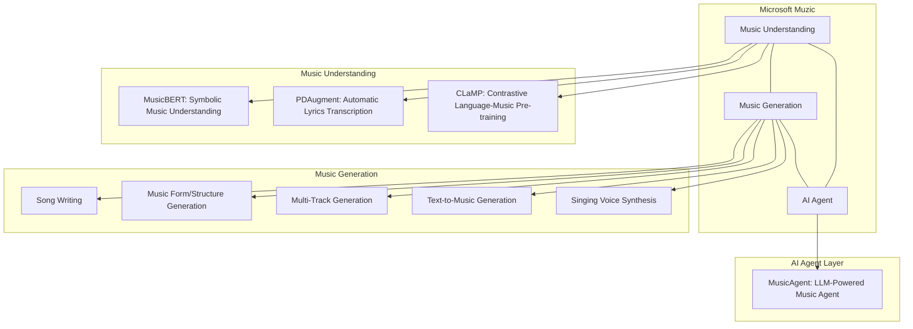
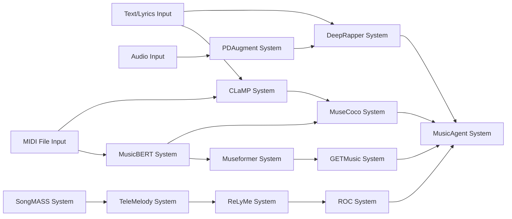
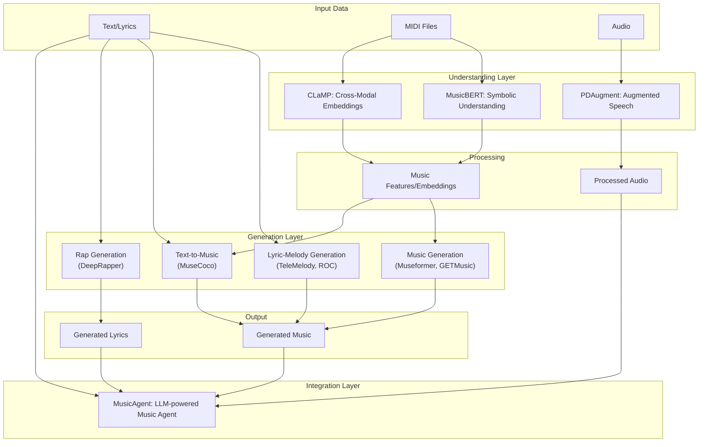

<!-- source: DeepWiki mcp.deepwiki.com · repo microsoft/muzic · page 1 Overview · fetched 2026-10-26 -->

# Overview

Relevant source files

The following files were used as context for generating this wiki page:

- [README.md](README.md)
- [pdaugment/README.md](pdaugment/README.md)

Microsoft Muzic is a comprehensive research project focused on using artificial intelligence to advance music understanding and generation. This page provides a high-level overview of the Muzic project's architecture, components, and capabilities.

## Introduction to Microsoft Muzic

Microsoft Muzic is a large-scale AI music research initiative that leverages deep learning and artificial intelligence to empower music understanding and generation. The project was started by researchers from Microsoft Research Asia and has received contributions from external collaborators. Muzic (pronounced [ˈmjuːzeik]) encompasses multiple interconnected systems designed to handle various aspects of music processing, from symbolic music understanding to complete music generation and AI agent capabilities.

Sources: [README.md:6-7]()

## Project Architecture

Muzic is organized into three main categories of components that work together to create a comprehensive AI music ecosystem:

**Figure 1: Microsoft Muzic Architecture**

Sources: [README.md:27-46]()

### Music Understanding

The Music Understanding components focus on analyzing and interpreting musical data:

- **MusicBERT**: Symbolic music understanding with large-scale pre-training
- **PDAugment**: Data augmentation for automatic lyrics transcription
- **CLaMP**: Contrastive Language-Music Pre-training for cross-modal music information retrieval

These systems form the foundation for understanding music at different levels, from symbolic representation to cross-modal relationships between music and language.

Sources: [README.md:28-31](), [pdaugment/README.md:1-3]()

### Music Generation

The Music Generation components focus on creating various aspects of music:

1. **Song Writing**
   - SongMASS: Bidirectional lyric-melody generation
   - DeepRapper: Neural rap generation with rhyme and rhythm modeling
   - TeleMelody: Template-based lyric-to-melody generation
   - ReLyMe: Lyric-to-melody generation with relationship modeling
   - ROC: Theory-guided lyric-to-melody generation

2. **Music Form/Structure Generation**
   - MeloForm: Music form generation
   - Museformer: Fine- and coarse-grained attention for music generation

3. **Multi-Track Generation**
   - PopMAG: Pop music accompaniment generation
   - GETMusic: Any music tracks generation

4. **Text-to-Music Generation**
   - MuseCoco: Generating symbolic music from text

5. **Singing Voice Synthesis**
   - HiFiSinger: High-fidelity neural singing voice synthesis

Sources: [README.md:32-44]()

### AI Agent

The AI Agent layer integrates capabilities from both Music Understanding and Music Generation:

- **MusicAgent**: An LLM-powered AI agent for versatile music processing

MusicAgent represents the latest evolution of the Muzic project, using large language models to coordinate various music understanding and generation tasks. For more detailed information on MusicAgent, see [MusicAgent](#4).

Sources: [README.md:45-46]()

## Component Relationships and Data Flow

The following diagram illustrates how different components in the Muzic ecosystem relate to each other and build upon previous research. The arrows indicate technical influence or evolutionary progression:

**Figure 2: Component Relationships and Data Flow**

Sources: [README.md:27-46]()

### Data Processing Pipeline

The data processing pipeline in Muzic varies depending on the task:

**Figure 3: Data Processing Pipeline**

Sources: [README.md:32-46](), [pdaugment/README.md:3-9]()

For example, in the PDAugment subsystem, the pipeline involves:
1. Processing speech data (LibriSpeech)
2. Converting text to phoneme level
3. Performing phoneme level alignment
4. Processing music scores (FreeMidi)
5. Augmenting the speech data by adjusting pitch and duration to match musical notes

Sources: [pdaugment/README.md:12-149]()

## Capabilities and Use Cases

Microsoft Muzic offers a comprehensive set of capabilities across the music AI landscape:

| Category | Capability | Components | Use Cases |
|---|---|---|---|
| **Music Understanding** | Symbolic Music Analysis | MusicBERT | Music classification, similarity search |
| | Lyrics Transcription | PDAugment | Converting singing to text |
| | Cross-Modal Retrieval | CLaMP | Finding music matching text descriptions |
| **Music Generation** | Lyric-Melody Creation | SongMASS, TeleMelody, ReLyMe, ROC | Songwriting assistance |
| | Rap Generation | DeepRapper | Creating rap lyrics with rhyme and rhythm |
| | Music Structure Generation | Museformer, MeloForm | Creating structured musical pieces |
| | Multi-Track Music | GETMusic, PopMAG | Creating complete arrangements |
| | Text-to-Music | MuseCoco | Generating music from text descriptions |
| | Singing Voice | HiFiSinger | Creating realistic singing voices |
| **AI Agent** | Integrated Music Processing | MusicAgent | End-to-end music creation and editing |

Sources: [README.md:27-46]()

### Recent Developments

The Muzic project continues to advance with several notable recent achievements:

- CLaMP won the Best Student Paper Award at ISMIR 2023
- MusicAgent was released, integrating capabilities using large language models
- MuseCoco was released for generating symbolic music from text
- GETMusic was released as a versatile music generation system

For more information on usage examples, see [Usage and Examples](#5).

Sources: [README.md:56-63]()

## Technical Requirements

The Microsoft Muzic project is primarily designed to run on Linux operating systems. The repository has been tested on Ubuntu 16.04.6 LTS with CUDA 10 and Python 3.6.12. The requirements for running Muzic are listed in the repository's `requirements.txt` file.

Sources: [README.md:66-71]()

## References and Links

For each component, detailed documentation is available in the corresponding subdirectory of the repository. These components include MusicBERT, PDAugment, CLaMP, DeepRapper, SongMASS, TeleMelody, ReLyMe, ROC, MeloForm, Museformer, GETMusic, MuseCoco, and MusicAgent.

For more detailed information on specific components, please refer to their respective wiki pages:
- For Music Understanding Components, see [Music Understanding Components](#2)
- For Music Generation Components, see [Music Generation Components](#3)
- For MusicAgent, see [MusicAgent](#4)
- For usage examples, see [Usage and Examples](#5)
- For developer guides, see [Developer Guide](#6)

Sources: [README.md:72]()

---

