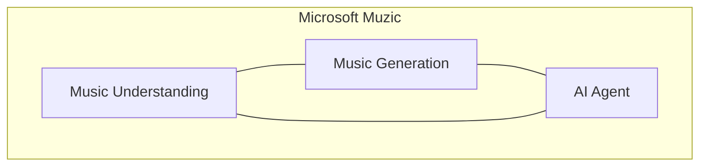
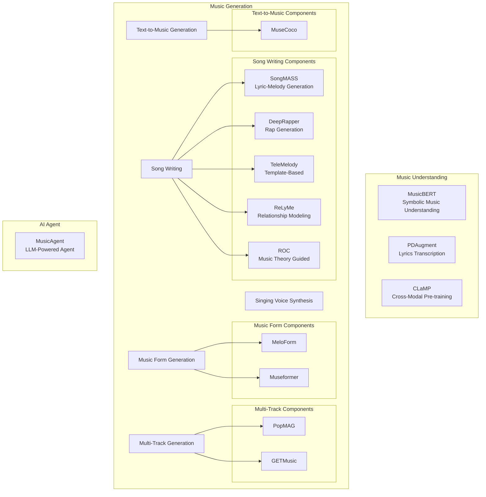
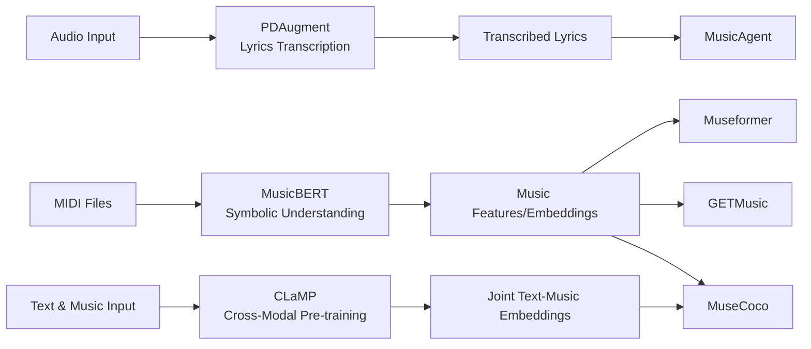
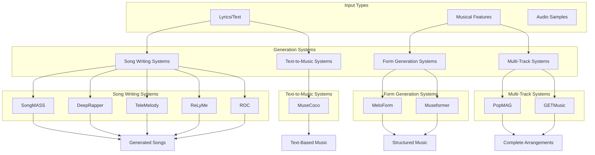
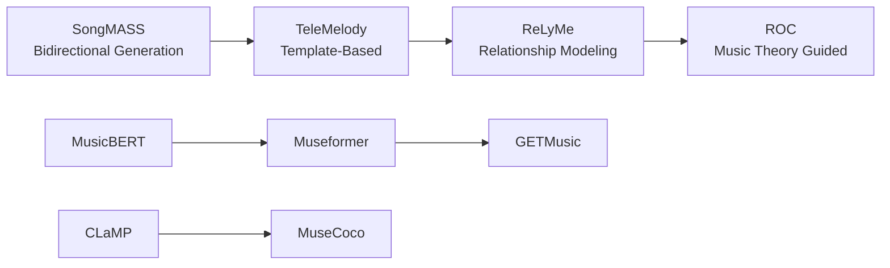
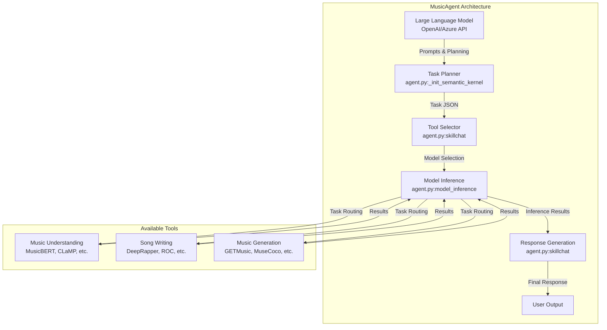
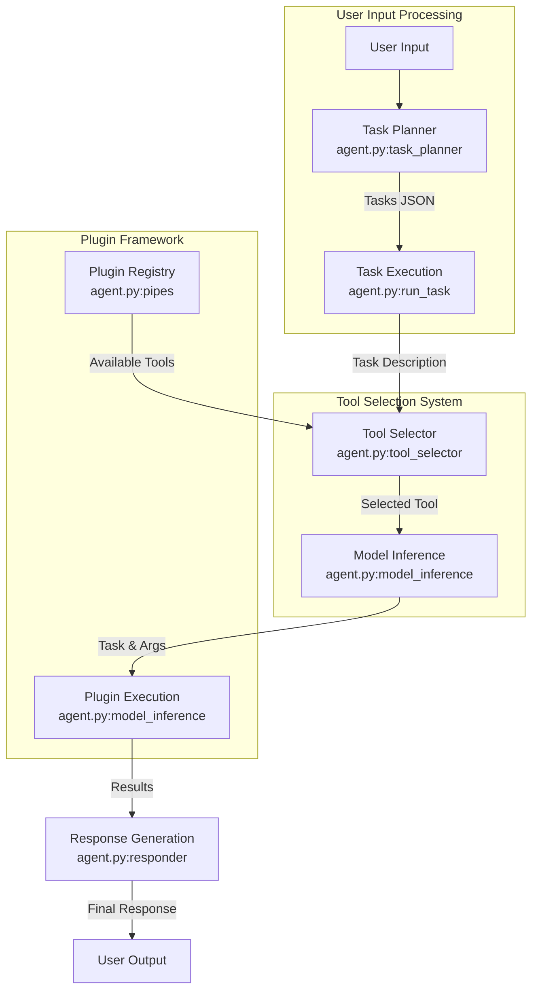
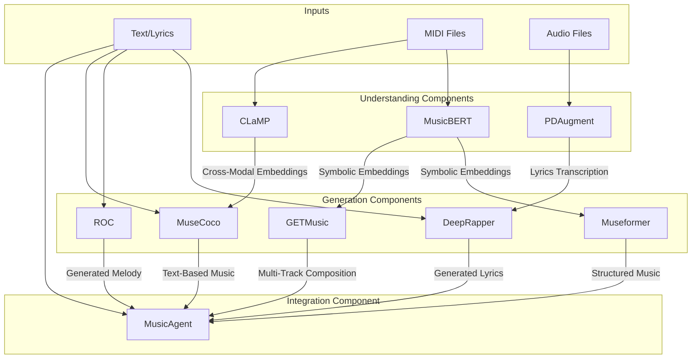
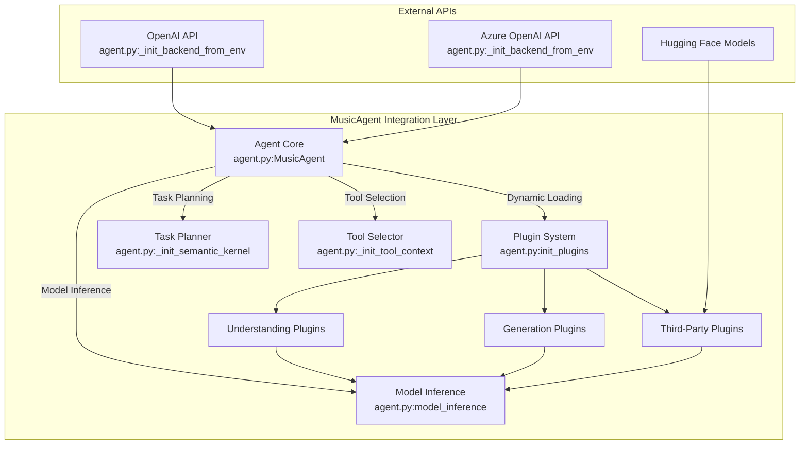

<!-- source: DeepWiki mcp.deepwiki.com · repo microsoft/muzic · page 1.1 Project Goals and Architecture · fetched 2026-10-26 -->

# Project Goals and Architecture

Relevant source files

The following files were used as context for generating this wiki page:

- [README.md](README.md)
- [musicagent/.env](musicagent/.env)
- [musicagent/README.md](musicagent/README.md)
- [musicagent/agent.py](musicagent/agent.py)
- [musicagent/auxiliary/muzic/roc/main.py](musicagent/auxiliary/muzic/roc/main.py)
- [pdaugment/README.md](pdaugment/README.md)

This document provides an overview of the Microsoft Muzic project's objectives and architectural design. It explains the research goals driving the project and details how the various components are organized and interact within the system. For information about specific capabilities and use cases, see [Capabilities and Use Cases](#1.2).

## Research Objectives

Microsoft Muzic is a comprehensive research initiative that aims to advance artificial intelligence for music understanding and generation. The project integrates deep learning techniques with music theory to create systems capable of analyzing, interpreting, and creating music in various forms.

The primary research objectives of the Muzic project include:

1. **Developing foundation models for music understanding** - Creating systems that can comprehend symbolic music representations, transcribe lyrics, and establish cross-modal relationships between music and language
   
2. **Advancing techniques for music generation** - Researching and implementing methods for composing various aspects of music, from melodies and lyrics to complete multi-track compositions
   
3. **Exploring music-language interactions** - Investigating the relationship between textual descriptions and musical elements to enable text-based music generation and control
   
4. **Building integrated AI music agents** - Developing unified systems that can leverage large language models to perform diverse music tasks

Sources: [README.md:6-7](), [README.md:27-46]()

## High-Level Architecture

The Muzic project is organized into three primary subsystems, each addressing distinct aspects of AI music technology:

Title: Core Subsystems of Microsoft Muzic

Sources: [README.md:17-23]()

### Core Components Overview

Each subsystem contains specialized components focused on specific research challenges:

Title: Detailed Component Structure of Microsoft Muzic

Sources: [README.md:27-46](), [pdaugment/README.md:1-3](), [musicagent/README.md:1-17]()

## Music Understanding Components

The music understanding subsystem focuses on developing models that can interpret and analyze musical content in different forms:

Title: Music Understanding Data Flow

Sources: [README.md:28-31](), [pdaugment/README.md:1-3]()

### Key Concepts and Technologies

The understanding components implement several key technologies:

1. **Symbolic Music Representation** - A tokenized representation of musical elements that enables transformer-based models to process musical structures
   
2. **Data Augmentation Techniques** - Methods like PDAugment that adjust pitch and duration of speech to narrow the gap between natural speech and singing voice
   
3. **Cross-Modal Embeddings** - Techniques to create unified representations of both text and music for joint understanding

Sources: [README.md:29-31](), [pdaugment/README.md:3-9]()

## Music Generation Components

The music generation subsystem comprises multiple specialized systems for creating different aspects of musical content:

Title: Music Generation System Architecture

Sources: [README.md:32-44](), [musicagent/auxiliary/muzic/roc/main.py:519-764]()

### Generation Components Evolution

The Muzic project shows a clear evolution path in its research development, particularly in the song writing domain:

Title: Component Evolution and Research Progression

Sources: [README.md:34-36]()

### Technical Approach to Music Generation

The music generation components implement various technical approaches:

1. **Lyric-to-Melody Generation** - Systems like ROC use music theory to guide the conversion of lyrics to melodies by analyzing syllable structure and sentiment

2. **Template-Based Generation** - TeleMelody employs a two-stage approach that first extracts templates and then fills them with musical content

3. **Multi-Track Diffusion** - GETMusic utilizes a diffusion framework to generate various instrumental tracks in a complete arrangement

4. **Text-Conditioned Generation** - MuseCoco takes textual descriptions and generates corresponding symbolic music

Sources: [README.md:34-43](), [musicagent/auxiliary/muzic/roc/main.py:31-161]()

## MusicAgent: Unifying AI Agent

MusicAgent serves as an integrative system that leverages large language models to coordinate diverse music understanding and generation tasks:

Title: MusicAgent System Architecture

Sources: [musicagent/agent.py:21-141](), [musicagent/README.md:6-17]()

### Plugin System and Tool Selection

MusicAgent employs a modular architecture with a plugin system:

Title: MusicAgent Plugin Architecture and Tool Selection

Sources: [musicagent/agent.py:130-268](), [musicagent/README.md:12-17]()

The key aspects of the MusicAgent architecture include:

1. **Task Planning** - Analyzes user input to determine required music processing tasks

2. **Tool Selection** - Dynamically selects the most appropriate tool for each identified task

3. **Plugin Execution** - Executes the selected tool with appropriate parameters

4. **Response Generation** - Synthesizes results into coherent responses for the user

Sources: [musicagent/agent.py:130-140](), [musicagent/agent.py:229-341](), [musicagent/README.md:14-17]()

## Data Flow Between Components

The complete Muzic ecosystem features complex data flows between components, with outputs from understanding components often serving as inputs to generation components:

Title: Data Flow in the Muzic Ecosystem

Sources: [README.md:27-46](), [pdaugment/README.md:1-3](), [musicagent/agent.py:130-141]()

## Implementation Architecture

The codebase implementation follows a modular structure, with each research component contained in its own directory:

| Subsystem | Component | Directory | Purpose |
|-----------|-----------|-----------|---------|
| Music Understanding | MusicBERT | `/musicbert` | Symbolic music understanding with pre-training |
| Music Understanding | PDAugment | `/pdaugment` | Data augmentation for lyrics transcription |
| Music Understanding | CLaMP | `/clamp` | Contrastive language-music pre-training |
| Music Generation | SongMASS | `/songmass` | Automatic song writing with pre-training |
| Music Generation | DeepRapper | `/deeprapper` | Neural rap generation |
| Music Generation | TeleMelody | `/telemelody` | Template-based lyric-to-melody generation |
| Music Generation | ReLyMe | `/relyme` | Lyric-to-melody with relationship modeling |
| Music Generation | ROC | `/roc` | Music theory guided lyric-to-melody generation |
| Music Generation | MeloForm | `/meloform` | Music form generation |
| Music Generation | Museformer | `/museformer` | Fine- and coarse-grained attention for music |
| Music Generation | GETMusic | `/getmusic` | Multi-track music generation |
| Music Generation | MuseCoco | `/musecoco` | Text-to-music generation |
| AI Agent | MusicAgent | `/musicagent` | LLM-powered music agent |

Sources: [README.md:72](), [musicagent/README.md:1-17]()

## Integration and Extensibility

The Muzic project is designed to be extensible, allowing for new components to be added and integrated into the existing architecture. The MusicAgent particularly showcases this extensibility through its plugin-based design:

Title: MusicAgent Integration and Extensibility Architecture

Sources: [musicagent/agent.py:41-117](), [musicagent/README.md:12-17]()

The extensibility of the system is facilitated by:

1. **Modular Component Design** - Each component can be used independently or as part of the integrated system

2. **Plugin Architecture** - MusicAgent's plugin system allows for easy addition of new tools and capabilities

3. **Standardized Interfaces** - Components interact through well-defined interfaces, enabling interchangeability

4. **Configuration-Based Setup** - Environment variables and configuration files allow for flexible deployment

Sources: [musicagent/README.md:12-17](), [musicagent/agent.py:97-116](), [musicagent/.env:1-6]()

## Summary

The Microsoft Muzic project represents a comprehensive research initiative in AI music technology, with a structured architecture that encompasses understanding, generation, and agent components. The system is designed to be modular and extensible, allowing for continued research development while maintaining integration between components. Through this architecture, Muzic aims to advance the state-of-the-art in AI music capabilities across multiple domains.

Sources: [README.md:6-7](), [README.md:27-46](), [musicagent/README.md:6-17]()

---

