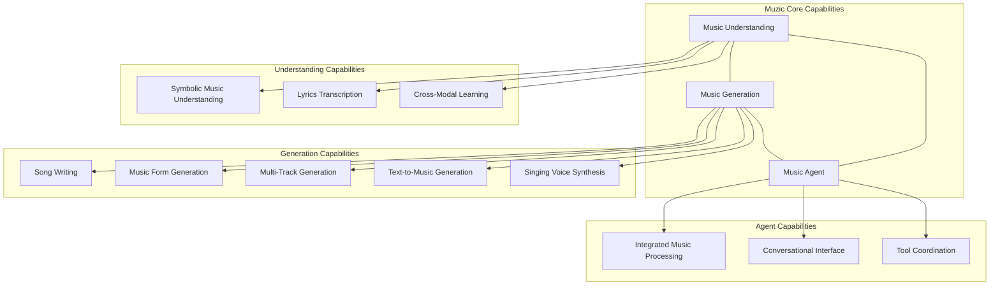
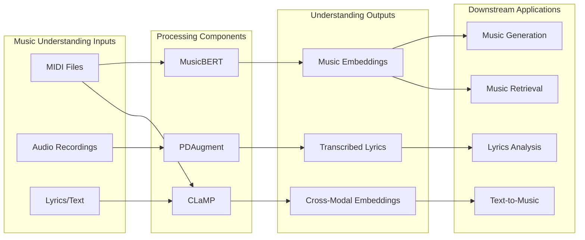
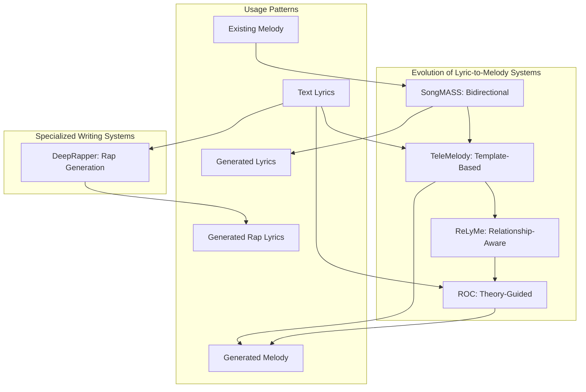
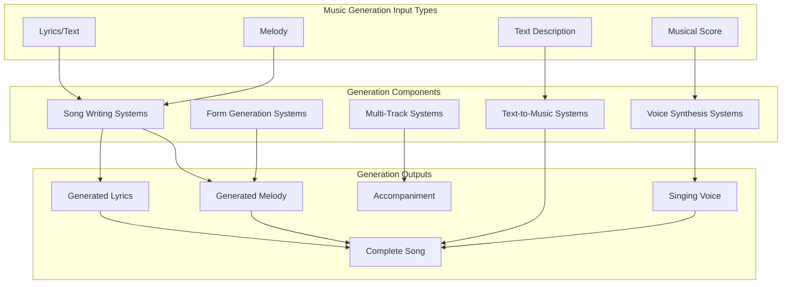
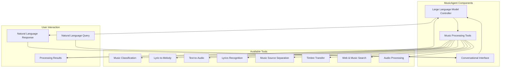
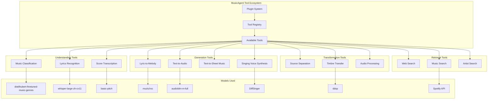
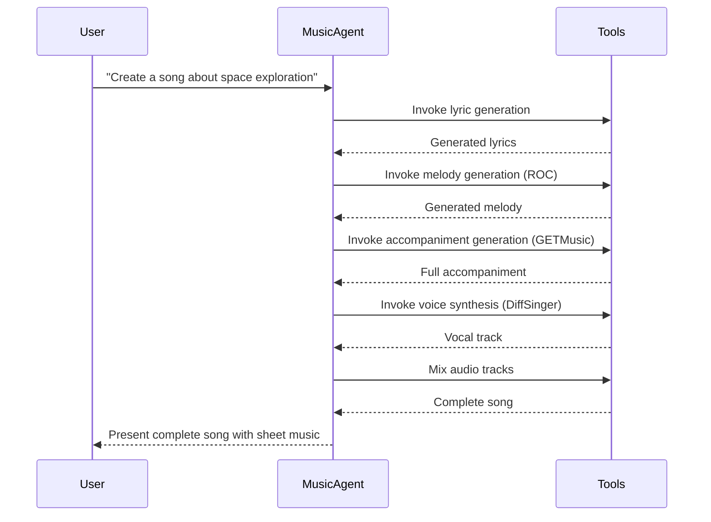

<!-- source: DeepWiki mcp.deepwiki.com · repo microsoft/muzic · page 1.2 Capabilities and Use Cases · fetched 2026-10-26 -->

# Capabilities and Use Cases

Relevant source files

The following files were used as context for generating this wiki page:

- [README.md](README.md)
- [musicagent/config.yaml](musicagent/config.yaml)
- [musicagent/gradio_agent.py](musicagent/gradio_agent.py)
- [musicagent/model_utils.py](musicagent/model_utils.py)
- [musicagent/models/download.sh](musicagent/models/download.sh)
- [musicagent/plugins.py](musicagent/plugins.py)
- [musicagent/requirements.txt](musicagent/requirements.txt)
- [musicagent/skills/MusicAgent/ChatBot/config.json](musicagent/skills/MusicAgent/ChatBot/config.json)
- [pdaugment/README.md](pdaugment/README.md)

This document outlines the key capabilities of the Microsoft Muzic project and their potential applications. It provides a comprehensive overview of what the system can do and how different components can be used individually or together to accomplish music-related tasks. For information about the overall architecture of Muzic, see [Project Goals and Architecture](#1.1).

## Core Capabilities Overview

Microsoft Muzic provides a diverse set of AI-powered capabilities organized into three main categories:

Sources: [README.md:15-26]()

## Music Understanding Capabilities

Music understanding components enable the system to analyze and comprehend musical data across different modalities:

1. **Symbolic Music Understanding (MusicBERT)** - Understands music in symbolic representations (e.g., MIDI) through large-scale pre-training
2. **Automatic Lyrics Transcription (PDAugment)** - Converts singing voices to text lyrics using data augmentation techniques
3. **Cross-Modal Embeddings (CLaMP)** - Creates unified representations between language and music for improved information retrieval

Sources: [README.md:27-31](), [pdaugment/README.md:1-3]()

### Use Cases for Music Understanding

| Component | Use Cases |
|-----------|-----------|
| MusicBERT | - Finding similar musical patterns - Classifying music by style or genre - Enabling more intelligent music generation - Music data mining and analysis |
| PDAugment | - Automatic lyrics transcription from recordings - Creating lyrics datasets from singing performances - Assisting with music transcription - Improving vocal recognition systems |
| CLaMP | - Cross-modal music retrieval (finding music based on text descriptions) - Enhanced music recommendation systems - Creating text descriptions of musical content - Bridging the gap between language and music understanding |

Sources: [README.md:27-31](), [pdaugment/README.md:1-3]()

## Music Generation Capabilities

Muzic offers multiple specialized music generation systems that can create different aspects of musical content:

### Song Writing

Components focused on lyrics and melody generation:

1. **SongMASS** - Bidirectional lyric-to-melody and melody-to-lyric generation
2. **DeepRapper** - Specialized in rap lyric generation with rhyme and rhythm modeling
3. **TeleMelody** - Template-based approach for converting lyrics to melodies
4. **ReLyMe** - Improved lyric-to-melody generation incorporating relationship modeling
5. **ROC (Re-creation of Creations)** - Theory-guided approach for lyric-to-melody generation

Sources: [README.md:32-36](), [musicagent/plugins.py:161-211]()

### Music Form/Structure Generation

Components focused on generating music with proper structural organization:

1. **MeloForm** - Generates music with coherent musical form
2. **Museformer** - Uses fine and coarse-grained attention mechanisms for improved long-form music generation

### Multi-Track Generation

Systems that can create multiple musical tracks or full arrangements:

1. **PopMAG** - Specialized in pop music accompaniment generation
2. **GETMusic** - Versatile system for generating any musical tracks using a unified representation and diffusion framework

### Text-to-Music Generation

Converting textual descriptions to music:

1. **MuseCoco** - Generates symbolic music based on text descriptions

### Singing Voice Synthesis

Converting melodies and lyrics to singing voice:

1. **HiFiSinger** - High-fidelity singing voice synthesis

Sources: [README.md:37-44](), [musicagent/plugins.py:212-339](), [musicagent/plugins.py:749-781]()

### Use Cases for Music Generation

| Category | Components | Use Cases |
|----------|------------|-----------|
| Song Writing | SongMASS, DeepRapper, TeleMelody, ReLyMe, ROC | - Assisted songwriting for lyricists and composers - Creating melody from lyrics or lyrics from melody - Specialized rap generation - Expanding musical ideas |
| Music Form | MeloForm, Museformer | - Generating structurally coherent music - Creating longer musical pieces - Maintaining thematic consistency in compositions |
| Multi-Track | PopMAG, GETMusic | - Creating accompaniments for melodies - Generating complete arrangements - Producing multi-instrument tracks from prompts |
| Text-to-Music | MuseCoco | - Creating music from textual descriptions - Mood-based music generation - Converting narrative concepts to music |
| Voice Synthesis | HiFiSinger | - Creating singing performances from score and lyrics - Virtual vocalist production - Converting melodies to vocal performances |

Sources: [README.md:32-44](), [musicagent/gradio_agent.py:192-201]()

## Music Agent Capabilities

MusicAgent integrates the various capabilities into a unified, LLM-powered system that can:

1. **Understand and respond to natural language instructions**
2. **Coordinate multiple music processing tools**
3. **Handle complex music-related tasks through tool composition**
4. **Process and generate multiple modalities** (text, music, audio)

Sources: [musicagent/gradio_agent.py:10-204](), [musicagent/plugins.py:24-85]()

### MusicAgent Tool Ecosystem

MusicAgent integrates a wide range of tools through its plugin architecture, enabling complex music-related tasks through natural language:

Sources: [musicagent/plugins.py:24-85](), [musicagent/models/download.sh:1-36]()

### Use Cases for MusicAgent

MusicAgent enables complex, multi-step music processing through natural language interaction:

| Category | Use Cases |
|----------|-----------|
| Content Creation | - Writing lyrics about specific topics - Generating Chinese songs with specific styles - Creating melodies for lyrics - Generating audio from text descriptions |
| Music Analysis | - Finding the genre of a song - Transcribing lyrics from recordings - Extracting sheet music from audio - Analyzing music trends |
| Audio Manipulation | - Separating vocals from instruments - Converting vocals to different instruments - Mixing and splicing audio files - Creating accompaniment for vocals |
| Music Discovery | - Searching for music by artists - Finding information about songs or albums - Discovering music based on descriptions - Getting information about music trends |

Sources: [musicagent/gradio_agent.py:192-201](), [musicagent/plugins.py:131-781]()

## Integration Examples

Here are examples of how the capabilities can be combined to accomplish complex music-related tasks:

### Example 1: Complete Song Creation

1. User provides a text prompt describing desired song style and theme
2. MusicAgent coordinates:
   - Lyric generation using DeepRapper or prompting the LLM
   - Melody generation using ROC or TeleMelody
   - Full arrangement using GETMusic
   - Optional vocal synthesis using DiffSinger

### Example 2: Music Analysis and Transformation

1. User uploads an audio recording
2. MusicAgent coordinates:
   - Lyrics transcription using Whisper model
   - Music source separation using Demucs
   - Genre classification using music classification models
   - Optional timbre transfer to create new versions

### Example 3: Music Retrieval and Exploration

1. User asks about specific artists or musical styles
2. MusicAgent coordinates:
   - Web search for information
   - Spotify integration for finding tracks
   - Audio playback and analysis
   - Creating similar music using generation components

Sources: [musicagent/gradio_agent.py:64-122](), [musicagent/plugins.py:131-781]()

## Supported Input/Output Formats

Microsoft Muzic supports various input and output formats across its components:

### Input Formats
- **Text**: Lyrics, descriptions, prompts
- **Audio**: WAV, MP3, FLAC recordings
- **MIDI**: Symbolic music representation
- **Structured Data**: Song information, musical scores

### Output Formats
- **Audio**: Generated music, processed recordings
- **MIDI**: Symbolic music, sheet music
- **Text**: Generated lyrics, transcriptions, analysis
- **Visualizations**: Sheet music representations

Sources: [musicagent/gradio_agent.py:35-52](), [musicagent/plugins.py:410-747]()

## System Requirements and Dependencies

The Muzic system has several key dependencies that enable its capabilities:

- **Core Libraries**: transformers, librosa, pytorch, tensorflow
- **Audio Processing**: soundfile, pydub, ddsp, demucs
- **Music Generation**: diffusers, fairseq
- **Natural Language**: Google APIs, Hugging Face models
- **External Services**: Spotify API (for music search)

For full installation details, see [Installation and Setup](#5.1).

Sources: [musicagent/requirements.txt:1-37](), [musicagent/models/download.sh:1-36]()

---

