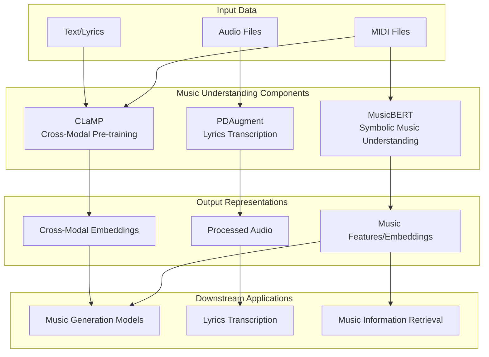
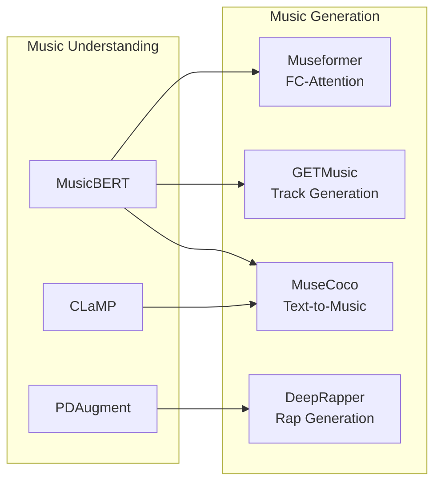
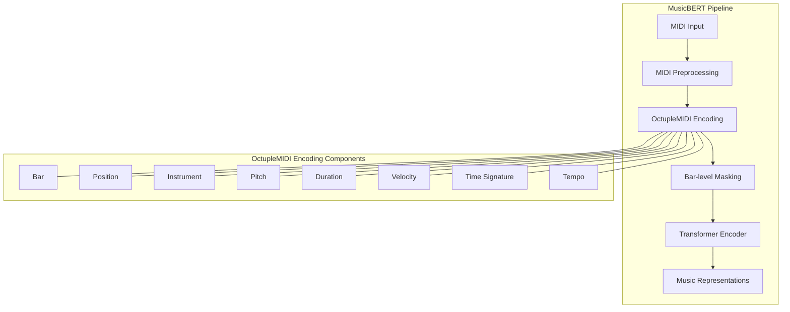
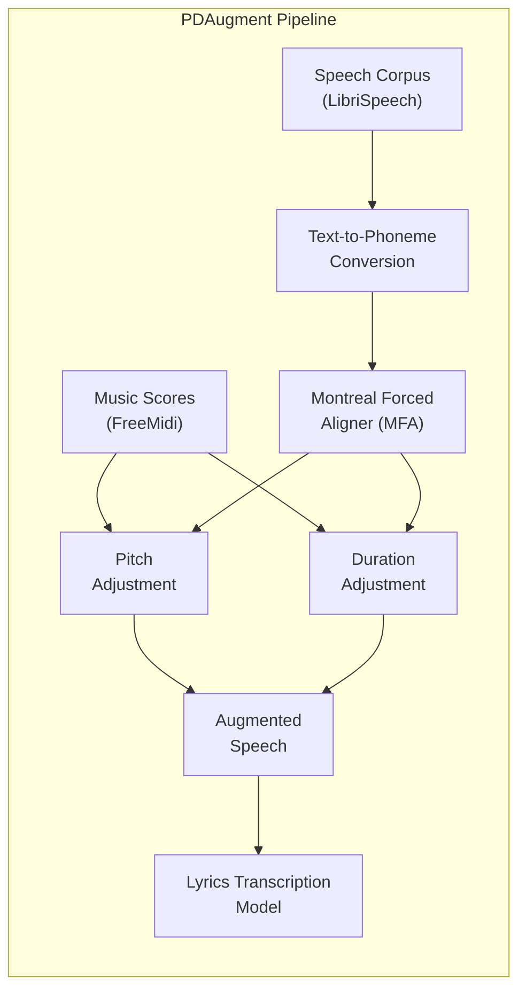

<!-- source: DeepWiki mcp.deepwiki.com · repo microsoft/muzic · page 2 Music Understanding Components · fetched 2026-10-26 -->

# Music Understanding Components

Relevant source files

The following files were used as context for generating this wiki page:

- [README.md](README.md)
- [deeprapper/README.md](deeprapper/README.md)
- [musicbert/README.md](musicbert/README.md)
- [pdaugment/README.md](pdaugment/README.md)
- [songmass/README.md](songmass/README.md)
- [telemelody/README.md](telemelody/README.md)
- [telemelody/inferrence/infer_zh.py](telemelody/inferrence/infer_zh.py)

This page provides a technical overview of the music understanding components within the Microsoft Muzic project. These components are responsible for analyzing and extracting structured representations from music data, which serve as foundations for the music generation systems covered in [Music Generation Components](#3).

The Music Understanding section of Muzic consists of three key components:
- MusicBERT: for symbolic music understanding
- PDAugment: for automatic lyrics transcription
- CLaMP: for contrastive language-music pre-training

## Component Architecture and Data Flow

The following diagram illustrates how music understanding components process different input data types and generate meaningful representations:

Sources: [README.md:27-31](), [musicbert/README.md:1-12](), [pdaugment/README.md:1-9]()

## Component Relationships with Generation Models

The music understanding components provide foundational capabilities that enable the more complex music generation tasks:

Sources: [README.md:17-23]()

This diagram shows how music understanding components feed into various generation models. For example, MusicBERT's music representations power multiple generation models while PDAugment specifically supports DeepRapper for high-quality rap generation.

## Overview of Components

The following table summarizes the key characteristics of each music understanding component:

| Component | Purpose | Input Data | Output | Key Technologies |
|-----------|---------|------------|--------|------------------|
| MusicBERT | Symbolic music understanding with pre-training | MIDI files | Music embeddings | OctupleMIDI encoding, Bar-level masking |
| PDAugment | Data augmentation for automatic lyrics transcription | Speech audio, Music scores | Augmented speech audio | Pitch adjustment, Duration adjustment |
| CLaMP | Contrastive Language-Music Pre-training | MIDI files, Text | Cross-modal embeddings | Contrastive learning |

Sources: [README.md:27-31](), [musicbert/README.md:1-4](), [pdaugment/README.md:1-3]()

## MusicBERT

MusicBERT is a large-scale pre-trained model for symbolic music understanding. It adapts the BERT (Bidirectional Encoder Representations from Transformers) approach from NLP to music data, utilizing several music-specific techniques.

### Architecture and Encoding

Sources: [musicbert/README.md:8-11]()

### Key Features

1. **OctupleMIDI Encoding**: Transforms MIDI events into 8-tuple representations that capture comprehensive musical information including bar position, pitch, duration, velocity, and more.

2. **Bar-level Masking Strategy**: Instead of masking individual tokens as in text BERT models, MusicBERT masks entire bars to better capture musical phrases and structures.

3. **Pre-training Task**: Uses masked language modeling approach adapted to music data to learn deep representations of musical structure.

### Supported Tasks

MusicBERT supports multiple downstream tasks for symbolic music understanding:

| Task | Description | Implementation |
|------|-------------|----------------|
| Melody Completion | Predicting the next melody notes given previous context | `eval_nsp.py` with "next" task |
| Accompaniment Suggestion | Suggesting accompaniment notes for a given melody | `eval_nsp.py` with "acc" task |
| Genre Classification | Identifying music genre from symbolic representation | `eval_genre.py` with "topmagd" dataset |
| Style Classification | Identifying music style from symbolic representation | `eval_genre.py` with "masd" dataset |

Sources: [musicbert/README.md:144-156]()

### Data Pipeline

MusicBERT requires a specific data pipeline to process MIDI files:

1. Data preparation: Convert raw MIDI files to the OctupleMIDI format
2. Binarization: Convert text-based OctupleMIDI data into binary format for efficient training
3. Pre-training: Train the model on large MIDI datasets like the Lakh MIDI Dataset (LMD)
4. Fine-tuning: Adapt the pre-trained model for specific downstream tasks

Sources: [musicbert/README.md:13-109]()

## PDAugment

PDAugment is a data augmentation method specifically designed for automatic lyrics transcription. It narrows the gap between natural speech and singing voice by adjusting pitch and duration of speech to match the characteristics of singing.

### System Pipeline

Sources: [pdaugment/README.md:12-150]()

### Key Features

1. **Pitch Adjustment**: Modifies the pitch of speech syllables to match the corresponding notes in music scores, making speech sound more like singing.

2. **Duration Adjustment**: Extends or shortens the duration of speech syllables to match note durations in music, accommodating the timing patterns in singing.

3. **Phoneme-level Processing**: Operates at the phoneme level for precise control over speech modifications.

### Data Requirements

PDAugment requires two primary data sources:

1. **Speech Corpus**: LibriSpeech ASR corpus is used as the speech source
2. **Music Score Dataset**: FreeMidi dataset provides melody information including pitch and duration

The system also requires phoneme-level alignment of speech, obtained through the Montreal Forced Aligner (MFA) tool.

Sources: [pdaugment/README.md:12-102]()

## CLaMP (Contrastive Language-Music Pre-training)

CLaMP is a cross-modal system that aligns language and music through contrastive learning. It won the Best Student Paper Award at ISMIR 2023.

### System Approach

CLaMP uses contrastive learning to create a shared embedding space between language (text) and music (symbolic representations). This enables cross-modal information retrieval and generation tasks.

### Applications

1. **Cross-modal Music Information Retrieval**: Finding music based on textual descriptions and vice versa
2. **Text-to-Music Generation**: Providing foundations for systems like MuseCoco that generate music from text

### Integration with Generation Systems

CLaMP's cross-modal embeddings are particularly valuable for text-to-music generation systems. The shared representation space allows models to map between linguistic descriptions and musical elements.

Sources: [README.md:58](), [README.md:92]()

## Integration with Music Generation Components

The music understanding components provide essential capabilities that enable the more advanced music generation systems:

1. **MusicBERT → Museformer, GETMusic, MuseCoco**: MusicBERT's symbolic music understanding powers multiple generation systems through its rich music representations.

2. **CLaMP → MuseCoco**: CLaMP's cross-modal alignments specifically enable MuseCoco to generate symbolic music from text descriptions.

3. **PDAugment → DeepRapper**: PDAugment's enhanced lyrics transcription capabilities help DeepRapper generate rap with better pronunciation and rhythm.

Sources: [README.md:27-46]()

## Summary

The Music Understanding components in the Muzic project provide the foundational technologies for analyzing and representing music data. By extracting structured representations from different music modalities (symbolic, audio, text), these components enable the more complex generation tasks in the Muzic ecosystem.

The three components (MusicBERT, PDAugment, and CLaMP) address different aspects of music understanding:
- Symbolic music understanding through pre-training
- Bridging the gap between speech and singing for lyrics transcription
- Creating cross-modal alignments between music and language

These capabilities form the backbone of the Muzic project's broader goal of empowering AI music generation and understanding.

---

