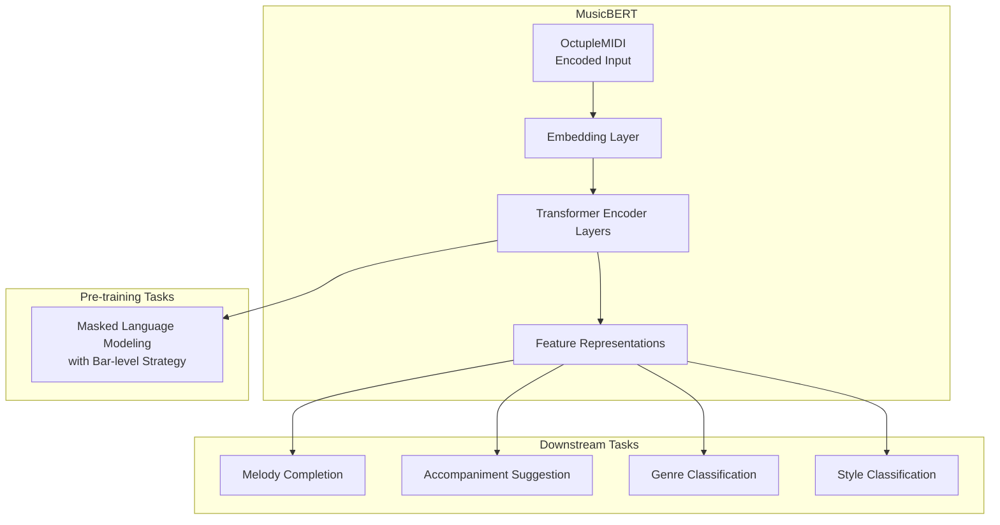
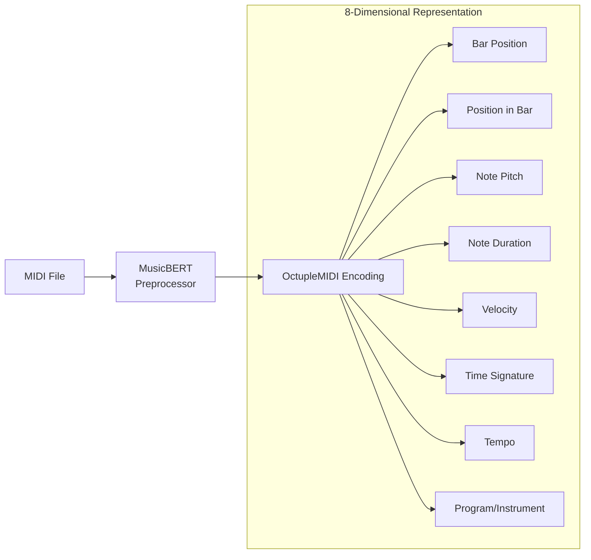
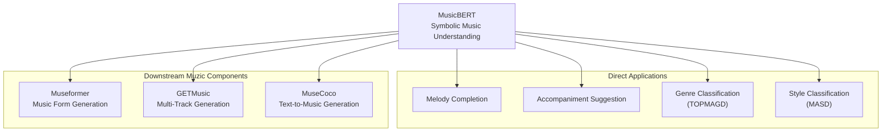
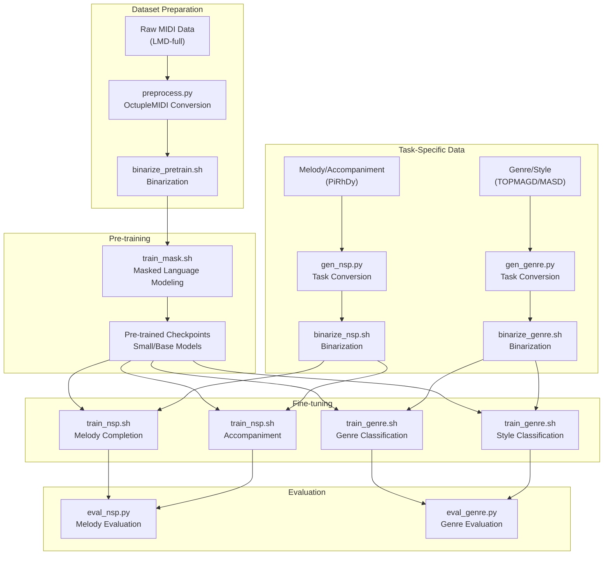

<!-- source: DeepWiki mcp.deepwiki.com · repo microsoft/muzic · page 2.1 MusicBERT · fetched 2026-10-26 -->

# MusicBERT

<details>
<summary>Relevant source files</summary>

The following files were used as context for generating this wiki page:

- [deeprapper/README.md](deeprapper/README.md)
- [musicbert/README.md](musicbert/README.md)
- [songmass/README.md](songmass/README.md)
- [telemelody/README.md](telemelody/README.md)
- [telemelody/inferrence/infer_zh.py](telemelody/inferrence/infer_zh.py)

</details>


## Purpose and Scope

MusicBERT is a large-scale pre-trained model for symbolic music understanding within the Microsoft Muzic project. This document explains MusicBERT's architecture, encoding mechanism, pre-training approach, downstream capabilities, and usage instructions. MusicBERT serves as a foundational component for music understanding, providing music feature representations that other generation systems in the Muzic ecosystem can build upon.

For information about other music understanding components like CLaMP (Contrastive Language-Music Pre-training), see [CLaMP](#2.2).

Sources: [musicbert/README.md:1-4]()

## Model Overview

MusicBERT adapts the BERT (Bidirectional Encoder Representations from Transformers) architecture for music data. It includes several mechanisms specifically designed for symbolic music understanding:

1. **OctupleMIDI encoding**: A specialized encoding format for representing symbolic music
2. **Bar-level masking strategy**: A music-specific approach to masked language modeling

The model achieves state-of-the-art accuracy on several music understanding tasks, including melody completion, accompaniment suggestion, genre classification, and style classification.

### MusicBERT Architecture



Sources: [musicbert/README.md:1-4](), [musicbert/README.md:9-11]()

### OctupleMIDI Encoding

The OctupleMIDI encoding is a comprehensive representation that captures multiple dimensions of musical information:



Sources: [musicbert/README.md:9-11]()

## Pre-training Approach

MusicBERT is pre-trained on The Lakh MIDI Dataset (LMD-full), a large collection of MIDI files. The pre-training process consists of:

1. **Data preparation**: Converting MIDI files to OctupleMIDI encoding
2. **Masked language modeling**: Using a specialized bar-level masking strategy
3. **Model training**: Training the Transformer-based architecture to predict masked tokens

Pre-trained checkpoints are available in both "small" and "base" configurations, with different model capacities.

Sources: [musicbert/README.md:13-21](), [musicbert/README.md:112-120]()

## Integration with Other Components

MusicBERT serves as a foundation for several other components in the Muzic ecosystem:



Sources: [musicbert/README.md:4-6]()

## Capabilities and Downstream Tasks

MusicBERT supports several music understanding tasks:

### Melody Completion

Predicts the next notes in a melody given a context sequence.

### Accompaniment Suggestion

Generates appropriate accompaniment patterns for a given melody.

### Genre Classification

Classifies music into different genres using the TOPMAGD dataset.

### Style Classification

Identifies musical styles using the MASD dataset.

Sources: [musicbert/README.md:2-4](), [musicbert/README.md:144-156]()

## Usage Guide

### Setting Up MusicBERT

#### 1. Preparing Pre-training Datasets

```bash
# Download LMD-full dataset
wget http://hog.ee.columbia.edu/craffel/lmd/lmd_full.tar.gz
tar -xzvf lmd_full.tar.gz
zip -r lmd_full.zip lmd_full

# Process the dataset
python -u preprocess.py

# Binarize the dataset
bash binarize_pretrain.sh lmd_full
```

Sources: [musicbert/README.md:13-44]()

#### 2. Preparing Task-Specific Datasets

Task-specific datasets are required for downstream applications:

| Task | Dataset | Preparation Script |
|------|---------|-------------------|
| Melody Completion | PiRhDy | `gen_nsp.py` (with "next" option) |
| Accompaniment Suggestion | PiRhDy | `gen_nsp.py` (with "acc" option) |
| Genre Classification | TOPMAGD | `gen_genre.py` (with "topmagd" option) |
| Style Classification | MASD | `gen_genre.py` (with "masd" option) |

Sources: [musicbert/README.md:46-110]()

### Training MusicBERT

#### Pre-training

```bash
bash train_mask.sh lmd_full small
```

Pre-trained checkpoints:
- Small configuration: Available for download
- Base configuration: Available for download

Sources: [musicbert/README.md:114-121]()

#### Fine-tuning

Fine-tuning commands for downstream tasks:

```bash
# Melody completion
bash train_nsp.sh next checkpoints/checkpoint_last_musicbert_base.pt

# Accompaniment suggestion
bash train_nsp.sh acc checkpoints/checkpoint_last_musicbert_small.pt

# Genre classification
bash train_genre.sh topmagd 13 0 checkpoints/checkpoint_last_musicbert_base.pt

# Style classification
bash train_genre.sh masd 25 4 checkpoints/checkpoint_last_musicbert_small.pt
```

Sources: [musicbert/README.md:123-142]()

### Evaluation

Evaluating MusicBERT on downstream tasks:

```bash
# Melody completion and accompaniment suggestion
python -u eval_nsp.py checkpoints/checkpoint_last_nsp_next_checkpoint_last_musicbert_base.pt next_data_bin

# Genre and style classification
python -u eval_genre.py checkpoints/checkpoint_last_genre_topmagd_x_checkpoint_last_musicbert_small.pt topmagd_data_bin/x
```

Sources: [musicbert/README.md:144-156]()

## Workflow Diagram

The complete workflow for using MusicBERT:



Sources: [musicbert/README.md:13-156]()

## External Projects Using MusicBERT

MusicBERT has been used in external projects, including:

- **midiformers**: A customized MIDI music remixing tool with an easy-to-use interface

Sources: [musicbert/README.md:4-6]()

---

