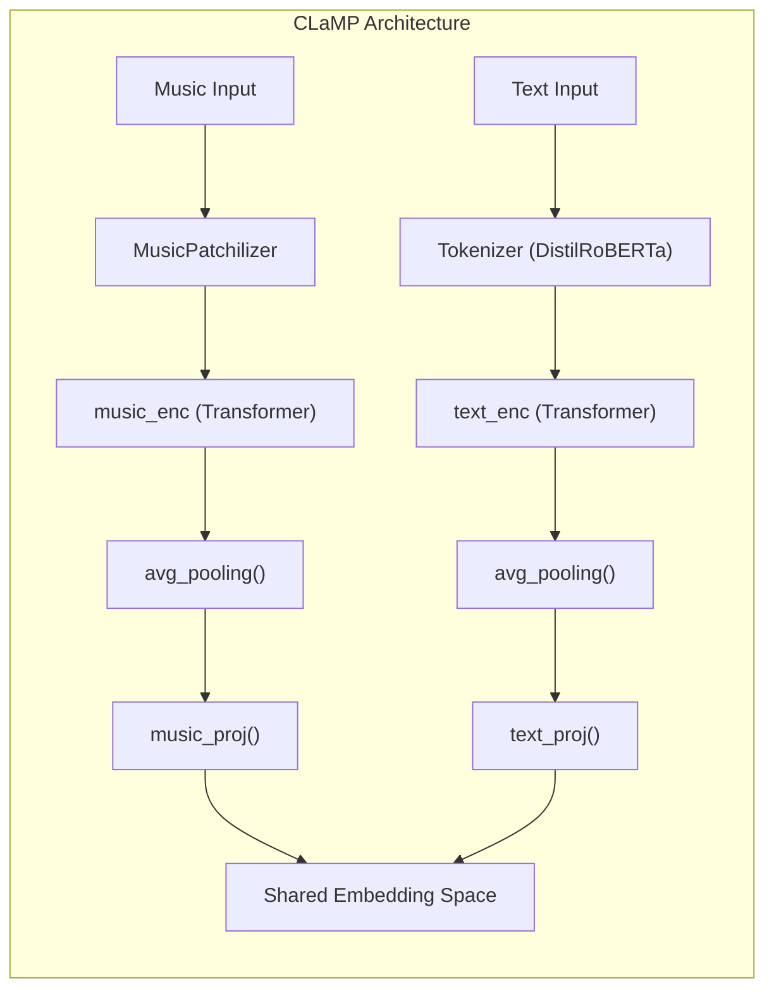
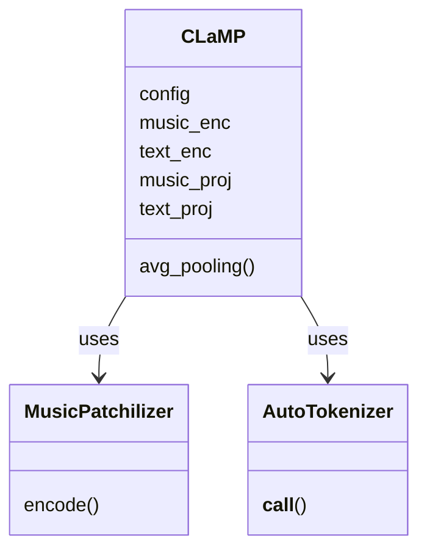
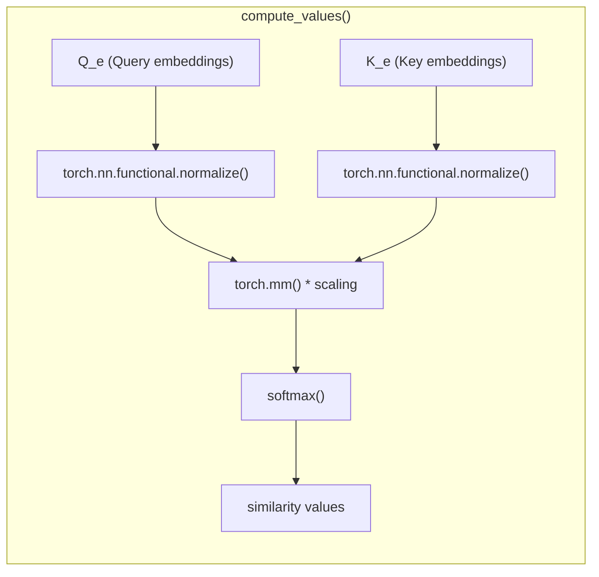
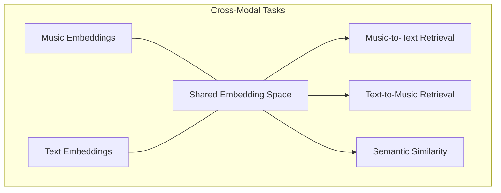
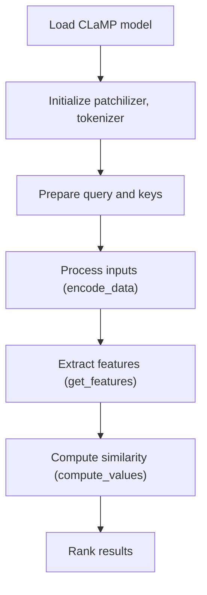
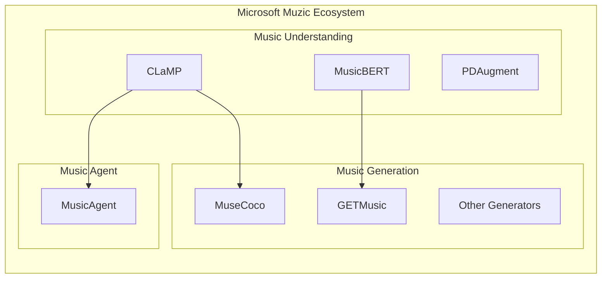

<!-- source: DeepWiki mcp.deepwiki.com · repo microsoft/muzic · page 2.2 CLaMP · fetched 2026-10-26 -->

# CLaMP

<details>
<summary>Relevant source files</summary>

The following files were used as context for generating this wiki page:

- [clamp/clamp.py](clamp/clamp.py)
- [clamp/inference/cache/music_key_cache_1024.pth](clamp/inference/cache/music_key_cache_1024.pth)
- [clamp/inference/cache/music_key_cache_512.pth](clamp/inference/cache/music_key_cache_512.pth)
- [clamp/inference/cache/text_key_cache_1024.pth](clamp/inference/cache/text_key_cache_1024.pth)
- [clamp/inference/cache/text_key_cache_512.pth](clamp/inference/cache/text_key_cache_512.pth)
- [clamp/inference/music_keys/music_keys.zip](clamp/inference/music_keys/music_keys.zip)
- [clamp/inference/music_query.mxl](clamp/inference/music_query.mxl)
- [clamp/inference/text_keys.txt](clamp/inference/text_keys.txt)
- [clamp/inference/text_query.txt](clamp/inference/text_query.txt)
- [clamp/inference/xml2abc.py](clamp/inference/xml2abc.py)
- [clamp/requirements.txt](clamp/requirements.txt)
- [img/clamp_clamp.png](img/clamp_clamp.png)
- [img/clamp_cross-modal tasks.png](img/clamp_cross-modal tasks.png)

</details>


CLaMP (Contrastive Language-Music Pre-training) is a cross-modal embedding system that enables semantic understanding and retrieval between music and text. This document covers the architecture, functionality, and usage of the CLaMP model within the Microsoft Muzic project. CLaMP provides embeddings for both music and text in a shared semantic space, supporting cross-modal tasks such as text-to-music retrieval, music-to-text retrieval, and semantic similarity computation.

## Overview and Architecture

CLaMP uses contrastive learning to align music and text representations in a shared embedding space. It consists of separate encoders for music and text, with projection layers that map their outputs to a common space where semantically related content is positioned closer together.



Sources: [clamp/clamp.py:33-41](). [clamp/clamp.py:147-165]()

## Core Components

CLaMP consists of several key components that work together to provide cross-modal embedding functionality:

### Model Architecture

The CLaMP model has separate encoders for music and text, with projection layers that map their representations to a shared embedding space.



Sources: [clamp/clamp.py:33-41](), [clamp/clamp.py:39-40]()

### Input Processing Components

CLaMP uses specialized components to process raw inputs into a format suitable for the model:

1. **MusicPatchilizer**: Converts music notation (from MusicXML/ABC format) into patches that can be processed by the transformer model
2. **Tokenizer**: Uses a pre-trained DistilRoBERTa tokenizer to convert text into token IDs

Sources: [clamp/clamp.py:39](), [clamp/clamp.py:40]()

### Feature Extraction

The system extracts features from both modalities and projects them into a shared embedding space:

```mermaid
flowchart LR
    subgraph "get_features()"
        direction LR
        IDs["ids_list"] --> | "music" | MusicFeatures["model.music_enc()"]
        IDs --> | "text" | TextFeatures["model.text_enc()"]
        
        MusicFeatures --> MusicPooling["model.avg_pooling()"]
        TextFeatures --> TextPooling["model.avg_pooling()"]
        
        MusicPooling --> MusicProjection["model.music_proj()"]
        TextPooling --> TextProjection["model.text_proj()"]
        
        MusicProjection --> Features["features_list"]
        TextProjection --> Features
    end
```

Sources: [clamp/clamp.py:136-165]()

### Similarity Computation

CLaMP computes similarity between embeddings using scaled cosine similarity:



Sources: [clamp/clamp.py:43-62]()

## Cross-Modal Tasks

CLaMP supports several cross-modal tasks through its unified embedding space:



Sources: [img/clamp_cross-modal tasks.png]()

### Text-to-Music Retrieval

Search for music using natural language descriptions. The system encodes the text query, computes similarities with music embeddings, and returns the most relevant music pieces.

### Music-to-Text Retrieval

Find textual descriptions that match a given music piece. The system encodes the music query, computes similarities with text embeddings, and returns the most relevant text items.

### Semantic Similarity

Compute the semantic similarity between music and text to understand their relationships.

## Usage Workflow

The typical workflow for using CLaMP involves:



Sources: [clamp/clamp.py:168-312]()

## Implementation Details

### Model Loading

CLaMP offers pre-trained models in two variants:

- `sander-wood/clamp-small-512`: Supports smaller context length (512 tokens)
- `sander-wood/clamp-small-1024`: Supports longer context length (1024 tokens)

```python
# Load CLaMP model
model = CLaMP.from_pretrained(CLAMP_MODEL_NAME)
music_length = model.config.max_length
model = model.to(device)
model.eval()
```

Sources: [clamp/clamp.py:33-36]()

### Data Encoding

The system encodes music and text inputs differently:

```python
# For music:
patches = patchilizer.encode(item, music_length=music_length, add_eos_patch=True)
ids_list.append(torch.tensor(patches).reshape(-1))

# For text:
text_encodings = tokenizer(item, return_tensors='pt', truncation=True, max_length=TEXT_LENGTH)
ids_list.append(text_encodings['input_ids'].squeeze(0))
```

Sources: [clamp/clamp.py:65-89]()

### Music Loading and Processing

For music in MusicXML format, the system:
1. Converts MusicXML to ABC notation using `xml2abc.py`
2. Filters metadata from the ABC file
3. Processes the filtered content to create input for the model

Sources: [clamp/clamp.py:92-134](), [clamp/inference/xml2abc.py:1-43]()

### Caching for Efficiency

CLaMP implements a caching mechanism to avoid reprocessing previously seen inputs:

```python
# Check if cache exists
if os.path.exists("inference/cache/"+KEY_MODAL+"_key_cache_"+str(music_length)+".pth"):
    with open("inference/cache/"+KEY_MODAL+"_key_cache_"+str(music_length)+".pth", 'rb') as f:
        key_cache = torch.load(f)
    cached_keys = key_cache["keys"]
    cached_key_filenames = key_cache["filenames"]
    cached_key_features = key_cache["features"]
```

Sources: [clamp/clamp.py:190-195](), [clamp/clamp.py:239-244]()

## Performance Considerations

### Hardware Requirements

CLaMP requires a CUDA-capable GPU for optimal performance. The system checks for GPU availability:

```python
if torch.cuda.is_available():    
    device = torch.device("cuda")
    print('There are %d GPU(s) available.' % torch.cuda.device_count())
    print('We will use the GPU:', torch.cuda.get_device_name(0))
else:
    print('No GPU available, using the CPU instead.')
    device = torch.device("cpu")
```

Sources: [clamp/clamp.py:6-13]()

### Memory Usage

The system's memory usage depends on:
1. The model size (`clamp-small-512` vs `clamp-small-1024`)
2. The number of keys being compared
3. The sequence lengths of inputs

For large collections, consider:
- Processing batches incrementally
- Using the caching mechanism
- Setting appropriate maximum sequence lengths

## Command Line Interface

CLaMP provides a command-line interface with several configurable parameters:

| Parameter | Description | Default |
|-----------|-------------|---------|
| `-clamp_model_name` | Model name to use | `sander-wood/clamp-small-512` |
| `-query_modal` | Query modality (music/text) | `music` |
| `-key_modal` | Key modality (music/text) | `text` |
| `-top_n` | Number of top results to return | `10` |

Sources: [clamp/clamp.py:15-21]()

## Example Usage Scenarios

### Finding Music That Matches a Text Description

```
python clamp.py -query_modal text -key_modal music -top_n 5
```

This retrieves the top 5 music pieces from the "music_keys" folder that best match the text in "text_query.txt".

### Finding Text Descriptions for a Music Piece

```
python clamp.py -query_modal music -key_modal text -top_n 5
```

This finds the top 5 text descriptions from "text_keys.txt" that best match the music in "music_query.mxl".

## Dependencies

CLaMP relies on several external libraries:

- transformers 4.18.0
- torch 1.9.1+cu111
- torchvision 0.10.1+cu111
- requests 2.27.1
- tqdm 4.63.1
- unidecode 1.3.4

Sources: [clamp/requirements.txt:1-8]()

## Position in Microsoft Muzic Ecosystem

CLaMP is a fundamental component within the Microsoft Muzic ecosystem, providing music understanding capabilities that other components can build upon.



Sources: [Based on the repository overview diagrams provided]

CLaMP provides cross-modal understanding between music and text, which is particularly valuable for text-to-music generation systems like MuseCoco and for intelligent music agents that need to understand relationships between music and language.

---

