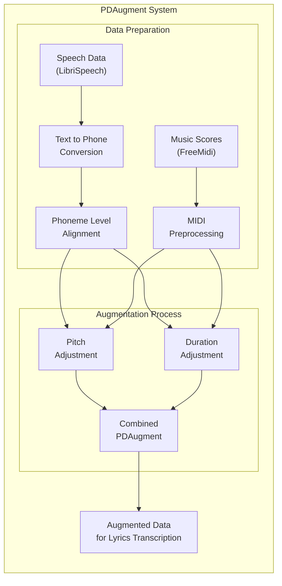
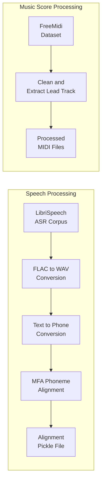
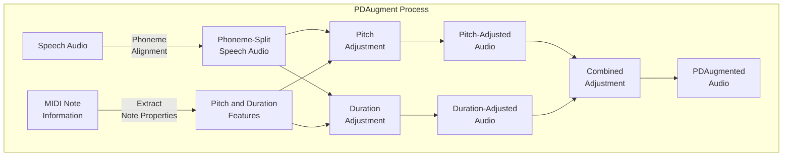
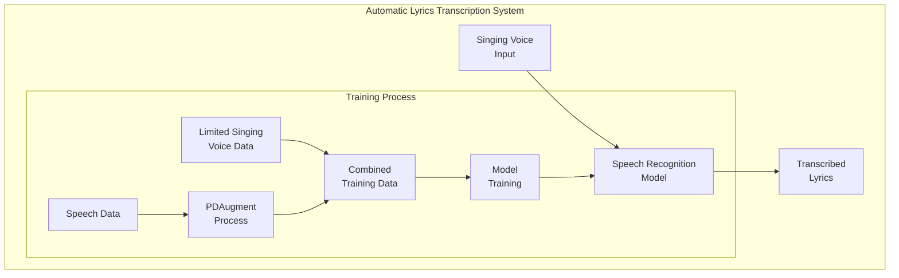

<!-- source: DeepWiki mcp.deepwiki.com · repo microsoft/muzic · page 2.3 PDAugment · fetched 2026-10-26 -->

# PDAugment

<details>
<summary>Relevant source files</summary>

The following files were used as context for generating this wiki page:

- [README.md](README.md)
- [pdaugment/README.md](pdaugment/README.md)

</details>


## Introduction

PDAugment is a data augmentation method that adjusts pitch and duration of speech to help the training of automatic lyrics transcription systems. It narrows the gap between natural speech and singing voice by adjusting the pitch and duration of each syllable in natural speech to match those of corresponding notes extracted from music scores. This wiki page documents the architecture, implementation, and usage of the PDAugment system within Microsoft's Muzic project.

For information about other music understanding components, see [Music Understanding Components](#2).

Sources: [README.md:29-31]()', [pdaugment/README.md:1-9]()

## System Overview

PDAugment is designed to solve the problem of insufficient training data for lyrics transcription systems by leveraging existing speech recognition datasets and music scores. The system transforms regular speech data by adjusting its pitch and duration characteristics to more closely resemble singing voice data, thereby creating synthetic training data for automatic lyrics transcription systems.



The PDAugment pipeline consists of two main stages:
1. **Data Preparation**: Processing speech datasets and music scores to extract phoneme-level information and musical notes
2. **Augmentation Process**: Adjusting the pitch and duration of speech data based on musical information

Sources: [pdaugment/README.md:5-9]()

## Data Preparation Process

The data preparation process involves collecting and processing two types of data:

1. **Speech Data**: Using the LibriSpeech ASR corpus
2. **Music Scores**: Using FreeMidi dataset (specifically pop songs)



### Speech Data Processing

1. **Download LibriSpeech ASR Corpus**
   - Save in `data/speech/raw`
   - Convert FLAC to WAV format using `ffmpeg`

2. **Text to Phone Conversion**
   - Convert word-level text to phoneme-level text using `phonemizer`
   - Generate metadata CSV files with phoneme information

3. **Phoneme Level Alignment**
   - Use Montreal Forced Aligner (MFA) to get phoneme-level alignment
   - Generate alignment pickle files with split positions between phonemes

Sources: [pdaugment/README.md:12-77]()

### Music Score Processing

1. **Download FreeMidi Dataset**
   - Use specifically pop songs (approximately 4000 MIDI files)
   - Save in `data/midis/raw`

2. **MIDI Preprocessing**
   - Clean multitrack data
   - Recognize and extract the lead track information
   - Save processed files in `data/midis/processed/midi_6tracks`

Sources: [pdaugment/README.md:81-102]()

## Augmentation Process

The core of PDAugment involves two types of adjustments that can be applied independently or combined:



### Pitch Adjustment

Pitch adjustment modifies the pitch of each phoneme in the speech to match the pitch of corresponding notes in music scores. This process:

1. Uses the phoneme alignment information to identify each phoneme segment
2. Extracts pitch information from music notes
3. Adjusts the pitch of each phoneme using frequency mapping

### Duration Adjustment

Duration adjustment modifies the length of each phoneme to match the duration of corresponding notes in music scores. This process:

1. Uses the phoneme alignment information to identify each phoneme segment
2. Extracts duration information from music notes
3. Either stretches or compresses each phoneme segment to match the target duration

### Combined PDAugment

The full PDAugment process applies both pitch and duration adjustments to create speech that more closely resembles singing voice in terms of melodic characteristics.

Sources: [pdaugment/README.md:5-9](), [pdaugment/README.md:105-149]()

## Implementation and Usage

The PDAugment system is implemented in Python and requires specific dependencies to run.

### Code Structure

The main implementation consists of:

- `pdaugment.py`: Main script for the augmentation process
- `text2phone.py`: Script for converting text to phoneme
- `flac2wav.py`: Script for converting FLAC files to WAV format
- `midi_preprocess/`: Directory containing MIDI preprocessing scripts
  - `preprocess.py`: Script for processing MIDI files
  - `configs/default.yaml`: Configuration for MIDI preprocessing

### Requirements

To run PDAugment, you need:

```
python=3.6
ffmpeg (for audio conversion)
phonemizer (for text-to-phone conversion)
Montreal Forced Aligner (for phoneme alignment)
```

Additional Python dependencies are listed in `requirements.txt`.

### Usage Instructions

The main augmentation process is performed by running `pdaugment.py` with the following parameters:

```
python pdaugment.py <pickle_path> <frequency_json_file> <dataset_dir> <midi_file_dir> <metadata_dir> <output_duration_dir> <output_pitch_dir> <output_pdaugment_dir> <number_of_threads>
```

Where:
- `pickle_path`: Path to the phoneme alignment pickle file
- `frequency_json_file`: Mapping between semitone and frequency
- `dataset_dir`: Directory containing the speech dataset
- `midi_file_dir`: Directory containing processed MIDI files
- `metadata_dir`: Path to the metadata CSV file
- `output_duration_dir`: Output directory for duration-adjusted audio
- `output_pitch_dir`: Output directory for pitch-adjusted audio
- `output_pdaugment_dir`: Output directory for combined PDAugmented audio
- `number_of_threads`: Number of parallel processing threads

Example usage:
```
python pdaugment.py data/pickle/mel_splits.pickle utils/frequency.json data/speech/wav/dev-clean data/midis/processed/midi_6tracks data/speech/phone/dev-clean_metadata.csv data/duration data/pitch data/pdaugment 16
```

Sources: [pdaugment/README.md:105-149]()

## Performance and Applications

PDAugment significantly improves the performance of automatic lyrics transcription systems. According to research results, systems trained with PDAugment outperform previous state-of-the-art systems by:

- 5.9% WER (Word Error Rate) reduction on the DSing30 dataset
- 18.1% WER reduction on the Dali dataset



The augmented data created by PDAugment helps bridge the gap between speech and singing voice, making it possible to leverage large speech recognition datasets for training lyrics transcription systems.

Sources: [pdaugment/README.md:3]()

## Related Work

PDAugment is part of Microsoft's Muzic project, which includes other music understanding components:

- **MusicBERT**: Symbolic Music Understanding with Large-Scale Pre-Training
- **CLaMP**: Contrastive Language-Music Pre-training

For more information about these related systems, see [Music Understanding Components](#2).

Sources: [README.md:27-31]()

---

