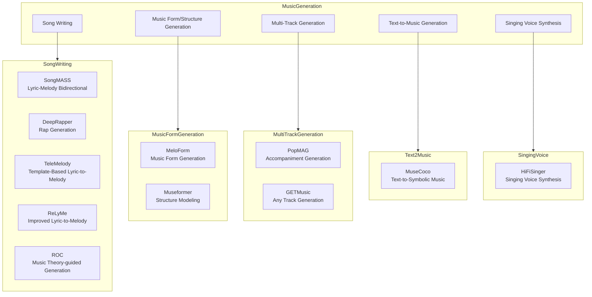
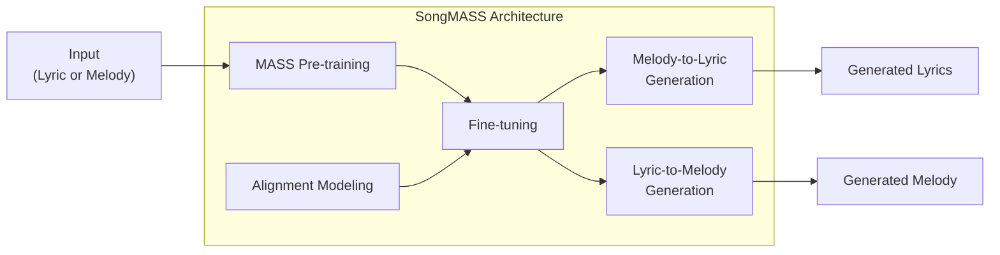
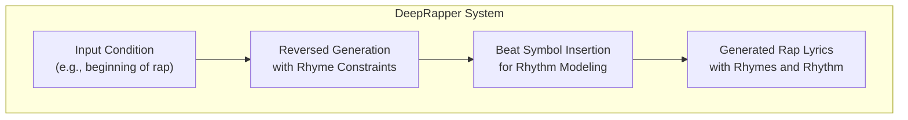
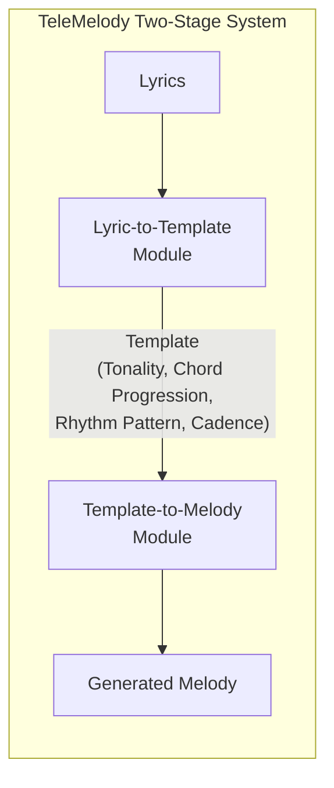
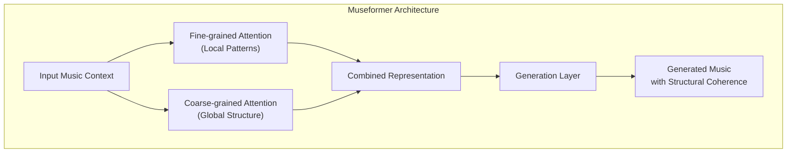
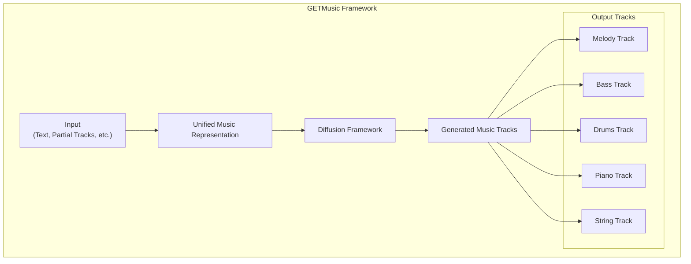
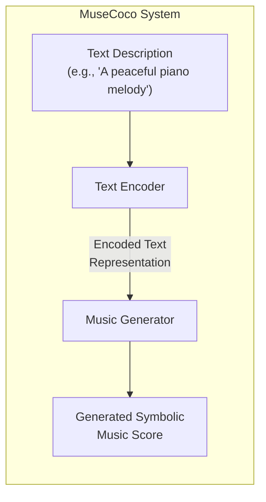
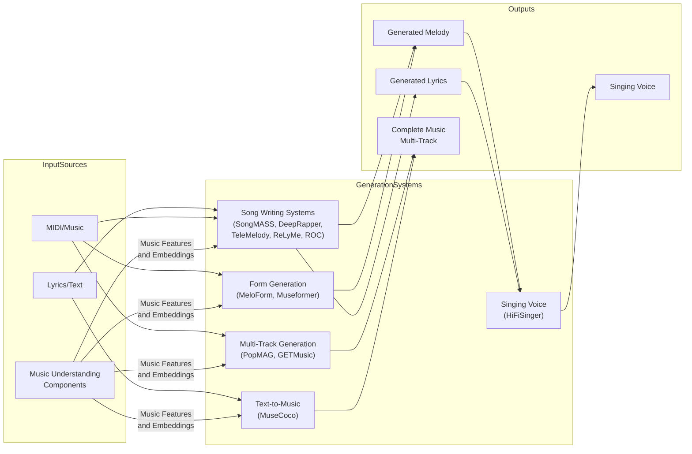
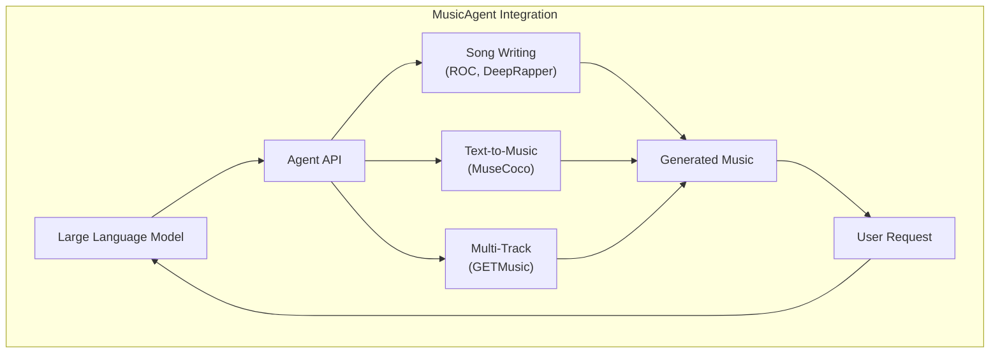

<!-- source: DeepWiki mcp.deepwiki.com · repo microsoft/muzic · page 3 Music Generation Components · fetched 2026-10-26 -->

# Music Generation Components

Relevant source files

The following files were used as context for generating this wiki page:

- [README.md](README.md)
- [deeprapper/README.md](deeprapper/README.md)
- [musicbert/README.md](musicbert/README.md)
- [pdaugment/README.md](pdaugment/README.md)
- [songmass/README.md](songmass/README.md)
- [telemelody/README.md](telemelody/README.md)
- [telemelody/inferrence/infer_zh.py](telemelody/inferrence/infer_zh.py)

## Purpose and Scope

This document provides a comprehensive overview of the music generation components within the Microsoft Muzic project. Music generation represents the creative aspect of AI music technology, focused on producing novel musical content across various forms including lyrics, melodies, multi-track compositions, and structured musical pieces. For information about music understanding components, see [Music Understanding Components](#2).

Sources: [README.md:32-44]()

## Overview of Music Generation in Muzic

The Muzic project organizes music generation capabilities into five major categories, each addressing a distinct aspect of music creation:

1. **Song Writing** - Generation of melodies and lyrics, including specialized systems for rap generation
2. **Music Form/Structure Generation** - Generation of music with coherent structural form
3. **Multi-Track Generation** - Creation of multiple instrumental tracks or accompaniments
4. **Text-to-Music Generation** - Conversion of textual descriptions into symbolic music
5. **Singing Voice Synthesis** - Creation of realistic singing voices

These components can be used independently or in combination to create complete musical works.

### Architecture of Music Generation Components

Sources: [README.md:32-44]()

## Song Writing Systems

Song writing components focus on generating lyrics, melodies, or both, addressing the challenge of creating musically coherent compositions that follow musical patterns like rhymes and rhythms.

### SongMASS: Bidirectional Lyric-Melody Generation

SongMASS (Song Masked Sequence to Sequence) uses pre-training and alignment constraint for generating melodies from lyrics and lyrics from melodies. It leverages masked sequence to sequence pre-training to learn the correlation between lyrics and melodies.

Sources: [songmass/README.md:3-8](), [README.md:34]()

### DeepRapper: Neural Rap Generation

DeepRapper is a specialized system for rap generation that models both rhymes and rhythms. It generates lyrics in reverse order, using both rhyme representation and beat symbols for rhythm modeling.

Key features:
- Reverse-order generation to enhance rhyming
- Beat symbol integration for rhythm modeling
- Transformer-based architecture

Sources: [deeprapper/README.md:2-4](), [README.md:35]()

### TeleMelody: Template-Based Lyric-to-Melody

TeleMelody is a two-stage system that bridges the gap between lyrics and melodies using music templates. It consists of a lyric-to-template module and a template-to-melody module.

The system's modularity provides several advantages:
- Better controllability of melody generation
- Reduced dependency on paired lyric-melody data
- Higher quality melody output

The implementation includes distinct components for rhythm modeling and melody generation, with support for both English and Chinese lyrics.

Sources: [telemelody/README.md:3-6](), [telemelody/inferrence/infer_zh.py:1-383](), [README.md:36]()

### ReLyMe and ROC

ReLyMe (Improved Lyric-to-Melody Generation) builds on TeleMelody by incorporating explicit modeling of lyric-melody relationships.

ROC (Re-creation of Creations) introduces music theory guidance into the lyric-to-melody generation process, enabling more musically coherent outputs.

Sources: [README.md:36]()

## Music Form/Structure Generation

### MeloForm

MeloForm focuses on generating music with coherent structural form, addressing the challenge of creating longer musical pieces with consistent themes and variations.

### Museformer

Museformer introduces fine- and coarse-grained attention mechanisms for long-form music generation. It enables the model to capture both local patterns and global structure in music.

Sources: [README.md:37-39]()

## Multi-Track Generation

Multi-track generation systems create complete musical arrangements with multiple instrumental tracks.

### PopMAG

PopMAG (Pop Music Accompaniment Generation) specializes in generating accompaniment tracks for pop music, creating supporting instrumental parts for existing melodies.

### GETMusic

GETMusic (Generating Any Music Tracks) provides a versatile system for generating multiple tracks of music simultaneously using a unified representation and diffusion framework.

Sources: [README.md:40-42]()

## Text-to-Music Generation

### MuseCoco

MuseCoco enables the generation of symbolic music directly from textual descriptions, serving as a music composition copilot. It connects natural language understanding with musical composition.

Sources: [README.md:43]()

## Singing Voice Synthesis

### HiFiSinger

HiFiSinger provides high-fidelity singing voice synthesis, converting lyrics and melody into realistic singing voices.

Sources: [README.md:44]()

## Data Flow in Music Generation

The following diagram illustrates how data flows through the different music generation components, showing their inputs and outputs:

Sources: [README.md:32-44]()

## Code Structure and Implementation

The music generation components are organized into separate directories within the Muzic repository, each containing specialized implementation for their specific task:

| Component | Primary Directory | Core Functionality |
|-----------|------------------|-------------------|
| SongMASS | `/songmass` | Bidirectional lyric-melody generation using MASS pre-training |
| DeepRapper | `/deeprapper` | Rap generation with rhyme and rhythm modeling |
| TeleMelody | `/telemelody` | Two-stage lyric-to-melody generation |
| Museformer | `/museformer` | Music generation with fine- and coarse-grained attention |
| GETMusic | `/getmusic` | Multi-track generation with unified representation |
| MuseCoco | `/musecoco` | Text-to-symbolic music generation |

Each component maintains its own training, inference, and evaluation scripts, with many providing pre-trained models for immediate use.

Sources: [README.md:72]()

## Integration with Other Components

Music generation components integrate with other parts of the Muzic ecosystem:

1. **Integration with Music Understanding** - Components like Museformer and GETMusic leverage music understanding capabilities from MusicBERT to generate more contextually appropriate music

2. **Integration with MusicAgent** - The MusicAgent system provides a unified interface to many of these generation capabilities, using large language models to orchestrate different music generation components

Sources: [README.md:45-46](), [README.md:58-60]()

## Summary

The music generation components in Muzic provide a comprehensive set of tools for creating various aspects of music, from lyrics and melodies to multi-track compositions and singing voices. These components can be used individually for specialized tasks or combined to create complete musical works.

The progression of components shows a research evolution toward more sophisticated and controllable music generation, with newer systems addressing limitations of previous approaches. The entire ecosystem supports diverse musical creation tasks across different genres, styles, and composition types.

Sources: [README.md:32-46]()

---

