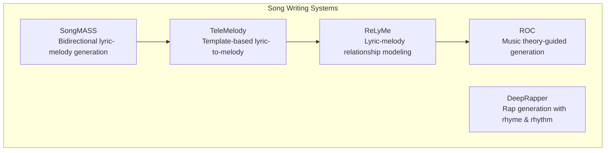
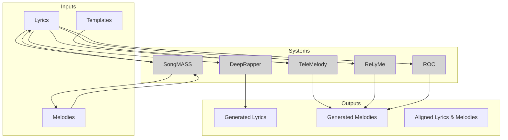
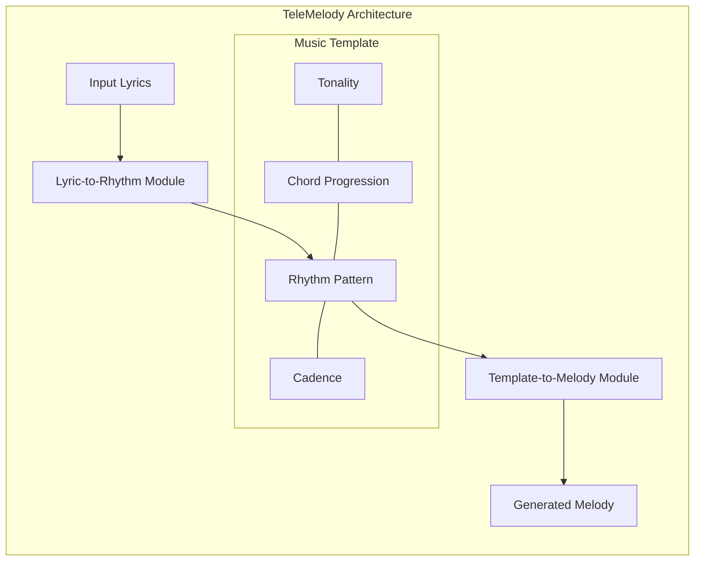
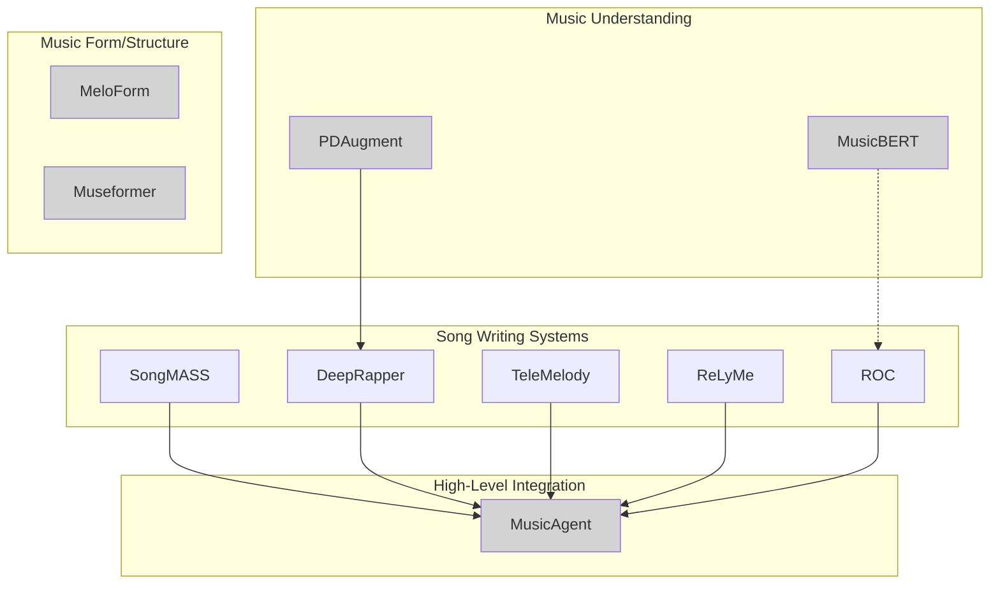
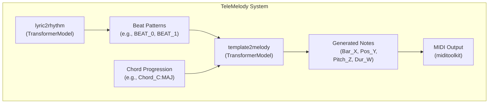

<!-- source: DeepWiki mcp.deepwiki.com · repo microsoft/muzic · page 3.1 Song Writing Systems · fetched 2026-10-26 -->

# Song Writing Systems

Relevant source files

The following files were used as context for generating this wiki page:

- [README.md](README.md)
- [deeprapper/README.md](deeprapper/README.md)
- [musicbert/README.md](musicbert/README.md)
- [pdaugment/README.md](pdaugment/README.md)
- [songmass/README.md](songmass/README.md)
- [telemelody/README.md](telemelody/README.md)
- [telemelody/inferrence/infer_zh.py](telemelody/inferrence/infer_zh.py)

## Purpose and Scope

This document provides an overview of the song writing systems within the Microsoft Muzic project. These systems focus on automating various aspects of song composition, including lyric generation, melody creation, and the integration of lyrics with melodies. For information about other music generation components such as multi-track generation, see [Music Generation Components](#3), and for text-to-music generation, see [Text-to-Music Generation](#3.4).

Sources: [README.md:32-36]()

## Overview of Song Writing Systems

The Microsoft Muzic project includes five principal song writing systems, each addressing different aspects of the song creation process:

### System Progression and Evolution

These systems represent an evolutionary progression in lyric-to-melody generation capabilities:

1. **SongMASS (2021)**: The foundational system that enables bidirectional generation between lyrics and melodies using pre-training and alignment constraints.

2. **DeepRapper (2021)**: Specialized system focusing on rap generation with explicit modeling of rhymes and rhythms.

3. **TeleMelody (2022)**: Improves upon SongMASS by introducing a template-based two-stage approach that bridges the gap between lyrics and melodies.

4. **ReLyMe (2022)**: Enhances lyric-to-melody generation by explicitly incorporating lyric-melody relationships.

5. **ROC (2022)**: Further advances the field by incorporating music theory principles into the generation process.

Sources: [README.md:32-36](), [telemelody/README.md:1-3](), [deeprapper/README.md:1-2](), [songmass/README.md:1-3]()

## Approaches and Data Flow

The song writing systems employ different approaches to generate lyrics and melodies:

Sources: [README.md:32-36](), [telemelody/README.md:1-3](), [deeprapper/README.md:1-2](), [songmass/README.md:1-3]()

## Technical Architecture Details

### SongMASS

SongMASS (Song with Masked Sequence to Sequence) employs a bidirectional generation approach inspired by MASS (Masked Sequence to Sequence) pre-training. It uses:

- Song-level MASS pre-training to learn patterns from unpaired data
- Alignment constraint mechanism to ensure synchronization between lyrics and melodies
- Encoder-decoder architecture for both lyric-to-melody and melody-to-lyric generation

Sources: [songmass/README.md:1-9]()

### DeepRapper

DeepRapper generates rap lyrics by modeling both rhymes and rhythms:

- Reverse-order generation with rhyme representation and constraints
- Beat symbols insertion for rhythm/beat modeling
- Transformer-based architecture fine-tuned for rap-specific characteristics

Sources: [deeprapper/README.md:1-4]()

### TeleMelody

TeleMelody introduces a template-based two-stage approach:

The system consists of:
- Lyric-to-rhythm module
- Template-to-melody module
- Music template components (tonality, chord progression, rhythm, cadence)

The code in [telemelody/inferrence/infer_zh.py]() shows how TeleMelody processes lyrics to generate rhythms (beats) and then uses those with chord progressions to generate melodies.

Sources: [telemelody/README.md:1-7](), [telemelody/inferrence/infer_zh.py:148-383]()

### ReLyMe

ReLyMe (Relationship-based Lyric-to-Melody) incorporates:

- Explicit modeling of relationships between lyrics and melodies
- Enhanced understanding of how linguistic features influence melodic choices
- Improved melody generation by considering lyric-melody relationships

Sources: [README.md:86]()

### ROC

ROC (Re-creation of Creations) introduces:

- Music theory principles to guide the generation process
- Framework for creating melodies that adhere to established composition rules
- Enhanced control over musical structure and form

Sources: [README.md:87]()

## Integration with Muzic Components

The song writing systems integrate with other components of the Muzic project:

- **PDAugment** provides enhanced audio processing for DeepRapper
- **MusicBERT** offers symbolic music understanding that can inform theory-based approaches like ROC
- All song writing systems can be leveraged by the **MusicAgent** that integrates various components

Sources: [README.md:27-46](), [pdaugment/README.md:1-3](), [musicbert/README.md:1-3]()

## Data Processing and Representation

The song writing systems use various data representations and processing techniques:

| System | Input Format | Processing | Output Format |
|--------|-------------|------------|--------------|
| SongMASS | Lyrics/MIDI | MASS pre-training, alignment constraint | Generated lyrics/melodies |
| DeepRapper | Lyrics, pinyin | Rhyme/rhythm modeling, reverse generation | Rap lyrics with beat symbols |
| TeleMelody | Lyrics, chord progressions | Lyric-to-rhythm conversion, template-based generation | MIDI with lyrics |
| ReLyMe | Lyrics | Lyric-melody relationship modeling | MIDI melodies |
| ROC | Lyrics | Music theory-guided generation | Theory-compliant melodies |

Sources: [songmass/README.md:10-22](), [deeprapper/README.md:7-45](), [telemelody/README.md:8-40]()

## System Components and Code Structure

The core components of the song writing systems map to specific implementation elements:

This diagram illustrates how TeleMelody's components correspond to code entities, showing the transformation from lyrics to MIDI output through two transformer models and template components.

Sources: [telemelody/inferrence/infer_zh.py:148-383](), [telemelody/README.md:8-140]()

## Evaluation Metrics

The song writing systems are evaluated using several metrics:

| Metric | Description | System |
|--------|-------------|--------|
| PD (Pitch Distribution) | Similarity between generated and ground-truth pitch distributions | TeleMelody, SongMASS |
| DD (Duration Distribution) | Similarity between generated and ground-truth duration distributions | TeleMelody, SongMASS |
| MD (Melody Distance) | DTW distance between generated and ground-truth melodies | TeleMelody, SongMASS |
| TA (Tonality Accuracy) | Accuracy of generated melody in following specified tonality | TeleMelody |
| CA (Chord Accuracy) | Accuracy of generated melody in following chord progression | TeleMelody |
| RA (Rhythm Accuracy) | Accuracy of generated melody in following rhythm pattern | TeleMelody |
| AA (Alignment Accuracy) | Accuracy of alignment between lyrics and melody | TeleMelody, SongMASS |

Sources: [telemelody/README.md:114-138](), [songmass/README.md:82-114]()

## Conclusion

The song writing systems in Microsoft Muzic demonstrate a progressive evolution in AI-based music composition capabilities. Starting with the foundational SongMASS system for bidirectional lyric-melody generation, the technology has advanced through specialized systems like DeepRapper for rap generation, and increasingly sophisticated approaches like TeleMelody's template-based generation, ReLyMe's relationship modeling, and ROC's theory-guided generation.

These systems collectively provide a comprehensive toolkit for automated song composition, addressing various aspects of the creative process from lyric generation to melody creation and their alignment. The progression of these systems shows increasing sophistication in understanding and modeling the complex relationships between linguistics and music.

Sources: [README.md:32-36]()

---

