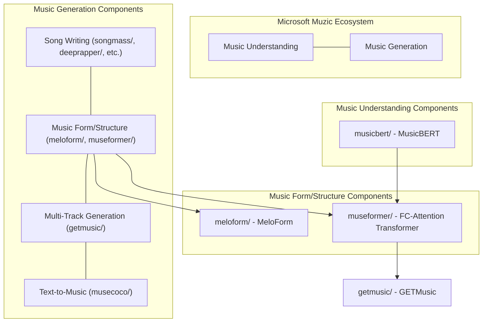
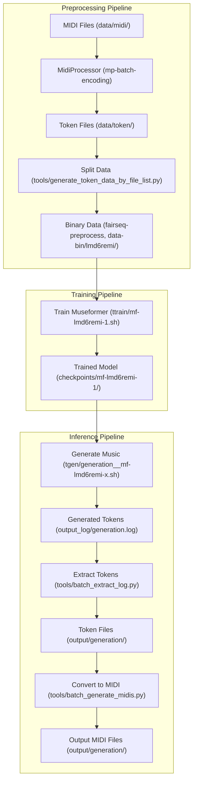

<!-- source: DeepWiki mcp.deepwiki.com · repo microsoft/muzic · page 3.2 Music Form/Structure Generation · fetched 2026-10-26 -->

# Music Form/Structure Generation

<details>
<summary>Relevant source files</summary>

The following files were used as context for generating this wiki page:

- [README.md](README.md)
- [museformer/README.md](museformer/README.md)
- [museformer/data/meta/general_use_dict.txt](museformer/data/meta/general_use_dict.txt)
- [museformer/tgen/generation__mf-lmd6remi-x.sh](museformer/tgen/generation__mf-lmd6remi-x.sh)
- [pdaugment/README.md](pdaugment/README.md)

</details>


This document provides an overview of the music form and structure generation components in the Microsoft Muzic project. These components focus on generating music with coherent structural organization across different time scales, which is essential for creating musically meaningful compositions that exhibit proper form.

For information about song writing systems like lyric-to-melody generation, see [Song Writing Systems](#3.1). For multi-track generation, see [Multi-Track Generation](#3.3).

## 1. Overview

Music form and structure refer to the organization of musical ideas over time. In traditional music theory, forms like ABA (where A and B represent distinct musical sections) provide structure that makes music coherent and engaging. Generating music with proper structural form is challenging for AI systems, as it requires both local coherence (within measures or phrases) and global coherence (across entire compositions).

The Microsoft Muzic project includes two systems for addressing music form/structure generation:

1. **MeloForm**: Generates melody with musical form based on a combination of expert systems and neural networks
2. **Museformer**: Models both long-range and short-range musical structures using a transformer architecture with specialized attention mechanisms

These systems produce music that not only sounds good at a local level but also exhibits coherent structural organization at a global level.

Sources: [README.md:37-39]()

## 2. Position in Muzic Ecosystem

The music form/structure generation components are positioned as critical elements in the Muzic ecosystem, bridging the gap between song writing systems and multi-track generation.

### Music Form/Structure Components in the Muzic Architecture



Sources: [README.md:17-24](), [README.md:37-39]()

## 3. Components

### 3.1 MeloForm

MeloForm is a system for generating melody with musical form, combining expert systems with neural networks. It's designed to create melodies that follow traditional musical structures.

Key features of MeloForm:
- Integration of music theory rules through expert systems
- Neural networks for creative generation
- Focus on producing structured, form-aware melodies

Sources: [README.md:38]()

### 3.2 Museformer

Museformer is a transformer-based model with a novel fine- and coarse-grained attention (FC-Attention) mechanism specifically designed for music generation. It addresses the challenge of capturing both local patterns and global structure in music.

#### 3.2.1 Key Innovations

Museformer introduces FC-Attention, which has two main components:

1. **Fine-grained attention**: Allows a token of a specific bar to directly attend to all tokens in bars that are most relevant to music structures (e.g., the previous 1st, 2nd, 4th and 8th bars, selected via similarity statistics)

2. **Coarse-grained attention**: Enables a token to attend to summaries of other bars rather than individual tokens, reducing computational complexity

This approach provides two major advantages:
- It captures both music structure-related correlations (via fine-grained attention) and other contextual information (via coarse-grained attention)
- It is computationally efficient, allowing the model to handle sequences that are 3 times longer than traditional full-attention transformers

Sources: [museformer/README.md:3-9]()

#### 3.2.2 FC-Attention Mechanism

The FC-Attention mechanism is the core innovation of Museformer, enabling efficient modeling of both local and global music structures.

### Museformer's FC-Attention Architecture

```mermaid
graph TD
    subgraph "Museformer FC-Attention Implementation"
        Input["Input: Token Sequence"]
        Bars["Bar Segmentation (using note timing)"]
        FA["Fine-grained Attention (con2con param)"]
        CA["Coarse-grained Attention (con2sum param)"]
        Combine["Combine Attentions (in forward pass)"]
        Output["Output: Next Token Prediction"]
        
        Input --> Bars
        Bars --> FA
        Bars --> CA
        FA --> Combine
        CA --> Combine
        Combine --> Output
    end
    
    subgraph "Fine-grained Attention Implementation"
        BarToken["Current Bar Token"]
        RelBars["RelBars: Select 1st, 2nd, 4th, 8th previous bars"]
        FullAttention["Full Self-Attention (standard transformer)"]
        
        BarToken --> RelBars
        RelBars --> FullAttention
    end
    
    subgraph "Coarse-grained Attention Implementation"
        OtherBars["Other Bars"]
        Summarize["Bar Summarization Function"]
        AttendToSummary["Attention to Bar Summaries Only"]
        
        OtherBars --> Summarize
        Summarize --> AttendToSummary
    end
```



Sources: [museformer/README.md:3-9](), [museformer/README.md:109]()

#### 3.2.3 Technical Implementation

Museformer is implemented on top of the Fairseq framework and requires specific hardware and software dependencies:
- Recommended hardware: NVIDIA V100 32GB GPU
- Required software: Python 3.8, Fairseq 0.10.2, TensorboardX 2.2, and the Triton library

Sources: [museformer/README.md:74-97]()

## 4. Data Processing and Workflow

The workflow for using Museformer involves several stages from data preprocessing to music generation.

### Museformer Data Processing Pipeline



Sources: [museformer/README.md:13-69](), [museformer/README.md:98-112](), [museformer/README.md:128-152]()

### 4.1 Dataset and Preprocessing

Museformer was trained on the Lakh MIDI dataset (LMD-full), preprocessed with the following steps:

1. Normalize MIDI files:
   - Time signatures to 4/4
   - Instruments to 6 basic ones: square synthesizer (80), piano (0), guitar (25), string (48), bass (43), drum

2. Encode MIDI files into tokens using MidiProcessor with the REMIGEN2 representation:

```bash
mp-batch-encoding $midi_dir $token_dir --encoding-method REMIGEN2 --normalize-pitch-value --remove-empty-bars --ignore-ts --sort-insts 6tracks_cst1
```

3. Gather tokens for each data split:

```bash
python tools/generate_token_data_by_file_list.py data/meta/${split}.txt $token_dir $split_dir
```

4. Create binary data using fairseq-preprocess:

```bash
fairseq-preprocess \
  --only-source \
  --trainpref $split_dir/train.data \
  --validpref $split_dir/valid.data \
  --testpref $split_dir/test.data \
  --destdir $data_bin_dir \
  --srcdict data/meta/dict.txt
```

Sources: [museformer/README.md:13-69]()

### 4.2 Training

Training Museformer is done using fairseq-train with parameters that control:
- The bars used for fine-grained attention (`con2con`)
- The bars used for coarse-grained attention (`con2sum`)

The model is typically trained on 4 GPUs with an effective batch size of 4 (batch size 1 per GPU).

Sources: [museformer/README.md:98-112]()

### 4.3 Inference and Generation

To generate music with Museformer:

1. Run the generation script with a trained checkpoint:
```bash
fairseq-interactive $DATA_DIR \
  --path checkpoints/$MODEL_NAME/$CHECKPOINT  \
  --user-dir museformer \
  --task museformer_language_modeling \
  --sampling --sampling-topk 8  --beam 1 --nbest 1 \
  --min-len 1024 \
  --max-len-b 20480 \
  --num-workers $NUM_WORKERS \
  --seed $SEED
```

2. Extract token sequences from the generation log:
```bash
python tools/batch_extract_log.py output_log/generation.log output/generation --start_idx 1
```

3. Convert the token sequences back to MIDI files:
```bash
python tools/batch_generate_midis.py --encoding-method REMIGEN2 --input-dir output/generation --output-dir output/generation
```

Sources: [museformer/README.md:128-152](), [museformer/tgen/generation__mf-lmd6remi-x.sh:1-16]()

## 5. General Use Cases

Museformer can be adapted to work with arbitrary datasets with various time signatures and instruments by modifying the preprocessing steps:

1. Use `--encoding-method REMIGEN` and `--sort-insts id` instead of the default parameters
2. Remove the `--ignore-ts` parameter to encode time signature information
3. Use a more comprehensive dictionary (`data/meta/general_use_dict.txt`) that includes various time signatures and instruments
4. Add `--beat-mask-ts True` for the `fairseq-train` command

The dictionary file contains a comprehensive list of tokens for different musical elements:
- Bar tokens (`b-*`)
- Octave tokens (`o-*`)
- Instrument tokens (`i-*`)
- Pitch tokens (`p-*`)
- Duration tokens (`d-*`)
- Velocity tokens (`v-*`)
- Position tokens (`s-*`)
- Time signature tokens (`t-*`)
- Other special tokens

This flexibility allows Museformer to be used with a wide range of musical styles and formats beyond the standard dataset used in the original implementation.

Sources: [museformer/README.md:35-36](), [museformer/README.md:70](), [museformer/README.md:110](), [museformer/data/meta/general_use_dict.txt:1-1021]()

## 6. Conclusion

Music form/structure generation is a critical aspect of AI music composition. MeloForm and Museformer represent Microsoft's approach to addressing the challenge of generating music with coherent and meaningful structure, bridging the gap between local patterns and global organization in AI-generated music.

The Museformer model, in particular, demonstrates how specialized attention mechanisms can efficiently model both local and global structures in music, enabling the generation of longer, more coherent musical pieces. By selectively applying different types of attention to different parts of the music, it effectively captures the hierarchical nature of musical composition without the computational overhead of full attention mechanisms.

Sources: [museformer/README.md:3-9](), [README.md:37-39]()

---

