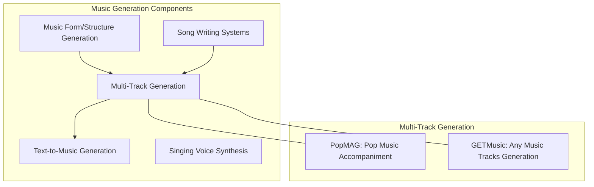
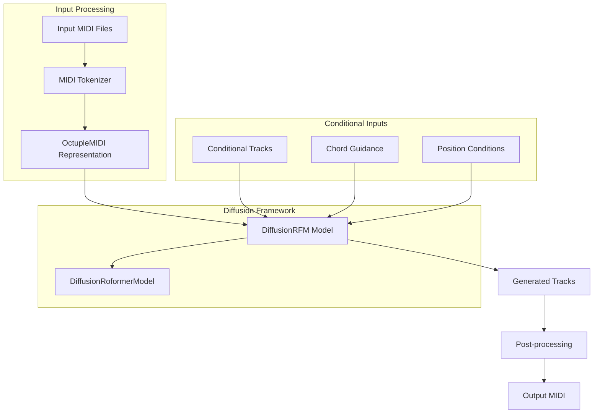
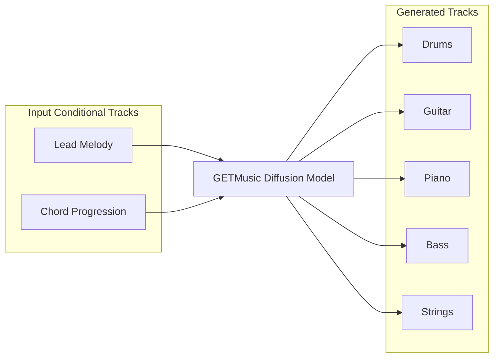
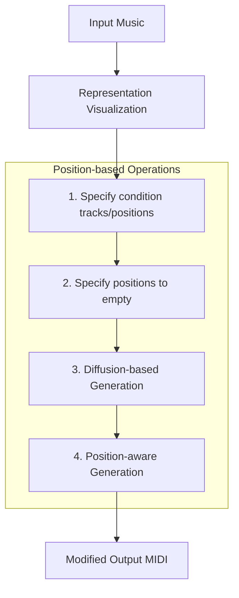
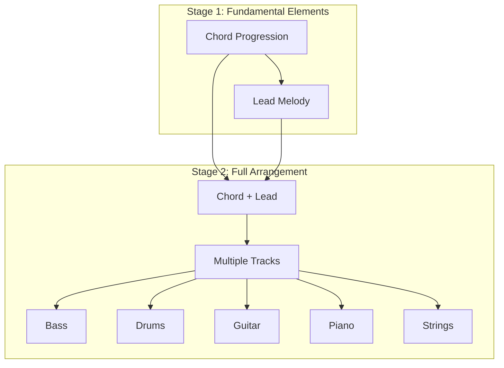
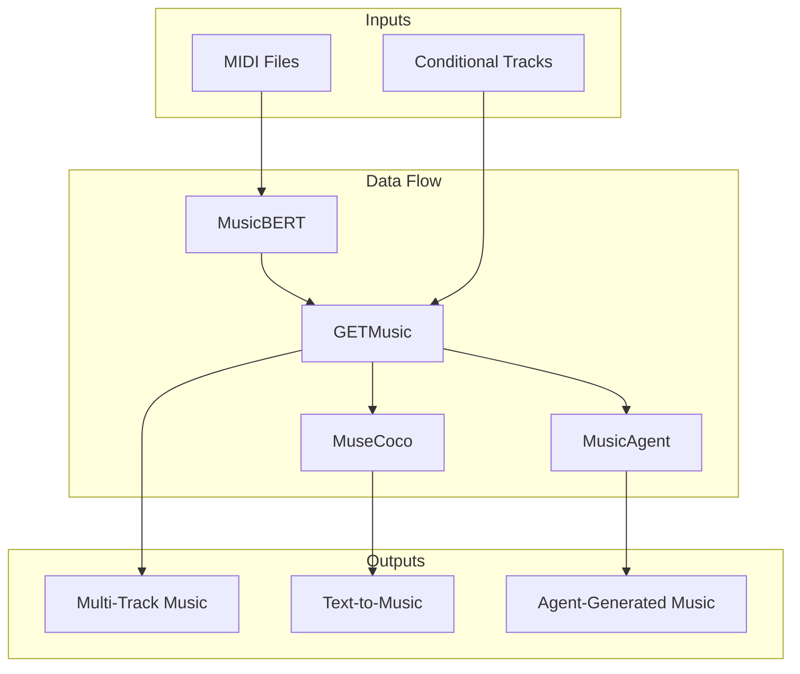

<!-- source: DeepWiki mcp.deepwiki.com · repo microsoft/muzic · page 3.3 Multi-Track Generation · fetched 2026-10-26 -->

# Multi-Track Generation

Relevant source files

The following files were used as context for generating this wiki page:

- [README.md](README.md)
- [getmusic/README.md](getmusic/README.md)
- [getmusic/configs/train.yaml](getmusic/configs/train.yaml)
- [getmusic/example_data/inference/childhood.mid](getmusic/example_data/inference/childhood.mid)
- [getmusic/example_data/train/0_01023_TS0.mid](getmusic/example_data/train/0_01023_TS0.mid)
- [pdaugment/README.md](pdaugment/README.md)

## Overview

Multi-Track Generation addresses the challenge of creating multiple complementary instrument tracks that form a cohesive musical piece. This capability is essential for generating rich, multi-layered music compositions where each instrument plays its role in harmony with others. Within the Microsoft Muzic project, Multi-Track Generation focuses on systems for generating accompaniment and creating arbitrary instrument tracks in music production.

The Multi-Track Generation component includes two primary systems:
1. PopMAG (Pop Music Accompaniment Generation)
2. GETMusic (Generating Any Music Tracks)

Sources: [README.md:39-42]()

## Position in Muzic Ecosystem

Multi-Track Generation is one component within the larger Music Generation category of the Microsoft Muzic project. It bridges the gap between Music Form/Structure Generation and Text-to-Music Generation systems.

### Music Generation Component Architecture

Sources: [README.md:27-46]()

## Core Systems

### PopMAG: Pop Music Accompaniment Generation

PopMAG focuses specifically on generating accompaniment for pop music. It takes existing melody tracks and generates appropriate accompanying instrument tracks to create complete musical pieces.

Sources: [README.md:41]()

### GETMusic: Any Music Tracks Generation

GETMusic is a versatile system built on a unified representation and diffusion framework. It can generate any combination of music tracks, providing a comprehensive solution for creating multi-track music with flexible conditions.

#### GETMusic Architecture

Sources: [getmusic/README.md:1-18](), [getmusic/configs/train.yaml:1-16]()

## Track Types and Representation

GETMusic works with multiple instrument tracks, each represented by specific MIDI program numbers:

| Track Type | MIDI Program ID | Description |
|------------|----------------|-------------|
| Piano      | 0              | Piano tracks |
| Guitar     | 25             | Guitar tracks |
| Bass       | 32             | Bass Guitar/Electric Bass |
| String     | 48             | String tracks |
| Lead       | 80             | Lead melody tracks |
| Drums      | N/A            | Percussion tracks (special handling) |
| Chord      | N/A            | Harmony representation |

The system uses a tokenization approach that converts MIDI data into a vocabulary of discrete tokens, enabling the use of diffusion-based generative models for music creation.

Sources: [getmusic/README.md:106-112]()

## Generation Capabilities

### Track Generation

GETMusic can generate music tracks conditioned on other existing tracks. This allows for flexible music composition scenarios:

For example, you can provide lead melody and chord tracks as conditions and generate complementary drum, guitar, and piano tracks that fit harmoniously with the input.

Sources: [getmusic/README.md:23-54]()

### Position-Based Generation and Infilling

In addition to track-wise generation, GETMusic supports advanced operations like position-based generation and infilling, which allows for:

1. Conditioning on specific time positions in certain tracks
2. Emptying selected positions for regeneration
3. Hybrid generation combining track-wise composition and infilling

Sources: [getmusic/README.md:59-96]()

## Implementation Details

### Data Representation

The GETMusic system uses a specialized tokenization approach based on the OctupleMIDI format (developed for MusicBERT) to represent multi-track MIDI data. The representation includes:

1. Track-specific token ranges in the vocabulary
2. Special tokens like [EMPTY] for masked positions
3. A unified representation for all instrument tracks

Sources: [getmusic/README.md:133-144](), [getmusic/configs/train.yaml:14-16]()

### Diffusion Framework

GETMusic employs a diffusion-based approach for music generation:

1. A diffusion model (DFM) that progressively denoises latent representations
2. Roformer-based architecture for handling music sequences
3. Conditional generation mechanisms for incorporating track dependencies

The model is configured with parameters such as:
- Diffusion steps: 100
- Vocabulary size: ~11,880 tokens
- Alpha initialization type: 'alpha1'

Sources: [getmusic/configs/train.yaml:1-16]()

## Recommended Generation Workflow

Based on empirical findings, the GETMusic documentation recommends an incremental generation approach when creating multiple tracks from scratch:

1. **Stage 1**: Generate fundamental elements (chord → lead)
2. **Stage 2**: Generate remaining tracks (chord, lead → bass, drum, guitar, piano, string)

This approach produces more coherent results with better musical regularity and quality.

Sources: [getmusic/README.md:118-122]()

## Usage Considerations

When working with the GETMusic system, several factors can impact generation quality:

1. **Input style compatibility**: Results may vary if input music differs significantly from the training data (pop music)
2. **Track-wise domain matching**: Ensure input tracks are assigned appropriate instrument roles
3. **Volume balancing**: Post-generation volume adjustment is often necessary for balanced arrangements
4. **Chord guidance**: Always enable chord guidance for more regular musical patterns

Sources: [getmusic/README.md:102-127]()

## Integration with Other Muzic Components

The Multi-Track Generation systems integrate with other components in the Muzic ecosystem:

1. They can utilize representations from Music Understanding components like MusicBERT
2. They provide input to Text-to-Music systems like MuseCoco
3. They can be accessed through the MusicAgent framework

Sources: [README.md:27-46]()

## Technical References

The GETMusic system acknowledges several foundational technologies:

1. VQ-diffusion for the diffusion framework
2. MusicBERT for symbolic music representation
3. Roformer for rotary position embeddings in the transformer model

Sources: [getmusic/README.md:199-208]()

---

