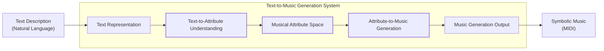

<!-- source: DeepWiki mcp.deepwiki.com · repo microsoft/muzic · page 3.4 Text-to-Music Generation · fetched 2026-10-26 -->

# Text-to-Music Generation

<details>
<summary>Relevant source files</summary>

The following files were used as context for generating this wiki page:

- [README.md](README.md)
- [musecoco/2-attribute2music_dataprepare/midi_data_extractor/data_extractor.py](musecoco/2-attribute2music_dataprepare/midi_data_extractor/data_extractor.py)
- [musecoco/2-attribute2music_model/data/truncated_5120/dict.txt](musecoco/2-attribute2music_model/data/truncated_5120/dict.txt)
- [musecoco/README.md](musecoco/README.md)
- [musecoco/requirements.txt](musecoco/requirements.txt)
- [pdaugment/README.md](pdaugment/README.md)

</details>


This page documents the Text-to-Music Generation component of the Microsoft Muzic project, which enables the generation of symbolic music from natural language descriptions. Text-to-Music Generation bridges the gap between language understanding and music creation, allowing users to generate music by describing the desired characteristics in plain text.

For information about Multi-Track Generation, see [Multi-Track Generation](#3.3). For Singing Voice Synthesis, see [HiFiSinger](#3.5).

## 1. Purpose and Overview

Text-to-Music Generation takes textual descriptions as input and produces symbolic music (MIDI files) that matches the described characteristics. This component serves as an interface between natural language and music generation, making music creation more accessible to users without musical expertise.

The primary implementation of Text-to-Music Generation in the Muzic project is MuseCoco, a system that follows a two-stage approach to transform text into music.

Sources: [README.md:42-43](), [musecoco/README.md:1-2]()

## 2. Architecture Overview

Text-to-Music Generation within the Muzic ecosystem functions as a bridge between textual descriptions and generated music. The system converts natural language descriptions into structured musical attributes, which are then used to guide the music generation process.

**Data Flow in Text-to-Music Generation**



Sources: [musecoco/README.md:1-20]()

## 3. MuseCoco System

MuseCoco is the primary implementation of Text-to-Music Generation in the Muzic project. It generates symbolic music (MIDI) based on textual descriptions, following a two-stage architecture:

**MuseCoco Architecture**

```mermaid
flowchart TB
    subgraph "Stage 1: Text-to-Attribute Understanding"
        Text["Text Input"] --> PreProc["Text Preprocessing"]
        PreProc --> FT_LM["Fine-tuned T5 Model"]
        FT_LM --> Attributes["Predicted Attributes"]
    end
    
    subgraph "Stage 2: Attribute-to-Music Generation"
        Attributes --> AttEncoder["Attribute Encoder"]
        AttEncoder --> FairseqModel["Transformer Model\n(Fairseq)"]
        FairseqModel --> Tokens["Music Tokens"]
        Tokens --> PostProc["Token Decoder"]
        PostProc --> MIDI["MIDI Output"]
    end
    
    Text --> |"User Query"| "Stage 1: Text-to-Attribute Understanding"
    "Stage 1: Text-to-Attribute Understanding" --> |"Attribute Vectors"| "Stage 2: Attribute-to-Music Generation"
    "Stage 2: Attribute-to-Music Generation" --> |"Music Generation"| MIDI
```

Sources: [musecoco/README.md:5-19]()

### 3.1 Attribute Space

The MuseCoco system uses a rich attribute space to bridge text descriptions and music generation. These attributes serve as an intermediate representation that captures various musical characteristics.

| Attribute Type | Keyword | Description |
|----------------|---------|-------------|
| Instrument | I1s2 | Type of instrument used |
| Rhythm Danceability | R1 | How danceable the rhythm is |
| Rhythm Intensity | R3 | Intensity level of the rhythm |
| Artist | S2s1 | Artist style influence |
| Genre | S4 | Musical genre |
| Bar | B1s1 | Number of bars |
| Time Signature | TS1s1 | Time signature of the music |
| Key | K1 | Musical key |
| Tempo | T1s1 | Speed of the music |
| Pitch Range | P4 | Range of pitches used |
| Emotion | EM1 | Emotional quality |
| Time | TM1 | Temporal characteristics |

**Attribute Space Relationships**

```mermaid
graph TD
    subgraph "Attribute Space"
        StructuralAttrs["Structural Attributes"]
        StyleAttrs["Style Attributes"]
        TechnicalAttrs["Technical Attributes"]
        EmotionalAttrs["Emotional Attributes"]
    end
    
    subgraph "Structural Attributes"
        B1s1["B1s1: Bar"]
        TS1s1["TS1s1: Time Signature"]
    end
    
    subgraph "Style Attributes"
        S2s1["S2s1: Artist"]
        S4["S4: Genre"]
        R1["R1: Rhythm Danceability"]
        R3["R3: Rhythm Intensity"]
    end
    
    subgraph "Technical Attributes"
        I1s2["I1s2: Instrument"]
        K1["K1: Key"]
        T1s1["T1s1: Tempo"]
        P4["P4: Pitch Range"]
    end
    
    subgraph "Emotional Attributes"
        EM1["EM1: Emotion"]
        TM1["TM1: Time"]
    end
    
    TextDescription["Text Description"] --> |"Extraction"| "Attribute Space"
    "Attribute Space" --> |"Controls"| MusicGeneration["Music Generation"]
    
    StructuralAttrs --- B1s1 & TS1s1
    StyleAttrs --- S2s1 & S4 & R1 & R3
    TechnicalAttrs --- I1s2 & K1 & T1s1 & P4
    EmotionalAttrs --- EM1 & TM1
```

Sources: [musecoco/README.md:35-51](), [musecoco/2-attribute2music_dataprepare/midi_data_extractor/data_extractor.py:90-102]()

### 3.2 Text-to-Attribute Understanding

The Text-to-Attribute Understanding stage processes natural language descriptions and extracts musical attributes. It uses a fine-tuned language model to predict attribute values from text.

The workflow involves:
1. Text preprocessing and tokenization
2. Fine-tuned T5 model for attribute prediction
3. Output processing to prepare attributes for the next stage

Sources: [musecoco/README.md:56-66](), [musecoco/requirements.txt:1-9]()

### 3.3 Attribute-to-Music Generation

The Attribute-to-Music Generation stage takes the attribute vectors as input and generates symbolic music tokens that conform to those attributes. This stage uses a transformer-based model implemented with Fairseq.

The process includes:
1. Encoding attribute vectors
2. Passing through a trained transformer model
3. Generating music tokens
4. Converting tokens to MIDI format

This stage represents music using a specialized tokenization scheme, where different token types represent different musical elements:

- `b-*`: Bar markers
- `o-*`: Octave information
- `i-*`: Instrument tokens
- `p-*`: Pitch tokens
- `d-*`: Duration tokens
- `v-*`: Velocity tokens
- `s-*`: Position tokens
- `t-*`: Tempo tokens

Sources: [musecoco/README.md:67-106](), [musecoco/requirements.txt:11-24](), [musecoco/2-attribute2music_model/data/truncated_5120/dict.txt:1-1250]()

## 4. Implementation Details

### 4.1 Data Preparation and Processing

The implementation involves several data processing steps:

1. **Text Data Preparation**
   - Processing text descriptions
   - Creating attribute-text pairs for training

2. **Music Data Processing**
   - Tokenizing MIDI files
   - Extracting attributes from MIDI
   - Splitting data into training, validation, and test sets

The attribute extraction from MIDI files uses the `DataExtractor` class, which analyzes various aspects of the MIDI data to determine attribute values.

Sources: [musecoco/README.md:56-95](), [musecoco/2-attribute2music_dataprepare/midi_data_extractor/data_extractor.py:87-244]()

### 4.2 Model Architecture

The system uses two main models:

1. **Text-to-Attribute Model**: A fine-tuned transformer-based language model that extracts attributes from text descriptions.

2. **Attribute-to-Music Model**: A transformer architecture with approximately 200M parameters that generates music based on attribute inputs.

Sources: [musecoco/README.md:98-106]()

### 4.3 Training Workflow

**Training Process Diagram**

```mermaid
flowchart TD
    subgraph "Stage 1 Training"
        AT["Attribute-Text Pairs"] --> FTM["Fine-tune T5 Model"]
        FTM --> TAU_Model["Text-to-Attribute Model"]
    end
    
    subgraph "Stage 2 Training"
        MA["MIDI with Attributes"] --> PreprocessMIDI["Tokenize & Extract\nAttributes"]
        PreprocessMIDI --> Train_AMG["Train Attribute-to-Music\nTransformer Model"]
        Train_AMG --> AMG_Model["Attribute-to-Music Model"]
    end
    
    "Stage 1 Training" --> |"Trained Model"| TAU_Model
    "Stage 2 Training" --> |"Trained Model"| AMG_Model
    
    TAU_Model & AMG_Model --> |"Inference Pipeline"| FullSystem["Complete MuseCoco System"]
```

The training process involves:

1. **Text-to-Attribute Training**
   - Constructing attribute-text pairs
   - Fine-tuning a pre-trained language model

2. **Attribute-to-Music Training**
   - Data processing of MIDI files
   - Training a transformer model on the tokenized music data with attribute conditioning

Sources: [musecoco/README.md:55-106]()

## 5. Inference and Usage

The inference pipeline takes a text description and generates a corresponding MIDI file:

1. Process the text description to extract attributes using the Text-to-Attribute model
2. Use the extracted attributes to condition the Attribute-to-Music model
3. Generate music tokens and convert them to MIDI format
4. Evaluate the generated music for attribute accuracy

**Inference Pipeline Diagram**


Usage tips:
1. Create text descriptions that align with the supported attributes for better control
2. Use the attribute synthesis method with ChatGPT as mentioned in the paper
3. Use only the attribute values provided in the implementation
4. Apply the evaluation model to filter out samples with the highest attribute accuracy

Sources: [musecoco/README.md:109-148]()

## 6. Evaluation

The evaluation of generated music focuses on attribute control accuracy:

1. **Objective Attribute Accuracy**: How well the generated music matches the specified objective attributes (e.g., instrument, key, tempo)
2. **Sample-wise Accuracy (ASA)**: Average accuracy across all attributes for each sample

The implementation includes an evaluation script that calculates these metrics automatically, helping users select the best-generated samples.

Sources: [musecoco/README.md:141-155]()

## 7. Relationship with Other Components

Text-to-Music Generation builds on other components in the Muzic ecosystem:

1. It uses music understanding capabilities (like those in MusicBERT and CLaMP) to comprehend and represent music
2. It complements other music generation components like Multi-Track Generation (GETMusic)
3. It serves as a component for MusicAgent, which integrates multiple Muzic capabilities

Sources: [README.md:26-46]()

---

