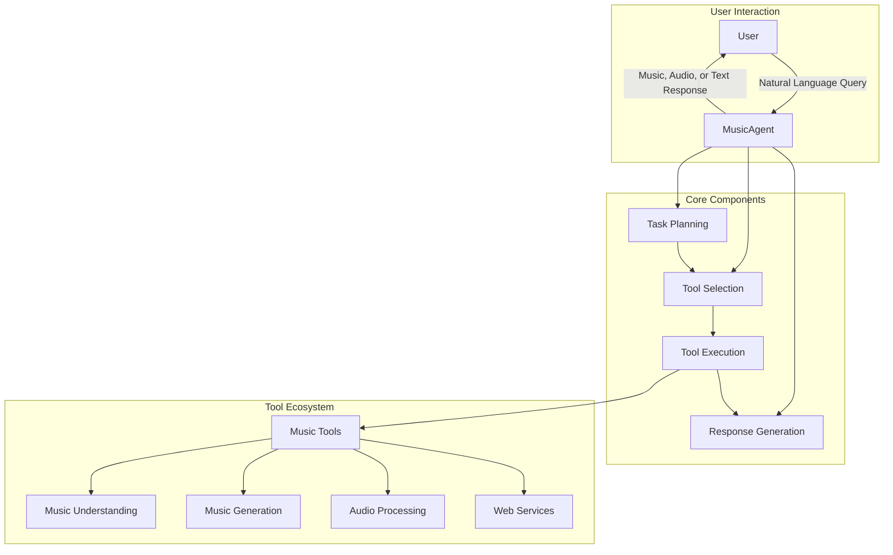
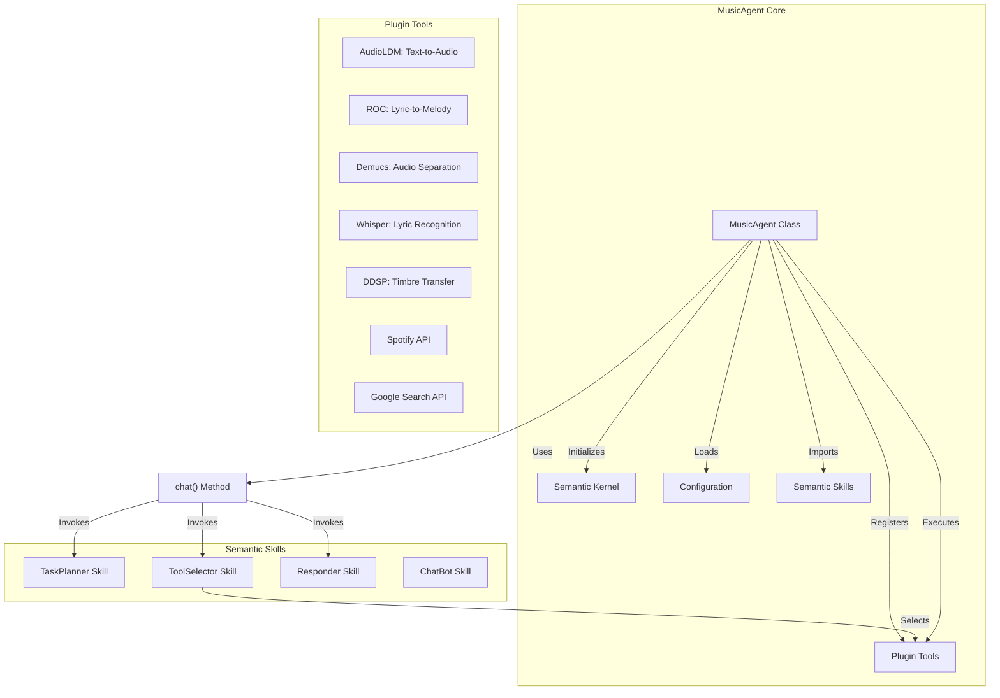
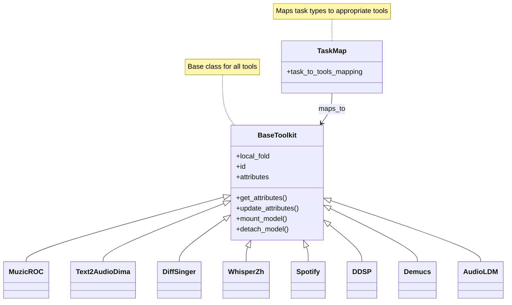
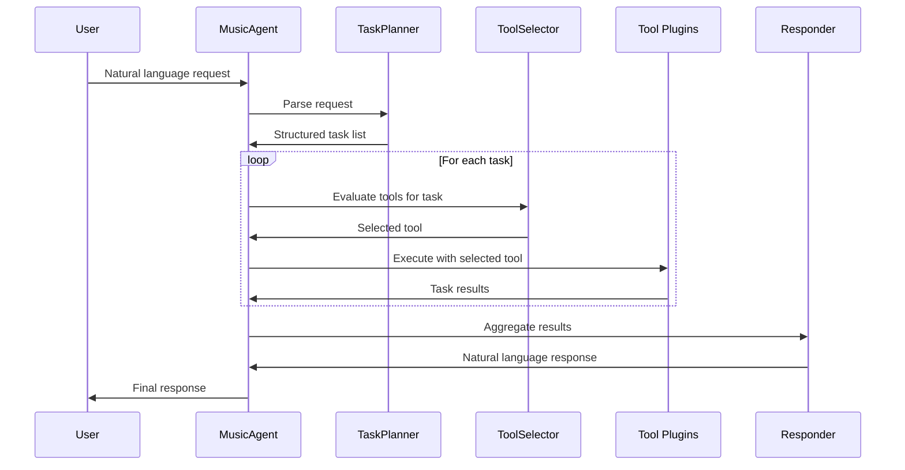

<!-- source: DeepWiki mcp.deepwiki.com · repo microsoft/muzic · page 4 MusicAgent · fetched 2026-10-26 -->

# MusicAgent

<details>
<summary>Relevant source files</summary>

The following files were used as context for generating this wiki page:

- [README.md](README.md)
- [musicagent/.env](musicagent/.env)
- [musicagent/README.md](musicagent/README.md)
- [musicagent/agent.py](musicagent/agent.py)
- [musicagent/auxiliary/muzic/roc/main.py](musicagent/auxiliary/muzic/roc/main.py)
- [musicagent/config.yaml](musicagent/config.yaml)
- [musicagent/gradio_agent.py](musicagent/gradio_agent.py)
- [musicagent/model_utils.py](musicagent/model_utils.py)
- [musicagent/models/download.sh](musicagent/models/download.sh)
- [musicagent/plugins.py](musicagent/plugins.py)
- [musicagent/requirements.txt](musicagent/requirements.txt)
- [musicagent/skills/MusicAgent/ChatBot/config.json](musicagent/skills/MusicAgent/ChatBot/config.json)
- [pdaugment/README.md](pdaugment/README.md)

</details>


MusicAgent is an LLM-powered autonomous agent for music understanding and generation within the Microsoft Muzic project. This document provides an overview of the MusicAgent system architecture, its plugin-based design, and how it leverages large language models to intelligently select and orchestrate music processing tools.

For information about other music generation components in the Muzic project, see the related pages on [MuseCoco](#3.4.1), [GETMusic](#3.3.1), or [ROC](#3.1.5).

## 1. Overview

MusicAgent serves as an AI-powered music assistant that unifies diverse music-related tools into a coherent system. It can understand natural language requests, decompose them into sequences of subtasks, select appropriate tools for each subtask, and execute them to fulfill the user's request.



Key features of MusicAgent include:

- **Task Planning**: Breaks down complex music-related requests into executable subtasks
- **Tool Selection**: Intelligently chooses the most appropriate tools for each subtask
- **Plugin Architecture**: Modular design that allows easy integration of new tools
- **Unified Interface**: Provides a consistent natural language interface to diverse music functionalities

Sources: [README.md:5-46](), [musicagent/README.md:1-17]()

## 2. System Architecture

MusicAgent employs a modular architecture built around a core agent that coordinates with plugins through Semantic Kernel skills.



### 2.1 Core Components

The MusicAgent system is built around these key components:

1. **Agent Class**: The central controller that manages the entire workflow
2. **Semantic Kernel**: Framework for connecting LLMs to external tools
3. **Semantic Skills**: LLM-powered functions for task planning, tool selection, and response generation
4. **Plugin Tools**: Implementations of various music processing capabilities

The main agent class ([musicagent/agent.py]()) manages configuration, loads models, and handles the core functionality of processing user requests.

Sources: [musicagent/agent.py:21-63](), [musicagent/agent.py:142-180]()

### 2.2 Semantic Skills

MusicAgent uses semantic skills powered by large language models to perform key cognitive functions:

| Skill | Purpose | Implementation |
|-------|---------|----------------|
| TaskPlanner | Analyzes user requests and breaks them down into subtasks | Prompts LLM to generate structured task list |
| ToolSelector | Selects the most appropriate tool for a specific task | Evaluates tools based on capabilities and context |
| Responder | Generates natural language responses based on task results | Synthesizes results into coherent responses |
| ChatBot | Handles general conversation when no specific task is needed | Provides conversational responses |

These skills are defined as prompt templates in the skills directory and are loaded by the semantic kernel.

Sources: [musicagent/agent.py:65-90](), [musicagent/skills/MusicAgent/ChatBot/config.json:1-15]()

### 2.3 Plugin Architecture

MusicAgent implements an extensible plugin architecture that allows for easy integration of diverse music tools:



Tools are implemented as classes that inherit from `BaseToolkit` and implement specific inference methods. The plugin system dynamically loads tools based on configuration and makes them available to the agent.

Sources: [musicagent/plugins.py:131-161](), [musicagent/plugins.py:89-128]()

## 3. Workflow and Task Execution

MusicAgent follows a multi-step process to handle user requests:



### 3.1 Task Planning

When a user submits a request, MusicAgent first uses the TaskPlanner skill to analyze and decompose it into a structured task list. This process converts natural language into a machine-interpretable form:

```
User: "Download a song by Jay Chou and separate the vocals from the music"
↓
Tasks: [
  {
    "id": 0,
    "task": "track-search",
    "args": [{"artist": ["Jay Chou"]}]
  },
  {
    "id": 1,
    "task": "separate-track",
    "args": [{"audio": "<GENERATED>-0"}],
    "dep": [0]
  }
]
```

The task planning handles dependencies between tasks, allowing for complex workflows where the output of one task serves as input to another.

Sources: [musicagent/agent.py:280-288](), [musicagent/agent.py:276-306]()

### 3.2 Tool Selection

For each task, MusicAgent selects the most appropriate tool using the ToolSelector skill. The selection process considers:

1. Task compatibility - which tools can perform the required task
2. Input compatibility - which tools accept the available inputs
3. Performance characteristics - which tool performs best for the specific inputs

The system maintains a task map that associates task types with compatible tool implementations:

```python
task_map = {
    "text-to-sheet-music": ["sander-wood/text-to-music"],
    "text-to-audio": ["cvssp/audioldm-m-full"],
    "music-classification": ["lewtun/distilhubert-finetuned-music-genres", "dima806/music_genres_classification"],
    "lyric-to-melody": ["muzic/roc", "muzic/telemelody"],
    "separate-track": ["demucs"],
    "lyric-recognition": ["jonatasgrosman/whisper-large-zh-cv11"],
    ...
}
```

Sources: [musicagent/plugins.py:24-87](), [musicagent/agent.py:247-265]()

### 3.3 Task Execution

Tasks are executed in parallel when possible, respecting dependencies between tasks. The agent manages a threaded execution system that:

1. Identifies tasks with satisfied dependencies
2. Launches threads to execute those tasks
3. Collects results for use in dependent tasks
4. Continues until all tasks are completed or errors occur

Task execution includes pre-processing inputs (especially handling outputs from previous tasks), performing inference with the selected model, and post-processing results.

Sources: [musicagent/agent.py:295-340](), [musicagent/agent.py:176-222]()

### 3.4 Response Generation

After executing all tasks, MusicAgent uses the Responder skill to generate a natural language response based on task results. The response integrates:

1. Direct answers to user queries
2. References to generated media (audio files, sheet music)
3. Explanations of the process when appropriate

Sources: [musicagent/agent.py:334-336]()

## 4. Available Tools and Integrations

MusicAgent integrates a diverse set of tools covering various aspects of music understanding and generation:

### 4.1 Music Understanding Tools

| Tool | Purpose | Model Source |
|------|---------|--------------|
| Music Genre Classification | Identifies music genres in audio | HuggingFace models (distilhubert, wav2vec2) |
| Lyric Recognition | Transcribes lyrics from audio | Whisper model fine-tuned for Chinese |

Sources: [musicagent/plugins.py:214-283](), [musicagent/plugins.py:383-417]()

### 4.2 Music Generation Tools

| Tool | Purpose | Model Source |
|------|---------|--------------|
| ROC | Generates melodies from lyrics | Microsoft Muzic ROC model |
| DiffSinger | Synthesizes singing voice | DiffSinger model |
| AudioLDM | Generates audio from text descriptions | HuggingFace AudioLDM model |

Sources: [musicagent/plugins.py:161-212](), [musicagent/plugins.py:286-338](), [musicagent/plugins.py:749-781]()

### 4.3 Audio Processing Tools

| Tool | Purpose | Implementation |
|------|---------|----------------|
| Demucs | Separates audio into vocals and instruments | Facebook Demucs model |
| DDSP | Transfers timbre between instruments | Google DDSP model |
| BasicMerge | Merges multiple audio files | Custom implementation |
| BasicCrop | Trims audio to specific time ranges | Custom implementation |
| BasicSplice | Concatenates audio files | Custom implementation |

Sources: [musicagent/plugins.py:569-633](), [musicagent/plugins.py:633-654](), [musicagent/plugins.py:654-780]()

### 4.4 External Services

| Service | Purpose | API |
|---------|---------|-----|
| Spotify | Music search and information retrieval | Spotify Web API |
| Google Search | Web search for music information | Google Custom Search API |

Sources: [musicagent/plugins.py:420-517](), [musicagent/plugins.py:520-566]()

## 5. Usage Examples

MusicAgent supports a wide range of music-related tasks through its natural language interface. Here are some example use cases:

### 5.1 Music Creation

```
User: "Write a piece of lyric about the recent World Cup and convert it to melody"

MusicAgent:
1. Generates lyrics about the World Cup using ChatGPT
2. Uses ROC model to convert lyrics to melody
3. Returns both lyrics and playable melody file
```

### 5.2 Audio Processing

```
User: "Download a song by Jay Chou and separate the vocals and the accompanies"

MusicAgent:
1. Searches for a song by Jay Chou using Spotify API
2. Downloads the song
3. Uses Demucs to separate vocals from accompaniment
4. Returns separate audio files for vocals and instrumental
```

### 5.3 Music Analysis

```
User: "What's the genre of this music file and give me the sheet music?"

MusicAgent:
1. Analyzes the music using genre classification models
2. Transcribes the melody using BasicPitch
3. Returns genre information and sheet music representation
```

Sources: [musicagent/gradio_agent.py:192-201]()

## 6. Configuration and Setup

MusicAgent requires configuration for both the core system and external services:

### 6.1 Core Configuration

MusicAgent uses a YAML configuration file that specifies:
- Model settings (device, local folder)
- Debug settings
- History length
- Disabled tools

```yaml
debug: false
use_azure_openai: false
model: text-davinci-003
device: cuda:0
local_fold: models
log_file: logs/debug.log
src_fold: public/audios
disabled_tools:
history_len: 200
candidate_tools: 5
```

Sources: [musicagent/config.yaml:1-21]()

### 6.2 External Service Configuration

For integrating with external services, MusicAgent requires API keys and credentials:

```yaml
huggingface:
  token: YOUR_HF_TOKEN
spotify:
  client_id: YOUR_CLIENT_ID
  client_secret: YOUR_CLIENT_SECRET
google:
  api_key: YOUR_API_KEY
  custom_search_engine_id: YOUR_SEARCH_ENGINE_ID
```

Additionally, for LLM integration, you need to configure either OpenAI API or Azure OpenAI credentials in the .env file.

Sources: [musicagent/.env:1-6](), [musicagent/config.yaml:1-9]()

## 7. Implementation Details

MusicAgent is implemented in Python, with the main components being:

- `agent.py`: Core agent implementation that orchestrates the entire system
- `plugins.py`: Plugin implementations for various tools
- `model_utils.py`: Utility functions for model handling
- `gradio_agent.py`: Gradio-based web interface

The system uses Semantic Kernel to integrate LLMs and tools, making it easy to extend with new capabilities.

Sources: [musicagent/agent.py:1-363](), [musicagent/plugins.py:1-781](), [musicagent/model_utils.py:1-362](), [musicagent/gradio_agent.py:1-206]()

---

