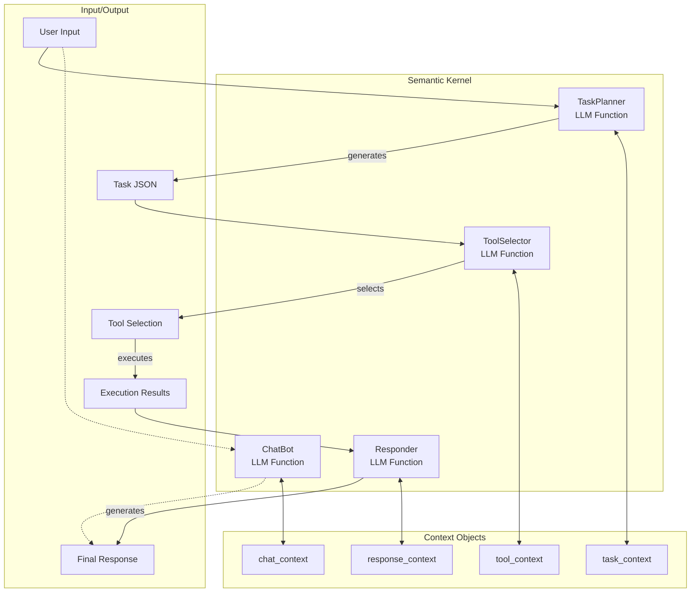
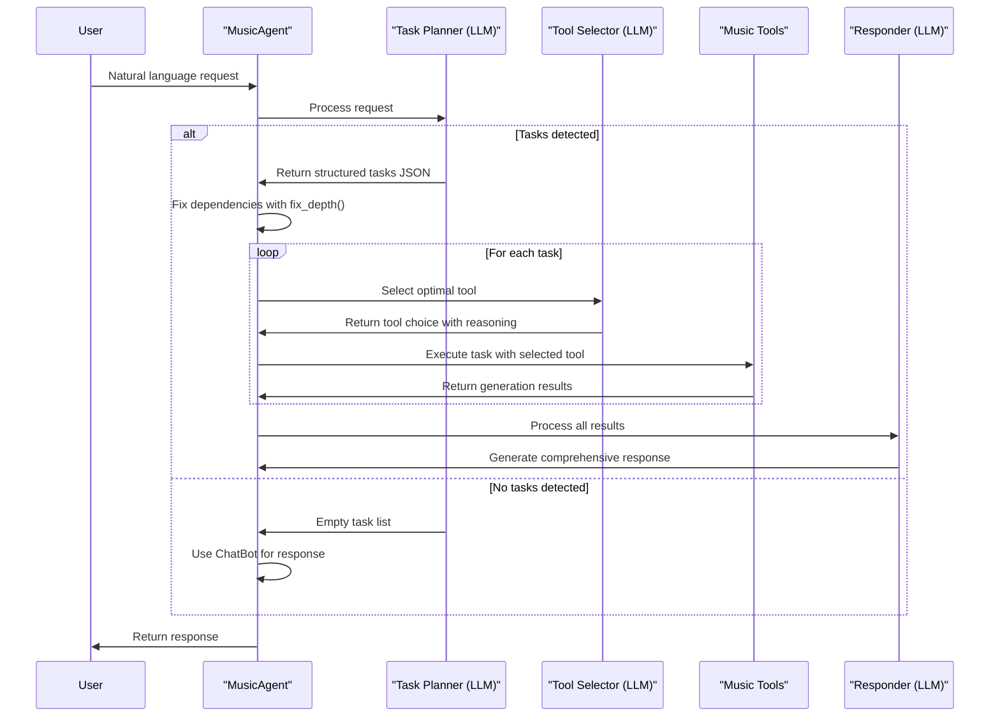
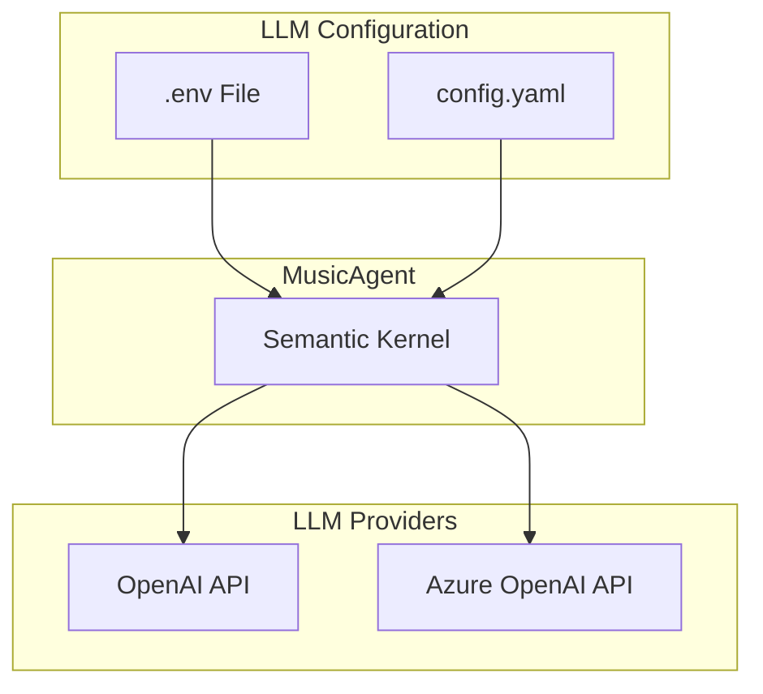

<!-- source: DeepWiki mcp.deepwiki.com · repo microsoft/muzic · page 4.1 LLM-Powered Music Generation · fetched 2026-10-26 -->

# LLM-Powered Music Generation

<details>
<summary>Relevant source files</summary>

The following files were used as context for generating this wiki page:

- [musicagent/.env](musicagent/.env)
- [musicagent/README.md](musicagent/README.md)
- [musicagent/agent.py](musicagent/agent.py)
- [musicagent/auxiliary/muzic/roc/main.py](musicagent/auxiliary/muzic/roc/main.py)

</details>


## Purpose and Scope

This document explains how MusicAgent uses large language models (LLMs) to understand music-related requests and orchestrate various music generation tools. MusicAgent provides an intelligent interface that can interpret natural language instructions, plan appropriate musical tasks, select the optimal tools for each task, and generate coherent responses about the process and results.

For information about the overall MusicAgent architecture and available plugins, see [Plugin Architecture](#4.2).

## Architecture Overview

MusicAgent integrates LLMs as the core intelligence for music understanding and generation tasks. The system uses a modular design where the LLM serves as the "brain" that coordinates specialized music generation tools based on user requests.

```mermaid
flowchart TD
    subgraph "User Interaction"
        UI["User Input"]
        Output["Generated Response"]
    end

    subgraph "LLM Components"
        TaskPlanner["Task Planner"]
        ToolSelector["Tool Selector"]
        Responder["Response Generator"]
        ChatBot["General Chat"]
    end

    subgraph "Music Generation Tools"
        RoC["ROC<br>(Lyric-to-Melody)"]
        DeepRapper["DeepRapper"]
        MuseCoco["MuseCoco"]
        GETMusic["GETMusic"]
        OtherTools["Other Music Tools"]
    end

    UI --> TaskPlanner
    TaskPlanner --> ToolSelector
    ToolSelector --> Tools
    Tools --> Responder
    Responder --> Output
    
    TaskPlanner -.-> ChatBot
    ChatBot -.-> Output
    
    Tools["Tool Execution"]
    Tools --- RoC & DeepRapper & MuseCoco & GETMusic & OtherTools

    class LLM Components LLM;
    classDef LLM fill:#f5f5f5,stroke:#333,stroke-width:1px;
```

**MusicAgent LLM Processing Flow**

Sources: [musicagent/agent.py:21-90](), [musicagent/agent.py:276-340]()

## LLM Integration Components

MusicAgent uses four primary LLM-powered components to handle different aspects of music generation:

1. **Task Planner**: Analyzes user requests and breaks them down into structured tasks
2. **Tool Selector**: Selects the most appropriate music tool for each task
3. **Response Generator**: Creates human-readable responses explaining the generation process
4. **Chat Bot**: Handles general conversational interactions when no specific music tasks are detected



**LLM Function Components and Their Contexts**

Sources: [musicagent/agent.py:65-95](), [musicagent/agent.py:118-129]()

### 1. Task Planning

The Task Planner is responsible for analyzing user requests and breaking them down into a structured series of tasks. It converts natural language inputs into a JSON representation of tasks with dependencies.

Key features:
- Identifies multiple tasks from a single request
- Establishes dependencies between tasks
- Organizes tasks in an execution order
- Maintains task history to inform future planning

The LLM receives context about previously executed tasks to maintain coherence between generations.

Sources: [musicagent/agent.py:70-72](), [musicagent/agent.py:280-292]()

### 2. Tool Selection

Once tasks are identified, the Tool Selector evaluates which specialized music tool is most appropriate for each task. It chooses from available plugins based on:

- Task requirements
- Tool capabilities
- Previous interactions
- User constraints

The system presents tool attributes to the LLM to make informed selections, particularly when multiple tools could handle the same task.

Sources: [musicagent/agent.py:74-78](), [musicagent/agent.py:258-266]()

### 3. Response Generation

After tasks are executed, the Response Generator creates a coherent summary of the process and results. It:

- Explains what was done
- Describes the generated content
- Addresses any issues encountered
- Responds to the user's original request

This component translates technical process details into user-friendly explanations.

Sources: [musicagent/agent.py:80-84](), [musicagent/agent.py:334-336]()

### 4. Chat Interaction

For general music questions or when no specific generation tasks are detected, the Chat Bot component handles conversational interactions. This provides fallback capabilities for user queries that don't fit into the task execution model.

Sources: [musicagent/agent.py:86-89](), [musicagent/agent.py:286-292]()

## Workflow and Processing

The MusicAgent uses a structured workflow to process user requests, orchestrated by LLMs at key decision points:



**MusicAgent Request Processing Workflow**

Sources: [musicagent/agent.py:276-340](), [musicagent/agent.py:143-168](), [musicagent/agent.py:294-326]()

### Parallel Execution

MusicAgent uses a thread-based approach to execute multiple tasks in parallel while respecting task dependencies:

1. Task dependencies are tracked using a directed graph
2. Independent tasks are executed immediately in separate threads
3. Dependent tasks wait for their prerequisites to complete
4. Results are collected and combined for the final response

This allows complex music generation pipelines with interdependent components to be executed efficiently.

Sources: [musicagent/agent.py:294-326]()

## LLM Backend Integration

MusicAgent supports multiple LLM providers through Semantic Kernel's abstraction layer:



**LLM Provider Integration**

Sources: [musicagent/agent.py:97-105](), [musicagent/.env:1-6]()

The system configures LLM providers through:

1. **Environment variables** - API keys and endpoints stored in `.env`
2. **Configuration file** - Model selection and parameters in `config.yaml`

MusicAgent supports:
- OpenAI's models (default)
- Azure OpenAI Service (enterprise deployment)

The LLM is used to power the semantic functions that drive task planning, tool selection, and response generation.

Sources: [musicagent/agent.py:97-116]()

## Usage Examples

### Basic Example: Melody Generation from Lyrics

```
User: Generate a melody for these lyrics: "The stars shine bright in the midnight sky, guiding my way back home."

MusicAgent: 
1. Plans tasks: [{"id": 0, "task": "lyric-to-melody", "args": [{"lyric": "The stars shine bright in the midnight sky, guiding my way back home."}]}]
2. Selects ROC tool: "ROC is well-suited for lyric-to-melody generation with music theory guidance"
3. Executes generation
4. Returns: "I've created a melody for your lyrics using ROC. The melody has a gentle, nostalgic quality that complements the homecoming theme in your lyrics. It follows a traditional chord progression with a clear tonal center to evoke the stability suggested by 'guiding my way back home.'"
```

### Complex Example: Multi-Step Generation

```
User: Create a rap song about technology with a beat that samples old computer sounds, then synthesize it with a male voice.

MusicAgent:
1. Plans multiple tasks: 
   - Lyric generation (DeepRapper)
   - Beat creation with samples
   - Voice synthesis
2. Establishes dependencies between tasks
3. Selects appropriate tools for each step
4. Executes the pipeline in the correct order
5. Returns comprehensive response explaining the generation process and results
```

## Implementation Details

### Key Classes and Methods

The LLM-powered music generation is primarily implemented through the `MusicAgent` class and its methods:

| Method | Purpose | LLM Component |
|--------|---------|---------------|
| `_init_semantic_kernel()` | Initializes LLM functions | All |
| `_init_task_context()` | Sets up available tasks | Task Planner |
| `_init_tool_context()` | Sets up tool information | Tool Selector |
| `skillchat()` | Handles LLM communication | All |
| `chat()` | Main entry point for requests | - |
| `run_task()` | Executes individual tasks | - |

Sources: [musicagent/agent.py:65-89](), [musicagent/agent.py:143-168](), [musicagent/agent.py:276-340]()

### LLM Prompting

MusicAgent uses a prompt-based approach where different contexts are prepared for each LLM component:

1. **Task context**: Contains task history and available tasks
2. **Tool context**: Contains tool descriptions and capabilities  
3. **Response context**: Contains execution results and process details
4. **Chat context**: Contains conversation history

These contexts are managed as part of the Semantic Kernel framework and updated throughout the interaction to maintain coherence.

Sources: [musicagent/agent.py:72-89]()

## Summary

MusicAgent's LLM-powered approach to music generation provides several key benefits:

1. **Natural language interface** - Users can express musical requests in plain language
2. **Task decomposition** - Complex requests are broken down into manageable subtasks
3. **Tool orchestration** - The most appropriate tools are selected for each task
4. **Coherent processes** - Dependencies between tasks are managed automatically
5. **Explainable results** - The system provides human-readable explanations of the generation process

This architecture combines the strengths of specialized music generation tools with the flexibility and understanding capabilities of large language models, creating a powerful and accessible music creation system.

Sources: [musicagent/README.md:6-16]()

---

