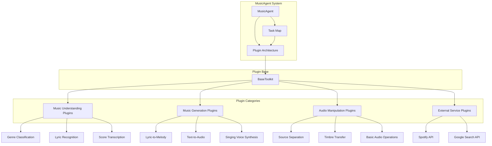
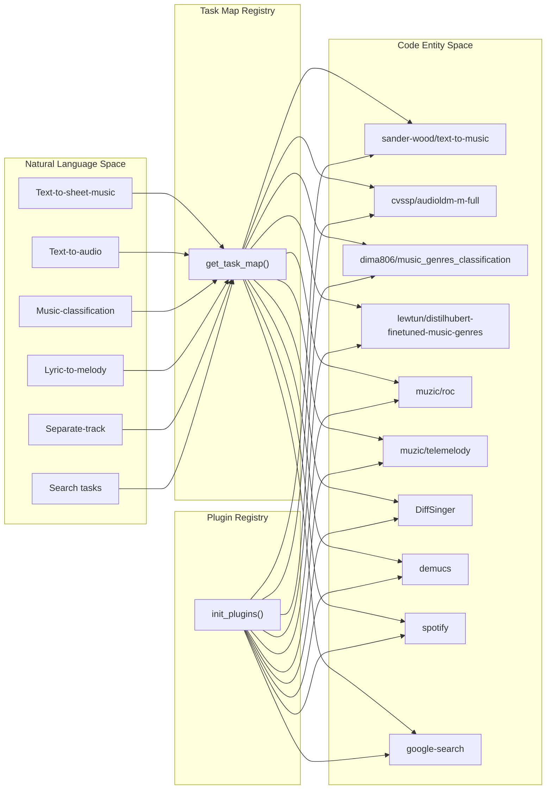
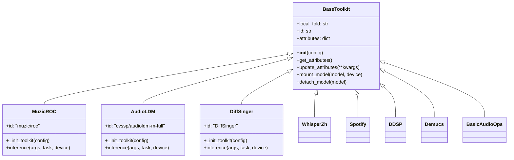
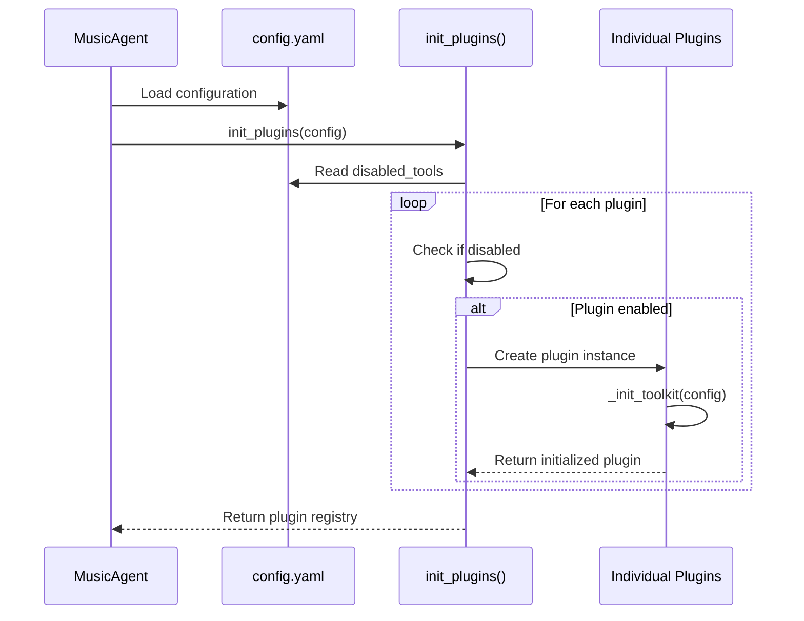
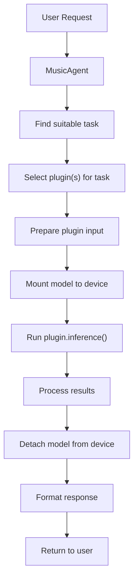

<!-- source: DeepWiki mcp.deepwiki.com · repo microsoft/muzic · page 4.2 Plugin Architecture · fetched 2026-10-26 -->

# Plugin Architecture

<details>
<summary>Relevant source files</summary>

The following files were used as context for generating this wiki page:

- [musicagent/config.yaml](musicagent/config.yaml)
- [musicagent/gradio_agent.py](musicagent/gradio_agent.py)
- [musicagent/model_utils.py](musicagent/model_utils.py)
- [musicagent/models/download.sh](musicagent/models/download.sh)
- [musicagent/plugins.py](musicagent/plugins.py)
- [musicagent/requirements.txt](musicagent/requirements.txt)
- [musicagent/skills/MusicAgent/ChatBot/config.json](musicagent/skills/MusicAgent/ChatBot/config.json)

</details>


This page details the plugin-based architecture of MusicAgent, explaining how various music tools and APIs are integrated, initialized, and used within the system. For information about the overall MusicAgent system and how it uses large language models, see [LLM-Powered Music Generation](#4.1).

## Overview

MusicAgent uses a flexible plugin architecture to integrate diverse music understanding and generation capabilities. The architecture enables easy addition of new tools, disabling of unused ones, and consistent interface for LLM interaction. Each plugin provides specific functionality like genre classification, lyric-to-melody generation, or audio manipulation.

**Plugin Architecture Diagram**



Sources: [plugins.py:1-747](). [gradio_agent.py:1-205](). [config.yaml:1-21]().

## Plugin Registration and Task Mapping

MusicAgent uses a two-stage system to connect user requests to appropriate plugins:

1. **Task Map**: Maps high-level tasks to specific plugin implementations
2. **Plugin Registry**: Manages available plugin instances and their initialization

**Task-to-Plugin Mapping System**



Sources: [plugins.py:24-87](). [plugins.py:90-128]().

The task map is defined in the `get_task_map()` function, which creates a dictionary mapping task names to a list of suitable plugins:

```python
def get_task_map():
    task_map = {
        "text-to-sheet-music": ["sander-wood/text-to-music"],
        "text-to-audio": ["cvssp/audioldm-m-full"],
        "music-classification": [
            "lewtun/distilhubert-finetuned-music-genres",
            "dima806/music_genres_classification"
        ],
        "lyric-to-melody": ["muzic/roc", "muzic/telemelody"],
        # ... additional mappings
    }
    return task_map
```

The actual plugin initialization occurs in `init_plugins()`, which creates instances based on configuration:

```python
def init_plugins(config):
    if config["disabled_tools"] is not None:
        disabled = [tool.strip() for tool in config["disabled_tools"].split(",")]
    else: 
        disabled = []

    pipes = {}
    if "muzic/roc" not in disabled:
        pipes["muzic/roc"] = MuzicROC(config)
    if "cvssp/audioldm-m-full" not in disabled:
        pipes["cvssp/audioldm-m-full"] = AudioLDM(config)
    # ... other plugins
    return pipes
```

Sources: [plugins.py:24-87](). [plugins.py:90-128]().

## BaseToolkit: The Plugin Foundation

All plugins inherit from the `BaseToolkit` base class, which provides common functionality:



The `BaseToolkit` class provides these important capabilities:

- **Attribute Management**: Stores and retrieves plugin metadata
- **Model Device Management**: Handles moving models between CPU and GPU
- **Configuration Access**: Provides access to global configuration settings

Sources: [plugins.py:131-159]().

## Plugin Implementation Pattern

Each plugin follows a common implementation pattern with these key components:

1. **Initialization**: Set up the plugin's identity and resources
2. **Model Loading**: Load required models and resources
3. **Inference**: Process inputs and generate outputs

Here's the typical structure of a plugin class:

```python
class ExamplePlugin(BaseToolkit):
    def __init__(self, config):
        super().__init__(config)
        self.id = "plugin-id"
        self.attributes = {"description": "Plugin description"}
        self._init_toolkit(config)
        
    def _init_toolkit(self, config):
        # Load models and resources
        self.model = load_model(...)
        
    def inference(self, args, task, device="cpu"):
        results = []
        self.mount_model(self.model, device)  # Move to GPU if available
        
        # Process inputs
        for arg in args:
            if "required_input" in arg:
                # Process and generate output
                results.append({"output_key": output_value})
                
        self.detach_model(self.model)  # Return to CPU
        return results
```

Sources: [plugins.py:161-211](). [plugins.py:749-781]().

## Available Plugins

MusicAgent includes a diverse set of plugins to handle various music-related tasks:

| Plugin Type | Plugin ID | Description | Primary Task |
|-------------|-----------|-------------|-------------|
| **Music Understanding** | | | |
| Genre Classification | lewtun/distilhubert-finetuned-music-genres | Music genre classification | music-classification |
| Genre Classification | dima806/music_genres_classification | GTZAN-based genre classification | music-classification |
| Lyric Recognition | jonatasgrosman/whisper-large-zh-cv11 | Transcribe lyrics from audio | lyric-recognition |
| Score Transcription | basic-pitch | Convert audio to sheet music | score-transcription |
| **Music Generation** | | | |
| Lyric-to-Melody | muzic/roc | Generate melody from lyrics | lyric-to-melody |
| Text-to-Audio | cvssp/audioldm-m-full | Generate audio from text | text-to-audio |
| Singing Voice | DiffSinger | Singing voice synthesis | lyric-to-audio |
| **Audio Manipulation** | | | |
| Source Separation | demucs | Separate tracks in music | separate-track |
| Timbre Transfer | ddsp | Convert between sound sources | timbre-transfer |
| Audio Editing | basic-merge, basic-crop, basic-splice | Basic audio operations | audio-mixing, audio-crop, audio-splice |
| **External Services** | | | |
| Music Search | spotify | Access Spotify catalog | artist/track/album/playlist-search |
| Web Search | google-search | Search the web for music info | web-search |

Sources: [plugins.py:214-284](). [plugins.py:290-339](). [plugins.py:383-417](). [plugins.py:420-517](). [plugins.py:569-747]().

## Plugin Initialization Process

When MusicAgent starts, it initializes the plugin system following this sequence:



Sources: [plugins.py:90-128](). [gradio_agent.py:140-141]().

## Plugin Configuration

Plugins are configured through the global `config.yaml` file, which includes these key settings:

```yaml
# External API credentials
huggingface:
  token: 
spotify:
  client_id: 
  client_secret: 
google:
  api_key: 
  custom_search_engine_id: 

# Agent settings
device: cuda:0         # Device for model execution
local_fold: models     # Path to model files
src_fold: public/audios # Path for generated audio files
disabled_tools:        # Comma-separated list of disabled plugins
```

The `disabled_tools` setting allows disabling specific plugins to reduce resource usage or simplify the system.

Sources: [config.yaml:1-21]().

## Plugin Interaction Flow

When processing a request, MusicAgent follows this sequence to use the plugin system:



Sources: [plugins.py:161-211](). [gradio_agent.py:75-122]().

## Extending with New Plugins

To add a new plugin to MusicAgent:

1. Create a new class that inherits from `BaseToolkit`
2. Implement `__init__`, `_init_toolkit`, and `inference` methods
3. Add the plugin to `init_plugins()` function
4. Add task mappings to `get_task_map()` function

Example plugin skeleton:

```python
class NewPlugin(BaseToolkit):
    def __init__(self, config):
        super().__init__(config)
        self.id = "new-plugin-id"
        self.attributes = {"description": "New plugin description"}
        self._init_toolkit(config)
        
    def _init_toolkit(self, config):
        # Initialize resources
        pass
        
    def inference(self, args, task, device="cpu"):
        results = []
        # Process inputs and generate outputs
        return results
```

Sources: [plugins.py:161-211](). [plugins.py:749-781]().

---

