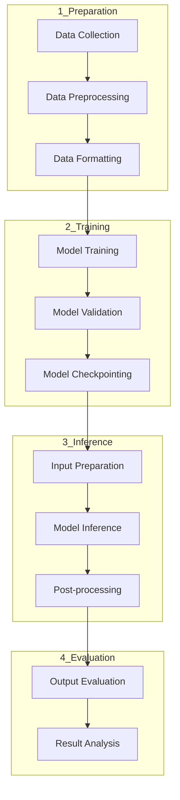
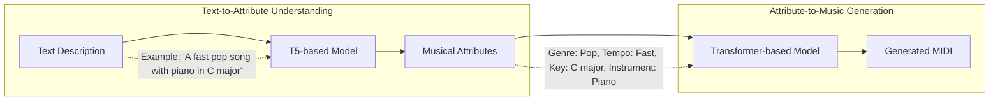
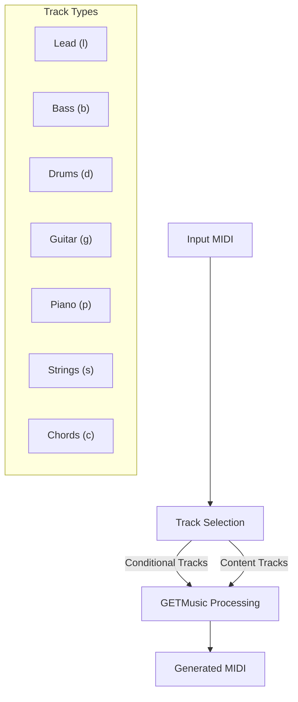
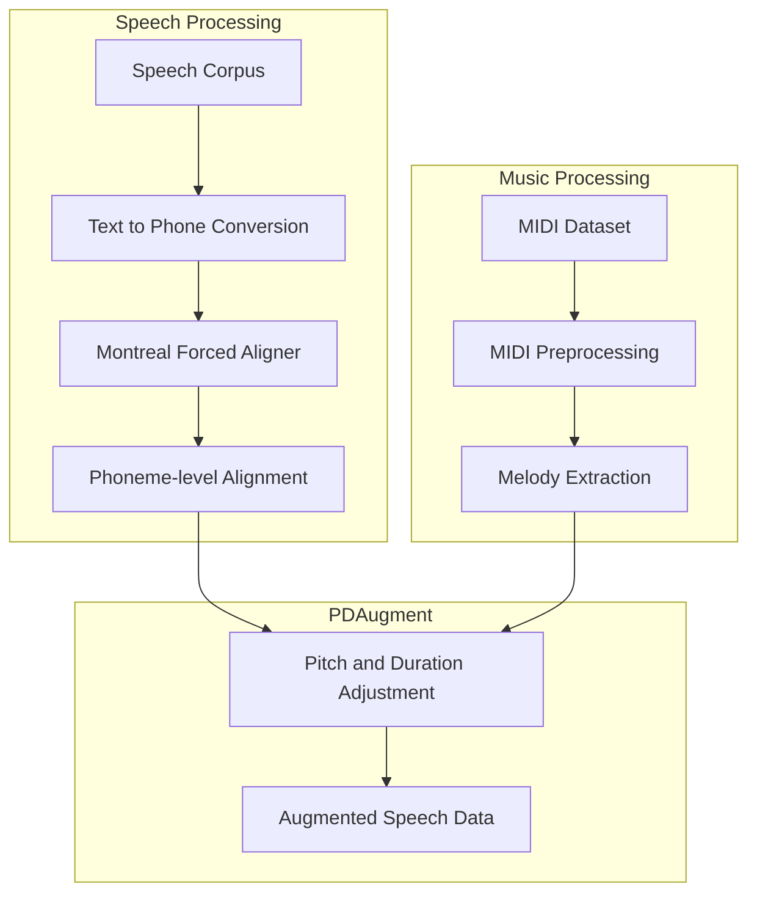
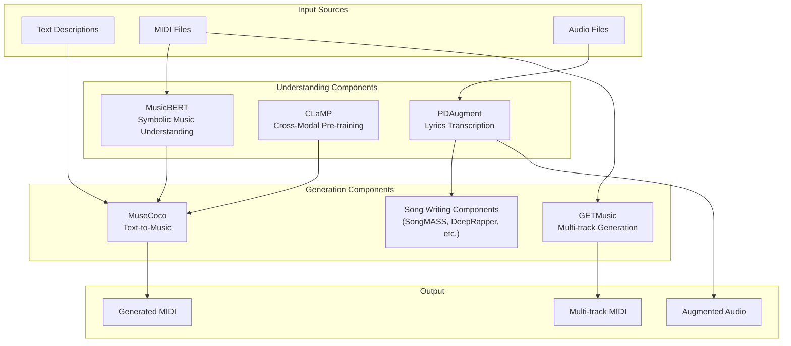

<!-- source: DeepWiki mcp.deepwiki.com · repo microsoft/muzic · page 5 Usage and Examples · fetched 2026-10-26 -->

# Usage and Examples

<details>
<summary>Relevant source files</summary>

The following files were used as context for generating this wiki page:

- [README.md](README.md)
- [getmusic/README.md](getmusic/README.md)
- [getmusic/configs/train.yaml](getmusic/configs/train.yaml)
- [getmusic/example_data/inference/childhood.mid](getmusic/example_data/inference/childhood.mid)
- [getmusic/example_data/train/0_01023_TS0.mid](getmusic/example_data/train/0_01023_TS0.mid)
- [musecoco/2-attribute2music_dataprepare/midi_data_extractor/data_extractor.py](musecoco/2-attribute2music_dataprepare/midi_data_extractor/data_extractor.py)
- [musecoco/2-attribute2music_model/data/truncated_5120/dict.txt](musecoco/2-attribute2music_model/data/truncated_5120/dict.txt)
- [musecoco/README.md](musecoco/README.md)
- [musecoco/requirements.txt](musecoco/requirements.txt)
- [pdaugment/README.md](pdaugment/README.md)

</details>


This page provides practical instructions for using the Microsoft Muzic components, with specific examples of common workflows and tasks. The documentation covers installation setup, component usage patterns, and step-by-step guides for working with specific systems.

For information about the theoretical aspects and architecture of Muzic components, see [Project Goals and Architecture](#1.1) and [Capabilities and Use Cases](#1.2).

## Installation and Setup

Before using any of the Muzic components, you need to set up the required environment.

### Base Requirements

The Microsoft Muzic project operates on Linux systems. It has been tested on Ubuntu 16.04.6 LTS with CUDA 10 and Python 3.6.12.

```bash
# Install base requirements
pip install -r requirements.txt
```

Sources: [README.md:66-71]()

### Component-Specific Requirements

Many components have their own specific dependencies. Below are examples for a few key components:

#### MuseCoco Requirements

```bash
# Create and activate conda environment
conda create -n MuseCoco python=3.8
conda activate MuseCoco
conda install pytorch=1.11.0 -c pytorch
pip install -r requirements.txt  # g++ should be installed to let this line work
```

Sources: [musecoco/README.md:27-33]()

#### GETMusic Requirements

```bash
pip install torch==1.12.1+cu113 torchvision==0.13.1+cu113 torchaudio==0.12.1 --extra-index-url https://download.pytorch.org/whl/cu113    
pip install tensorboard    
pip install pyyaml
pip install tqdm
pip install transformers
pip install einops
pip install miditoolkit
pip install scipy
```

Sources: [getmusic/README.md:9-19]()

## Common Usage Workflow

Most Muzic components follow a similar workflow pattern for music generation and understanding tasks. The diagram below illustrates this general pattern:

### Typical Component Workflow



Sources: [musecoco/README.md:5-19](), [getmusic/README.md:3-5]()

## Example Applications

### 1. Text-to-Music Generation with MuseCoco

MuseCoco is a system for generating symbolic music from text descriptions. The process involves two stages: Text-to-Attribute Understanding and Attribute-to-Music Generation.

#### System Architecture



Sources: [musecoco/README.md:35-51]()

#### Musical Attributes

MuseCoco translates text into specific musical attributes that control the generation:

| Code Keyword | Musical Attribute    |
|--------------|----------------------|
| I1s2         | Instrument           |
| R1           | Rhythm Danceability  |
| R3           | Rhythm Intensity     |
| S2s1         | Artist               |
| S4           | Genre                |
| B1s1         | Bar                  |
| TS1s1        | Time Signature       |
| K1           | Key                  |
| T1s1         | Tempo                |
| P4           | Pitch Range          |
| EM1          | Emotion              |
| TM1          | Time                 |

Sources: [musecoco/README.md:35-51]()

#### Usage Example

1. **Text-to-Attribute Understanding**:
   ```bash
   # Navigate to the text-to-attribute model directory
   cd 1-text2attribute_model
   
   # Prepare text input in predict.json format
   # Run prediction script
   bash predict.sh
   
   # Process output for the next stage
   python stage2_pre.py
   ```

2. **Attribute-to-Music Generation**:
   ```bash
   # Navigate to the attribute-to-music model directory
   cd 2-attribute2music_model
   
   # Download and prepare checkpoint
   # Run inference
   bash interactive_1billion.sh 0 200
   ```

3. **Evaluate Generated Music**:
   ```bash
   # Navigate to evaluation directory
   cd evaluation
   
   # Run evaluation script
   python eval_acc_v3.py --root=PATH_OF_GENERATED_MUSIC
   ```

Sources: [musecoco/README.md:109-148]()

### 2. Multi-track Music Generation with GETMusic

GETMusic provides capabilities for generating any music tracks using a unified representation and diffusion framework. It supports various operations including track generation and position-based generation.

#### Music Track Generation



Sources: [getmusic/README.md:24-56]()

#### Track Generation Example

```bash
# Run the generation script
python track_generation.py --load_path /path-of-checkpoint --file_path example_data/inference

# When prompted, specify which tracks to use as conditions
# Example: 'lc' for lead and chord tracks

# Then specify which tracks to generate
# Example: 'dgp' for drums, guitar, and piano
```

This will generate a new MIDI file with the specified tracks based on the conditional tracks.

Sources: [getmusic/README.md:30-56]()

#### Advanced Operations: Position-based Generation

For more control over the generation process, GETMusic supports position-based generation:

```bash
# Run the position generation script
python position_generation.py --load_path /path-of-checkpoint --file_path example_data/inference

# Specify positions to condition on
# Example: '0,0,200;6,0,' for first 200 time units of lead track and entire chord track

# Specify positions to empty (to be generated)
# Example: '1,0,;4,0,;5,0,' for entire bass, piano, and string tracks
```

Sources: [getmusic/README.md:59-95]()

### 3. Data Augmentation with PDAugment

PDAugment adjusts pitch and duration of speech data to help train automatic lyrics transcription systems.

#### Workflow Diagram



Sources: [pdaugment/README.md:13-142]()

#### PDAugment Usage Example

```bash
# Process speech data (LibriSpeech)
python flac2wav.py data/speech/raw/dev-clean data/speech/wav
python text2phone.py data/speech/wav/dev-clean data/speech/phone

# Process MIDI files
conda activate midi
pip install -r midi_preprocess/requirements.txt
PYTHONPATH=. python midi_preprocess/preprocess.py --config midi_preprocess/configs/default.yaml

# Run PDAugment
conda activate pdaugment
python pdaugment.py data/pickle/mel_splits.pickle utils/frequency.json data/speech/wav/dev-clean data/midis/processed/midi_6tracks data/speech/phone/dev-clean_metadata.csv data/duration data/pitch data/pdaugment 16
```

Sources: [pdaugment/README.md:113-149]()

## Component Interactions

The diagram below illustrates how different Muzic components can be used together and their relationships:



Sources: [README.md:27-46](), [musecoco/README.md:1-4](), [getmusic/README.md:1-5](), [pdaugment/README.md:1-4]()

## Usage Tips and Best Practices

### MuseCoco Tips

1. For text descriptions, either write them manually or use the synthesis method with ChatGPT as mentioned in the paper.
2. Use only the specific attributes implemented in the code when constructing your text descriptions.
3. Use provided attribute values to ensure accurate control.
4. Use the evaluation model to calculate control accuracy and select the best samples.

Sources: [musecoco/README.md:150-156]()

### GETMusic Tips

1. Check MIDI program IDs for supported instruments (Piano: 0, Guitar: 25, Bass: 32, String: 48, Lead melody: 80).
2. For bass tracks, change the default instrument from Double Bass to Electric Bass/Bass Guitar in your MIDI editor for better harmonization.
3. Adjust volume levels of each instrument to achieve a balanced composition.
4. Enable chord guidance to achieve more regular patterns in generated music.
5. For better quality when generating multiple tracks, use incremental generation:
   - Stage 1: chord → lead
   - Stage 2: chord, lead → bass, drum, guitar, piano, string
6. Be aware of potential domain gaps with input styles that differ significantly from the training data.

Sources: [getmusic/README.md:102-127]()

## Data Preprocessing and Training

For users who want to train their own models, the following workflows are available:

### GETMusic Data Preprocessing Example

```bash
# Process MIDI files
python preprocess/to_oct.py example_data/train example_data/processed_train

# Construct vocabulary
python preprocess/make_dict.py example_data/processed_train/ 3

# Configure training and validation sets
python preprocess/binarize.py example_data/processed_train/pitch_dict.txt example_data/processed_train/oct.txt example_data/processed_train

# Update configuration and train the model
python train.py
```

Sources: [getmusic/README.md:129-197]()

### MuseCoco Training Example

**Text-to-Attribute Understanding:**
```bash
# Construct attribute-text pairs
cd 1-text2attribute_dataprepare
bash run.sh

# Train the model
cd 1-text2attribute_model
bash train.sh
```

**Attribute-to-Music Generation:**
```bash
# Data processing
cd 2-attribute2music_dataprepare
python extract_data.py path/to/the/folder/containing/midi/files path/to/save/the/dataset

# Switch to data_process and prepare training data
cd 2-attribute2music_model/data_process
python split_data.py
python util.py

# Train the model
cd 2-attribute2music_model
bash train-xl.sh
```

Sources: [musecoco/README.md:56-105]()

## Technical Representation Details

Understanding the underlying data representation is essential for effective use of Muzic components. Below is an excerpt of token types from the MuseCoco dictionary:

```
b-0, b-1                 # Bar tokens
o-0 through o-127        # Octave tokens
i-0 through i-128        # Instrument tokens
p-0 through p-255        # Pitch tokens
d-0 through d-127        # Duration tokens
v-0 through v-31         # Velocity tokens
s-0 through s-253        # Position tokens
t-0 through t-48         # Tempo tokens
e-0, e-1                 # Event tokens
```

Sources: [musecoco/2-attribute2music_model/data/truncated_5120/dict.txt:1-979]()

Musical attributes are encoded as specific tokens such as:

```
I1s2_0_0 through TM1_5   # Various musical attribute tokens
```

Sources: [musecoco/2-attribute2music_model/data/truncated_5120/dict.txt:982-1248]()

## Common Issues and Troubleshooting

1. **Domain Gap Issues**: If generation results don't meet expectations, the input may have a significant style gap from the training data. Consider:
   - Using musical inputs that align with the pop music style used in training
   - Modifying MIDI program IDs to better match the expected track roles
   - Trying different random seeds or truncating music length

2. **Instrument Sound Issues**: When using generated MIDI files, some instruments may need manual adjustment in your DAW or MIDI editor:
   - Bass tracks often sound better with Electric Bass rather than Double Bass
   - Volume balancing between instruments is often necessary
   - Some percussion elements may need manual editing

3. **Control Accuracy**: For attribute-based generation, not all attributes can be controlled with 100% accuracy. Use the evaluation tools to filter results.

Sources: [getmusic/README.md:124-127](), [musecoco/README.md:153-155]()

---

