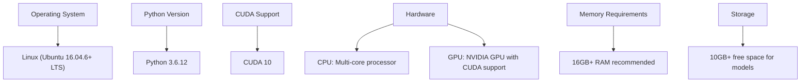
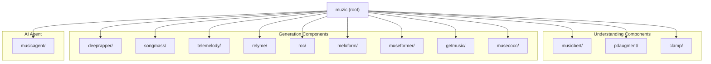
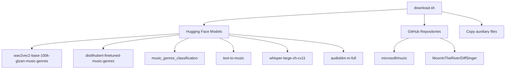
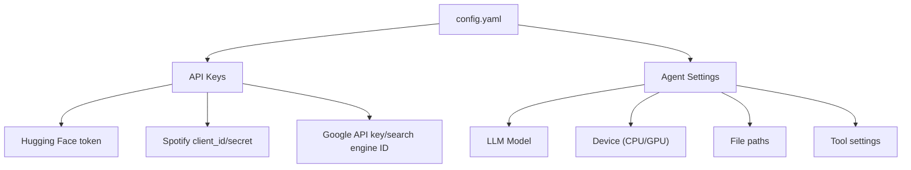
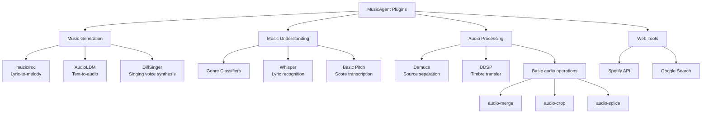
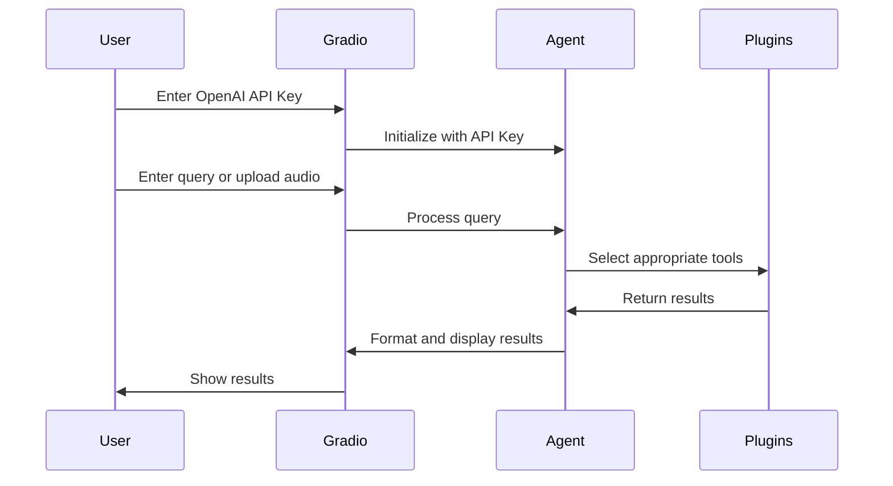

<!-- source: DeepWiki mcp.deepwiki.com · repo microsoft/muzic · page 5.1 Installation and Setup · fetched 2026-10-26 -->

# Installation and Setup

<details>
<summary>Relevant source files</summary>

The following files were used as context for generating this wiki page:

- [README.md](README.md)
- [musicagent/config.yaml](musicagent/config.yaml)
- [musicagent/gradio_agent.py](musicagent/gradio_agent.py)
- [musicagent/model_utils.py](musicagent/model_utils.py)
- [musicagent/models/download.sh](musicagent/models/download.sh)
- [musicagent/plugins.py](musicagent/plugins.py)
- [musicagent/requirements.txt](musicagent/requirements.txt)
- [musicagent/skills/MusicAgent/ChatBot/config.json](musicagent/skills/MusicAgent/ChatBot/config.json)
- [pdaugment/README.md](pdaugment/README.md)

</details>


This document provides instructions for installing and setting up the Microsoft Muzic project and its various components. This guide covers system requirements, basic installation, component-specific setup, configuration, and verification steps. For information about running specific components, see [Example Applications](#5.2).

## System Requirements

Microsoft Muzic is primarily developed and tested on Linux environments. Below are the specific requirements for running the system:



Sources: [README.md:66-68]()

### Required System Libraries

Several system libraries may be needed depending on which components you plan to use:

- FFmpeg (for audio processing)
- Fluidsynth (for MIDI to audio conversion)
- Lilypond (for sheet music generation)
- Tesseract (for OCR in some components)

For example, to install the necessary libraries on Ubuntu:

```bash
sudo apt-get update
sudo apt-get install -y ffmpeg fluidsynth lilypond pytesseract
```

## Basic Installation

### Cloning the Repository

First, clone the Muzic repository:

```bash
git clone https://github.com/microsoft/muzic.git
cd muzic
```

### Installing Python Dependencies

Install the required Python packages:

```bash
pip install -r requirements.txt
```

For specific components like MusicAgent, additional dependencies are required:

```bash
pip install -r musicagent/requirements.txt
```

Sources: [README.md:69-71](), [musicagent/requirements.txt:1-38]()

### Repository Structure

The Muzic repository is organized by component, with each having its own directory:



Sources: [README.md:72]()

## Component-specific Setup

Each component in Muzic may require specific setup steps. Here we focus on key components that require additional setup.

### MusicAgent Setup

MusicAgent integrates multiple components and requires additional setup:

1. Download pre-trained models:

```bash
cd musicagent/models
bash download.sh
```

This script downloads several models from Hugging Face and GitHub repositories:



Sources: [musicagent/models/download.sh:1-37]()

2. Configure MusicAgent:

Edit the `config.yaml` file to set up API keys and configure the agent:



Sources: [musicagent/config.yaml:1-21]()

### PDAugment Setup

PDAugment requires additional data preparation steps:

1. Download LibriSpeech ASR corpus for speech data
2. Convert audio files from flac to wav format
3. Convert text to phoneme level using phonemizer
4. Perform phoneme level alignment using Montreal Forced Aligner
5. Download and preprocess music scores (FreeMidi Dataset)

See the PDAugment README for detailed instructions.

Sources: [pdaugment/README.md:12-102]()

## Plugin System Configuration

MusicAgent uses a plugin system to integrate various tools. The available plugins are:



Plugins can be enabled or disabled in the config.yaml file using the `disabled_tools` setting.

Sources: [musicagent/plugins.py:1-781]()

## Configuration Options

### MusicAgent Configuration

The main configuration file for MusicAgent is `config.yaml`. Below are the key settings:

| Section | Setting | Description | Example |
|---------|---------|-------------|---------|
| API Keys | huggingface.token | Hugging Face API token | "hf_..." |
| API Keys | spotify.client_id | Spotify client ID | "abcdef..." |
| API Keys | spotify.client_secret | Spotify client secret | "12345..." |
| API Keys | google.api_key | Google API key | "AIza..." |
| API Keys | google.custom_search_engine_id | Google CSE ID | "12345..." |
| Agent | debug | Debug mode | false |
| Agent | use_azure_openai | Use Azure OpenAI | false |
| Agent | model | LLM model name | "text-davinci-003" |
| Agent | device | Computing device | "cuda:0" |
| Agent | local_fold | Models folder | "models" |
| Agent | log_file | Log file path | "logs/debug.log" |
| Agent | src_fold | Audio folder | "public/audios" |
| Agent | disabled_tools | Disabled plugins | "" |
| Agent | history_len | History length | 200 |
| Agent | candidate_tools | Number of candidate tools | 5 |

Sources: [musicagent/config.yaml:1-21](), [musicagent/gradio_agent.py:11-143]()

## Running the Agent

To run the MusicAgent with a Gradio interface:

```bash
cd musicagent
python gradio_agent.py -c config.yaml
```

This launches a web interface where you can interact with the agent:



The Gradio interface allows you to:
- Upload audio files
- Enter text queries
- View processing results
- See intermediate processing steps

Sources: [musicagent/gradio_agent.py:139-205]()

## Troubleshooting

Common issues and solutions:

1. **Model download failures**: 
   - Ensure you have a stable internet connection
   - Try downloading models manually from their respective sources

2. **Missing dependencies**:
   - Check for error messages indicating missing packages
   - Install additional dependencies as needed

3. **GPU issues**:
   - Verify CUDA installation with `nvidia-smi`
   - Check GPU compatibility with installed CUDA version

4. **API authentication errors**:
   - Verify API keys in config.yaml are correct
   - Check if API quotas have been exceeded

For component-specific issues, refer to the README files in each component directory.

Sources: [README.md:66-72]()

---

