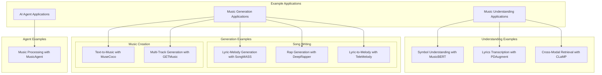
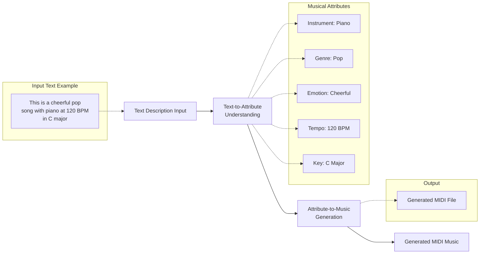
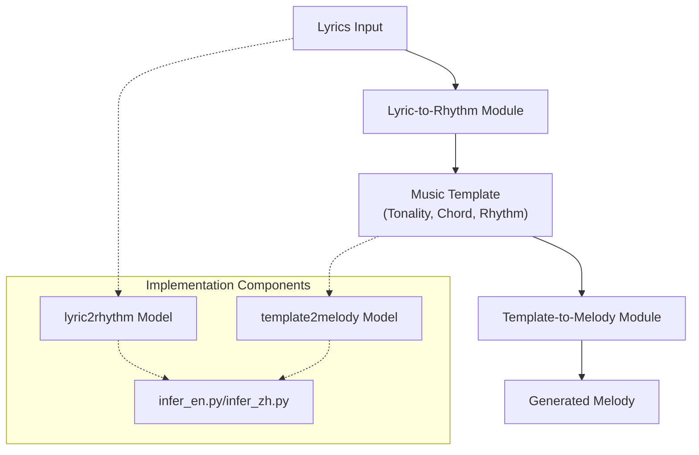
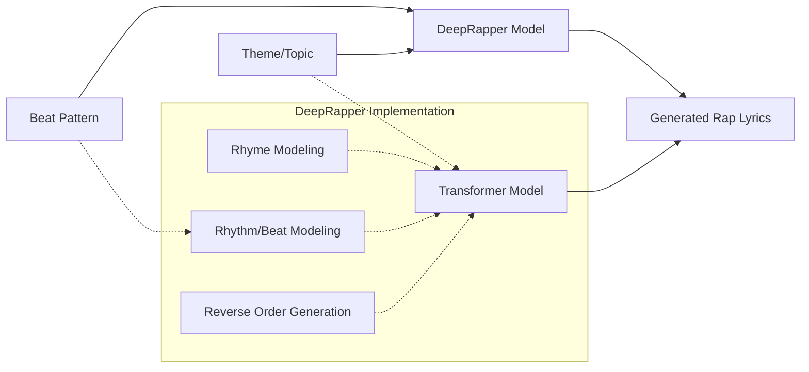
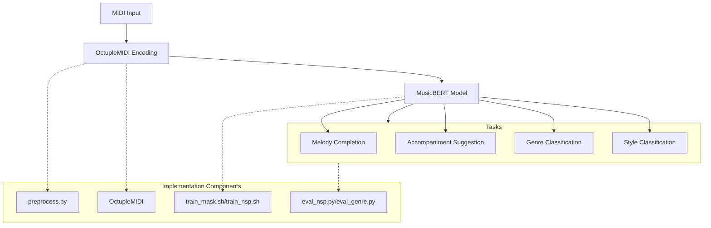
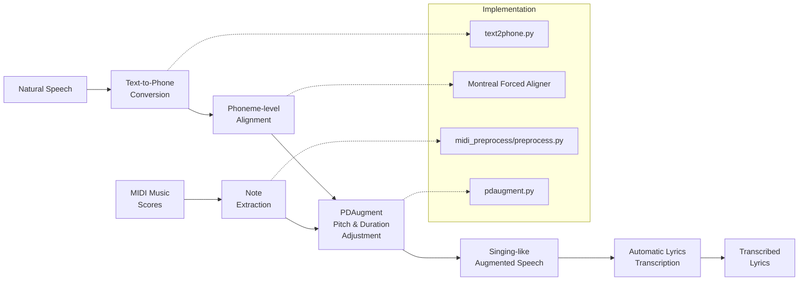
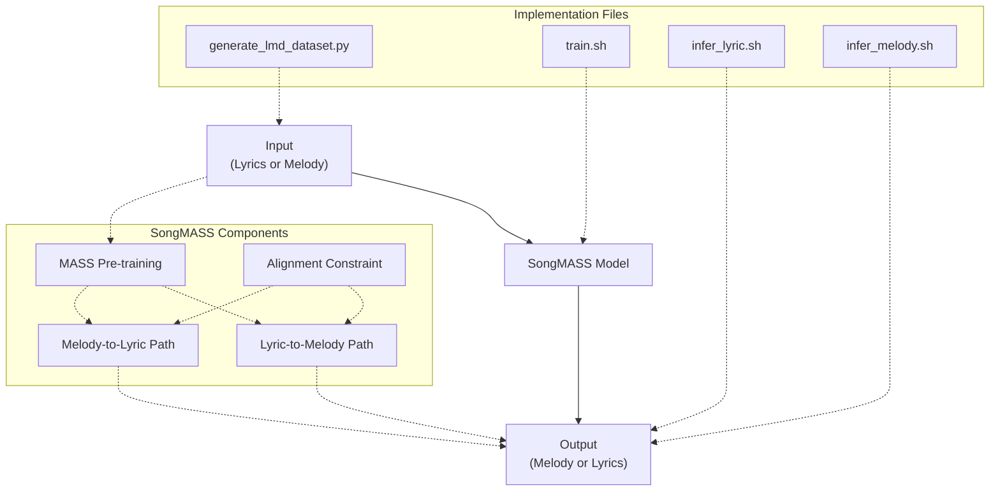

<!-- source: DeepWiki mcp.deepwiki.com · repo microsoft/muzic · page 5.2 Example Applications · fetched 2026-10-26 -->

# Example Applications

<details>
<summary>Relevant source files</summary>

The following files were used as context for generating this wiki page:

- [README.md](README.md)
- [deeprapper/README.md](deeprapper/README.md)
- [musecoco/2-attribute2music_dataprepare/midi_data_extractor/data_extractor.py](musecoco/2-attribute2music_dataprepare/midi_data_extractor/data_extractor.py)
- [musecoco/2-attribute2music_model/data/truncated_5120/dict.txt](musecoco/2-attribute2music_model/data/truncated_5120/dict.txt)
- [musecoco/README.md](musecoco/README.md)
- [musecoco/requirements.txt](musecoco/requirements.txt)
- [musicbert/README.md](musicbert/README.md)
- [pdaugment/README.md](pdaugment/README.md)
- [songmass/README.md](songmass/README.md)
- [telemelody/README.md](telemelody/README.md)
- [telemelody/inferrence/infer_zh.py](telemelody/inferrence/infer_zh.py)

</details>


This page demonstrates practical applications of the Microsoft Muzic toolkit components, providing concrete examples of how to use various systems for music understanding and generation. For installation and setup instructions, see [Installation and Setup](#5.1).

## Overview of Example Applications

The Microsoft Muzic project offers a diverse set of AI-powered music technologies that can be applied to various music-related tasks. The following diagram illustrates the example applications organized by their categories:



Sources: [README.md:27-46]()

## Text-to-Music Generation with MuseCoco

MuseCoco enables generating symbolic music from text descriptions. It uses a two-stage approach: text-to-attribute understanding followed by attribute-to-music generation.

### Workflow and Architecture



Sources: [musecoco/README.md:1-3](), [musecoco/requirements.txt:1-9]()

### Using MuseCoco

The MuseCoco example workflow involves:

1. **Text-to-Attribute Understanding**:
   - Prepare a text description following the format in the predict.json file
   - Use the pre-trained model to predict musical attributes

   ```bash
   # In directory 1-text2attribute_model
   bash predict.sh
   ```

2. **Attribute-to-Music Generation**:
   - Use the predicted attributes to generate music

   ```bash
   # In directory 2-attribute2music_model
   bash interactive_1billion.sh 0 200
   ```

3. **Evaluating Generated Music**:
   - Assess the accuracy of generated music against desired attributes

   ```bash
   # In evaluation directory
   python eval_acc_v3.py --root=PATH_OF_GENERATED_MUSIC
   ```

MuseCoco supports a wide range of musical attributes:

| Attribute Code | Musical Meaning        |
|----------------|------------------------|
| I1s2           | Instrument             |
| R1             | Rhythm Danceability    |
| R3             | Rhythm Intensity       |
| S2s1           | Artist                 |
| S4             | Genre                  |
| B1s1           | Bar                    |
| TS1s1          | Time Signature         |
| K1             | Key                    |
| T1s1           | Tempo                  |
| P4             | Pitch Range            |
| EM1            | Emotion                |
| TM1            | Time                   |

Sources: [musecoco/README.md:35-51](), [musecoco/README.md:109-125](), [musecoco/2-attribute2music_dataprepare/midi_data_extractor/data_extractor.py:86-236]()

### Example Text Prompt and Result

A sample text input:

```
Create a cheerful pop song with piano as the main instrument, set at a moderate tempo of 120 BPM in C major key. The rhythm should be danceable with medium intensity.
```

The generated output is a MIDI file that matches these specifications, which can be found in the `generation/` directory after running the generation script.

Sources: [musecoco/README.md:151-156]()

## Lyric-to-Melody Generation with TeleMelody

TeleMelody is a two-stage system that bridges the gap between lyrics and melodies using music templates.

### Workflow and Architecture



Sources: [telemelody/README.md:1-7]()

### Using TeleMelody

1. **Prepare the Environment**:
   - Modify `miditoolkit` to support lyrics (especially for Chinese)
   - Save checkpoints in the appropriate directories

2. **Prepare Input Data**:
   - For English: Prepare word-level lyrics in `data/en/{data_prefix}/lyric.txt` and chord progression in `data/en/{data_prefix}/chord.txt`
   - For Chinese: Prepare character-level lyrics and chord progressions similarly

3. **Generate Melodies**:
   - For English:
     ```bash
     python infer_en.py {en_lyric2rhythm_prefix} {template2melody_prefix} {en_data_prefix} {en_save_prefix}
     ```
   - For Chinese:
     ```bash
     python infer_zh.py {zh_lyric2rhythm_prefix} {template2melody_prefix} {zh_data_prefix} {zh_save_prefix}
     ```

The results (MIDI files with melodies) are saved in `results/{save_prefix}/midi/`.

Sources: [telemelody/README.md:95-109](), [telemelody/inferrence/infer_zh.py:148-383]()

### Example Input and Output

**Input Example**:
- Lyrics: "I'm walking down this road, trying to find my way home"
- Chord progression: "C:maj G:maj F:maj G:maj"

**Output**:
- A MIDI file with melody matching the rhythm and mood of the lyrics, following the given chord progression

TeleMelody supports evaluation metrics like Pitch Distribution (PD), Duration Distribution (DD), Melody Distance (MD), and various accuracy metrics.

Sources: [telemelody/README.md:114-138]()

## Rap Generation with DeepRapper

DeepRapper is a neural rap generation system that models both rhymes and rhythms.

### Workflow and Architecture



Sources: [deeprapper/README.md:1-3]()

### Using DeepRapper

1. **Data Preparation**:
   - Prepare lyrics and pinyin for each song
   - Format should include beat markers as in the example:
     ```
     [BEAT]那就[BEAT]让我再沉[BEAT]沦这一世
     ```

2. **Training**:
   ```bash
   bash train.sh
   ```

3. **Generation**:
   ```bash
   bash generate.sh
   ```

For quick testing, a pre-trained model is available:
```bash
bash generate_from_pretrain.sh
```

The model generates rap lyrics with appropriate rhyme patterns and rhythmic alignment to beats.

Sources: [deeprapper/README.md:47-91]()

## Symbolic Music Understanding with MusicBERT

MusicBERT is a large-scale pre-trained model for symbolic music understanding.

### Workflow and Architecture



Sources: [musicbert/README.md:1-12]()

### Using MusicBERT

1. **Data Preparation**:
   - Prepare MIDI datasets (like Lakh MIDI Dataset)
   - Process the data into OctupleMIDI format
   - Binarize the datasets

2. **Pre-training**:
   ```bash
   bash train_mask.sh lmd_full small
   ```

3. **Fine-tuning for Specific Tasks**:
   - For melody completion:
     ```bash
     bash train_nsp.sh next checkpoints/checkpoint_last_musicbert_base.pt
     ```
   - For genre classification:
     ```bash
     bash train_genre.sh topmagd 13 0 checkpoints/checkpoint_last_musicbert_base.pt
     ```

4. **Evaluation**:
   ```bash
   python -u eval_nsp.py checkpoints/checkpoint_last_nsp_next_checkpoint_last_musicbert_base.pt next_data_bin
   ```

Pre-trained checkpoints are available for both small and base model sizes.

Sources: [musicbert/README.md:113-156]()

## Lyrics Transcription with PDAugment

PDAugment is a data augmentation method for automatic lyrics transcription that adjusts pitch and duration of speech to match music scores.

### Workflow and Architecture



Sources: [pdaugment/README.md:1-10]()

### Using PDAugment

1. **Data Preparation**:
   - Prepare speech data (e.g., LibriSpeech)
   - Convert to WAV format and generate phoneme-level text
   - Perform phoneme-level alignment using Montreal Forced Aligner
   - Prepare MIDI files (e.g., from FreeMidi Dataset)

2. **Augmentation**:
   ```bash
   python pdaugment.py <pickle_path> <frequency_json_file> <dataset_dir> <midi_file_dir> <metadata_dir> <output_duration_dir> <output_pitch_dir> <output_pdaugment_dir> <number_of_threads>
   ```

The output is augmented speech that resembles singing voice, which can be used to train automatic lyrics transcription systems.

Sources: [pdaugment/README.md:105-149]()

## Song Writing with SongMASS

SongMASS is a song writing system for lyric-to-melody and melody-to-lyric generation that uses masked sequence to sequence pre-training.

### Workflow and Architecture



Sources: [songmass/README.md:1-7]()

### Using SongMASS

1. **Data Preparation**:
   ```bash
   python data/generate_lmd_dataset.py --lmd-data-dir $DATADIR --output-dir $OUTPUTDIR
   bash generate_data.sh $OUTPUTDIR
   bash preprocess.sh $data_dir $user_dir
   ```

2. **Training**:
   ```bash
   bash train.sh $data_dir $user_dir
   ```

3. **Inference**:
   - For lyric generation:
     ```bash
     bash infer_lyric.sh $data_dir $user_dir $model
     ```
   - For melody generation:
     ```bash
     bash infer_melody.sh $data_dir $user_dir $model
     ```

4. **Evaluation**:
   - Evaluate pitch distribution similarity, duration distribution similarity, and melody distance

A pre-trained model is available for quick testing.

Sources: [songmass/README.md:55-116]()

## Best Practices and Tips

When working with Muzic's example applications, consider these best practices:

1. **Choosing the Right Component**:
   - For generating music from text descriptions: Use MuseCoco
   - For creating melodies matching lyrics: Use TeleMelody
   - For rap generation with rhymes and rhythm: Use DeepRapper
   - For understanding and analyzing MIDI music: Use MusicBERT

2. **Data Preparation**:
   - Most components require specific data formats
   - Follow the data preparation instructions carefully for each component
   - Consider using the provided sample data as templates

3. **Computational Resources**:
   - Training models requires significant GPU resources
   - For testing, use the provided pre-trained models
   - For inference, most components can run on CPU, but GPU accelerates the process

4. **Evaluation and Refinement**:
   - Each component provides evaluation metrics for generated outputs
   - Use these metrics to refine your inputs and parameters
   - Experiment with different configurations to achieve desired results

The examples provided in this documentation serve as starting points - customize them to your specific music generation or understanding needs.

Sources: [musecoco/README.md:150-156]()

---

